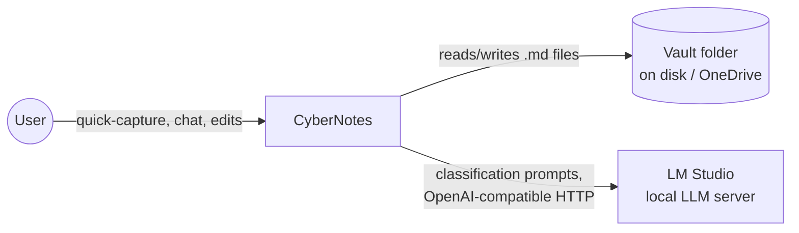

# 3. System Scope and Context

## 3.1 Business Context

Single user, single local machine. No multi-user, no accounts, no remote
service the app depends on to function.

- **Vault folder** — plain files on disk. May be inside a OneDrive-synced
  directory; the app does not manage sync itself, it just reads/writes
  files and reacts to external changes via the file watcher.
- **LM Studio** — an already-running local process exposing an
  OpenAI-compatible HTTP API. The app is a client only; it does not manage
  the model or the LM Studio process lifecycle.

## 3.2 Technical Context

| Interface | Direction | Protocol/Format |
|---|---|---|
| Renderer ↔ Main (IPC) | bidirectional | `contextBridge`-exposed typed API over Electron IPC |
| Main ↔ Vault filesystem | bidirectional | Node `fs`, `chokidar` for watching |
| Main ↔ LM Studio | outbound | HTTP, OpenAI-compatible chat/completions API |

No other external systems in Phase 1. Phase 3 adds multi-vault (still
local filesystem only); Future Scope adds Tailscale-based remote access —
out of scope for now.
