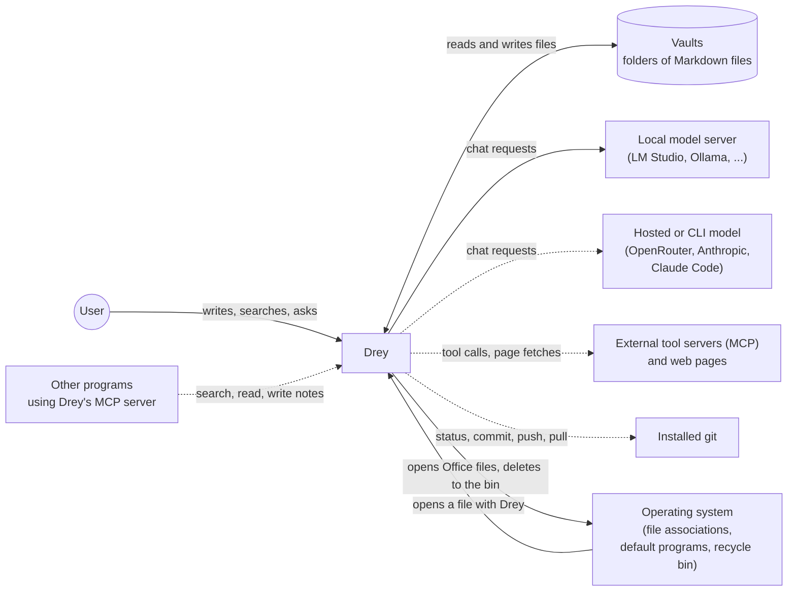

# 3. System Scope and Context

## 3.1 Business context

One user, one machine. No accounts, no server of its own, and nothing
outside the machine that Drey needs in order to work.

Solid lines are always there. Dashed lines exist only after the user
switched the feature on.

| Neighbour | What passes | Notes |
|---|---|---|
| **Vaults** | Markdown notes, attachments, templates | Several folders can be registered; one is active. A vault may sit in a synced folder (OneDrive) or be a Git repository — Drey does not sync anything itself. |
| **Local model server** | Chat requests, optionally with tool calls; a model list where the server offers one | The default. Any OpenAI-compatible endpoint. Drey does not start or manage the server and assumes no particular model. |
| **Hosted or CLI model** | The same requests | Opt-in. Note text leaves the machine when one is chosen ([ADR-0047](09_architecture_decisions/0047-llm-provider-abstraction.md)). |
| **External tool servers and web pages** | Tool calls the model makes; fetched pages | Opt-in, each source asks before a call unless set to "allow" ([ADR-0063](09_architecture_decisions/0063-mcp-client-and-assistant-tool-groups.md)). |
| **Other programs using Drey's MCP server** | Vault search, read and (confirmed) write | Opt-in. Local connections only ([ADR-0021](09_architecture_decisions/0021-mcp-vault-server.md)). |
| **Installed git** | Commands and their output | Used only for a vault that is a repository ([ADR-0065](09_architecture_decisions/0065-git-vaults-source-control-plugin.md)). |
| **Hugging Face hub** | One download of the embedding model | Only when semantic retrieval is first switched on; cached afterwards ([ADR-0055](09_architecture_decisions/0055-semantic-vault-retrieval.md)). |
| **Operating system** | Files handed to Drey; documents handed back to their own program | [ADR-0054](09_architecture_decisions/0054-opening-files-from-the-os.md), [ADR-0066](09_architecture_decisions/0066-office-documents-open-in-their-own-program.md). |

## 3.2 Technical context

| Interface | Direction | Protocol / format |
|---|---|---|
| Vault files | both | Node `fs`; writes are atomic (temp file, then rename). Optional `chokidar` watcher for changes made by other programs. |
| Model, HTTP | out | OpenAI-compatible `chat/completions` or Anthropic Messages, streamed (SSE). No timeout on generation; the user cancels. |
| Model, CLI | out | A child process (`claude -p`), JSON lines on stdout. |
| External MCP servers | out | Official MCP SDK over stdio or Streamable HTTP; tools only. |
| Web fetch | out | An `http:` / `https:` page request, started by a model's tool call. |
| Web search | out | One request per search to the provider chosen in Settings (DuckDuckGo, Brave Search, Tavily, or a SearXNG instance), started by a model's tool call. |
| Drey's MCP server | in | MCP over a stdio bridge or local HTTP. |
| git | out | `execFile`, no shell, one queue per repository. |
| Files from the OS | in | Command-line arguments, also from a second instance. |

Inside the app there is one more boundary that matters as much as the
outer ones: the user interface runs in a sandboxed browser process with
no file or network access, and reaches everything above through a typed
bridge. That is described in [§5](05_building_block_view.md).

## 3.3 Out of scope

No multi-user operation, no synchronisation service, no mobile client,
no rendering of Office documents. `specs/decisions.md` lists what was
considered and left out.
