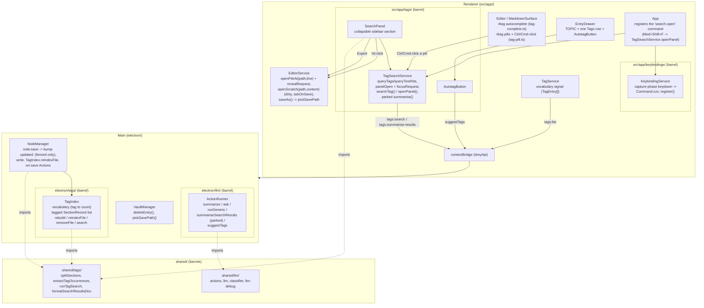
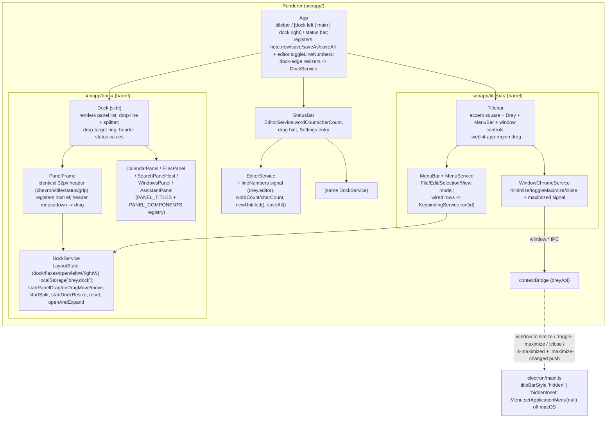

# 5. Building Block View

> **Reading order.** This file is layered by milestone: each
> "§5.x Notable implementation decisions" section is a point-in-time
> record, with `_(Superseded …)_` notes where a later section changed
> course. The tag system was rebuilt in milestone 11
> ([ADR-0017](09_architecture_decisions/0017-tags-as-labels-and-section-index.md)):
> **§5.14** has the current tag / search / feature-module picture; the
> `TagIndex` / routing / master-document material in §5.1 and §5.9 is
> kept for the record but superseded.

## 5.1 Whitebox Overall System (as of the "visual shell" milestone)

Electron main process, Angular renderer, the IPC bridge between them,
vault selection + file listing, and the full two-column shell from the
design prototype: a sidebar (mini-calendar, vault file tree,
open-windows list, settings entry) and a main area with a **tab bar**, the
editor (one CodeMirror 6 view with an inline **Live Preview** mode and a
raw **Source** mode, switched by a `⋯` mode menu, Live Preview by
default, explicit save), and the **"Add entry" drawer** pinned to
its bottom (optional TOPIC field, one Tags chip row, a spellchecked
Markdown body — §5.12). A third column on the right holds the **note
assistant** (auto-summary + Q&A thread, §5.11). The bottom chat bar that
used to sit under the editor is gone: its capture role became the drawer
and its Ask role the assistant's composer, so each job lives in exactly one
place. The sidebar↔main, editor↔drawer and main↔assistant borders are
**drag-resizable**
(sizes clamped + persisted to `localStorage` by `LayoutService`); the
open-windows list is capped at a third of the sidebar height and each row
has an `x` to close that document; the file tree has a **right-click menu
to create a new file or folder**. Quick-capture is a
global hotkey (`Ctrl/Cmd+Alt+N`) that brings the main window forward and
opens **today's daily note** — creating `daily/YYYY-MM-DD.md` from
`templates/daily.md` (scaffolded on first use) if needed — then starts a
fresh `## HH:mm` entry. No popup window (see
[ADR-0002](09_architecture_decisions/0002-quick-capture-opens-daily-note.md)).

The editor now holds **multiple open documents** (one per tab); switching
tabs never prompts, closing a dirty tab does. Clicking a calendar day
opens that day's daily note, or — for a day with no file yet — an
**unsaved draft** that only reaches disk once the user types and saves
(see [ADR-0003](09_architecture_decisions/0003-multi-document-editor-tab-model.md)).
Milestone 6 added a tag layer that milestone 11 then replaced
([ADR-0017](09_architecture_decisions/0017-tags-as-labels-and-section-index.md),
**§5.14**): tags are now free inline `#tag` labels, a main-process
`TagIndex` holds the vault-wide vocabulary **plus** an inverted index of
tagged `##`/`###` sections, `note:save` only bumps `updated:` and
re-indexes the file (no `#tag`→frontmatter merge, no master-document
routing), and a sidebar **search panel** queries the section index (tags
AND + free text) with clickable hits and a Markdown Export. The paragraph
above and the diagram below describe the milestone-6 shape and are kept
for the record only.

```mermaid
graph TB
    subgraph Renderer["Renderer process (Angular)"]
        App["App (src/app/app.ts)\nroot shell -- two-column layout;\ndrag handles -> LayoutService"]
        Sidebar["Sidebar (src/app/sidebar/)\ncalendar + file tree (+ right-click\nnew file/folder) + open-windows +\nsettings entry"]
        Calendar["Calendar (src/app/sidebar/calendar/)\nmini-calendar; day click -> openDailyNote"]
        OpenWindows["OpenWindows (src/app/sidebar/open-windows/)\nmirror of open tabs"]
        TabBar["TabBar (src/app/tab-bar/)\ntab per open doc; activate / close"]
        Editor["Editor (src/app/editor/)\none CodeMirror 6 view, doc swapped per active\ntab; Live Preview decorations via Compartment;\n&hairsp;⋯ mode menu (ADR-0009)"]
        EntryDrawer["EntryDrawer (src/app/entry-drawer/)\nTOPIC + chip rows + MarkdownSurface\n(compact, inline spellcheck)"]
        NoteAssistant["NoteAssistant (src/app/note-assistant/)\nauto-summary switch + card thread + composer"]
        Icon["Icon (src/app/icons/)\nvendored Lucide path data"]
        VaultService["VaultService\nsignals: activeVaultPath, fileTree, isLoading, error"]
        EditorService["EditorService\nopenDocs: OpenDoc[], activePath\n+ computed openPath/savedContent/bufferContent/\nviewMode/isDirty; setViewMode (persists defaultMode);\nopenDailyNote, closeTab, newEntryRequest\n+ pure newDailyEntryEdit()"]
        CalendarService["CalendarService\nviewYear/viewMonth/selectedIso, weeks,\nnoteDates (from VaultService.fileTree)"]
        EntryDraftService["EntryDraftService\ntopic/text/tags/people/meetings;\nempty-TOPIC confirmation rule"]
        AssistantService["AssistantService\nper-note sidecar thread + auto-summary rule;\npanel toggle is session state (ADR-0012)"]
        SpellcheckService["SpellcheckService\nSpellcheckSource for the CM extension;\nper-language verdict cache"]
        LlmTaskService["LlmTaskService\nin-flight generations: elapsed clock +\nCancel (ADR-0014)"]
        LayoutService["LayoutService\nsidebarWidth / assistantWidth signals;\nclamp + persist to localStorage"]
        DailyNoteService["DailyNoteService (src/app/services/)\nonOpenDailyNote -> openFile + requestNewDailyEntry"]
        TagService["TagService (src/app/services/)\ntags signal (TagEntry[]) from tag:list;\nrefreshed on construct + after a tag-changing save"]
        App --> Sidebar
        App --> TabBar
        App --> Editor
        App --> EntryDrawer
        App --> NoteAssistant
        App --> LayoutService
        App --> DailyNoteService
        Sidebar --> Calendar
        Sidebar --> OpenWindows
        Sidebar --> VaultService
        Sidebar -->|"openFile(relativePath)"| EditorService
        Sidebar -->|"createEntry(kind, path)"| VaultService
        Calendar --> CalendarService
        Calendar -->|"openDailyNote(iso)"| EditorService
        CalendarService --> VaultService
        OpenWindows --> EditorService
        TabBar --> EditorService
        Editor --> EditorService
        Editor -->|"#tag autocomplete source"| TagService
        EditorService -->|"refresh() after a tag-changing save"| TagService
        EntryDrawer --> EntryDraftService
        EntryDrawer --> SpellcheckService
        EntryDraftService -->|"requestEntryFromDraft(draft)"| EditorService
        NoteAssistant --> AssistantService
        AssistantService --> LlmTaskService
        AssistantService --> EditorService
        DailyNoteService --> EditorService
    end

    subgraph Preload["Preload (electron/preload.ts)"]
        Bridge["contextBridge.exposeInMainWorld\n('dreyApi', ...)"]
    end

    subgraph Main["Main process (electron/main.ts)"]
        IpcHandlers["ipcMain.handle(...)"]
        Protocol["app:// protocol handler\n(serves the built renderer)"]
        Hotkey["globalShortcut (Ctrl+Alt+N)\n+ single-instance lock\n-> openTodayDailyNote()"]
        VaultManager["VaultManager (electron/vault-manager.ts)\nactive vault + directory listing +\nfile read/write/create + dir create\n(path-guarded)"]
        DailyNoteManager["DailyNoteManager (electron/daily-note.ts)\nensureTodayNote(): create daily/ note from\ntemplates/daily.md, scaffold template;\nnoteContentFor(date): substituted template, no write"]
        TagIndex["TagIndex (electron/tag-index.ts)\nin-memory tag vocabulary + master metadata;\nrebuild() scans all .md frontmatter\n(skips daily/ + templates/); tag:list / tag:registry"]
        NoteManager["NoteManager (electron/note-manager.ts)\nnote:save pipeline: merge inline #tags -> frontmatter,\nbump updated:, (6b) route entries to master docs"]
        IpcHandlers --> VaultManager
        IpcHandlers --> DailyNoteManager
        IpcHandlers --> NoteManager
        IpcHandlers --> TagIndex
        Hotkey --> DailyNoteManager
        DailyNoteManager --> VaultManager
        NoteManager --> VaultManager
        NoteManager --> TagIndex
        TagIndex --> VaultManager
    end

    ConfigFile[("vault-config.json\n(app.getPath('userData'))")]
    DailyFiles[("<vault>/daily/YYYY-MM-DD.md\n<vault>/templates/daily.md")]
    VaultManager --> ConfigFile
    DailyNoteManager --> DailyFiles

    Shared["shared/\nipc-api.ts: DreyApi, IPC_CHANNELS, Frontmatter, TagEntry, ...\ntimestamp.ts: formatDate/Time/DateTime\nfrontmatter.ts / inline-tags.ts / tag-registry.ts /\nentries.ts / history.ts: pure tag + YAML-frontmatter\n+ routing logic (milestone 6)"]

    VaultService -->|"window.dreyApi.*()"| Bridge
    EditorService -->|"window.dreyApi.*()"| Bridge
    TagService -->|"window.dreyApi.listTags()"| Bridge
    DailyNoteService -->|"onOpenDailyNote(listener)"| Bridge
    Bridge -->|"ipcRenderer.invoke"| IpcHandlers
    IpcHandlers -->|"handle result"| Bridge
    Hotkey -.->|"webContents.send('daily:open', path)"| Bridge

    Shared -.->|imported by| VaultService
    Shared -.->|imported by| EditorService
    Shared -.->|imported by| CalendarService
    Shared -.->|imported by| TagService
    Shared -.->|imported by| Bridge
    Shared -.->|imported by| IpcHandlers
    Shared -.->|imported by| DailyNoteManager
    Shared -.->|imported by| TagIndex
    Shared -.->|imported by| NoteManager
```



## 5.2 Folder Structure

```
electron/           Main process + preload (compiled to dist-electron/, CommonJS/Node16)
  main.ts           App lifecycle, single-instance lock, window creation, global
                     hotkey -> openTodayDailyNote(), IPC handlers, app:// protocol
  preload.ts        contextBridge exposure only -- no other logic
  vault-manager.ts  Active vault (persisted in userData), directory listing,
                     path-guarded file read/write, file/dir creation
  daily-note.ts     DailyNoteManager: ensureTodayNote() -- creates daily/<date>.md
                     from templates/daily.md (scaffolds a starter template on
                     first use); noteContentFor(date) -- substituted template
                     with no write (calendar draft); placeholder substitution
  note-manager.ts   NoteManager: the note:save pipeline -- on a file with a
                     frontmatter fence, bump updated: / fill created:, write, then
                     TagIndex.reindexFile + run the on-save Actions. No fence -> bytes
                     verbatim. No #tag->frontmatter merge and no routing any more
                     (ADR-0017). Sequences fs calls only; decisions are pure shared/
  tags/             Feature module (ADR-0016), barrel index.ts:
    tag-index.ts      TagIndex: in-memory vocabulary (Map<tag,count>) + tagged
                       SectionRecord[]; rebuild() scans all .md BODIES (skips
                       templates/; daily/ INCLUDED), reindexFile(path,content) on
                       save, removeFile(path) on delete; backs tags:list / tags:search
    (search + suggest + summarise-results logic call into shared/tags + electron/llm)
  llm/              Feature module (ADR-0016), barrel index.ts:
    app-config.ts     AppConfigStore: read/replace app-config.json under userData
                       (LLM connection + Actions). fs only; shape logic is
                       shared/app-config.ts (ADR-0010)
    lm-studio-client.ts LmStudioClient: GET /models, POST /chat/completions, and a
                       never-rejecting testConnection(); model id from AppConfigStore,
                       never hard-coded. Sends `Authorization: Bearer <key>` when set,
                       so any OpenAI-compatible server works; 401/403 -> API-key problem
    llm-debug-log.ts  LlmDebugLog: in-memory ring buffer (50) of LLM HTTP exchanges +
                       a listener for the main->renderer push. Not persisted
    classifier.ts     ClassifierService: wraps classifier-spec Prompt 1 (task vs note)
                       and the described-registry tag suggestion around LmStudioClient;
                       both currently unwired. Parsing is shared/llm/classifier.ts
    action-runner.ts  ActionRunner: runs an Action against the active document ->
                       ActionOutcome (edit / noop / error); also hosts Ask, the
                       note-summary, summariseSearchResults (parked) and suggestTags
                       (the Autotag button). Pure decisions in shared/llm/
    llm-tasks.ts      LlmTaskRegistry: one AbortController per in-flight generation
  tsconfig.json      Node-targeted compile config, separate from the Angular one

src/                Angular renderer (standalone components, esbuild via Angular CLI)
  app/
    app.ts            Root component -- two-column shell; tab bar + editor + chat bar
    icons/
      icon.ts          <app-icon name>: vendored Lucide path data, no dependency
    services/
      vault.service.ts     Wraps dreyApi's vault methods as signals; no logic beyond that
      editor.service.ts    Multi-document state: openDocs[] + activePath, with computed
                            openPath/savedContent/bufferContent/viewMode/isDirty over the
                            active doc; openFile/openDailyNote/closeTab; unsaved drafts;
                            newEntryRequest + pure newDailyEntryEdit(); setViewMode
                            persists the last mode as the new-note default (drey.editor)
      calendar.service.ts  Mini-calendar view state (month, selected day) + weeks grid +
                            "has a daily note" lookup off VaultService.fileTree
      entry-draft.service.ts  The drawer's draft ({ topic, text, tags }); hands the
                            finished draft to EditorService.requestEntryFromDraft().
                            (People/Meetings chip rows and the empty-TOPIC
                            confirmation are gone -- ADR-0017 / §5.14)
      assistant.service.ts  Per-note sidecar thread, the auto-summary rule, the
                            session-scoped panel toggle, and Ask (ADR-0012)
      spellcheck.service.ts  Builds the SpellcheckSource the CodeMirror extension
                            consumes; per-language verdict cache; dictionary list
                            for the settings pane
      llm-task.service.ts  Tracks in-flight generations: mints the task id, ticks
                            the elapsed clock at 1 Hz, cancels via llm:cancel, and
                            reports how long a finished run took (ADR-0014)
      layout.service.ts    sidebarWidth / assistantWidth / drawerHeight signals; clamp and
                            persist to localStorage; read back in the constructor
      daily-note.service.ts Subscribes to onOpenDailyNote; opens the pushed path and
                            requests a new `## HH:mm` entry. No other logic.
      tag.service.ts       tags signal (TagEntry[] = { tag, count }) from tags:list;
                            refreshed on construction and after every save. Source
                            for the editor's #tag autocomplete and the search
                            panel's tag picker.
    tags/                Feature module (ADR-0016), barrel index.ts: TagSearchService
                          (query state + hits + parked digest), SearchPanel (the
                          sidebar "Search" section), AutotagButton (drawer). §5.14
    keybindings/         Feature module (ADR-0016), barrel index.ts: KeybindingService
                          (one capture-phase keydown listener mapping chord strings
                          -> Command.run) + the Command type. §5.14
      settings.service.ts  Two signals: `config` (persisted) and `draft` (what the
                            Settings screen edits). Pane mutators write the draft
                            only; save() sends it via setConfig and adopts the
                            normalised result, discard() resets it, isDirty compares
                            structurally (shared/deep-equal.ts). Runtime state
                            (llmEnabled, manualActions) reads `config`, never the
                            draft. setTriggerConfirmImmediate is the one persist-now
                            path (the dialog's "don't ask again"). Also holds the
                            model list + connection-test state (ADR-0010/0011)
      confirmation.service.ts  The one confirmation mechanism (ADR-0011): request()
                            shows the shared dialog and resolves to the user's
                            yes/no; "don't ask again" flips the trigger's confirm in
                            SettingsService
      actions.service.ts   Runs a manual action, routes an 'edit' outcome through
                            ConfirmationService, applies it via
                            EditorService.applyRewrite; an effect drains the on-save
                            pendingActions queue the same way
      about.service.ts     Backs SettingsAbout: appInfo signal (app:get-info IPC) +
                            licenses signal (fetch of the bundled assets/licenses.json,
                            generated from the production dep tree by
                            scripts/generate-licenses.mjs, wired as the `prebuild` hook)
    confirmation-dialog/  ConfirmationDialog: modal over ConfirmationService.pending;
                            'localized' -> collapsed line diff (shared/text-diff.ts),
                            'document' -> side-by-side; "don't ask again" checkbox
    settings/          Settings: master-detail overlay (category list + detail pane).
                        llm/ SettingsLlm: enable switch, base URL, model picker +
                        refresh, test connection. assistant/ SettingsAssistant: the
                        auto-summary default (ADR-0012). spellcheck/
                        SettingsSpellcheck: enable switch, language picker, add/remove
                        Hunspell dictionaries (ADR-0013). appearance/
                        SettingsAppearance: the document editor's typeface
                        (SettingsService.setEditorFontFamily -> --font-sans /
                        --drey-heading-font on the Editor host, persisted at once
                        like the editor zoom). actions/ SettingsActions:
                        trigger rows (event / confirm / enabled) + template library CRUD.
                        about/ SettingsAbout: read-only -- app/Electron/Chromium/Node
                        version (app:get-info IPC) + a scrollable list of production
                        dependencies with their license text (AboutService reads the
                        build-time src/assets/licenses.json)
    tab-bar/           TabBar: a tab per open doc (activate / close), "+" placeholder
    entry-drawer/      EntryDrawer: the bottom capture drawer -- TOPIC field first,
                         then Tags / People / Meetings chip rows, then a
                         MarkdownSurface (compact, multi-line, inline spellcheck).
                         Empty TOPIC raises an inline confirmation before appending
    note-assistant/    NoteAssistant: the right-hand panel -- "Automatische
                         Zusammenfassung" switch, the card thread (summary /
                         question / answer) and the question composer (the
                         shared MarkdownSurface, compact, inline spellcheck)
    sidebar/
      sidebar.ts        Calendar + recursive file tree (collapsible folders) +
                         open-windows list + settings entry; a file click opens it;
                         right-click -> in-renderer menu -> inline name input ->
                         VaultService.createEntry()
      calendar/         Calendar: mini-calendar grid; day click -> EditorService.openDailyNote
      open-windows/     OpenWindows: list mirroring the open editor tabs
    editor/
      editor.ts         One CodeMirror 6 EditorView (document swapped per active tab);
                         Live Preview extensions swapped in/out via a Compartment
                         (`⋯` mode menu, Live Preview by default). Fenced code gets
                         nested language parsing via @codemirror/language-data. The
                         only place CodeMirror is referenced; applies newEntryRequest.
      markdown-surface/ MarkdownSurface: THE shared CodeMirror component (full editor
                         + drawer body): language setup, #tag autocomplete, mode
                         compartment; compact = slim theme, submitOnEnter = Enter
                         submits (off in the drawer, whose body is multi-line
                         Markdown); spellcheck = the inline checker's source;
                         foldFrontmatter = mount the frontmatter fold (full editor
                         only), mirrored into a frontmatterExpanded signal;
                         onTagActivate = wire the tag-pill extension (full editor only).
      tag-complete.ts   Pure #tag autocomplete completion source (vocabulary from
                         the live TagService signal).
      tag-pill.ts       ViewPlugin rendering inline #tags as pills in both modes;
                         Ctrl/Cmd-click -> onTagActivate(tag). Matching delegated to
                         shared/tags extractTagOccurrences. Pure tagPillDecorations
                         split out for tests (like conceal.ts). §5.14
      frontmatter-fold.ts  ADR-0009. StateField<boolean> + block-replace pill
                         ("Frontmatter . N fields") folding the leading YAML in BOTH
                         modes; expand -> dim editable YAML + collapse chevron.
                         Mounted outside the mode compartment; Editor remembers the
                         state per document path across tab switches.
      spellcheck/       ADR-0013. spellcheck.ts: the inline spellchecker -- StateField
                         holding wavy-underline decorations + flagged words (mapped
                         through edits), a debounced/version-guarded ViewPlugin that
                         asks a SpellcheckSource, and a showTooltip popup whose
                         suggestions replace the word on click.
      live-preview/     ADR-0009. conceal.ts: ViewPlugin hiding syntax markers away
                         from the selection (+ bullet/checkbox/rule widgets, quote/
                         code/frontmatter line classes). block-render.ts: StateField
                         rendering tables (block widgets via markdown-it), images
                         (resolveVaultImageUrl) and sanitized HTML blocks.
                         sanitize-html.ts: allowlist HTML sanitizer. theme.ts:
                         EditorView.theme for the lp-* classes. widgets.ts: the
                         WidgetType classes.
      editor-theme.ts   dreyEditorLook: EditorView.theme + HighlightStyle from the design
                         tokens (sans headings by default -- overridable in Settings ->
                         Appearance, mono code, accent links; dark token colors for
                         code inside fences) -- both modes' typography.
      markdown-frontmatter.ts  Pure. stripFrontmatter() + frontmatterEnd() +
                         frontmatterFieldCount() (the fold pill's label); shared by
                         EditorService and the editor.
      vault-image.ts    Pure. resolveVaultImageUrl(): a note's `` -> a
                         `drey-asset://` URL served from inside the vault, or null.
  index.html
  main.ts             Angular bootstrap
  styles.css          Global dark theme + design tokens (palette / type / spacing)

public/
  fonts/README.md    Where to drop the self-hosted Newsreader / IBM Plex Mono .woff2

shared/             Code compiled into BOTH electron/ and src/ (two separate
                     tsconfig contexts -- see docs/09_architecture_decisions/0001-*.md).
  ipc-api.ts         Interfaces + channel names crossing the IPC boundary
                      (incl. Frontmatter / TagEntry ({ tag, count }) / TagSearch* /
                      NoteSave* / LlmConnectionTest; re-exports AppConfig + Action*
                      + the shared/llm barrel types)
  app-config.ts      Pure: AppConfig shape (LlmConfig = enabled / baseUrl / apiKey /
                      model), DEFAULT_APP_CONFIG (incl. the three built-in action
                      templates -- Summarise note / Summarise search results / Autotag
                      -- and their English prompts), normalizeAppConfig (total parse)
  daily.ts           Pure: dailyPathFor(date) -> daily/<year>/<month>/YYYY-MM-DD.md
                      and dailyDateFromPath() (nested + legacy flat)
  timestamp.ts       Pure local-time formatters (date / time / datetime / timestamp)
  frontmatter.ts     Pure YAML frontmatter engine (split / read / write / bumpUpdated),
                      built on the `yaml` package's parseDocument for a lossless
                      round-trip; forces date fields to double-quoted scalars
  entries.ts         Pure: split a note body into dated entries (## HH:mm /
                      ## YYYY-MM-DD HH:mm / ### ... headings + their text)
  entry-compose.ts   Pure: compose the drawer's ## HH:mm [-- Topic] block + a
                      #tag-only meta line into a { from, to, insert } edit
  text-diff.ts       Pure: lineDiff (LCS) + diffStats + pickPreviewStyle heuristic
  deep-equal.ts      Pure: structural equality; the Settings screen's isDirty
  tags/              Feature module (ADR-0016), barrel index.ts:
    sections.ts        splitSections(body) -> Section[] (heading/level/line/text; a
                        section runs to the next heading of any level; pre-heading
                        content is implicit; fenced code skipped)
    tags.ts            extractInlineTags / extractTagOccurrences (names + offsets;
                        #task reserved; code spans blanked)
    search.ts          runTagSearch(records, { tags, text }) (tags AND + free-text
                        AND over body|heading) + formatSearchResultsDoc(query, hits)
  llm/               Feature module (ADR-0016), barrel index.ts:
    actions.ts         Pure, dependency-light: ActionContext / ActionOutcome /
                        AskOutcome / ResolvedAction + resolveActions. Renderer-safe
    llm.ts             Pure: ChatMessage shape + a tolerant JSON extractor
    classifier.ts      Pure: build/parse Prompt 1 (task vs note) + the tag-suggestion
                        parsers (parseSuggestedTags for the wired Autotag; the
                        described-registry parseTagSuggestion kept, unwired). English
    llm-debug.ts       Pure: LlmDebugEntry shape, maskSecret / maskAuthorizationHeader,
                        truncate, toCurl()

Deleted with the tag rebuild (ADR-0017): shared/inline-tags.ts,
shared/tag-registry.ts, shared/history.ts, shared/llm/action-apply.ts,
electron/tag-index.ts.

docs/               This arc42 documentation
specs/              Binding concept/schema/classifier specs (not modified by the app build)
scripts/
  run-electron.js    Launcher that strips a leaked ELECTRON_RUN_AS_NODE before
                      spawning Electron (see inline comment for why)

.tools/node/        Portable, project-local Node.js runtime (gitignored)
env.ps1             Puts .tools/node on PATH for the current shell session
```

## 5.3 Renderer ↔ Main IPC

| Channel                              | Purpose                                                                                                                                                                                                                                                                                                                                                                                                                                                                       |
| ------------------------------------ | ----------------------------------------------------------------------------------------------------------------------------------------------------------------------------------------------------------------------------------------------------------------------------------------------------------------------------------------------------------------------------------------------------------------------------------------------------------------------------- |
| `app:get-info`                       | Milestone-1 smoke test for the IPC bridge (`AppInfo`) -- not itself a Phase-1 feature.                                                                                                                                                                                                                                                                                                                                                                                        |
| `vault:get-active`                   | Returns the persisted active vault path, or `null`.                                                                                                                                                                                                                                                                                                                                                                                                                           |
| `vault:select`                       | Opens the native folder picker; returns the resulting active vault path (unchanged if cancelled).                                                                                                                                                                                                                                                                                                                                                                             |
| `vault:list-files`                   | Recursively lists the active vault's contents (`VaultFileEntry[]`); rejects if no vault is active or the folder is unreadable.                                                                                                                                                                                                                                                                                                                                                |
| `vault:read-file`                    | Reads one vault-relative file (`VaultFileContent` = `{ content, modifiedMs }`); rejects if no vault is active, the path escapes the vault, or the file is unreadable.                                                                                                                                                                                                                                                                                                         |
| `vault:write-file`                   | Overwrites one vault-relative file with UTF-8 `content`; creates intermediate folders (`daily/` on a draft's first save); same guards; resolves to the new `modifiedMs`.                                                                                                                                                                                                                                                                                                      |
| `vault:create-file`                  | Creates an empty vault-relative file (missing parent folders included, `wx` flag); rejects if anything already exists there, the path escapes the vault, or no vault is active; resolves to the created path. Backs the file-tree right-click "New file".                                                                                                                                                                                                                     |
| `vault:create-directory`             | Creates a vault-relative directory; same guards/rejections as `vault:create-file`. Backs "New folder".                                                                                                                                                                                                                                                                                                                                                                        |
| `vault:delete`                       | Deletes one vault-relative file or folder (`fs.rm` recursive) plus its `.{name}.chat.json` sidecar; same path guard. Backs the file-tree "Delete". The renderer closes any open tab(s) under it first and refreshes the tag index after.                                                                                                                                                                                                                                      |
| `vault:pick-save-path`               | Native save dialog rooted at the vault; forces a `.md` extension and **rejects a target outside the vault**. Returns the vault-relative path, or `null` on cancel. Backs `EditorService.saveAs()` / the first save of an export scratch tab.                                                                                                                                                                                                                                  |
| `daily:build-content`                | Returns the substituted `templates/daily.md` for a given `YYYY-MM-DD`, **without** creating the file or scaffolding the template. Backs the calendar's "open a draft for a day with no note yet". Rejects if no vault is active or the date is malformed.                                                                                                                                                                                                                     |
| `daily:open`                         | `webContents.send` / `ipcRenderer.on` — **main → renderer** push, fired by the quick-capture hotkey after `DailyNoteManager.ensureTodayNote()`. Payload: the vault-relative path of today's daily note. Preload exposes it as `onOpenDailyNote(listener)` returning an unsubscribe.                                                                                                                                                                                           |
| `note:save`                          | Saves a `.md` note through `NoteManager`: on a file with a `---` fence, bump `updated:` / fill `created:` and rewrite; no fence → bytes verbatim. Then `TagIndex.reindexFile` and the `on-save` Actions (§5.10). **No `#tag`→frontmatter merge and no routing** (ADR-0017). Takes `NoteSaveRequest` (`{ path, body (LF), eol, runOnSaveActions? }`), returns `NoteSaveResult` (`{ path, content (LF), modifiedMs, pendingActions? }`). Replaces `vault:write-file` for notes. |
| `tags:list`                          | The vault-wide tag vocabulary (`TagEntry[]` = `{ tag, count }`) from `TagIndex`, for `#tag` autocomplete and the search tag picker. `[]` when no vault is active.                                                                                                                                                                                                                                                                                                             |
| `tags:search`                        | `TagSearchQuery` (`{ tags, text }`) → `TagSearchHit[]` (`{ path, heading, line, snippet, text }`), matched over `TagIndex`'s tagged `SectionRecord[]`. Fast, no LLM.                                                                                                                                                                                                                                                                                                          |
| `tags:summarise-results`             | `TagSearchQuery` + a task id → a prose digest of the matching sections (`search-summary` built-in). **Backend wired, panel UI parked** (ADR-0017).                                                                                                                                                                                                                                                                                                                            |
| `tags:suggest`                       | Entry text + a task id → up to four suggested tags (`{"tags":[…]}`), using the current vocabulary. Backs the drawer's **Autotag** button.                                                                                                                                                                                                                                                                                                                                     |
| `config:get` / `config:set`          | Read / replace the whole `AppConfig` (`shared/app-config.ts`) held in `app-config.json` under `userData`. `set` normalises via `normalizeAppConfig` and returns what was stored. Backs the Settings screen (ADR-0010).                                                                                                                                                                                                                                                        |
| `llm:list-models`                    | Live `GET {baseUrl}/models`, with the bearer API key when one is set; `string[]` of model ids. Takes an optional `LlmEndpoint` override so the Settings screen can probe the URL/key currently _typed_ rather than the saved one. Rejects on transport/HTTP error.                                                                                                                                                                                                            |
| `llm:test-connection`                | Probe the endpoint (saved, or the same override); never rejects — `{ ok, message, models }` for the Settings "test connection" feedback. A 401/403 is reported as an API-key problem.                                                                                                                                                                                                                                                                                         |
| `llm:debug-list` / `llm:debug-clear` | Read / empty the session's LLM traffic log (`LlmDebugEntry[]`, oldest first) shown at the bottom of the LLM settings pane. Bearer tokens are already masked.                                                                                                                                                                                                                                                                                                                  |
| `llm:debug-entry`                    | `webContents.send` — **main → renderer** push, one per completed LLM request, so the debug panel updates live. Preload exposes it as `onLlmDebugEntry(listener)` returning an unsubscribe, same rule as `daily:open`.                                                                                                                                                                                                                                                         |
| `action:run`                         | Run one Action (by trigger id) against `ActionContext` (`{ path, body, selection? }` — the active document). Returns `ActionOutcome`: an `'edit'` (`before`/`after` for the confirmation flow), a `'noop'` (ran, nothing to change), or an `'error'`.                                                                                                                                                                                                                         |
| `chat:ask`                           | Chat Ask mode: `ActionContext` + question → `AskOutcome`, either `{ kind: 'answer', text }` (read-only) or `{ kind: 'edit', before, after, previewStyle, summary }` (routed through the same confirmation flow).                                                                                                                                                                                                                                                              |

All but `daily:open` follow the same request/response pattern: a channel
name + types in `shared/ipc-api.ts`, an `ipcMain.handle` in
`electron/main.ts` (delegating to `VaultManager`, `DailyNoteManager`,
`NoteManager`, `TagIndex`, `AppConfigStore`, `LmStudioClient`, or
`ActionRunner`), and an exposed method in
`electron/preload.ts`. `daily:open` is the first main→renderer push —
still typed in `shared/ipc-api.ts`, and the preload wrapper forwards only
the path, never the raw `ipcRenderer` event (ADR-0001).

## 5.4 Notable implementation decisions from this milestone

- **`app://` custom protocol instead of `file://`** for loading the built
  renderer in production. Angular's esbuild output is
  `<script type="module">`; Chromium refuses module-script loads under
  `file://` as a CORS violation, so the page would load with silently zero
  content. `protocol.handle('app', ...)` (registered as a privileged
  scheme before `app.whenReady()`) serves the built files from a normal
  origin instead. This is the same protocol-handler mechanism the roadmap
  already earmarks for safe local image rendering in Phase 3 — one
  pattern, reused later for a second purpose.
- **Preload is not sandboxed** (`sandbox: false`), while `contextIsolation`
  and `nodeIntegration: false` are on, as ADR-0001 commits to. A sandboxed
  preload's `require()` is restricted to a handful of Electron/Node
  built-ins and cannot load a project-local file like the compiled
  `shared/ipc-api.js` — it fails silently at runtime with no error
  surfaced anywhere obvious (`window.dreyApi` just never appears).
  Tracked as technical debt in
  [11_risks_and_technical_debt.md](11_risks_and_technical_debt.md); revisit
  once preload has a bundling step that can inline `shared/` into one file.
- **Active-vault persistence is a hand-written JSON file in
  `app.getPath('userData')`**, not a package like `electron-store`. It's
  ~15 lines (`vault-manager.ts`'s `readConfig`/`writeConfig`) with full
  control over the failure modes that matter here (corrupt file → treat as
  unset, not crash; configured path that no longer exists → treat as
  unset for this session without touching the file, since the vault can
  live on removable/networked storage like OneDrive and may just not be
  mounted yet). This is app _settings_, not vault content -- doesn't
  conflict with "no database as source of truth" (`specs/roadmap.md`),
  which is about notes, not app configuration.
- **`listVaultFiles()` skips dotfiles/dotfolders** (`.git`, `.obsidian`,
  ...) unconditionally. Nothing in the Phase-1 spec needs them surfaced.
  Revisit if a future milestone needs to see them (unlikely).

## 5.5 Notable implementation decisions — milestone 3 (editor)

- **CodeMirror 6 as a single `EditorView` inside `Editor`**, with the
  `extensions` array as the extension point. The spec picks CodeMirror 6
  precisely because features like spellcheck/syntax-highlighting plug in
  as extensions (no custom plugin loader) — so the wrapper stays a thin
  host, not a framework. Packages: `codemirror` (basicSetup) +
  `@codemirror/lang-markdown` + `@codemirror/language-data` (nested
  parsers for fenced code); `oneDark` was dropped for `dreyEditorLook`
  (`editor-theme.ts`, from the design tokens). One always-visible view
  runs both modes, so undo history and selection survive a mode switch.
- **Live Preview = decorations over the one view (ADR-0009).**
  `src/app/editor/live-preview/`: a `ViewPlugin` conceals syntax markers
  away from the selection (reveal-on-touch: per node for inline
  formatting, per line for headings/quotes/bullets, per block for fences)
  and renders bullets, task checkboxes and rules as small widgets; a
  `StateField` renders tables (block widgets via a minimal markdown-it,
  `html: false`) and images (`src` via `vault-image.ts` →
  `drey-asset://`, a privileged scheme served from the vault by
  `electron/main.ts`). The leading YAML frontmatter is folded behind a
  `▸ Frontmatter · N fields` pill by default (`frontmatter-fold.ts`, active
  in source mode too, state remembered per tab), expandable to dim editable
  YAML; it stays inert for every other decoration. Footnotes degrade to
  plain text (no Lezer extension). The old read-only markdown-it
  preview, highlight.js and click-to-edit are gone; this supersedes the
  preview half of
  [ADR-0008](09_architecture_decisions/0008-editor-mode-menu-and-rendered-preview.md).
- **Mode is a `⋯` menu, not toggle buttons.** `EditorViewMode` is
  `'live' | 'source'` (a stored `'preview'` migrates to `'live'`), a
  per-tab `OpenDoc` field; the last choice is persisted (`drey.editor` →
  `{ defaultMode }`) as the landing mode for new notes. A `Compartment`
  swaps the Live Preview extensions in and out. Auto-switch /
  `caretOffset` / `source-map.ts` / `preview-caret.ts` from ADR-0004 are
  gone.
- **Explicit save (Ctrl+S) + dirty indicator, not autosave.** Autosave's
  conflict story (keep-mine / take-external) depends on the chokidar file
  watcher, which no milestone has built yet
  ([11_risks_and_technical_debt.md](11_risks_and_technical_debt.md),
  autosave-vs-watcher). Switching a dirty buffer to another file prompts
  via `confirm()` — the roadmap's stated minimum bar, replaced when the
  watcher forces a real decision.
- **`updated:` frontmatter is _not_ bumped on save yet.** Save writes the
  buffer bytes verbatim. Bumping `updated:` (per
  `specs/frontmatter-schema.md`) needs YAML frontmatter parse/reserialize,
  which is milestone 5's concern (it also merges body `#tags` into
  frontmatter) — doing it now would mean a throwaway partial parser.
  Flagged deviation, deferred to milestone 5.
  _(Superseded by milestone 6a — `note:save` now parses the frontmatter,
  merges body `#tag`s, and bumps `updated:`. §5.9.)_
- **One open document, no tab bar.** `EditorService` holds exactly one
  file. CLAUDE.md's tab bar is built when quick-capture / multiple windows
  (milestone 4+) give it more than one thing to hold.
  _(Superseded by the "visual shell" milestone / ADR-0003 — `EditorService`
  is now multi-document and the tab bar exists. §5.7.)_
- **Line endings are normalised in `EditorService`, not the editor.**
  CodeMirror always holds its document as `\n`; a CRLF file (the Windows
  default for these `.md` notes) would otherwise register as "modified"
  the moment the buffer syncs, with nothing typed. The service detects the
  file's dominant ending on read, keeps `savedContent`/`bufferContent` in
  `\n`, and restores the ending on write. `Editor` stays a pure-LF text
  editor. Mixed endings collapse to the dominant one on save (same as VS
  Code's default).
- **Initial-bundle budget raised to 1.2 MB warn / 2 MB error**
  (`angular.json`). CodeMirror + markdown-it put the initial bundle at
  ~880 kB raw / ~263 kB transfer. Lazy-loading the editor isn't worth it
  for a desktop app whose main surface _is_ the editor.
- **Editor content zoom, in the renderer** (`EditorZoomService` +
  `editor.fontScale` in `app-config.json`, ADR-0015). Ctrl +/−/0 and
  Ctrl+wheel while a document is open scale the CodeMirror surface only —
  headings and code included, via `em`-relative sizing off one
  `--drey-editor-scale` custom property — never the sidebar, tab bar,
  entry drawer or assistant panel. This replaced a main-process
  `webContents.setZoomFactor` zoom (custom View-menu items + the
  `zoom-changed` event, persisted in `window-config.json`) that scaled the
  whole window; `electron/zoom.ts` and its menu items are gone, and
  `main.ts` calls `setVisualZoomLevelLimits(1, 1)` so the touchpad pinch
  gesture can't zoom the chrome either.
- **Editor typeface, in the renderer** (`SettingsAppearance` +
  `editor.fontFamily` in `app-config.json`). Settings → Appearance picks
  one of `EDITOR_FONT_FAMILIES` (`shared/app-config.ts`); `Editor` maps the
  id to `--font-sans` / `--drey-heading-font` overrides on its own host, so
  the document editor's body and headings (Live Preview and source, via
  `editor-theme.ts`) follow the choice while the rest of the app keeps the
  `styles.css` defaults. Persisted immediately, off the draft/Save path,
  the same way the zoom multiplier is.
- **Clipboard is native, owned in the main process** (`electron/menu.ts`).
  A `Menu.setApplicationMenu` template carries the standard edit roles
  (cut/copy/paste/select-all) so their accelerators stay bound even once a
  later feature replaces the menu; the bar is hidden via
  `autoHideMenuBar`. `webContents.on('context-menu')` builds the
  right-click menu from the hit-test params (full set in the editor, just
  Copy on a selection elsewhere). All items are `role`-based, so they run
  native editing commands on the focused `webContents` — CodeMirror 6
  handles the resulting DOM clipboard events, and nothing touches the
  renderer or the IPC bridge. Undo/redo are left to CodeMirror's own
  keymap rather than menu roles.

## 5.6 Notable implementation decisions — milestone 4 (quick-capture)

- **No popup window.** `specs/roadmap.md` planned a frameless capture
  popup with its own input; a first pass built it, then it was dropped in
  review. The hotkey now raises the main window and opens today's daily
  note in the full editor. Rationale and the rejected popup design are in
  [ADR-0002](09_architecture_decisions/0002-quick-capture-opens-daily-note.md).
  **This is a live deviation from the specs** — see
  [11_risks_and_technical_debt.md](11_risks_and_technical_debt.md).
- **Daily note = `daily/YYYY-MM-DD.md`, created from a vault template.**
  `DailyNoteManager.ensureTodayNote()` (main process) returns today's
  path, creating the file from `templates/daily.md` if absent.
  `templates/daily.md` itself is scaffolded with a starter (frontmatter +
  `{{date}}`/`{{time}}`/`{{datetime}}`/`{{title}}` placeholders) the
  first time it's needed, so "customise the daily note" = edit that file.
  The substitution helper is generic and will be reused when milestone 5
  creates master/notiz files.
- **Kept out of `VaultManager`.** `VaultManager` is vault registration +
  raw path-guarded IO with no note/frontmatter knowledge; template
  substitution is exactly that knowledge, so it lives in its own
  `DailyNoteManager` that leans on `VaultManager` for the active-vault
  path.
- **Global hotkey `CommandOrControl+Alt+N`, one constant in `main.ts`.**
  Registered on `whenReady`, `globalShortcut.unregisterAll()` on
  `will-quit`. A failed registration (another app owns the combo) is
  logged, not fatal — rebinding UI comes later. `Ctrl+Alt`+letter is
  rarely claimed system-wide; `N` = note.
- **Single-instance lock added** (`app.requestSingleInstanceLock()`). A
  second launch can't register the already-taken global shortcut and
  would look broken; instead it focuses the running window and exits.
- **First main→renderer push** (`daily:open`). The hotkey handler sends
  the daily-note path straight to `mainWindow.webContents`; the preload
  wrapper forwards only the path (no `IpcRendererEvent`, ADR-0001).
  `DailyNoteService` in the renderer turns it into
  `EditorService.openFile(path)` + `requestNewDailyEntry()`.
- **The editor gains one external-command path.** `EditorService` holds a
  `newEntryRequest` counter and a _pure_ `newDailyEntryEdit(text)` that
  returns the `## HH:mm` insertion (or `null` when the doc already ends
  with an empty entry heading — a double hotkey press shouldn't stack
  blank sections). `Editor` computes the edit against live CodeMirror
  state and dispatches it, leaving the buffer dirty for a normal Ctrl+S.
  This is the first time anything outside `Editor` changes the document —
  done via a request signal, not by writing `bufferContent`, because CM
  is the buffer's source of truth (§5.5).
- **`shared/timestamp.ts`** (moved from an earlier `electron/timestamp.ts`):
  the renderer needs local-time `HH:mm` for the entry heading too, so the
  pure formatters live in `shared/`, compiled into both contexts. Local
  time, not UTC — the values are human-read and drive the day view.
- **The main process now materialises vault files the user didn't create**
  (`daily/…`, `templates/daily.md`) on the first hotkey press in a fresh
  vault. Deliberate, and visible in the sidebar; flagged so it isn't a
  surprise.

## 5.7 Notable implementation decisions — "visual shell" milestone

Rebuilding the design prototype (`Notizen Desktop.dc.html`) as real Angular
components. Scope was staged: this milestone is the **layout + state
shell**; the behaviour behind not-yet-built features renders as disabled
placeholders. See also
[ADR-0003](09_architecture_decisions/0003-multi-document-editor-tab-model.md).

- **Design tokens in `src/styles.css`.** The prototype's palette,
  type families and radii are CSS custom properties on `:root`; component
  stylesheets never hard-code a hex value. One place to flip the accent
  colour (the prototype offers four).
- **Fonts are self-hosted, not from the Google CDN.** Offline-first
  (`specs/roadmap.md`: no cloud calls). `@font-face` for Newsreader / IBM
  Plex Mono points at `public/fonts/`; until the `.woff2` files are added
  the token fallbacks (`Georgia`, platform monospace) apply — which is
  what the prototype specifies as its own fallback anyway. See
  `public/fonts/README.md`.
- **Icons: vendored Lucide path data, no package.** `lucide-angular@1.x`
  pins `@angular/core` to 13–21 (this project is on 22). `<app-icon>`
  carries a small map of [Lucide](https://lucide.dev) shapes rendered as
  declarative `<path>` / `<circle>` primitives — no `innerHTML`, no
  sanitizer bypass. Swappable for `lucide-static` later without touching
  call sites.
- **Multi-document `EditorService` + one `EditorView`.** See ADR-0003. The
  historical single-doc accessors (`openPath`, `bufferContent`, …) are
  kept as computed signals over the active tab, so `App` / `Sidebar` /
  `DailyNoteService` were untouched.
- **Calendar day → daily note, drafts included.** `Calendar` calls
  `EditorService.openDailyNote(iso)`: existing file opens normally; a day
  with no note opens an unsaved draft from `daily:build-content`. Nothing
  is written until the user types and saves (ADR-0003). "Has a note"
  markers come from scanning `daily/*.md` in `VaultService.fileTree()` —
  no new IPC for that.
- **`CalendarService` / `EntryDraftService` / `AssistantService` hold the
  view state**, not the components (CLAUDE.md, "no business logic inside
  components"). Calendar navigation + selection + note-date lookup; the
  drawer's draft and its empty-TOPIC rule; the assistant's per-note thread
  and auto-summary rule.
- **UI chrome is English**, matching the existing app ("Save", and the
  `⋯` menu's "Live Preview"/"Source"); the prototype's German labels are treated
  as visual reference only. Vault content stays German (CLAUDE.md, "Language
  Convention"). _(The "Drey" wordmark above the calendar was later
  removed on UX feedback — §5.8.)_
- **Placeholders, clearly disabled:** the tab-bar "+" button. The
  all-notes search scope disappeared with the chat bar; keyword search
  gets its own surface when that milestone lands.

## 5.8 Notable implementation decisions — shell refinements

Follow-up polish on the visual shell, driven by direct UX feedback.

- **Resizable panes via native pointer events, not a CDK/split-pane
  package.** Three 1px drag handles in `App` (`.divider-x` sidebar↔main and
  main↔assistant, `.divider-y` editor↔drawer — the last only while the
  drawer is open); `setPointerCapture` on the handle keeps
  the drag alive off the strip, `pointermove`/`pointerup` are handled on
  the host, and the moved-to size goes straight into `LayoutService`. ~15
  lines, no dependency — same rationale as the vendored icons (§5.7).
- **`LayoutService` owns pane sizes; persistence is `localStorage`.**
  `sidebarWidth` / `assistantWidth` / `drawerHeight` signals, setters clamp to a fixed
  range, and the value is written synchronously from the setter (not via an
  `effect`) so a drag frame and its persisted value never diverge. It's
  per-machine window chrome, not note data, and must be readable before
  first paint — `localStorage`, not a main-process config file or the
  vault.
- **Editor lands in `preview` by default** (or the last mode chosen via the
  `⋯` menu, persisted per machine). A leading YAML frontmatter block is
  stripped before markdown-it renders (`stripFrontmatter` /
  `frontmatterEnd`, pure, in `editor/markdown-frontmatter.ts`). Only a
  `---` fence at offset 0 counts — a `---` further down stays a horizontal
  rule. A click in the preview drops to source at that block's line.
  _(Superseded by ADR-0009: the mode is now `live`; frontmatter is kept in
  the document but folded behind a pill by default (`frontmatter-fold.ts`),
  expandable to dim editable YAML, in both modes; and click-to-edit is gone
  — the cursor already sits in the rendered document. §5.5.)_
- **The file-tree context menu is an in-renderer overlay, not Electron's
  `Menu.popup()`.** It matches the app's flat visual language and keeps all
  future in-app menus (tree, tabs, calendar) on one renderer-side pattern;
  the native `webContents 'context-menu'` handler in `electron/menu.ts`
  stays scoped to editable-field cut/copy/paste. The renderer handler
  bows out (`return` before `preventDefault`) when the target is the
  inline name `<input>`, so the native editing menu still works there.
  Chosen over the native menu after flagging the trade-off.
- **New-file naming: inline input, `.md` appended when no extension is
  typed.** `window.prompt` is disabled in Electron, so the name is entered
  in a small input at the top of the Files panel (Enter commits, Esc/blur
  cancels). Appending `.md` to an extension-less name is an assumption
  (these notes are Markdown), not something the specs state.
- **Create errors surface as a one-off `alert()`, not `VaultService.error()`.**
  A name clash or a bad name shouldn't blank the whole file tree the way a
  failed initial load does; `createEntry()` lets the error propagate and
  the sidebar shows it transiently (consistent with the existing
  `confirm()` on closing a dirty tab).
- **Open-windows list capped at `max-height: 33%`** of the sidebar with its
  own scroll, and each row carries a close `x` (reusing the tab-bar close
  affordance → `EditorService.closeTab`, which already prompts on a dirty
  buffer). The file tree above stays the primary surface.

## 5.9 Notable implementation decisions — milestone 6 (tag parsing, autocomplete, registry index, routing)

> **Largely superseded by milestone 11
> ([ADR-0017](09_architecture_decisions/0017-tags-as-labels-and-section-index.md),
> §5.14).** The `#tag`→frontmatter merge, the classifier registry and the
> routing append-copy are all gone. What survives: `note:save` is still a
> main-process chokepoint that bumps `updated:` / fills `created:` on a
> fenced file (the pure-`shared/` `frontmatter.ts` engine, the `yaml`
> round-trip, the EOL transform in `NoteManager`), and `TagIndex` is
> still a full rescan on vault open with no watcher — now also
> incremental per file on save. The rest below is kept for the record.

Built in two passes: **6a** — the tag _vocabulary_ (`TagIndex`,
autocomplete) and the _save pipeline_ that maintains the frontmatter;
**6b** — deterministic _routing_, appending each tagged dated entry into
its topic's master-document `## History`.

- **YAML frontmatter via the `yaml` package (`parseDocument`), not
  `js-yaml` or a hand parser.** `parseDocument()` round-trips losslessly —
  `note:save` mutates only `tags` / `updated` / `created` and every other
  key, its value style, and any comment survive. Date fields are forced to
  double-quoted scalars (`updated: "2026-09-05T14:32:00"`) because
  `specs/frontmatter-schema.md` requires it and some YAML consumers coerce
  bare dates to `Date`. `yaml` has zero transitive deps and is
  main-process-only — it never enters the renderer bundle (verified: the
  built `main.js` contains no `yaml` symbols); the pure module still lives
  in `shared/` so the renderer test suite can reach it.
- **The save pipeline runs in the main process, behind `note:save`.**
  `specs/frontmatter-schema.md` puts the body-`#tag` merge and `updated:`
  bump on the chokidar file watcher. There is no watcher yet, and routing
  (6b) inherently needs the main-process `TagIndex` and returns a possibly
  new content string the editor must adopt — so a single main-process
  chokepoint is cleaner than splitting frontmatter ownership. Recorded as a
  spec deviation ([ADR-0007](09_architecture_decisions/0007-on-save-tag-pipeline.md),
  [11_risks_and_technical_debt.md](11_risks_and_technical_debt.md)).
- **`EditorService.save()` now calls `saveNote` and adopts the returned
  `content`** as both `savedContent` and `bufferContent`, so the merged
  frontmatter shows in the editor and the tab is immediately clean. The
  EOL transform moved from the service into `NoteManager` (the service
  sends the LF buffer plus the `eol` flag). `Editor.loadActiveDoc()` gained
  a same-file guard so this in-place reload keeps the caret roughly in
  place instead of snapping to offset 0 (a tab switch still lands at 0).
- **`#task` / `#important` are never merged as tags** — they are structural
  markers (task lines, summary pinning), a two-entry denylist in
  `shared/inline-tags.ts`. `daily/` and `templates/` files get `updated:`
  bumped but their `tags` array left alone.
- **`TagIndex` is a full rescan on vault select and after a tag-changing
  save**, not incremental — there is no file watcher, so an external edit
  is only reflected on the next rebuild. Cheap for a personal vault; noted
  as tech debt. It is the single source for both `#tag` autocomplete and
  (milestone 7) the classifier registry, per CLAUDE.md.
- **`#tag` autocomplete is a language-data completion source**
  (`markdownLanguage.data.of({ autocomplete })`), added to the static
  `extensions` array — `basicSetup` already runs `autocompletion()` and its
  keymap, and there is no `Compartment` infrastructure to hot-swap. The
  source is pure and reads the live `TagService` signal, so a vault change
  needs no editor rebuild. An alias match inserts the canonical `#tag`.
  `@codemirror/autocomplete` is now a direct (type-only) dependency.
- **Main-process code (`TagIndex`, `NoteManager`) has no unit-test
  harness** (Vitest only sees `src/**/*.spec.ts`). All branching logic was
  pushed into the pure `shared/` modules, which are covered from `src`
  specs; the two classes only sequence filesystem calls.

### 6b — routing

- **Routing appends a dated copy into `## History`; it never moves a
  file** ([ADR-0007](09_architecture_decisions/0007-on-save-tag-pipeline.md)).
  For each dated entry (`shared/entries.ts` `parseDatedEntries` — `## HH:mm`
  / `## YYYY-MM-DD HH:mm` / `### …` headings) that carries a known tag,
  `NoteManager` reads that tag's master document and
  `shared/history.ts` `appendHistoryEntry` adds a
  `### <date> <time> <!-- drey:src <path>@<date> <time> -->` block at the
  end of its History section (creating the section if absent). The marker
  makes re-saving idempotent. The source note is unchanged apart from the
  6a frontmatter rewrite — content is deliberately duplicated between the
  timeline and the topic view (the project owner's explicit call; refines
  `specs/roadmap.md`'s "no duplicate", which meant _files_).
- **The entry's date** comes from the heading if it has one, else from
  `daily/YYYY-MM-DD.md` in the path, else `created:`, else today.
- **Not routed:** `templates/` files, entries with no known-tag or a tag
  with no master, and an entry whose target master _is_ the note being
  saved. Appending to a master also bumps _its_ `updated:`.
- **`NoteSaveResult.appendedTo`** lists masters that changed;
  `EditorService` reloads any of them open in a **clean** tab (a dirty one
  is left alone — that conflict is the file watcher's job).
  `unknownTags` now also covers per-entry tags with no master, for the
  milestone-8 inbox.
- **History entries append at the end of the section, not date-sorted**
  (`docs/11`). Fine when saves arrive roughly in order.

## 5.10 Notable implementation decisions — Settings, Actions, chat Ask mode

The Settings screen (LLM connection + an Actions engine), a single shared
confirmation flow, and an Input/Ask toggle on the bottom bar. Two ADRs:
[0010](09_architecture_decisions/0010-app-settings-storage.md) (settings
storage) and
[0011](09_architecture_decisions/0011-unified-confirmation-flow.md) (one
confirmation mechanism). _The 5.1 whitebox diagram predates this work;
the pieces below hang off `App` (renders `Settings` + `ConfirmationDialog`),
the `Sidebar` settings entry, the editor `⋯` menu, and the chat bar._

- **Settings live in `app-config.json` under `userData`, not the vault**
  (ADR-0010). Settings are application config, not knowledge; a vault can
  be opened from more than one machine. Same `app.getPath('userData')`
  JSON-file pattern as `vault-config.json`.
  `shared/app-config.ts` owns the shape + `normalizeAppConfig` (a total
  parse); `electron/app-config.ts` does only fs. `config:get` / `config:set`
  send the whole object (one editor, no field-level races).
- **Global, not per-vault — flagged and decided.** Every setting is global
  for Phase 1. A per-vault override layer is an additive change if Phase 3
  multi-vault needs it; not built now.
- **LM Studio client with no hard-coded model** (`lm-studio-client.ts`).
  `GET /models` fills the Settings picker ("Load models"); `testConnection`
  never rejects. `chat()` rejects when the master switch is off or no model
  is set. Global `fetch` + `AbortSignal.timeout` (8 s list / 120 s chat).
- **Bearer API key, so the client is not LM-Studio-specific.** `llm.apiKey`
  (optional) goes out as `Authorization: Bearer <key>` on **both**
  endpoints — the OpenAI convention that Unsloth Desktop
  (`sk-unsloth-…`, `:8888/v1`), llama.cpp, vLLM and Ollama all speak; LM
  Studio simply ignores it. The header is omitted entirely when no key is
  set, so a server that needs none isn't handed an empty bearer. A
  401/403 is translated into "the endpoint rejected the API key" /
  "this endpoint requires an API key" rather than a bare status, and
  `testConnection` stops claiming "could not reach" for a host that
  answered. The class name stays `LmStudioClient` (CLAUDE.md's component
  list, ADR-0010/0011) — LM Studio is still the documented default.
- **The model box is a combobox, not a `<select>`.** `<input list>` +
  `<datalist>`: "Load models" fills the dropdown from `/models`, but the id
  can also be typed, so a server that doesn't expose that endpoint (or
  rejects it before a key is entered) is still usable. Mirrors Unsloth's
  own "Load Models … or enter model IDs manually" affordance.
- **The Settings screen edits a draft; only Save crosses IPC** (ADR-0010).
  `SettingsService` holds `config` (persisted) and `draft` (edited);
  `isDirty` is a structural compare (`shared/deep-equal.ts`). Replaced a
  persist-on-every-change design that could _erase input as you typed_
  whenever the main process didn't yet know a field — the renderer adopted
  the stripped response. Runtime state reads `config`, never `draft`.
  Closing the screen while dirty raises an inline save / discard / keep-
  editing bar (in-renderer, not a native `confirm()` — same reasoning as
  the file-tree context menu, §5.8). The confirmation dialog's "don't ask
  again" is the one persist-now path.
- **Text inputs fire on `(input)` and store the value verbatim.** Trimming
  in the handler would rewrite the bound `[value]` mid-typing and eat the
  character just pressed; `normalizeAppConfig` trims on save instead.
- **"Load models" / "Test connection" probe the _typed_ endpoint.** Both
  IPC calls take an optional `LlmEndpoint` override that the screen fills
  from the draft, so testing a new URL/key doesn't force a save first.
  `chat()` takes no override — actions and Ask always use committed settings.
- **A debug log at the bottom of the LLM pane makes the traffic
  inspectable.** `LmStudioClient.send()` is the single place a request
  leaves the app; it records URL, headers, body, status, duration and
  response into `LlmDebugLog` (main, ring buffer of 50, never persisted —
  it carries note content). The pane lists them newest-first and expands
  one into a runnable `curl`.
  - **Secrets:** entries are built with the bearer **already masked**
    (`maskAuthorizationHeader`), so the panel and any screenshot of it are
    safe. "Copy curl (with key)" re-inserts the real key in the _renderer_
    only, as an explicit user action.
  - **`authSent` is a first-class field**, not just a header among others:
    a 401 with `authSent: false` (no key sent at all) is a completely
    different problem from a key the server rejected, and the pane calls
    that case out with the two likely causes — an unsaved key, or a stale
    main process (`docs/11`, environment gotchas).
  - Bodies are truncated at 2 kB with a "N chars total" marker; a
    document-rewrite prompt would otherwise dwarf the panel and the IPC
    payload.
  - **Calls refused before any HTTP** (master switch off, no model) are
    recorded too, as `Not sent — <reason>`. Otherwise the log is silent in
    exactly the cases where nothing reaches the server, which reads as "the
    button did nothing".
  - **There is no separate authentication call** to log — the bearer is a
    header on every request, so the first entry of a session is normally
    `GET /v1/models`. The pane says so, because expecting a login handshake
    is the natural (wrong) assumption.
  - `LlmDebugService` **merges** the pulled backlog with live pushes by id
    rather than overwriting: an entry arriving during the `getLlmDebugLog()`
    await used to be dropped. A failure to read the log is **surfaced**, not
    swallowed — an empty panel was indistinguishable from "that IPC channel
    doesn't exist", which is precisely what a stale main process looks like.
- **The API key field distinguishes "empty" from "hidden".** A password
  input alone cannot: both look blank. Below it, a status line reports the
  _persisted_ key masked (`Saved: sk-unslo…3456`) or `No key saved`, plus an
  "edited, press Save" note when the draft differs — and a Show/Hide toggle
  reveals what is actually stored, which is the first thing you want when a
  server answers 401.
- **Actions = templates + trigger mappings** (`shared/app-config.ts`).
  A template is name + prompt + `resultKind` (`localized` / `document`,
  which picks the confirmation preview). A trigger maps a template to an
  event (`on-save` / `manual`) with its own `confirm` toggle (default on)
  and `enabled` flag. Two built-in templates, editable but not deletable
  (`normalizeAppConfig` re-injects them).
  _(Update — milestone 11 / ADR-0017: the built-ins are now **three** —
  `note-summary` (assistant panel), `search-summary` (parked search
  digest), `autotag` (drawer button). "Update summary" is gone with
  master documents; "Autotagging" became the vocabulary-based `autotag`,
  `{"tags":[…]}` with no `{registry_list}`.)_
  - **Autotagging** — its prompt text _is_ the classifier's Prompt 2
    system prompt (`{registry_list}` injected at call time), so it is
    genuinely wired to the classifier, not a second copy. Ships with a
    **manual** trigger: `specs/classifier-spec.md` scopes tag suggestion
    to batch/inbox review, so auto-tagging every save is wrong; `on-save`
    stays a supported type with no built-in mapping.
  - **Update summary** — rebuilds a `type: master` document's `## Summary`
    section (recency window + `#important` selection in
    `selectSummaryInput`, prose from the model, section swap in
    `applySummarySection`). A built-in **manual** Action, replacing the
    standalone "Update summary" button `specs/roadmap.md` envisaged — one
    code path.
- **Manual actions run against the active editor document** (there is no
  Inbox yet). The editor's `⋯` menu lists `SettingsService.manualActions()`;
  `Editor.runAction` passes the live CodeMirror text + selection.
- **One `ConfirmationService` + `ConfirmationDialog`** (ADR-0011), used by
  both `ActionsService` (manual + the drained on-save queue) and
  `AssistantService.ask`. `request()` returns `Promise<boolean>`; requests are
  serialised (the on-save caller awaits them in a loop). `'localized'` →
  `lineDiff` with long context runs collapsed; `'document'` → two panes.
  The "don't ask again for this action" checkbox calls
  `SettingsService.setTriggerConfirm(id, false)` — the same toggle
  Settings shows, not a separate suppression list.
- **`note:save` gained `runOnSaveActions` (in) + `pendingActions` (out).**
  After the normal save, `NoteManager.runOnSaveActions` runs each enabled
  `on-save` trigger against the just-written text: a `confirm` trigger's
  `'edit'` outcome goes into `pendingActions`; a non-`confirm` one is
  applied right there (the file is written again, `content` reflects it).
  `EditorService.applyRewrite` saves confirmed edits with
  `runOnSaveActions: false`, so applying an action never recurses.
  `EditorService` exposes `pendingActions` as a signal;
  `ActionsService` drains it via an `effect` (no `EditorService →
ActionsService` dependency, which would be a DI cycle).
- **The Input/Ask toggle is gone, split into two surfaces.** What was the
  bottom bar's `'input'` mode is now the entry drawer (§5.12); what was
  `'ask'` is the assistant panel's composer (§5.11), which still calls
  `chat:ask` and still routes a document-modifying reply through the shared
  confirmation flow. One job, one place — the toggle (and `ChatService`
  with it) had no reason to survive that split.
- **Pure logic is Vitest-covered** (`shared/app-config.ts`,
  `shared/classifier.ts`, `shared/actions.ts`, `shared/action-apply.ts`,
  `shared/text-diff.ts`, `shared/llm.ts`); `electron/` stays a thin
  sequencer (ADR-0007). `shared/actions.ts` was kept dependency-light and
  the frontmatter/`yaml` helpers split into `shared/action-apply.ts` so
  `resolveActions` can run in the renderer without pulling `yaml` into the
  bundle.

## 5.11 Note assistant panel (Feature A)

The right-hand column. Per open note it shows an automatic summary card,
then the question/answer cards that follow, and a composer.

- **The panel is only shown when the assistant can actually do something.**
  `panelVisible = llmEnabled && panelWanted`: with the LLM master switch off
  it can neither summarise nor answer, so it would be dead furniture taking
  a third of the window. `panelWanted` is the user's own show/hide choice
  from the sparkles toggle in the editor chrome, remembered in
  `localStorage` like the pane sizes; that toggle only appears when the
  panel is available at all.
- **`AssistantService`** owns the state: threads by note path, the per-note
  auto-summary override, and the in-flight flags. It reads
  `EditorService.openPath()` through an `effect`, so a tab switch loads
  (and possibly summarises) the newly active note with no wiring in the
  component.
- **Persistence is a sidecar file** — `.{name}.chat.json` beside the note,
  read/written through `thread:read` / `thread:write` (`ChatStore` in main).
  See [ADR-0012](09_architecture_decisions/0012-note-assistant-sidecar-thread.md)
  for why not in the note and why not in a central store.
- **The auto-summary rule**: first open this session + no sidecar thread
  yet + toggle on → `thread:summarize` → the reply is stored as the
  thread's first card. Switching the toggle on later applies the same rule
  once. Anything else does nothing, so re-opening a note never re-bills a
  summary that already exists.
- **The panel toggle is session state**, seeded from
  `assistant.autoSummaryDefault` (Settings → Assistant) and never
  written back — a per-note decision must not change the global default.
- **The summary prompt is the `note-summary` built-in template**, editable
  in Settings → Actions like the other built-ins. `ActionRunner.run`
  refuses it as a generic action (returns a `noop`): its result is a panel
  card, and running it as a rewrite would replace the note with its own
  summary.
- **Ask goes through the same plumbing as before**: `chat:ask` →
  `{kind:'answer'}` becomes an answer card; `{kind:'edit'}` goes through
  `ConfirmationService` and, on confirm, `EditorService.applyRewrite`,
  with the outcome recorded as a card so the thread reads as a history of
  what actually happened.
- **Per-card actions** (hover, top-right): _Copy_ puts the card text on the
  clipboard; _Restart from here_ is a two-step control — the first click
  arms an inline "Remove N message(s)?" strip, the second calls
  `AssistantService.restartFrom(cardId)`, which truncates the thread to
  everything _before_ that card and rewrites the sidecar. When the card was
  a question its text is returned and dropped back into the composer to
  edit and re-send; nothing is sent automatically. Disabled while a
  generation is running.
- **The composer is the shared `MarkdownSurface`** (compact mode), not a
  bare `<textarea>` — so the inline spellchecker (nspell + click-to-correct
  popup, [ADR-0013](09_architecture_decisions/0013-inline-spellcheck.md))
  behaves here exactly as in the editor and the entry drawer; there is no
  second spellchecker anywhere in the app. Its `submitRequested` (Enter,
  not Shift+Enter) drives `send()`; a `readOnly` input makes it
  non-interactive while no note is open. It grows with its content up to a
  200 px cap (CSS), past which it scrolls.

## 5.12 Entry drawer (Feature B)

The bottom of the main area, replacing the old capture bar.

> **Update — milestone 11 / ADR-0017.** `EntryDraft` is now
> `{ topic, text, tags }`: the **People and Meetings chip rows are gone**
> (a person or meeting is written as an ordinary `#tag`), and the meta
> line `formatEntryMeta` produces is `#tag #tag` only — no
> `· [[Person]] · [[Meeting]]` groups. TOPIC is **optional** with no
> inline "empty topic?" confirmation; `submit()` no longer has a `force`
> path. Appending still saves immediately, but the save no longer routes
> anything — it just re-indexes the file. The drawer also carries the
> **Autotag** button (§5.14). The rest of the section describes the
> original shape.

- **Field order is load-bearing**: TOPIC first and prominent (serif, full
  width, not a chip), then the Tags / People / Meetings chip rows, then
  the Markdown body. The topic is what the entry is filed under and what
  gates the spellchecker, so it is asked for before the prose.
- **`EntryDraftService`** holds the draft and the one rule with teeth:
  submitting with an empty TOPIC does not append, it raises an inline
  confirmation, and only the second, explicit press appends. `submit()`
  therefore returns `'appended' | 'needs-topic-confirmation' | 'empty'`,
  not a boolean.
- **The appended block is composed by pure shared code**
  (`shared/entry-compose.ts`), so the preview and the real insertion cannot
  drift:

  ```
  ## HH:mm — <Thema>
  <Markdown-Text>
  #tag #tag · [[Person]] · [[Meeting]]
  ```

  The topic (with its dash) and the meta line are each omitted when empty,
  which keeps a bare entry byte-identical to what the old capture bar
  wrote. `entryInsertion()` returns a `{from, to, insert}` range rather
  than a new document, so the editor dispatches it as an ordinary
  CodeMirror change — undo, caret and scroll position survive.

- **`shared/entries.ts` learned the topic suffix.** The routing parser had
  to, not a second parser: routing, `untaggedEntryText` and the master
  `## History` all walk entries through `parseDatedEntries`, and a
  topic-carrying entry that failed to parse would silently stop being
  routed. A title with no dash (`## 14:32 Rollout`) still isn't an entry.
- **Appending saves immediately.** The entry's `#tag`s only reach their
  master documents through the `note:save` pipeline, and "Zum Dokument
  hinzufügen" is an explicit commit — unlike typing in the editor, which
  still leaves a dirty buffer for Ctrl+S.
- **Inline spellcheck** ([ADR-0013](09_architecture_decisions/0013-inline-spellcheck.md)):
  the body is a `MarkdownSurface` with the CodeMirror extension mixed in;
  `SpellcheckService` supplies the `SpellcheckSource` and caches verdicts
  per language. It checks from the first word typed — the "anchored entry"
  gate an earlier version had was removed — and the **document editor gets
  the same extension**, viewport-scoped past 60 kB. Because the Settings
  switch and the dictionary choice can change without the text changing,
  both surfaces hold an `effect` that calls
  `MarkdownSurface.recheckSpelling()`.

## 5.13 Generation: no timeout, Cancel and a clock (ADR-0014)

`/chat/completions` has **no deadline**. The 120 s one it used to have was
killing real work on a local model, and no constant is right for a machine
whose answer time depends on the prompt (see
[ADR-0014](09_architecture_decisions/0014-no-chat-timeout-cancellable-tasks.md)).

- `LlmTaskRegistry` (main) holds an `AbortController` per generation, keyed
  by a task id; `llm:cancel` aborts one. `ActionRunner.run` / `.ask` /
  `.summarize` all run inside it, so Actions are cancellable too.
- **The renderer mints the task id** (`LlmTaskService.run`) and passes it
  into the call. It has to: a Cancel button that only appears once the call
  returns is a Cancel button for a request that is already over.
- A cancelled Action comes back as a `'noop'`, and the panel puts
  "Generation cancelled." on a grey `notice` line rather than the accent
  `err` line — the user decided, nothing broke.
- `LlmTaskService` ticks a 1 Hz clock while anything is running
  (`Summarising · thinking 12s`) and hands the caller the elapsed
  milliseconds when it finishes; `AssistantService` stores that as
  `durationMs` on the card, so `took 8s` survives a restart.

## 5.14 Tag index + tag search, feature modules, keybindings (milestones 11–12)

The milestone-6 tag layer (§5.9) was replaced
([ADR-0017](09_architecture_decisions/0017-tags-as-labels-and-section-index.md)).
Tags are free inline `#tag` labels; there is no creation flow, no
frontmatter `tags[]`, no master documents, no routing. Alongside it,
`llm/` and `tags/` were cut into feature modules per layer
([ADR-0016](09_architecture_decisions/0016-feature-module-convention.md)),
and a small keybinding registry landed.



- **`TagIndex` (`electron/tags/tag-index.ts`)** holds two things: a
  `vocabulary` map (tag → occurrence count) and `SectionRecord[]` —
  `{ path, heading, level, line, tags, text }` for every `##`/`###`
  section that contains at least one tag. `rebuild()` is a full scan on
  vault open and on manual refresh (`templates/` excluded, `daily/`
  included); `reindexFile(path, content)` replaces one file's records on
  save; `removeFile(path)` drops them on delete. No file watcher
  ([ADR-0018](09_architecture_decisions/0018-manual-refresh-no-file-watcher.md)).
- **Pure `shared/tags/`**: `splitSections` cuts a body into heading
  sections (a section runs to the next heading of any level; pre-heading
  content is an implicit section; fenced code skipped);
  `extractTagOccurrences` yields `{ tag, index }` with `#task` reserved
  and code spans blanked; `runTagSearch(records, { tags, text })` is AND
  over tags and AND over whitespace-split free-text terms, each matched
  in a section's `text` **or** `heading`, hits ordered path then line;
  `formatSearchResultsDoc(query, hits)` builds the Export Markdown.
- **`SearchPanel`** is the collapsible "Search" section in the sidebar
  (tag chips with a vocabulary datalist, a free-text field, a section hit
  list). `TagSearchService` owns the query state, the hits, `panelOpen` +
  a `focusRequest` counter (so a pill click or the keybinding can open
  and focus it), `searchTag(tag)` (replace the query with one tag and
  run), and the still-wired-but-unused `summarise()`. A hit calls
  `EditorService.openFileAt(path, line)`, which opens the tab and emits a
  `revealRequest` the `Editor` consumes to place the caret. **Export**
  calls `EditorService.openScratch('search-results.md', doc)`.
- **Scratch tabs and Save-as** (see the
  [ADR-0003](09_architecture_decisions/0003-multi-document-editor-tab-model.md)
  addendum): `openScratch` opens an `existsOnDisk:false` tab with
  `savedContent:''` (dirty from the start) and `askOnSave:true`;
  `save()` on such a doc routes to `saveAs()`, which calls
  `vault:pick-save-path` (native dialog rooted at the vault, `.md`
  forced, outside-vault rejected), writes via `note:save`, re-keys the
  tab and refreshes.
- **`#tag` pills** — `src/app/editor/tag-pill.ts`, a `ViewPlugin` +
  self-contained theme, added to `MarkdownSurface` only when
  `onTagActivate` is set (the full editor; not the drawer). Matching is
  delegated to `shared/tags` `extractTagOccurrences`, so a pill marks
  exactly what the index indexes. A `Ctrl`/`Cmd`-click calls
  `onTagActivate(tag)` → `TagSearchService.searchTag`; a plain click is
  left alone. Pure `tagPillDecorations` is split out for tests, like
  `conceal.ts`.
- **Autotag** — `AutotagButton` (`src/app/tags/`) sits by the drawer's
  tag field and calls `tags:suggest` → `ActionRunner.suggestTags(entryText,
vocabulary, taskId)` → the `autotag` built-in template
  (`{"tags":[…]}`). The reply pre-fills the tag field; the user confirms
  by saving. Explicit call only.
- **Keybinding registry** — `src/app/keybindings/`. `KeybindingService`
  (`providedIn:'root'`) installs **one capture-phase** `window` `keydown`
  listener and matches events against parsed chord strings
  (`Mod+Shift+F`, `Mod` = Ctrl/Cmd); a match `preventDefault` +
  `stopPropagation`s so a CodeMirror keymap underneath never also fires.
  `register({ id, label, keybinding, run })` is called from `App`
  alongside the other app-lifetime wiring; today the only command is
  `search.open` → `TagSearchService.openPanel()`. Deliberately a small
  registry, not a plugin runtime.
- **Feature-module boundaries** — `electron/llm/`, `electron/tags/`,
  `shared/llm/`, `shared/tags/`, `src/app/tags/`, `src/app/keybindings/`
  each expose a thin `index.ts` barrel; `eslint.config.mjs`
  (`no-restricted-imports`, `npm run lint`) makes a deep import from
  outside a module a CI error. `shared/ipc-api.ts` stays the cross-layer
  contract, outside any module. _(Milestone 14 adds `src/app/dock/` and
  `src/app/titlebar/` to this list — §5.15.)_

## 5.15 v3 visual system + dock layout (milestone 14)

The fixed `sidebar | main | assistant` shell is replaced by a **dock
system**
([ADR-0019](09_architecture_decisions/0019-movable-dock-panels-and-layout-state.md)):
a custom titlebar with an HTML menu bar, a left and a right dock each
holding an ordered list of panels, the main column between them, and a
26px status bar. The panels — **Calendar, Files, Search, Open windows,
Assistant** — are dragged between docks by their header, resized by
splitters, and collapsed to their 32px header. `Sidebar` is deleted; its
file tree + context menu + inline-create flow moved into `FilesPanel`.



- **`DockService`** is the single owner of layout state and of the live
  gestures. The header drag uses `window` `mousemove`/`mouseup` (the
  pointer leaves the header and the list reorders under it); splitters and
  the dock-edge resizers use pointer capture. Element rects come from a
  `Map<PanelId, HTMLElement>` / `Map<DockSide, HTMLElement>` the components
  register on init. Drop target = pointer X within a dock's box (±12px) or
  the window midline; drop index = first panel whose vertical midpoint the
  pointer is above. `nextOpenId` skips collapsed neighbours, so N open
  panels have N−1 splitters. Persisted (minus the transient drag fields)
  to `localStorage['drey.dock']`, merged defensively onto the defaults.
- **`PanelFrame`** renders the header every panel shares (DESIGN.md
  principle 3). The body scrolls, except the assistant panel, which fills
  the frame and scrolls internally.
- **Titlebar / menu bar.** The window is frameless
  (`titleBarStyle: 'hidden'`, `'hiddenInset'` on macOS). `MenuService`
  holds the File/Edit/Selection/View model; a wired row calls a
  `KeybindingService` command id (so the menu and the shortcut are one
  definition) or a service directly, an unwired row renders disabled.
  Window controls go through four new IPC channels + a
  `window:maximize-changed` push; the native `Menu` is kept only on macOS.
- **`LayoutService`** now keeps only `drawerHeight` +
  `assistantComposerHeight`.
- **Editor chrome.** Tab bar and meta bar are both 34px; the meta bar's
  path is the one shrink child (DESIGN.md layout hardening). `Ctrl+S` /
  `Ctrl+Shift+S` are app-wide `KeybindingService` commands now, not an
  `Editor` host listener. Line numbers: a `MarkdownSurface` `lineNumbers`
  input un-hides + re-themes the gutter `basicSetup` already mounts (46px,
  Plex Mono 10.5), driven by `EditorService.lineNumbers` (persisted in
  `drey.editor`); reading width is a centred `max-width: 680px` column
  (`editor-theme.ts`).
- **Deviations** (also in `specs/`): editor stays CodeMirror 6 + Live
  Preview — no `contenteditable` blocks, no per-block gutter offsets; the
  vault switcher is "Open other vault …" only (no backend vault registry).
