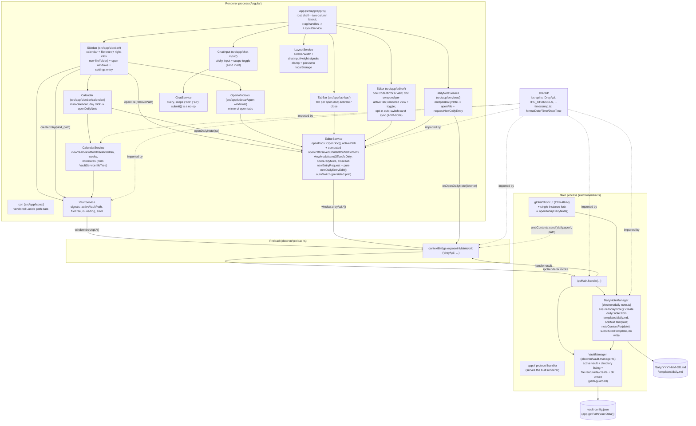

# 5. Building Block View

## 5.1 Whitebox Overall System (as of the "visual shell" milestone)

Electron main process, Angular renderer, the IPC bridge between them,
vault selection + file listing, and the full two-column shell from the
design prototype: a sidebar (mini-calendar, vault file tree,
open-windows list, settings entry) and a main area with a **tab bar**, the
CodeMirror 6 editor (source/rendered toggle, **rendered by default**,
explicit save), and a sticky chat input bar (scope toggle wired, sending
not yet). The sidebar↔main and editor↔chat-input borders are **drag-resizable**
(sizes clamped + persisted to `localStorage` by `LayoutService`); the
open-windows list is capped at a third of the sidebar height and each row
has an `x` to close that document; the file tree has a **right-click menu
to create a new file or folder**. Quick-capture is a
global hotkey (`Ctrl/Cmd+Alt+N`) that brings the main window forward and
opens **today's daily note** — creating `daily/YYYY-MM-DD.md` from
`templates/daily.md` (scaffolded on first use) if needed — then starts a
fresh `## HH:mm` entry. No popup window (see
[ADR-0002](09_architecture_decisions/0002-quick-capture-opens-daily-note.md)).

The editor now holds **multiple open documents** (one per tab); switching
tabs never prompts, closing a dirty tab does. Clicking a calendar day
opens that day's daily note, or — for a day with no file yet — an
**unsaved draft** that only reaches disk once the user types and saves
(see [ADR-0003](09_architecture_decisions/0003-multi-document-editor-tab-model.md)).
Still to come (milestone 5+, see `CLAUDE.md` "Build Order"): tag parsing /
routing, the "+" new-note action, and the chat/search backend. Those
affordances render as clearly-disabled placeholders.



## 5.2 Folder Structure

```
electron/           Main process + preload (compiled to dist-electron/, CommonJS/Node16)
  main.ts           App lifecycle, single-instance lock, window creation, global
                     hotkey -> openTodayDailyNote(), IPC handlers, app:// protocol
  preload.ts        contextBridge exposure only -- no other logic
  vault-manager.ts  Active vault (persisted in userData), directory listing,
                     path-guarded file read/write, file/dir creation
  daily-note.ts     DailyNoteManager: ensureTodayNote() -- creates daily/<date>.md
                     from templates/daily.md (scaffolds a starter template on
                     first use); noteContentFor(date) -- substituted template
                     with no write (calendar draft); placeholder substitution
  tsconfig.json      Node-targeted compile config, separate from the Angular one

src/                Angular renderer (standalone components, esbuild via Angular CLI)
  app/
    app.ts            Root component -- two-column shell; tab bar + editor + chat bar
    icons/
      icon.ts          <app-icon name>: vendored Lucide path data, no dependency
    services/
      vault.service.ts     Wraps dreyApi's vault methods as signals; no logic beyond that
      editor.service.ts    Multi-document state: openDocs[] + activePath, with computed
                            openPath/savedContent/bufferContent/viewMode/caretOffset/isDirty
                            over the active doc; openFile/openDailyNote/closeTab; unsaved
                            drafts; newEntryRequest + pure newDailyEntryEdit();
                            autoSwitch (localStorage-persisted preference, ADR-0004)
      calendar.service.ts  Mini-calendar view state (month, selected day) + weeks grid +
                            "has a daily note" lookup off VaultService.fileTree
      chat.service.ts      query + scope ('doc' | 'all') for the input bar; submit() inert
      layout.service.ts    sidebarWidth / chatInputHeight signals; setters clamp and
                            persist to localStorage; read back in the constructor
      daily-note.service.ts Subscribes to onOpenDailyNote; opens the pushed path and
                            requests a new `## HH:mm` entry. No other logic.
    tab-bar/           TabBar: a tab per open doc (activate / close), "+" placeholder
    chat-input/        ChatInput: sticky field + "this document" / "all notes" toggle
    sidebar/
      sidebar.ts        Calendar + recursive file tree (collapsible folders) +
                         open-windows list + settings entry; a file click opens it;
                         right-click -> in-renderer menu -> inline name input ->
                         VaultService.createEntry()
      calendar/         Calendar: mini-calendar grid; day click -> EditorService.openDailyNote
      open-windows/     OpenWindows: list mirroring the open editor tabs
    editor/
      editor.ts         One CodeMirror 6 EditorView (document swapped per active tab) +
                         markdown-it rendered view (default; leading YAML frontmatter
                         stripped before render) + source/rendered toggle. The only
                         place CodeMirror is referenced; applies newEntryRequest;
                         drives auto-switch mode (ADR-0004).
      source-map.ts     Pure. renderWithSourceMap() (markdown-it token.map -> cm-src-<n>
                         block spans) + character alignment between a block's rendered
                         text and its source slice. For auto-switch caret sync.
      preview-caret.ts  DOM-pure helpers: DOM point <-> text offset, nearest cm-src-<n> block.
  index.html
  main.ts             Angular bootstrap
  styles.css          Global dark theme + design tokens (palette / type / spacing)

public/
  fonts/README.md    Where to drop the self-hosted Newsreader / IBM Plex Mono .woff2

shared/             Code compiled into BOTH electron/ and src/ (two separate
                     tsconfig contexts -- see docs/09_architecture_decisions/0001-*.md).
  ipc-api.ts         Interfaces + channel names crossing the IPC boundary
  timestamp.ts       Pure local-time formatters (date / time / datetime / timestamp);
                      used by template substitution in main and the `## HH:mm`
                      heading in the renderer

docs/               This arc42 documentation
specs/              Binding concept/schema/classifier specs (not modified by the app build)
scripts/
  run-electron.js    Launcher that strips a leaked ELECTRON_RUN_AS_NODE before
                      spawning Electron (see inline comment for why)

.tools/node/        Portable, project-local Node.js runtime (gitignored)
env.ps1             Puts .tools/node on PATH for the current shell session
```

## 5.3 Renderer ↔ Main IPC

| Channel                  | Purpose                                                                                                                                                                                                                                                                             |
| ------------------------ | ----------------------------------------------------------------------------------------------------------------------------------------------------------------------------------------------------------------------------------------------------------------------------------- |
| `app:get-info`           | Milestone-1 smoke test for the IPC bridge (`AppInfo`) -- not itself a Phase-1 feature.                                                                                                                                                                                              |
| `vault:get-active`       | Returns the persisted active vault path, or `null`.                                                                                                                                                                                                                                 |
| `vault:select`           | Opens the native folder picker; returns the resulting active vault path (unchanged if cancelled).                                                                                                                                                                                   |
| `vault:list-files`       | Recursively lists the active vault's contents (`VaultFileEntry[]`); rejects if no vault is active or the folder is unreadable.                                                                                                                                                      |
| `vault:read-file`        | Reads one vault-relative file (`VaultFileContent` = `{ content, modifiedMs }`); rejects if no vault is active, the path escapes the vault, or the file is unreadable.                                                                                                               |
| `vault:write-file`       | Overwrites one vault-relative file with UTF-8 `content`; creates intermediate folders (`daily/` on a draft's first save); same guards; resolves to the new `modifiedMs`.                                                                                                            |
| `vault:create-file`      | Creates an empty vault-relative file (missing parent folders included, `wx` flag); rejects if anything already exists there, the path escapes the vault, or no vault is active; resolves to the created path. Backs the file-tree right-click "New file".                           |
| `vault:create-directory` | Creates a vault-relative directory; same guards/rejections as `vault:create-file`. Backs "New folder".                                                                                                                                                                              |
| `daily:build-content`    | Returns the substituted `templates/daily.md` for a given `YYYY-MM-DD`, **without** creating the file or scaffolding the template. Backs the calendar's "open a draft for a day with no note yet". Rejects if no vault is active or the date is malformed.                           |
| `daily:open`             | `webContents.send` / `ipcRenderer.on` — **main → renderer** push, fired by the quick-capture hotkey after `DailyNoteManager.ensureTodayNote()`. Payload: the vault-relative path of today's daily note. Preload exposes it as `onOpenDailyNote(listener)` returning an unsubscribe. |

All but `daily:open` follow the same request/response pattern: a channel
name + types in `shared/ipc-api.ts`, an `ipcMain.handle` in
`electron/main.ts` (delegating to `VaultManager` or `DailyNoteManager`),
and an exposed method in `electron/preload.ts`. `daily:open` is the first
main→renderer push —
still typed in `shared/ipc-api.ts`, and the preload wrapper forwards only
the path, never the raw `ipcRenderer` event (ADR-0001).

## 5.4 Notable implementation decisions from this milestone

- **`app://` custom protocol instead of `file://`** for loading the built
  renderer in production. Angular's esbuild output is
  `<script type="module">`; Chromium refuses module-script loads under
  `file://` as a CORS violation, so the page would load with silently zero
  content. `protocol.handle('app', ...)` (registered as a privileged
  scheme before `app.whenReady()`) serves the built files from a normal
  origin instead. This is the same protocol-handler mechanism the roadmap
  already earmarks for safe local image rendering in Phase 3 — one
  pattern, reused later for a second purpose.
- **Preload is not sandboxed** (`sandbox: false`), while `contextIsolation`
  and `nodeIntegration: false` are on, as ADR-0001 commits to. A sandboxed
  preload's `require()` is restricted to a handful of Electron/Node
  built-ins and cannot load a project-local file like the compiled
  `shared/ipc-api.js` — it fails silently at runtime with no error
  surfaced anywhere obvious (`window.dreyApi` just never appears).
  Tracked as technical debt in
  [11_risks_and_technical_debt.md](11_risks_and_technical_debt.md); revisit
  once preload has a bundling step that can inline `shared/` into one file.
- **Active-vault persistence is a hand-written JSON file in
  `app.getPath('userData')`**, not a package like `electron-store`. It's
  ~15 lines (`vault-manager.ts`'s `readConfig`/`writeConfig`) with full
  control over the failure modes that matter here (corrupt file → treat as
  unset, not crash; configured path that no longer exists → treat as
  unset for this session without touching the file, since the vault can
  live on removable/networked storage like OneDrive and may just not be
  mounted yet). This is app _settings_, not vault content -- doesn't
  conflict with "no database as source of truth" (`specs/roadmap.md`),
  which is about notes, not app configuration.
- **`listVaultFiles()` skips dotfiles/dotfolders** (`.git`, `.obsidian`,
  ...) unconditionally. Nothing in the Phase-1 spec needs them surfaced.
  Revisit if a future milestone needs to see them (unlikely).

## 5.5 Notable implementation decisions — milestone 3 (editor)

- **CodeMirror 6 as a single `EditorView` inside `Editor`**, with the
  `extensions` array as the extension point. The spec picks CodeMirror 6
  precisely because features like spellcheck/syntax-highlighting plug in
  as extensions (no custom plugin loader) — so the wrapper stays a thin
  host, not a framework. Packages: `codemirror` (basicSetup) +
  `@codemirror/lang-markdown` + `@codemirror/theme-one-dark` (matches the
  dark theme). The `cm-host` div stays mounted (`display:none`) while the
  rendered view shows, so the instance and its undo history survive a
  toggle.
- **Rendered view = markdown-it → `[innerHTML]`.** markdown-it is
  configured `html: false` (raw HTML in a note is escaped, not executed)
  and the output string is bound through Angular's `[innerHTML]`, which
  runs the built-in HTML sanitizer — two layers, no separate sanitizer
  dependency. No live preview: roadmap Phase 1 is explicit about the
  tab-switch model; live inline rendering is "Future Scope".
- **Auto-switch mode (opt-in, [ADR-0004](09_architecture_decisions/0004-auto-switch-editor-mode.md)).**
  `EditorService.autoSwitch` (a `localStorage`-persisted preference, off by
  default) changes the interaction, not the structure: the rendered `.doc`
  becomes `contenteditable="plaintext-only"` for a native caret, clicks no
  longer switch views, and the first `beforeinput` is cancelled and
  replayed into CodeMirror after switching to source at the matching
  offset. `OpenDoc.caretOffset` (offset into `bufferContent`, no effect on
  dirty state) is the shared position both views sync on. The source↔render
  offset translation lives in two pure/DOM-pure modules,
  `editor/source-map.ts` (markdown-it `token.map` → `cm-src-<n>` marker classes +
  a per-block character alignment) and `editor/preview-caret.ts` (DOM
  point ↔ text offset). Best-effort: character-precise for prose, headings
  and fenced code; a few characters off in dense inline markup.
- **Explicit save (Ctrl+S) + dirty indicator, not autosave.** Autosave's
  conflict story (keep-mine / take-external) depends on the chokidar file
  watcher, which no milestone has built yet
  ([11_risks_and_technical_debt.md](11_risks_and_technical_debt.md),
  autosave-vs-watcher). Switching a dirty buffer to another file prompts
  via `confirm()` — the roadmap's stated minimum bar, replaced when the
  watcher forces a real decision.
- **`updated:` frontmatter is _not_ bumped on save yet.** Save writes the
  buffer bytes verbatim. Bumping `updated:` (per
  `specs/frontmatter-schema.md`) needs YAML frontmatter parse/reserialize,
  which is milestone 5's concern (it also merges body `#tags` into
  frontmatter) — doing it now would mean a throwaway partial parser.
  Flagged deviation, deferred to milestone 5.
- **One open document, no tab bar.** `EditorService` holds exactly one
  file. CLAUDE.md's tab bar is built when quick-capture / multiple windows
  (milestone 4+) give it more than one thing to hold.
  _(Superseded by the "visual shell" milestone / ADR-0003 — `EditorService`
  is now multi-document and the tab bar exists. §5.7.)_
- **Line endings are normalised in `EditorService`, not the editor.**
  CodeMirror always holds its document as `\n`; a CRLF file (the Windows
  default for these `.md` notes) would otherwise register as "modified"
  the moment the buffer syncs, with nothing typed. The service detects the
  file's dominant ending on read, keeps `savedContent`/`bufferContent` in
  `\n`, and restores the ending on write. `Editor` stays a pure-LF text
  editor. Mixed endings collapse to the dominant one on save (same as VS
  Code's default).
- **Initial-bundle budget raised to 1.2 MB warn / 2 MB error**
  (`angular.json`). CodeMirror + markdown-it put the initial bundle at
  ~880 kB raw / ~263 kB transfer. Lazy-loading the editor isn't worth it
  for a desktop app whose main surface _is_ the editor.
- **Clipboard is native, owned in the main process** (`electron/menu.ts`).
  A `Menu.setApplicationMenu` template carries the standard edit roles
  (cut/copy/paste/select-all) so their accelerators stay bound even once a
  later feature replaces the menu; the bar is hidden via
  `autoHideMenuBar`. `webContents.on('context-menu')` builds the
  right-click menu from the hit-test params (full set in the editor, just
  Copy on a selection elsewhere). All items are `role`-based, so they run
  native editing commands on the focused `webContents` — CodeMirror 6
  handles the resulting DOM clipboard events, and nothing touches the
  renderer or the IPC bridge. Undo/redo are left to CodeMirror's own
  keymap rather than menu roles.

## 5.6 Notable implementation decisions — milestone 4 (quick-capture)

- **No popup window.** `specs/roadmap.md` planned a frameless capture
  popup with its own input; a first pass built it, then it was dropped in
  review. The hotkey now raises the main window and opens today's daily
  note in the full editor. Rationale and the rejected popup design are in
  [ADR-0002](09_architecture_decisions/0002-quick-capture-opens-daily-note.md).
  **This is a live deviation from the specs** — see
  [11_risks_and_technical_debt.md](11_risks_and_technical_debt.md).
- **Daily note = `daily/YYYY-MM-DD.md`, created from a vault template.**
  `DailyNoteManager.ensureTodayNote()` (main process) returns today's
  path, creating the file from `templates/daily.md` if absent.
  `templates/daily.md` itself is scaffolded with a starter (frontmatter +
  `{{date}}`/`{{time}}`/`{{datetime}}`/`{{title}}` placeholders) the
  first time it's needed, so "customise the daily note" = edit that file.
  The substitution helper is generic and will be reused when milestone 5
  creates master/notiz files.
- **Kept out of `VaultManager`.** `VaultManager` is vault registration +
  raw path-guarded IO with no note/frontmatter knowledge; template
  substitution is exactly that knowledge, so it lives in its own
  `DailyNoteManager` that leans on `VaultManager` for the active-vault
  path.
- **Global hotkey `CommandOrControl+Alt+N`, one constant in `main.ts`.**
  Registered on `whenReady`, `globalShortcut.unregisterAll()` on
  `will-quit`. A failed registration (another app owns the combo) is
  logged, not fatal — rebinding UI comes later. `Ctrl+Alt`+letter is
  rarely claimed system-wide; `N` = note.
- **Single-instance lock added** (`app.requestSingleInstanceLock()`). A
  second launch can't register the already-taken global shortcut and
  would look broken; instead it focuses the running window and exits.
- **First main→renderer push** (`daily:open`). The hotkey handler sends
  the daily-note path straight to `mainWindow.webContents`; the preload
  wrapper forwards only the path (no `IpcRendererEvent`, ADR-0001).
  `DailyNoteService` in the renderer turns it into
  `EditorService.openFile(path)` + `requestNewDailyEntry()`.
- **The editor gains one external-command path.** `EditorService` holds a
  `newEntryRequest` counter and a _pure_ `newDailyEntryEdit(text)` that
  returns the `## HH:mm` insertion (or `null` when the doc already ends
  with an empty entry heading — a double hotkey press shouldn't stack
  blank sections). `Editor` computes the edit against live CodeMirror
  state and dispatches it, leaving the buffer dirty for a normal Ctrl+S.
  This is the first time anything outside `Editor` changes the document —
  done via a request signal, not by writing `bufferContent`, because CM
  is the buffer's source of truth (§5.5).
- **`shared/timestamp.ts`** (moved from an earlier `electron/timestamp.ts`):
  the renderer needs local-time `HH:mm` for the entry heading too, so the
  pure formatters live in `shared/`, compiled into both contexts. Local
  time, not UTC — the values are human-read and drive the day view.
- **The main process now materialises vault files the user didn't create**
  (`daily/…`, `templates/daily.md`) on the first hotkey press in a fresh
  vault. Deliberate, and visible in the sidebar; flagged so it isn't a
  surprise.

## 5.7 Notable implementation decisions — "visual shell" milestone

Rebuilding the design prototype (`Notizen Desktop.dc.html`) as real Angular
components. Scope was staged: this milestone is the **layout + state
shell**; the behaviour behind not-yet-built features renders as disabled
placeholders. See also
[ADR-0003](09_architecture_decisions/0003-multi-document-editor-tab-model.md).

- **Design tokens in `src/styles.css`.** The prototype's palette,
  type families and radii are CSS custom properties on `:root`; component
  stylesheets never hard-code a hex value. One place to flip the accent
  colour (the prototype offers four).
- **Fonts are self-hosted, not from the Google CDN.** Offline-first
  (`specs/roadmap.md`: no cloud calls). `@font-face` for Newsreader / IBM
  Plex Mono points at `public/fonts/`; until the `.woff2` files are added
  the token fallbacks (`Georgia`, platform monospace) apply — which is
  what the prototype specifies as its own fallback anyway. See
  `public/fonts/README.md`.
- **Icons: vendored Lucide path data, no package.** `lucide-angular@1.x`
  pins `@angular/core` to 13–21 (this project is on 22). `<app-icon>`
  carries a small map of [Lucide](https://lucide.dev) shapes rendered as
  declarative `<path>` / `<circle>` primitives — no `innerHTML`, no
  sanitizer bypass. Swappable for `lucide-static` later without touching
  call sites.
- **Multi-document `EditorService` + one `EditorView`.** See ADR-0003. The
  historical single-doc accessors (`openPath`, `bufferContent`, …) are
  kept as computed signals over the active tab, so `App` / `Sidebar` /
  `DailyNoteService` were untouched.
- **Calendar day → daily note, drafts included.** `Calendar` calls
  `EditorService.openDailyNote(iso)`: existing file opens normally; a day
  with no note opens an unsaved draft from `daily:build-content`. Nothing
  is written until the user types and saves (ADR-0003). "Has a note"
  markers come from scanning `daily/*.md` in `VaultService.fileTree()` —
  no new IPC for that.
- **`CalendarService` / `ChatService` hold the view state**, not the
  components (CLAUDE.md, "no business logic inside components"). Calendar
  navigation + selection + note-date lookup; chat query + scope.
  `ChatService.submit()` is intentionally a no-op until keyword search
  lands.
- **UI chrome is English**, matching the existing app ("Save",
  "Source"/"Rendered"); the prototype's German labels are treated as
  visual reference only. Vault content stays German (CLAUDE.md, "Language
  Convention"). _(The "Drey" wordmark above the calendar was later
  removed on UX feedback — §5.8.)_
- **Placeholders, clearly disabled:** the tab-bar "+" button, the
  sidebar "Settings" entry, and the chat send button (until there's a
  query _and_ a backend). None are wired to anything yet.

## 5.8 Notable implementation decisions — shell refinements

Follow-up polish on the visual shell, driven by direct UX feedback.

- **Resizable panes via native pointer events, not a CDK/split-pane
  package.** Two 1px drag handles in `App` (`.divider-x` sidebar↔main,
  `.divider-y` editor↔chat-input); `setPointerCapture` on the handle keeps
  the drag alive off the strip, `pointermove`/`pointerup` are handled on
  the host, and the moved-to size goes straight into `LayoutService`. ~15
  lines, no dependency — same rationale as the vendored icons (§5.7).
- **`LayoutService` owns pane sizes; persistence is `localStorage`.**
  `sidebarWidth` / `chatInputHeight` signals, setters clamp to a fixed
  range, and the value is written synchronously from the setter (not via an
  `effect`) so a drag frame and its persisted value never diverge. It's
  per-machine window chrome, not note data, and must be readable before
  first paint — `localStorage`, not a main-process config file or the
  vault.
- **Editor lands in the rendered ("preview") view by default**, and a
  leading YAML frontmatter block is stripped before markdown-it renders
  (`stripFrontmatter`, a pure exported function in `editor.service.ts`).
  Only a `---` fence at offset 0 counts — a `---` further down stays a
  horizontal rule. Click-to-edit still drops into source.
- **The file-tree context menu is an in-renderer overlay, not Electron's
  `Menu.popup()`.** It matches the app's flat visual language and keeps all
  future in-app menus (tree, tabs, calendar) on one renderer-side pattern;
  the native `webContents 'context-menu'` handler in `electron/menu.ts`
  stays scoped to editable-field cut/copy/paste. The renderer handler
  bows out (`return` before `preventDefault`) when the target is the
  inline name `<input>`, so the native editing menu still works there.
  Chosen over the native menu after flagging the trade-off.
- **New-file naming: inline input, `.md` appended when no extension is
  typed.** `window.prompt` is disabled in Electron, so the name is entered
  in a small input at the top of the Files panel (Enter commits, Esc/blur
  cancels). Appending `.md` to an extension-less name is an assumption
  (these notes are Markdown), not something the specs state.
- **Create errors surface as a one-off `alert()`, not `VaultService.error()`.**
  A name clash or a bad name shouldn't blank the whole file tree the way a
  failed initial load does; `createEntry()` lets the error propagate and
  the sidebar shows it transiently (consistent with the existing
  `confirm()` on closing a dirty tab).
- **Open-windows list capped at `max-height: 33%`** of the sidebar with its
  own scroll, and each row carries a close `x` (reusing the tab-bar close
  affordance → `EditorService.closeTab`, which already prompts on a dirty
  buffer). The file tree above stays the primary surface.
