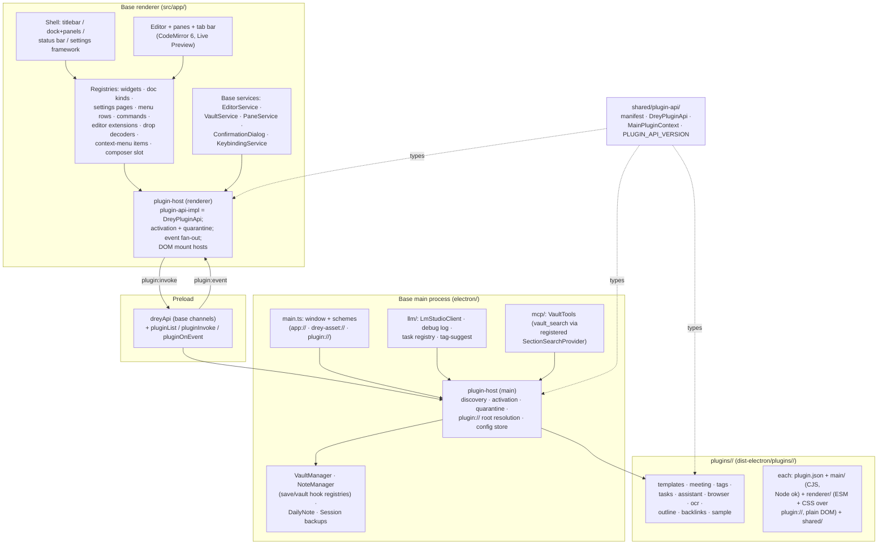
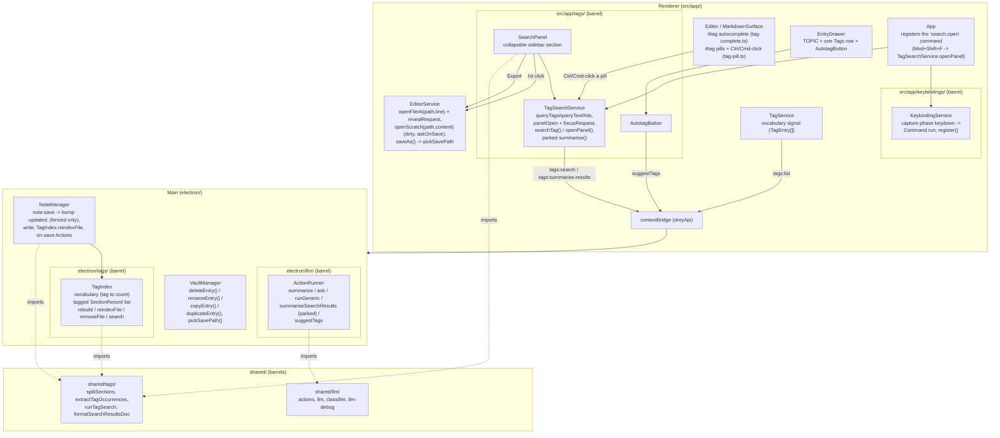
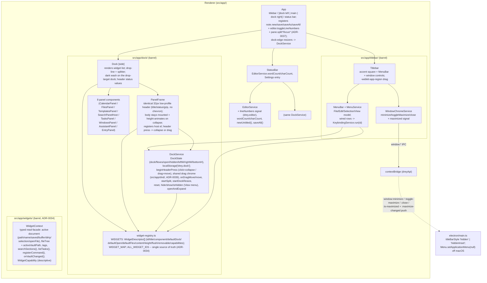

# 5. Building Block View

> **Reading order.** **§5.0 is the current structure** (base application
> + runtime plugins, [ADR-0044](09_architecture_decisions/0044-runtime-plugin-system.md)).
> The rest of this file is layered by milestone: each
> "§5.x Notable implementation decisions" section is a point-in-time
> record, with `_(Superseded …)_` notes where a later section changed
> course. The tag system was rebuilt in milestone 11
> ([ADR-0017](09_architecture_decisions/0017-tags-as-labels-and-section-index.md)):
> **§5.14** has the tag / search picture as of that milestone; the
> `TagIndex` / routing / master-document material in §5.1 and §5.9 is
> kept for the record but superseded. The feature sections (§5.10–§5.23)
> predate the plugin conversion — where a feature is now a runtime
> plugin, its section carries a note and §5.0 describes the seam it
> plugs into today.

## 5.0 Whitebox overall system — base application + runtime plugins (current, ADR-0044)

Since [ADR-0044](09_architecture_decisions/0044-runtime-plugin-system.md)
the app is a **base application** plus **runtime-loadable, in-process
plugins** — in-process and trusted (Obsidian's model), discovered at
startup, activated before Angular bootstraps. Every former feature module
is now a plugin; the base keeps the shell, the editor, vault IO, session
restore, keybindings, spellcheck, the MCP vault server, the LLM
*transport*, and the two plugin hosts.

### The blocks

**Base, main process** (`electron/`):

- `main.ts` — composition root: window creation, the privileged schemes
  (`app://`, `drey-asset://`, `plugin://`), single-instance lock,
  quick-capture hotkey, and the slimmed IPC handler registration.
- `external-open.ts` + `ipc/external-handlers.ts` — files the OS hands to
  Drey ([ADR-0054](09_architecture_decisions/0054-opening-files-from-the-os.md)):
  `extractOpenPaths` (argv filter), `ExternalFileGate` (queue → classify
  as vault / external via `locateInVaults` → read/write allowlist,
  extension + 50 MB gate; pull at cold start, push for `second-instance`). Renderer
  side: `src/app/external-open/ExternalOpenService` routes each request to
  `EditorService.openFile` (vault) or `openExternalFile` (`OpenDoc.external`:
  `vaultId: null`, absolute `path`, key `external://…`, pinned, edited
  normally and saved in place via `external:write` — no vault pipeline —
  skipped by the session snapshot; "Save as…" copies into the active vault).
- `plugin-host/` — discovery (`plugin-discovery.ts`: built-in root,
  `<userData>/plugins/*`, `DREY_EXTRA_PLUGIN_DIR`; manifest validation;
  `plugins.disabled` + `apiVersion` gating), the host
  (`plugin-host.ts`: activate/quarantine, `plugin://` root resolution),
  per-plugin config store (`plugin-config-store.ts`).
- Vault + note IO: `vault-manager.ts` (mutations record themselves in the
  own-write ledger), `note-manager.ts` (frontmatter
  bump + write; feature work rides the **save-hook / vault-hook
  registries**), `daily-note.ts`, `session/` (backup store),
  `own-write-ledger.ts` + `vault-watcher.ts` +
  `vault-change-announcer.ts` (the opt-in external-change round,
  ADR-0045), `llm/` (transport: the provider abstraction — `LlmClient`
  interface, per-call `LlmRouter`, one client per backend under
  `providers/` (ADR-0047), debug log, task registry, tag-suggest),
  `mcp/` (vault server; `vault_search` reads the
  section-search provider the tags plugin registers),
  `pdf-export.ts` (the "Export as PDF…" flow: paper-styled HTML from
  `shared/pdf-html.ts` printed in a hidden sandboxed window; its own save
  dialog, deliberately NOT vault-root-restricted; notes with a
  ` ```mermaid ` fence get the mermaid UMD bundle inlined so the fences
  render as figures — ADR-0052 later change).
- `ipc/` — the base channel handlers (thin, feature-free).

**Base, renderer** (`src/app/`):

- Shell: `titlebar/`, `dock/` (+ `WidgetRegistryService` — core widgets
  register through the same API plugins use; each dock also renders its
  **editor band**, the one pane `PaneService` has docked there —
  ADR-0038), `status-bar/`,
  `settings/` (framework + core categories; plugin pages append),
  `panes/` (centre split tree **plus the dock regions**),
  `tab-bar/`, `editor/` (+ the editor-extension /
  drop-decoder / context-menu / doc-kind registries behind it),
  `entry/`, `calendar/`, `vault/`, `image-viewer/`,
  `confirmation-dialog/`, `services/`.
- `plugin-host/` — `plugin-host.service.ts` (activation, quarantine,
  event fan-out, visibility synthesis), `plugin-api-impl.ts` (the
  `DreyPluginApi` implementation), the registries
  (`editor-extension-registry`, `doc-kind-registry.service`,
  `menu-contributions`, `drop-decoder-registry`,
  `settings-registry.service`), and the three DOM mount hosts
  (`plugin-widget-host`, `plugin-settings-host`, `plugin-doc-host`).
  `plugin-settings.css` is the shared form vocabulary for plugin
  Settings pages (fields/hints, inputs, rows, buttons — mirroring the
  core panes' `settings-forms.css`, scoped under `.plugin-settings-host`'s
  `.plugin-settings-body`; author guide `plugins/AUTHORING.md`).

**SDK** (`shared/plugin-api/`) — the frozen contract both sides compile
against: `manifest.ts` (`PluginManifest` + `validateManifest`),
`plugin-api.ts` (renderer `DreyPluginApi`), `main-plugin-api.ts`
(`MainPluginContext`), `plugin-ipc.ts` (the bridge payload types +
`PluginDescriptorForRenderer`), `versions.ts` (`PLUGIN_API_VERSION`;
major mismatch ⇒ `incompatible`). Exempt from module-boundary lint, like
`shared/ipc-api.ts`.

**Plugins** (`plugins/<id>/`, ten shipped): `sample` (exercises every
surface), `templates`, `meeting`, `tags`, `tasks`, `assistant`
(Assistant + Actions), `browser`, `ocr` (vision-LLM OCR, ADR-0050),
`outline` (the open note's heading tree, renderer-only), `backlinks`
(the "what links here" panel over a per-vault outlink index,
milestone 54). Each
is a full stack: `plugin.json` +
`main/` (CommonJS, Node access — `electron/` and app-`shared/` CJS
allowed) + `renderer/` (browser-context ES modules + CSS, served over
`plugin://`, plain DOM — no Angular, no `@codemirror/*` runtime imports)
+ `shared/` (its own types). Built by `scripts/build-plugins.mjs` into
`dist-electron/plugins/<id>/` — built-ins and user-installed plugins are
the same thing to the hosts.



### The seams (what a plugin can be)

Every base extension point is a **registry the base owns and a plugin
fills** — base knows the interfaces, not the features:

| Seam | Renderer API | Main context |
| --- | --- | --- |
| Dock panels + status values | `ui.registerWidget` | — |
| Non-file editor tabs (doc kinds) | `ui.registerDocKind` | — |
| Settings pages | `ui.registerSettingsPage` | — |
| Menu rows (`file`/`edit`/`selection`/`view`/`editor-more`) | `ui.registerMenuContributions` | — |
| Commands + keybindings | `commands.register` / `run(id, payload?)` (payload carries invoker context, SDK 1.9 — the base tag pills run `search.open` with `{ tag }`) | — |
| Shared tag chip field (colored chips + completion, milestone 33) | `ui.createTagField` | — |
| Editor extensions (host CM instances), drop decoders, context-menu items (with the click target, ADR-0050), composer slot | `editor.*` | — |
| Document read/observe/insert/confirmed rewrite/open + the live-edit input lock | `documents.*` (incl. `setEditLock`, ADR-0049) | — |
| Vault IO + change push | `vault.*` (incl. `saveAsset`) | `ctx.vault.*` (incl. `writeAnnounced`) |
| Backend methods + pushes (the plugin's own IPC) | `backend.invoke` / `backend.on` | `ctx.ipc.handle` / `ctx.ipc.emit` |
| Save pipeline (`{content?, pendingActions?}`), vault lifecycle, section search | — | `ctx.save`, `ctx.vault` hooks, `ctx.search` (`notifyChanged` pushes `search:changed` to the base vocabulary service, SDK 1.9; the provider's optional `styles()` serves the tag prefix colors) |
| LLM transport | `llm.chat/cancelTask/onDebugEntry/onDelta/listModels/capabilities/onCapabilitiesChanged` | `ctx.llm.chat/suggestTags/capabilities` (chat gains `tools`/`onToolCall`/`maxToolRounds`, ADR-0049; `maxOutputTokens` + the capability push, ADR-0050) |
| Per-plugin config, app config read/patch | `settings.*`, `appConfig.*` | `ctx.config`, `ctx.appConfig` |
| Native-surface hide (overlays/gestures) | `env.onNativeSurfaceVisibility` | — |

Runtime sequences (discovery/activation, the IPC roundtrip, extension
registration, the save-hook chain, doc-kind session restore) are in
[docs/06 §6.25–§6.29](06_runtime_view.md); packaging in
[docs/07](07_deployment_view.md).


## 5.1 Whitebox Overall System (as of the "visual shell" milestone)

Electron main process, Angular renderer, the IPC bridge between them,
vault selection + file listing, and the full two-column shell from the
design prototype: a sidebar (mini-calendar, vault file tree,
open-windows list, settings entry) and a main area with a **tab bar**, the
editor (one CodeMirror 6 view with an inline **Live Preview** mode, a
read-only **View** mode and a raw **Source** mode, switched by a `⋯` mode
menu, Live Preview by default, explicit save), and the **"Add entry" drawer** pinned to
its bottom (optional TOPIC field, one Tags chip row, a spellchecked
Markdown body — §5.12). A third column on the right holds the **note
assistant** (auto-summary + Q&A thread, §5.11). The bottom chat bar that
used to sit under the editor is gone: its capture role became the drawer
and its Ask role the assistant's composer, so each job lives in exactly one
place. The sidebar↔main, editor↔drawer and main↔assistant borders are
**drag-resizable**
(sizes clamped + persisted to `localStorage` by `LayoutService`); the
open-windows list is capped at a third of the sidebar height and each row
has an `x` to close that document; the file tree has a **right-click menu
to create a new file or folder**. Quick-capture is a
global hotkey (`Ctrl/Cmd+Alt+N`) that brings the main window forward and
opens **today's daily note** — creating it in the configured daily folder
(`daily.dir`, default `daily/`) from `templates/daily.md` (scaffolded on
first use) if needed — then starts a
fresh `## HH:mm` entry. No popup window (see
[ADR-0002](09_architecture_decisions/0002-quick-capture-opens-daily-note.md)).

The editor now holds **multiple open documents** (one per tab); switching
tabs never prompts, closing a dirty tab does. Clicking a calendar day
opens that day's daily note, or — for a day with no file yet — an
**unsaved draft** that only reaches disk once the user types and saves
(see [ADR-0003](09_architecture_decisions/0003-multi-document-editor-tab-model.md)).
Milestone 6 added a tag layer that milestone 11 then replaced
([ADR-0017](09_architecture_decisions/0017-tags-as-labels-and-section-index.md),
**§5.14**): tags are now free inline `#tag` labels, a main-process
`TagIndex` holds the vault-wide vocabulary **plus** an inverted index of
tagged `##`/`###` sections, `note:save` only bumps `updated:` and
re-indexes the file (no `#tag`→frontmatter merge, no master-document
routing), and a sidebar **search panel** queries the section index (tags
AND + free text) with clickable hits and a Markdown Export. The paragraph
above and the diagram below describe the milestone-6 shape and are kept
for the record only.

```mermaid
graph TB
    subgraph Renderer["Renderer process (Angular)"]
        App["App (src/app/app.ts)<br/>root shell -- two-column layout;<br/>drag handles -> LayoutService"]
        Sidebar["Sidebar (src/app/sidebar/)<br/>calendar + file tree (+ right-click<br/>new file/folder) + open-windows +<br/>settings entry"]
        Calendar["Calendar (src/app/sidebar/calendar/)<br/>mini-calendar; day click -> openDailyNote"]
        OpenWindows["OpenWindows (src/app/sidebar/open-windows/)<br/>mirror of open tabs"]
        PaneLayout["PaneLayout / PaneLeaf (src/app/panes/, ADR-0037)<br/>recursive split-tree layout; one TabBar +<br/>Editor/ImageTab per leaf pane"]
        TabBar["TabBar (src/app/tab-bar/)<br/>one pane's own tabs (PaneService); activate / close;<br/>drag = TabDragService (ADR-0039, real DnD via src/app/dnd/)"]
        Editor["Editor (src/app/editor/)<br/>one CodeMirror 6 view per pane, doc swapped per<br/>that pane's active tab; Live Preview decorations<br/>via Compartment; ⋯ mode menu (ADR-0009)"]
        EntryDrawer["EntryDrawer (src/app/entry-drawer/)<br/>TOPIC + chip rows + MarkdownSurface<br/>(compact, inline spellcheck)"]
        NoteAssistant["NoteAssistant (src/app/note-assistant/)<br/>auto-summary switch + card thread + composer"]
        Icon["Icon (src/app/icons/)<br/>vendored Lucide path data"]
        VaultService["VaultService<br/>signals: activeVaultPath, fileTree, isLoading, error"]
        EditorService["EditorService<br/>openDocs: OpenDoc[] (registry); activePath = the<br/>FOCUSED pane's active path (PaneService, ADR-0037)<br/>+ computed openPath/savedContent/bufferContent/<br/>viewMode/isDirty; save/saveAs/setViewMode take an<br/>optional explicit path; openDailyNote, closeTab,<br/>newEntryRequest + pure newDailyEntryEdit()"]
        PaneService["PaneService (src/app/panes/, ADR-0037)<br/>split tree + per-pane { tabs, active }; focusedId"]
        CalendarService["CalendarService<br/>viewYear/viewMonth/selectedIso, weeks,<br/>noteDates (from VaultService.fileTree)"]
        EntryDraftService["EntryDraftService<br/>topic/text/tags/people/meetings;<br/>empty-TOPIC confirmation rule"]
        AssistantService["AssistantService<br/>per-note sidecar thread + auto-summary rule;<br/>panel toggle is session state (ADR-0012)"]
        SpellcheckService["SpellcheckService<br/>SpellcheckSource for the CM extension;<br/>per-language verdict cache"]
        LlmTaskService["LlmTaskService<br/>in-flight generations: elapsed clock +<br/>Cancel (ADR-0014)"]
        LayoutService["LayoutService<br/>sidebarWidth / assistantWidth signals;<br/>clamp + persist to localStorage"]
        DailyNoteService["DailyNoteService (src/app/services/)<br/>onOpenDailyNote -> openFile + requestNewDailyEntry"]
        TagService["TagService (src/app/services/)<br/>tags signal (TagEntry[]) from tag:list;<br/>refreshed on construct + after a tag-changing save"]
        App --> Sidebar
        App --> PaneLayout
        PaneLayout --> TabBar
        PaneLayout --> Editor
        PaneLayout --> PaneService
        TabBar --> PaneService
        App --> EntryDrawer
        App --> NoteAssistant
        App --> LayoutService
        App --> DailyNoteService
        Sidebar --> Calendar
        Sidebar --> OpenWindows
        Sidebar --> VaultService
        Sidebar -->|"openFile(relativePath)"| EditorService
        Sidebar -->|"createEntry(kind, path)"| VaultService
        Calendar --> CalendarService
        Calendar -->|"openDailyNote(iso)"| EditorService
        CalendarService --> VaultService
        OpenWindows --> EditorService
        TabBar --> EditorService
        Editor --> EditorService
        Editor -->|"#tag autocomplete source"| TagService
        EditorService -->|"refresh() after a tag-changing save"| TagService
        EntryDrawer --> EntryDraftService
        EntryDrawer --> SpellcheckService
        EntryDraftService -->|"requestEntryFromDraft(draft)"| EditorService
        NoteAssistant --> AssistantService
        AssistantService --> LlmTaskService
        AssistantService --> EditorService
        DailyNoteService --> EditorService
    end

    subgraph Preload["Preload (electron/preload.ts)"]
        Bridge["contextBridge.exposeInMainWorld<br/>('dreyApi', ...)"]
    end

    subgraph Main["Main process (electron/main.ts)"]
        IpcHandlers["ipcMain.handle(...)"]
        Protocol["app:// protocol handler<br/>(serves the built renderer)"]
        Hotkey["globalShortcut (Ctrl+Alt+N)<br/>+ single-instance lock<br/>-> openTodayDailyNote()"]
        VaultManager["VaultManager (electron/vault-manager.ts)<br/>multi-vault registry (ADR-0051) + active vault +<br/>per-vault directory listing + file read/write/create +<br/>dir create + rename/copy/duplicate (sidecar-aware,<br/>cross-vault = copy+delete) + delete → OS recycle bin<br/>(milestone 52, trash-delete.ts, permanent fallback) +<br/>binary asset write (attachments/) +<br/>listAllMarkdownFiles (path-guarded per vault)"]
        DailyNoteManager["DailyNoteManager (electron/daily-note.ts)<br/>ensureTodayNote(): create <daily.dir>/ note from<br/>templates/daily.md, scaffold template;<br/>noteContentFor(date): substituted template, no write"]
        TagIndex["TagIndex (electron/tag-index.ts)<br/>in-memory tag vocabulary + master metadata;<br/>rebuild() scans all .md frontmatter<br/>(skips daily/ + templates/); tag:list / tag:registry"]
        NoteManager["NoteManager (electron/note-manager.ts)<br/>note:save pipeline: merge inline #tags -> frontmatter,<br/>bump updated:, (6b) route entries to master docs"]
        IpcHandlers --> VaultManager
        IpcHandlers --> DailyNoteManager
        IpcHandlers --> NoteManager
        IpcHandlers --> TagIndex
        Hotkey --> DailyNoteManager
        DailyNoteManager --> VaultManager
        NoteManager --> VaultManager
        NoteManager --> TagIndex
        TagIndex --> VaultManager
    end

    ConfigFile[("vault-config.json<br/>(app.getPath('userData'))")]
    DailyFiles[("<vault>/<daily.dir>/<y>/<m>/YYYY-MM-DD.md<br/><vault>/templates/daily.md")]
    VaultManager --> ConfigFile
    DailyNoteManager --> DailyFiles

    Shared["shared/<br/>ipc-api.ts: DreyApi, IPC_CHANNELS, Frontmatter, TagEntry, ...<br/>timestamp.ts: formatDate/Time/DateTime<br/>frontmatter.ts / inline-tags.ts / tag-registry.ts /<br/>entries.ts / history.ts: pure tag + YAML-frontmatter<br/>+ routing logic (milestone 6)"]

    VaultService -->|"window.dreyApi.*()"| Bridge
    EditorService -->|"window.dreyApi.*()"| Bridge
    TagService -->|"window.dreyApi.listTags()"| Bridge
    DailyNoteService -->|"onOpenDailyNote(listener)"| Bridge
    Bridge -->|"ipcRenderer.invoke"| IpcHandlers
    IpcHandlers -->|"handle result"| Bridge
    Hotkey -.->|"webContents.send('daily:open', path)"| Bridge

    Shared -.->|imported by| VaultService
    Shared -.->|imported by| EditorService
    Shared -.->|imported by| CalendarService
    Shared -.->|imported by| TagService
    Shared -.->|imported by| Bridge
    Shared -.->|imported by| IpcHandlers
    Shared -.->|imported by| DailyNoteManager
    Shared -.->|imported by| TagIndex
    Shared -.->|imported by| NoteManager
```



## 5.2 Folder Structure

```
electron/           Main process + preload (compiled to dist-electron/, CommonJS/Node16)
  main.ts           App lifecycle, single-instance lock, window creation, global
                     hotkey -> openTodayDailyNote(), IPC handlers, app:// protocol
  preload.ts        contextBridge exposure only -- no other logic
  vault-manager.ts  Active vault (persisted in userData), directory listing,
                     path-guarded file read/write, file/dir creation
  own-write-ledger.ts OwnWriteLedger: records the app's own mutations (content
                     writes as post-write mtimeMs, structural ops as path+TTL)
                     so the watcher can drop its echoes (ADR-0045)
  vault-watcher.ts  VaultWatcher: the opt-in chokidar watch over the active
                     vault (ready gate, dot-ignore, awaitWriteFinish, debounce)
                     -> one announcer round per external burst; chokidar itself
                     is injected (watchFactory) so the class stays testable
  vault-change-announcer.ts VaultChangeAnnouncer: one external-change round --
                     per-file plugin vault-change events for .md + the
                     vault:changed renderer push (ADR-0045); shared by watcher,
                     manual refresh (vault:refresh) and MCP writes
  daily-note.ts     DailyNoteManager: ensureTodayNote() -- creates <daily.dir>/<y>/<m>/<date>.md
                     (the configured daily folder, AppConfig.daily.dir) from
                     templates/daily.md (scaffolds a starter template on
                     first use); noteContentFor(date) -- substituted template
                     with no write (calendar draft); placeholder substitution
  note-manager.ts   NoteManager: the note:save pipeline -- on a file with a
                     frontmatter fence, bump updated: / fill created:, write, then
                     TagIndex.reindexFile + run the on-save Actions. No fence -> bytes
                     verbatim. No #tag->frontmatter merge and no routing any more
                     (ADR-0017). Sequences fs calls only; decisions are pure shared/
  tags/             Feature module (ADR-0016), barrel index.ts:
    tag-index.ts      TagIndex: in-memory vocabulary (Map<tag,count>) + tagged
                       SectionRecord[]; rebuild() scans all .md BODIES (skips
                       templates/; daily/ INCLUDED), reindexFile(path,content) on
                       save, removeFile(path) on delete; backs tags:list / tags:search
    (search + suggest + summarise-results logic call into shared/tags + electron/llm)
  llm/              Feature module (ADR-0016), barrel index.ts:
    app-config.ts     AppConfigStore: read/replace app-config.json under userData
                       (LLM connection + Actions). fs only; shape logic is
                       shared/app-config.ts (ADR-0010)
    lm-studio-client.ts LmStudioClient: GET /models, POST /chat/completions, and a
                       never-rejecting testConnection(); model id from AppConfigStore,
                       never hard-coded. Sends `Authorization: Bearer <key>` when set,
                       so any OpenAI-compatible server works; 401/403 -> API-key problem
    llm-debug-log.ts  LlmDebugLog: in-memory ring buffer (50) of LLM HTTP exchanges +
                       a listener for the main->renderer push. Not persisted
    classifier.ts     ClassifierService: wraps classifier-spec Prompt 1 (task vs note)
                       and the described-registry tag suggestion around LmStudioClient;
                       both currently unwired. Parsing is shared/llm/classifier.ts
    action-runner.ts  ActionRunner: runs an Action against the active document ->
                       ActionOutcome (edit / noop / error); also hosts Ask, the
                       note-summary, summariseSearchResults (parked) and suggestTags
                       (the Autotag button). Pure decisions in shared/llm/
    llm-tasks.ts      LlmTaskRegistry: one AbortController per in-flight generation
  tsconfig.json      Node-targeted compile config, separate from the Angular one

src/                Angular renderer (standalone components, esbuild via Angular CLI)
  app/
    app.ts            Root component -- two-column shell; tab bar + editor + chat bar
    icons/
      icon.ts          <app-icon name>: vendored Lucide path data, no dependency
    llm/               Feature module (ADR-0016 "renderer feature modules"): the
                         renderer half of LLM / Actions -- ActionsService,
                         LlmTaskService, LlmDebugService, ConfirmationService.
                         Service-only index.ts barrel.
    assistant/         Feature module: AssistantService + the NoteAssistant panel
                         body (ADR-0012). Barrel exports the service only; the
                         component is deep-imported by AssistantPanel.
    entry/             Feature module: EntryDraftService + the EntryDrawer capture
                         surface (ADR-0013). Same service-only barrel rule.
    calendar/          Feature module: CalendarService + the Calendar grid.
                         (Formerly src/app/sidebar/calendar/.)
    vault/             Feature module: VaultService + DailyNoteService.
    windows/           OpenWindows panel body -- plain folder (formerly
                         src/app/sidebar/open-windows/; SidebarComponent is gone,
                         ADR-0019).
    services/          App-wide singletons that belong to no one feature (the
                         feature clusters moved into the modules above, ADR-0016):
      vault.service.ts     -> src/app/vault/ (see above)
      editor.service.ts    Multi-document state: openDocs[] + activePath, with computed
                            openPath/savedContent/bufferContent/viewMode/isDirty over the
                            active doc; openFile/openDailyNote replace the focused CLEAN
                            tab when the new file opens (dirty stays, plugin kinds and
                            the reveal path excluded; internal flows pass keepFocused);
                            closeTab; unsaved drafts; newEntryRequest + pure
                            newDailyEntryEdit(); setViewMode persists the last mode as
                            the new-note default (drey.editor)
      calendar.service.ts  Mini-calendar view state (month, selected day) + weeks grid +
                            "has a daily note" lookup off VaultService.fileTree
                            (the configured daily folder, SettingsService.dailyDir)
      entry-draft.service.ts  The drawer's draft ({ topic, text, tags }); hands the
                            finished draft to EditorService.requestEntryFromDraft().
                            (People/Meetings chip rows and the empty-TOPIC
                            confirmation are gone -- ADR-0017 / §5.14)
      assistant.service.ts  Per-note sidecar thread, the auto-summary rule, the
                            session-scoped panel toggle, and Ask (ADR-0012)
      spellcheck.service.ts  Builds the SpellcheckSource the CodeMirror extension
                            consumes; per-language verdict cache; dictionary list
                            for the settings pane
      llm-task.service.ts  Tracks in-flight generations: mints the task id, ticks
                            the elapsed clock at 1 Hz, cancels via llm:cancel, and
                            reports how long a finished run took (ADR-0014)
      layout.service.ts    sidebarWidth / assistantWidth / drawerHeight signals; clamp and
                            persist to localStorage; read back in the constructor
      daily-note.service.ts Subscribes to onOpenDailyNote; opens the pushed path and
                            requests a new `## HH:mm` entry. No other logic.
      edit-target.service.ts  Tracks the CodeMirror surface that last held focus
                            (register on focus, dropped only when another editable
                            gains focus or the surface is destroyed). Lets the HTML
                            Edit/Selection menus (MenuService) dispatch editor
                            commands even after the menu click stole DOM focus.
      appearance.service.ts  Applies AppearanceConfig (ADR-0020): writes the resolved
                            accent hex onto --accent at :root and pushes the UI-scale
                            preset through dreyApi.setUiZoomFactor. Reads
                            SettingsService's effective getters, which preview the
                            draft while the Settings screen is open (ADR-0020 later
                            change) — Discard rolls the look back. Instantiated by App.
                            The 'theme' accent sentinel resolves against ThemeService.
      theme.service.ts     Applies the selected theme (ADR-0035). For a published
                            theme writes the seed's bg/fg onto --_bg/--_fg + a
                            data-theme attribute at :root (activates styles.css's
                            :root[data-theme] color-mix() block); for Drey clears them.
                            Exposes the resolved ThemeCatalogEntry as a signal that
                            MarkdownSurface reads to swap its CM6 theme compartment.
                            Instantiated by App.
      tag.service.ts       tags signal (TagEntry[] = { tag, count }) from tags:list;
                            refreshed on construction and after every save. Source
                            for the editor's #tag autocomplete and the search
                            panel's tag picker.
    tags/                Feature module (ADR-0016), barrel index.ts: TagSearchService
                          (query state + hits + parked digest), SearchPanel (the
                          sidebar "Search" section), AutotagButton (drawer). §5.14
    keybindings/         Feature module (ADR-0016), barrel index.ts: KeybindingService
                          (one capture-phase keydown listener mapping chord strings
                          -> Command.run) + the Command type. §5.14
    image-viewer/        Feature module (ADR-0026), barrel index.ts. ImageViewer
                          (shared zoom/pan canvas: plain-wheel zoom toward the
                          cursor, pointer-drag pan, +/-/0, fit); ImageLightbox +
                          ImageLightboxService (the full-app inset:0 overlay at
                          --z-lightbox, opened from the Live Preview lens button
                          and the image tab); ImageTab (centre-column view for a
                          kind:'image' OpenDoc, picked by editor.activeKind()).
      settings.service.ts  Two signals: `config` (persisted) and `draft` (what the
                            Settings screen edits). Pane mutators write the draft
                            only; save() sends it via setConfig and adopts the
                            normalised result, discard() resets it, isDirty compares
                            structurally (shared/deep-equal.ts). Runtime state
                            (llmEnabled, manualActions) reads `config`, never the
                            draft. setTriggerConfirmImmediate is the one persist-now
                            path (the dialog's "don't ask again"). Also holds the
                            model list + connection-test state (ADR-0010/0011)
      confirmation.service.ts  The one confirmation mechanism (ADR-0011): request()
                            shows the shared dialog and resolves to the user's
                            yes/no; "don't ask again" flips the trigger's confirm in
                            SettingsService
      actions.service.ts   Runs a manual action, routes an 'edit' outcome through
                            ConfirmationService, applies it via
                            EditorService.applyRewrite; an effect drains the on-save
                            pendingActions queue the same way
      about.service.ts     Backs SettingsAbout: appInfo signal (app:get-info IPC) +
                            licenses signal (fetch of the bundled assets/licenses.json,
                            generated from the production dep tree by
                            scripts/generate-licenses.mjs, wired as the `prebuild` hook)
    confirmation-dialog/  ConfirmationDialog: modal over ConfirmationService.pending;
                            'localized' -> collapsed line diff (shared/text-diff.ts),
                            'document' -> side-by-side; "don't ask again" checkbox
    settings/          Settings: master-detail overlay (category list + detail pane).
                        llm/ SettingsLlm: enable switch, base URL, model picker +
                        refresh, test connection. assistant/ SettingsAssistant: the
                        auto-summary default (ADR-0012). spellcheck/
                        SettingsSpellcheck: enable switch, language picker, add/remove
                        Hunspell dictionaries (ADR-0013). appearance/
                        SettingsAppearance: app-wide base font size (preset ->
                        webContents.setZoomFactor via AppearanceService) + highlight
                        colour (preset or custom hex -> --accent at :root, tints
                        color-mix'd off it; ADR-0020) + the document editor's typeface
                        (SettingsService.setEditorFontFamily -> --font-sans /
                        --drey-heading-font on the Editor host) + the theme picker
                        (ADR-0035: ThemeService writes the seed vars / data-theme).
                        dock-widgets/ SettingsDockWidgets: a checkbox per WIDGETS
                        entry -> AppConfig.widgets.disabled (ADR-0034); DockService
                        reconciles on Save. actions/ SettingsActions:
                        trigger rows (event / confirm / enabled) + template library CRUD.
                        about/ SettingsAbout: read-only -- app/Electron/Chromium/Node
                        version (app:get-info IPC) + a scrollable list of production
                        dependencies with their license text (AboutService reads the
                        build-time src/assets/licenses.json)
    tab-bar/           TabBar: [paneId] input (ADR-0037) -- one pane's own tab strip,
                         reading PaneService (not the old flat EditorService list). It
                         only reports the mousedown + renders the drop-line; the drag
                         itself is TabDragService (tab-drag.service.ts, ADR-0039) -- the
                         tab-side analogue of DockService's header drag: real DnD, the
                         source stays put, a .tab-drag-ghost chip follows the cursor,
                         dropTarget tracks a tab strip (data-tabstrip-pane, precise slot)
                         or a pane body (data-pane-id on PaneLeaf, append) else no-drop,
                         and PaneService.moveToPane commits once on release. ESC /
                         window-blur cancel. Uses the shared src/app/dnd/ overlay.
                         Context menu: Split right / Split down (PaneService.splitPane)
                         + Close others / Close all (this pane only). "+" opens a blank
                         scratch note in the focused pane.
    dnd/               (ADR-0039) Shared drag chrome for the press-then-promote gestures
                         (DockService header drag, TabDragService): a module-level
                         .drag-overlay that captures the pointer (no hover/selection
                         leak underneath, owns the cursor grabbing<->no-drop), the ghost
                         chip, and the <body> user-select flags.
                         startDragChrome / moveDragChrome / setDragCursor /
                         hitTestUnderPointer / endDragChrome.
    panes/             (ADR-0037, ADR-0038) PaneService: the split-view layout -- an arbitrary
                         row/column split tree (pane-tree.ts: leafIds/replaceLeaf/
                         removeLeaf/appendChild, pure + unit-tested) down to leaf PaneRecords
                         { tabs, active }; open/activate/reorder/close(InPane|Everywhere|
                         AllInPane|OthersInPane)/moveToPane/splitPane/resizeSplit/
                         renamePath. Plus regions (milestone 20): each dock
                         (left/right/bottom) hosts at most one pane in its editor band --
                         detachToDock / reattachToCenter / resetRegions, regionOf,
                         bandHeight per side (clamped 140..680); a docked pane whose last
                         tab closes takes its band with it, and splits refuse on docked
                         panes (a dock hosts a single leaf, never a subtree).
                         Session-persisted via snapshot()/restore() (ADR-0043): the
                         centre tree + an optional `dock` field ({paneId, height} per
                         occupied side) inside the drey.session layout. PaneLayout
                         renders the centre tree recursively
                         (imports itself for the split case) with draggable splitters
                         (DockService.startSplit's "measure + redistribute a delta"
                         recipe, resizing only the dragged pair). PaneLeaf renders one
                         pane's TabBar + EditorComponent (text) or ImageTab (image) or
                         an empty state (only the tree's sole tabless pane -- a non-root
                         pane collapses out of the layout when its last tab closes); a
                         mousedown anywhere in it calls PaneService.focus. App renders
                         <app-pane-layout [node]="panes.root()"> in place of the old
                         single fixed tab-bar + editor pair.
                       PaneLeaf host also owns dragover/drop: a vault file dropped in
                         the pane but not on .cm-content opens as a tab there via
                         PaneDropService (pane-drop.service.ts) -- resolves an
                         application/x-drey-vault-path drag or an OS file under the
                         active vault root to a relative path, focuses the pane, calls
                         EditorService.openFile. Out-of-vault OS files are left to
                         DropGuardService (ADR-0027 / ADR-0028 amendment).
    entry/             Feature module (ADR-0016). entry-drawer.ts = EntryDrawer, the
                         bottom capture drawer -- TOPIC field first, then a Tags chip
                         row + Autotag, then a MarkdownSurface (compact, inline
                         spellcheck); entry-draft.service.ts = EntryDraftService.
                         (Formerly src/app/entry-drawer/ + services/.)
    assistant/         Feature module. note-assistant.ts = NoteAssistant, the
                         right-hand panel -- auto-summary switch, the card thread
                         (summary / question / answer) and the composer;
                         assistant.service.ts = AssistantService.
                         (Formerly src/app/note-assistant/ + services/.)
    calendar/          Feature module. calendar.ts = Calendar (mini-calendar grid;
                         day click -> EditorService.openDailyNote);
                         calendar.service.ts = CalendarService.
    windows/           open-windows.ts = OpenWindows: list mirroring the open editor
                         tabs. Plain folder. (src/app/sidebar/ is deleted --
                         SidebarComponent went with ADR-0019.)
    editor/
      editor.ts         One CodeMirror 6 EditorView (document swapped per active tab);
                         Live Preview extensions swapped in/out via a Compartment
                         (`⋯` mode menu, three modes since milestone 42: Live
                         Preview / View / Source). Fenced code gets
                         nested language parsing via @codemirror/language-data. The
                         only place CodeMirror is referenced; applies newEntryRequest.
      markdown-surface/ MarkdownSurface: THE shared CodeMirror component (full editor
                         + drawer body): language compartment, mode compartment;
                         compact = slim theme, submitOnEnter = Enter submits (off in
                         the drawer, whose body is multi-line Markdown); spellcheck =
                         the inline checker's source; foldFrontmatter = mount the
                         frontmatter fold (full editor only), mirrored into a
                         frontmatterExpanded signal; onTagActivate = wire the tag-pill
                         extension (full editor only); onLinkActivate = wire the
                         link-open extension (full editor only);
                         onWikilinkActivate = wire the wikilink extension (full
                         editor resolves/creates, the drawer follows only).
                         toolbar = render the formatting toolbar (milestone 42,
                         full editor only, toggled from the `⋯` menu and persisted
                         in `localStorage['drey.editor']`); its image button routes
                         through the same image-paste vault asset chain as pasted
                         images (imagePasteConfig() shared by both).
                         languageFilename: the active tab's path -> its extension picks
                         the language compartment's contents. .md / null = the Markdown
                          bundle (grammar + #tag autocomplete + pills + link activation
                          + wikilinks + word completion + spellcheck + frontmatter fold); a code file (.cpp/.json/.ts)
                         = that language's grammar alone (lazy LanguageDescription.load,
                         @codemirror/language-data), source mode forced, none of the
                         Markdown chrome (ADR-0036). Compact composers pass nothing.
      markdown-toolbar.ts  The formatting toolbar (milestone 42, ported from the
                         Lariscus editor): headings/list menus, dedicated
                         task-list + blockquote buttons, bold/italic/strike,
                         link, image file picker, 5x5 table grid -- pure
                         emitter of ToolbarAction; toolbar-commands.ts is the
                         pure reducer layer (toggles, block-wise, no CodeMirror
                         types).
      slash-commands.ts  The `/` selection dialog (milestone 42): the toolbar's
                         block commands + code block + divider as a
                         CodeMirror completion source on the Markdown
                         language; applying one cuts the typed slash and runs
                         the same toolbar reducer. Gated by markdown-context
                         and a whitespace-before-slash rule; not on the
                         Enter-submits composers.
      tag-complete.ts   Pure #tag autocomplete completion source (vocabulary from
                         the live TagService signal).
      tag-pill.ts       ViewPlugin rendering inline #tags as pills in both modes;
                          Ctrl/Cmd-click -> onTagActivate(tag). Matching delegated to
                          shared/tags extractTagOccurrences. Pure tagPillDecorations
                          split out for tests (like conceal.ts). §5.14
      markdown-context.ts  The shared "what is the caret in?" detector for the
                          Markdown surface's completion sources (milestone 40):
                          Lezer-tree walk (code block/span, link, raw HTML, GFM
                          table, heading) + textual checks for what has no node
                          (frontmatter, unclosed [[, trailing #tag) + a table
                          fallback for rows typed before the parser builds a
                          Table. Exposes markdownContextAt(state, pos) ->
                          { kind }, inCompletableText() (the completion gate)
                          and insideCode() (the decoration guard formerly
                          duplicated in tag-pills.ts / wikilink.ts).
      word-completion/  Word completion (milestone 40): a third language-data
                          completion source next to #tag / [[wikilink]] --
                          repeats the document's own words (frequency-ranked,
                          vocabulary rebuilt per Text-object identity, only
                          when a popup session opens; validFor re-filters
                          while it stays open). Opens at >= 3 typed word
                          characters, boost -30 so tags/wikilinks keep
                          precedence, gated by markdown-context (silent in
                          code/frontmatter/links/HTML); not mounted on the
                          Enter-submits composers (the popup would swallow
                          Enter). WordCompletionConfig { minWordLength,
                          maxOptions }.
      link-open.ts      ViewPlugin marking Markdown links ([..](..), <autolink>,
                         bare URL) in both modes; Ctrl/Cmd-click -> onLinkActivate(href):
                         web/mail via the app:open-external IPC (shell.openExternal),
                         a vault path via EditorService.openFile. Pure
                         linkTargetDecorations + resolveVaultLinkPath split out for
                         tests. ADR-0031. Skips spans the wikilink regex claimed
                         (lezer sees `[[x]]`'s middle as a shortcut-reference Link).
      wikilinks/        ADR-0046 (req-20). wikilink.ts: pure extractWikilinks
                         ([[target]], [[t#heading]], [[t|alias]], [[t#h|a]],
                         [[#heading]]) + wikilinkDecorations (cm-wikilink /
                         -unresolved marks with data-wikilink/-anchor/-alias,
                         frontmatter + code guarded) + the wikilinks() ViewPlugin
                         (Ctrl/Cmd-click -> onActivate(target, anchor)) +
                         makeWikilinkCompletionSource (note names after `[[`).
                         wikilink.service.ts: WikilinkService -- a renderer note
                         index derived from vault.fileTree(); resolve() by path
                         (case-insensitive, `.md` appended) or basename (ambiguous:
                         linking note's folder first, then shortest, then locale
                         compare); open() = openFileAt at the #heading's line
                         (open buffer first) or create-missing via
                         createVaultFile + open; openResolvedOnly() for the drawer.
                         Mounted in the Markdown bundle's language compartment
                         (both modes); the conceal layer hides the brackets /
                         alias prefix.
      frontmatter-fold.ts  ADR-0009. StateField<boolean> + block-replace pill
                         ("Frontmatter . N fields", no box, accent > marker)
                         folding the leading YAML in BOTH modes; expand -> dim
                         editable YAML + accent collapse chevron; clicking the
                         pill expands without moving the caret. Provides
                         EditorView.atomicRanges for the collapsed block so
                         ArrowUp/Down step over it. Mounted outside the mode
                         compartment; Editor remembers the state per document
                         path across tab switches.
      spellcheck/       ADR-0013. spellcheck.ts: the inline spellchecker -- StateField
                          holding wavy-underline decorations + flagged words (mapped
                          through edits), a debounced/version-guarded ViewPlugin that
                          asks a SpellcheckSource, and a showTooltip popup whose
                          suggestions replace the word on click. ADR-0056:
                          language-detect.ts splits the scanned text into blank-line
                          blocks and detects each block's language (franc-min), so the
                          extension checks one word group per paragraph language and
                          every Flagged carries its dictionary id.
      live-preview/     ADR-0009. conceal.ts: ViewPlugin hiding syntax markers away
                         from the selection (+ bullet/checkbox/rule widgets, quote/
                         code/frontmatter line classes; yields a ```mermaid fence to
                         block-render). block-render.ts: StateField holding
                         { atoms, reveal } from one scanEmbeds walk -- atoms = the
                         Decoration.replace per un-revealed table (markdown-it) / image
                         (resolveVaultImageUrl) / sanitized HTML block / ```mermaid fence
                         (MermaidWidget, ADR-0025), also fed to atomicRanges; reveal =
                         the .lp-reveal line container around a touched embed's raw
                         source + an ImagePreviewWidget below a revealed image's markup
                         (Req-1, non-atomic). blockDecorations / revealDecorations are
                         accessors. clickToReveal handles the </> button (.lp-edit) on
                         table/html/mermaid/image; imageResize handles the .lp-resize
                         grip. fenced-code.ts: pure fenceLang(). sanitize-html.ts:
                         allowlist HTML sanitizer. theme.ts: EditorView.theme for the
                         lp-* classes (incl. the .lp-tools corner cluster + .lp-reveal
                         box). widgets.ts: the WidgetType classes -- MermaidWidget (lazy
                         import('mermaid'), async render, inline error box, hover zoom
                         lens -> onZoomDiagram via svgToDataUrl, ADR-0025/0026),
                         ImageWidget (lens + resize grip + </> button) and the read-only
                         ImagePreviewWidget; makeEditButton/appendTools build the shared
                         </> "View source" cluster.
      image-paste.ts    ADR-0024 / ADR-0028. imagePaste(): CodeMirror
                         domEventHandlers for paste + drop into the editor. An image
                         (paste, OS drag) -> bytes saved via VaultService.saveAsset
                         (vault:save-asset) into the per-note `attachments/`, ``
                         inserted behind a `` placeholder. A file
                         dragged from the Files panel (application/x-drey-vault-path):
                         an image is linked in place (noteRelativeLink -> ``,
                         no copy), a text file's contents are inlined raw at the drop
                         point (2 MB cap). A web image dragged from a browser -> URL
                         pulled from text/uri-list / an  in text/html, downloaded
                         via saveVaultAssetFromUrl (main-process fetch), inserted with
                         a `[Source](<url>)` caption line. Mounted on the full-page
                         editor and the "Add entry" drawer (imageCapture input).
      editor-theme.ts   dreyEditorLook: EditorView.theme + HighlightStyle from the design
                         tokens (sans headings by default -- overridable in Settings ->
                         Appearance, mono code, accent links; dark token colors for
                         code inside fences) -- both modes' typography. The default
                         entry of themes/theme-catalog.ts (ADR-0035).
      themes/theme-catalog.ts  THEME_CATALOG: Drey (local dreyEditorLook) + ~18
                         published @uiw/codemirror-themes-all entries, each a lazy
                         load() + a { bg, fg, accent, dark } seed for the shell.
                         resolveTheme(id) -> entry, unknown -> Drey.
      markdown-frontmatter.ts  Pure. stripFrontmatter() + frontmatterEnd() +
                         frontmatterFieldCount() (the fold pill's label); shared by
                         EditorService and the editor.
      vault-image.ts    Pure. resolveVaultImageUrl(): a note's `` -> a
                         `drey-asset://` URL served from inside the vault, or null.
  index.html
  main.ts             Angular bootstrap
  styles.css          Global theme + design tokens (palette / type / spacing). :root is
                       the Drey (default) palette; :root[data-theme] re-derives every
                       surface / text / border token as a color-mix() of --_bg / --_fg
                       for a published theme (ADR-0035).

public/
  fonts/README.md    Where to drop the self-hosted Newsreader / IBM Plex Mono .woff2

shared/             Code compiled into BOTH electron/ and src/ (two separate
                     tsconfig contexts -- see docs/09_architecture_decisions/0001-*.md).
  ipc-api.ts         Interfaces + channel names crossing the IPC boundary
                      (incl. Frontmatter / TagEntry ({ tag, count }) / TagSearch* /
                      NoteSave* / LlmConnectionTest; re-exports AppConfig + Action*
                      + the shared/llm barrel types)
  app-config.ts      Pure: AppConfig shape (LlmConfig = enabled / baseUrl / apiKey /
                      model), DEFAULT_APP_CONFIG (incl. the three built-in action
                      templates -- Summarise note / Summarise search results / Autotag
                      -- and their English prompts), normalizeAppConfig (total parse)
  daily.ts           Pure: dailyPathFor(date, dir) -> <dir>/<year>/<month>/YYYY-MM-DD.md
                      and dailyDateFromPath(path, dir) (nested + legacy flat,
                      both inside the configured folder); DEFAULT_DAILY_DIR = 'daily'
  timestamp.ts       Pure local-time formatters (date / time / datetime / timestamp)
  frontmatter.ts     Pure YAML frontmatter engine (split / read / write / bumpUpdated),
                      built on the `yaml` package's parseDocument for a lossless
                      round-trip; forces date fields to double-quoted scalars
  entries.ts         Pure: split a note body into dated entries (## HH:mm /
                      ## YYYY-MM-DD HH:mm / ### ... headings + their text)
  entry-compose.ts   Pure: compose the drawer's ## HH:mm [-- Topic] block + a
                      #tag-only meta line into a { from, to, insert } edit
  text-diff.ts       Pure: lineDiff (LCS) + diffStats + pickPreviewStyle heuristic
  deep-equal.ts      Pure: structural equality; the Settings screen's isDirty
  tags/              Feature module (ADR-0016), barrel index.ts:
    sections.ts        splitSections(body) -> Section[] (heading/level/line/text; a
                        section runs to the next heading of any level; pre-heading
                        content is implicit; fenced code skipped)
    tags.ts            extractInlineTags / extractTagOccurrences (names + offsets;
                        #task reserved; code spans blanked)
    search.ts          runTagSearch(records, { tags, text }) (tags AND + free-text
                        AND over body|heading) + formatSearchResultsDoc(query, hits)
  llm/               Feature module (ADR-0016), barrel index.ts:
    actions.ts         Pure, dependency-light: ActionContext / ActionOutcome /
                        AskOutcome / ResolvedAction + resolveActions. Renderer-safe
    llm.ts             Pure: ChatMessage shape + a tolerant JSON extractor
    classifier.ts      Pure: build/parse Prompt 1 (task vs note) + the tag-suggestion
                        parsers (parseSuggestedTags for the wired Autotag; the
                        described-registry parseTagSuggestion kept, unwired). English
    llm-debug.ts       Pure: LlmDebugEntry shape, maskSecret / maskAuthorizationHeader,
                        truncate, toCurl()

Deleted with the tag rebuild (ADR-0017): shared/inline-tags.ts,
shared/tag-registry.ts, shared/history.ts, shared/llm/action-apply.ts,
electron/tag-index.ts.

docs/               This arc42 documentation
specs/              Binding concept/schema/classifier specs (not modified by the app build)
scripts/
  run-electron.js    Launcher that strips a leaked ELECTRON_RUN_AS_NODE before
                      spawning Electron (see inline comment for why)

.tools/node/        Portable, project-local Node.js runtime (gitignored)
env.ps1             Puts .tools/node on PATH for the current shell session
```

## 5.3 Renderer ↔ Main IPC

| Channel                              | Purpose                                                                                                                                                                                                                                                                                                                                                                                                                                                                       |
| ------------------------------------ | ----------------------------------------------------------------------------------------------------------------------------------------------------------------------------------------------------------------------------------------------------------------------------------------------------------------------------------------------------------------------------------------------------------------------------------------------------------------------------- |
| `app:get-info`                       | Milestone-1 smoke test for the IPC bridge (`AppInfo`) -- not itself a Phase-1 feature.                                                                                                                                                                                                                                                                                                                                                                                        |
| `vault:get-active`                   | Returns the persisted active vault path, or `null`.                                                                                                                                                                                                                                                                                                                                                                                                                           |
| `vault:list` / `vault:get-active-id` | ADR-0051. The full vault registry (`VaultStatus[]`: id, name, path, `exists`, `active`) / the active vault's id.                                                                                                                                                                                                                                                                                                                                                              |
| `vault:add`                          | ADR-0051. Opens the native folder picker and registers the folder as a new vault (id minted, name = basename, duplicates rejected; first vault becomes active). Fires the all-vaults refresh round.                                                                                                                                                                                                                                                                            |
| `vault:remove`                       | ADR-0051. Registry-only removal (the folder stays on disk); removing the active vault promotes the first remaining one. Fires the all-vaults refresh round.                                                                                                                                                                                                                                                                                                                   |
| `vault:rename-vault`                 | ADR-0051. Renames a vault's display name (id and folder untouched).                                                                                                                                                                                                                                                                                                                                                                                                           |
| `vault:set-active`                   | ADR-0051. Makes the given vault the active one; fires the all-vaults refresh round (also fixing the old `vault:select` gap where a switch never pushed `vault:changed`).                                                                                                                                                                                                                                                                                                      |
| `vault:reveal-folder`                | ADR-0051. Shows the vault's folder in the OS file manager (`shell.showItemInFolder`).                                                                                                                                                                                                                                                                                                                                                                                         |
| `vault:list-files`                   | Recursively lists a vault's contents (`VaultFileEntry[]`); `vaultId` defaults to the active vault; rejects if that folder is unreadable. All `vault:*` data channels below take the same optional trailing `vaultId` (ADR-0051).                                                                                                                                                                                                                                               |
| `vault:read-file`                    | Reads one vault-relative file (`VaultFileContent` = `{ content, modifiedMs }`); rejects if no vault is active, the path escapes the vault, or the file is unreadable.                                                                                                                                                                                                                                                                                                         |
| `vault:write-file`                   | Overwrites one vault-relative file with UTF-8 `content`; creates intermediate folders (`daily/` on a draft's first save); same guards; resolves to the new `modifiedMs`.                                                                                                                                                                                                                                                                                                      |
| `vault:save-asset`                   | ADR-0024. Writes binary `bytes` (a pasted/dropped image) into `<dir(noteRelPath)>/attachments/` (vault root when the note has no folder), named `YYYY-MM-DD-HHmmss-<6 hex sha256>.<ext>`, never overwriting; same path guard. Resolves to the note-relative `attachments/<name>` to drop into ``.                                                                                                                                                                        |
| `vault:save-asset-from-url`          | ADR-0028. Downloads a web image dragged from a browser: main-process `fetch` (http(s) only, redirects + final-protocol re-check, 15 s timeout, 25 MB cap, image content-type / extension), then `saveAsset`. Rejects with a user-facing message.                                                                                                                                                                                                                                 |
| `vault:create-file`                  | Creates an empty vault-relative file (missing parent folders included, `wx` flag); rejects if anything already exists there, the path escapes the vault, or no vault is active; resolves to the created path. Backs the file-tree right-click "New file".                                                                                                                                                                                                                     |
| `vault:create-directory`             | Creates a vault-relative directory; same guards/rejections as `vault:create-file`. Backs "New folder".                                                                                                                                                                                                                                                                                                                                                                        |
| `vault:delete`                       | Deletes one vault-relative file or folder — to the OS recycle bin by default (`shell.trashItem`, milestone 52; permanent `fsp.rm` fallback on volumes without a bin, `{ trash: false }` for move-semantics callers) — plus its `.{name}.chat.json` sidecar; same path guard. Resolves to the paths that fell back to a permanent delete. Backs the file-tree "Delete". The renderer closes any open tab(s) under it first and refreshes the tag index after.                                                                                                                                                                                                               |
| `vault:delete-many`                  | Bug-8: the Files panel's multi-select delete. Same per-path rules as `vault:delete`, one round trip, **one** vault-change re-index for the whole batch. Overlapping paths are fine (a missing target is not an error). Resolves to the fallback (permanent-delete) paths; the panel messages the user when non-empty.                                                                                                                                                                                                                                                                                          |
| `vault:pick-save-path`               | Native save dialog rooted at the vault; forces a `.md` extension and **rejects a target outside the vault**. Returns the vault-relative path, or `null` on cancel. Backs `EditorService.saveAs()` / the first save of an export scratch tab.                                                                                                                                                                                                                                  |
| `daily:build-content`                | Returns the substituted `templates/daily.md` for a given `YYYY-MM-DD`, **without** creating the file or scaffolding the template. Backs the calendar's "open a draft for a day with no note yet". Rejects if no vault is active or the date is malformed.                                                                                                                                                                                                                     |
| `daily:open`                         | `webContents.send` / `ipcRenderer.on` — **main → renderer** push, fired by the quick-capture hotkey after `DailyNoteManager.ensureTodayNote()`. Payload: the vault-relative path of today's daily note. Preload exposes it as `onOpenDailyNote(listener)` returning an unsubscribe.                                                                                                                                                                                           |
| `note:save`                          | Saves a `.md` note through `NoteManager`: on a file with a `---` fence, bump `updated:` / fill `created:` and rewrite; no fence → bytes verbatim. Then `TagIndex.reindexFile` + `TaskIndex.reindexFile` and the `on-save` Actions (§5.10). **No `#tag`→frontmatter merge and no routing** (ADR-0017). Takes `NoteSaveRequest` (`{ path, body (LF), eol, runOnSaveActions? }`), returns `NoteSaveResult` (`{ path, content (LF), modifiedMs, pendingActions? }`). Replaces `vault:write-file` for notes. |
| `tags:list`                          | The vault-wide tag vocabulary (`TagEntry[]` = `{ tag, count }`) from `TagIndex`, for `#tag` autocomplete and the search tag picker. `[]` when no vault is active.                                                                                                                                                                                                                                                                                                             |
| `tags:search`                        | `TagSearchQuery` (`{ tags, text }`) → `TagSearchHit[]` (`{ path, heading, line, snippet, text }`), matched over `TagIndex`'s tagged `SectionRecord[]` (files on disk). Fast, no LLM. `TagSearchService` then folds in hits from open tabs' unsaved buffers — same `sectionRecordsFor` + `runTagSearch` routines — replacing a dirty file's on-disk hits and tagging them `unsaved`.                                                                                                 |
| `tasks:list`                         | Every checkbox / `#task` line in the vault (`TaskRecord[]` = `{ path, line, text, done, kind, heading, tags }`; `tags` = the task's heading-section inline `#tags`) from `TaskIndex` — the Tasks panel in "whole vault" scope. Same lifecycle as `tags:list` (rebuild on vault open, `reindexFile` on `note:save`, no watcher). `[]` when no vault is active. Document scope is scanned live in the renderer, not via this channel (§5.20).                                                                                                    |
| `tags:summarise-results`             | *(retired base channel — superseded in milestone 37)* The LLM digest of search hits now lives in the **tags plugin**: its renderer calls the plugin's own `summarise` backend method, which loads the editable `builtin:search-summary` prompt from app config, sends the budgeted sections through `ctx.llm.chat` (streaming via the plugin's `summary:delta` event, cancel via `llm:cancel`), and the digest streams into a `search-summary.md` scratch tab (ADR-0017). |
| `tags:suggest`                       | Entry text + a task id → up to four suggested tags (`{"tags":[…]}`), using the current vocabulary. Backs the drawer's **Autotag** button.                                                                                                                                                                                                                                                                                                                                     |
| `config:get` / `config:set`          | Read / replace the whole `AppConfig` (`shared/app-config.ts`) held in `app-config.json` under `userData`. `set` normalises via `normalizeAppConfig` and returns what was stored. Backs the Settings screen (ADR-0010).                                                                                                                                                                                                                                                        |
| `edit:exec`                          | Runs a standard editing command (`undo`/`redo`/`cut`/`copy`/`paste`/`selectAll`) against the focused editable via `mainWindow.webContents`. Backs the HTML Edit-menu clicks (the accelerators already worked). CodeMirror and native fields both honour it.                                                                                                                                                                                                                   |
| `ui:set-zoom`                        | `mainWindow.webContents.setZoomFactor(factor)` — the app-wide "Base font size" preset in Settings → Appearance (ADR-0020). Resets on reload, so `AppearanceService` re-sends it from config on startup.                                                                                                                                                                                                                                                                       |
| `llm:list-models`                    | Live `GET {baseUrl}/models`, with the bearer API key when one is set; `string[]` of model ids. Takes an optional `LlmEndpoint` override so the Settings screen can probe the URL/key currently _typed_ rather than the saved one. Rejects on transport/HTTP error.                                                                                                                                                                                                            |
| `llm:test-connection`                | Probe the endpoint (saved, or the same override); never rejects — `{ ok, message, models }` for the Settings "test connection" feedback. A 401/403 is reported as an API-key problem.                                                                                                                                                                                                                                                                                         |
| `llm:debug-list` / `llm:debug-clear` | Read / empty the session's LLM traffic log (`LlmDebugEntry[]`, oldest first) shown at the bottom of the LLM settings pane. Bearer tokens are already masked.                                                                                                                                                                                                                                                                                                                  |
| `llm:debug-entry`                    | `webContents.send` — **main → renderer** push, one per completed LLM request, so the debug panel updates live. Preload exposes it as `onLlmDebugEntry(listener)` returning an unsubscribe, same rule as `daily:open`.                                                                                                                                                                                                                                                         |
| `action:run`                         | Run one Action (by trigger id) against `ActionContext` (`{ path, body, selection? }` — the active document). Returns `ActionOutcome`: an `'edit'` (`before`/`after` for the confirmation flow), a `'noop'` (ran, nothing to change), or an `'error'`.                                                                                                                                                                                                                         |
| `chat:ask`                           | Chat Ask mode: `ActionContext` + question → `AskOutcome`, either `{ kind: 'answer', text }` (read-only) or `{ kind: 'edit', before, after, previewStyle, summary }` (routed through the same confirmation flow).                                                                                                                                                                                                                                                              |
| `exit:confirm-request` / `exit:decision` | Bug-5: the save-before-exit bridge. Main intercepts `BrowserWindow 'close'`, pushes `{ id }` (main → renderer), and the renderer's `ExitConfirmService` answers `'save' \| 'discard' \| 'cancel'` (clean state answers `'discard'` with no dialog). No timeout by design (see `ExitBridge`); requests are readiness-gated (`exit:listener-ready`) so a close racing app bootstrap cannot lose the request.                                                                                                                                                                                  |
| `draft:save`                         | Bug-5: commits an untitled buffer into the hidden `<vault>/.drafts/` as the next `unnamed-N.md` through the `note:save` pipeline with `runOnSaveActions: false`; the tab is re-keyed to the returned path. No Save-As dialog on exit (the Notepad++ model).                                                                                                                                                                                                                  |

All but `daily:open` follow the same request/response pattern: a channel
name + types in `shared/ipc-api.ts`, an `ipcMain.handle` in
`electron/main.ts` (delegating to `VaultManager`, `DailyNoteManager`,
`NoteManager`, `TagIndex`, `AppConfigStore`, `LmStudioClient`, or
`ActionRunner`), and an exposed method in
`electron/preload.ts`. `daily:open` is the first main→renderer push —
still typed in `shared/ipc-api.ts`, and the preload wrapper forwards only
the path, never the raw `ipcRenderer` event (ADR-0001).

## 5.4 Notable implementation decisions from this milestone

- **`app://` custom protocol instead of `file://`** for loading the built
  renderer in production. Angular's esbuild output is
  `<script type="module">`; Chromium refuses module-script loads under
  `file://` as a CORS violation, so the page would load with silently zero
  content. `protocol.handle('app', ...)` (registered as a privileged
  scheme before `app.whenReady()`) serves the built files from a normal
  origin instead. This is the same protocol-handler mechanism the roadmap
  already earmarks for safe local image rendering in Phase 3 — one
  pattern, reused later for a second purpose.
- **Preload is not sandboxed** (`sandbox: false`), while `contextIsolation`
  and `nodeIntegration: false` are on, as ADR-0001 commits to. A sandboxed
  preload's `require()` is restricted to a handful of Electron/Node
  built-ins and cannot load a project-local file like the compiled
  `shared/ipc-api.js` — it fails silently at runtime with no error
  surfaced anywhere obvious (`window.dreyApi` just never appears).
  Tracked as technical debt in
  [11_risks_and_technical_debt.md](11_risks_and_technical_debt.md); revisit
  once preload has a bundling step that can inline `shared/` into one file.
- **Active-vault persistence is a hand-written JSON file in
  `app.getPath('userData')`**, not a package like `electron-store`. It's
  ~15 lines (`vault-manager.ts`'s `readConfig`/`writeConfig`) with full
  control over the failure modes that matter here (corrupt file → treat as
  unset, not crash; configured path that no longer exists → treat as
  unset for this session without touching the file, since the vault can
  live on removable/networked storage like OneDrive and may just not be
  mounted yet). This is app _settings_, not vault content -- doesn't
  conflict with "no database as source of truth" (`specs/roadmap.md`),
  which is about notes, not app configuration.
- **`listVaultFiles()` skips dotfiles/dotfolders** (`.git`, `.obsidian`,
  ...) unconditionally. Nothing in the Phase-1 spec needs them surfaced.
  Revisit if a future milestone needs to see them (unlikely).

## 5.5 Notable implementation decisions — milestone 3 (editor)

- **CodeMirror 6 as a single `EditorView` inside `Editor`**, with the
  `extensions` array as the extension point. The spec picks CodeMirror 6
  precisely because features like spellcheck/syntax-highlighting plug in
  as extensions (no custom plugin loader) — so the wrapper stays a thin
  host, not a framework. Packages: `codemirror` (basicSetup) +
  `@codemirror/lang-markdown` + `@codemirror/language-data` (nested
  parsers for fenced code); `oneDark` was dropped for `dreyEditorLook`
  (`editor-theme.ts`, from the design tokens). One always-visible view
  runs both modes, so undo history and selection survive a mode switch.
- **Live Preview = decorations over the one view (ADR-0009).**
  `src/app/editor/live-preview/`: a `ViewPlugin` conceals syntax markers
  away from the selection (reveal-on-touch: per node for inline
  formatting, per line for headings/quotes/bullets, per block for fences)
  and renders bullets, task checkboxes and rules as small widgets; a
  `StateField` renders tables (block widgets via a minimal markdown-it,
  `html: false`) and images (`src` via `vault-image.ts` →
  `drey-asset://`, a privileged scheme served from the vault by
  `electron/main.ts`). The leading YAML frontmatter is folded behind a
  `▸ Frontmatter · N fields` pill by default (`frontmatter-fold.ts`, active
  in source mode too, state remembered per tab), expandable to dim editable
  YAML; it stays inert for every other decoration. Footnotes degrade to
  plain text (no Lezer extension). The old read-only markdown-it
  preview, highlight.js and click-to-edit are gone; this supersedes the
  preview half of
  [ADR-0008](09_architecture_decisions/0008-editor-mode-menu-and-rendered-preview.md).
- **Mode is a `⋯` menu, not toggle buttons.** `EditorViewMode` is
  `'live' | 'view' | 'source'` (a stored `'preview'` migrates to `'live'`), a
  per-tab `OpenDoc` field; the last choice is persisted (`drey.editor` →
  `{ defaultMode }`) as the landing mode for new notes. A `Compartment`
  swaps the Live Preview extensions in and out; **view** (milestone 42)
  keeps them mounted read-only with `revealSelection: false` — nothing
  ever flips back to raw Markdown, links and resolved wikilinks open on a
  plain click, and the embed editing chrome is hidden. Auto-switch /
  `caretOffset` / `source-map.ts` / `preview-caret.ts` from ADR-0004 are
  gone.
- **Explicit save (Ctrl+S) + dirty indicator, not autosave.** Autosave's
  conflict story (keep-mine / take-external) depends on the chokidar file
  watcher, which no milestone has built yet
  ([11_risks_and_technical_debt.md](11_risks_and_technical_debt.md),
  autosave-vs-watcher). Switching a dirty buffer to another file prompts
  via `confirm()` — the roadmap's stated minimum bar, replaced when the
  watcher forces a real decision.
- **`updated:` frontmatter is _not_ bumped on save yet.** Save writes the
  buffer bytes verbatim. Bumping `updated:` (per
  `specs/frontmatter-schema.md`) needs YAML frontmatter parse/reserialize,
  which is milestone 5's concern (it also merges body `#tags` into
  frontmatter) — doing it now would mean a throwaway partial parser.
  Flagged deviation, deferred to milestone 5.
  _(Superseded by milestone 6a — `note:save` now parses the frontmatter,
  merges body `#tag`s, and bumps `updated:`. §5.9.)_
- **One open document, no tab bar.** `EditorService` holds exactly one
  file. CLAUDE.md's tab bar is built when quick-capture / multiple windows
  (milestone 4+) give it more than one thing to hold.
  _(Superseded by the "visual shell" milestone / ADR-0003 — `EditorService`
  is now multi-document and the tab bar exists. §5.7.)_
- **Line endings are normalised in `EditorService`, not the editor.**
  CodeMirror always holds its document as `\n`; a CRLF file (the Windows
  default for these `.md` notes) would otherwise register as "modified"
  the moment the buffer syncs, with nothing typed. The service detects the
  file's dominant ending on read, keeps `savedContent`/`bufferContent` in
  `\n`, and restores the ending on write. `Editor` stays a pure-LF text
  editor. Mixed endings collapse to the dominant one on save (same as VS
  Code's default).
- **Initial-bundle budget raised to 1.2 MB warn / 2 MB error**
  (`angular.json`). CodeMirror + markdown-it put the initial bundle at
  ~880 kB raw / ~263 kB transfer. Lazy-loading the editor isn't worth it
  for a desktop app whose main surface _is_ the editor.
- **Editor content zoom, in the renderer** (`EditorZoomService` +
  `editor.fontScale` in `app-config.json`, ADR-0015). Ctrl +/−/0 and
  Ctrl+wheel while a document is open scale the CodeMirror surface only —
  headings and code included, via `em`-relative sizing off one
  `--drey-editor-scale` custom property — never the sidebar, tab bar,
  entry drawer or assistant panel. This replaced a main-process
  `webContents.setZoomFactor` zoom (custom View-menu items + the
  `zoom-changed` event, persisted in `window-config.json`) that scaled the
  whole window; `electron/zoom.ts` and its menu items are gone, and
  `main.ts` calls `setVisualZoomLevelLimits(1, 1)` so the touchpad pinch
  gesture can't zoom the chrome either.
- **Editor typeface, in the renderer** (`SettingsAppearance` +
  `editor.fontFamily` in `app-config.json`). Settings → Appearance picks
  one of `EDITOR_FONT_FAMILIES` (`shared/app-config.ts`); `Editor` maps the
  id to `--font-sans` / `--drey-heading-font` overrides on its own host, so
  the document editor's body and headings (Live Preview and source, via
  `editor-theme.ts`) follow the choice while the rest of the app keeps the
  `styles.css` defaults. Persisted immediately, off the draft/Save path,
  the same way the zoom multiplier is.
- **Clipboard is native, owned in the main process** (`electron/menu.ts`).
  A `Menu.setApplicationMenu` template carries the standard edit roles
  (cut/copy/paste/select-all) so their accelerators stay bound even once a
  later feature replaces the menu; the bar is hidden via
  `autoHideMenuBar`. `webContents.on('context-menu')` builds the
  right-click menu from the hit-test params (full set in the editor, just
  Copy on a selection elsewhere). All items are `role`-based, so they run
  native editing commands on the focused `webContents` — CodeMirror 6
  handles the resulting DOM clipboard events, and nothing touches the
  renderer or the IPC bridge. Undo/redo are left to CodeMirror's own
  keymap rather than menu roles.

## 5.6 Notable implementation decisions — milestone 4 (quick-capture)

- **No popup window.** `specs/roadmap.md` planned a frameless capture
  popup with its own input; a first pass built it, then it was dropped in
  review. The hotkey now raises the main window and opens today's daily
  note in the full editor. Rationale and the rejected popup design are in
  [ADR-0002](09_architecture_decisions/0002-quick-capture-opens-daily-note.md).
  **This is a live deviation from the specs** — see
  [11_risks_and_technical_debt.md](11_risks_and_technical_debt.md).
- **Daily note = `daily/YYYY-MM-DD.md`, created from a vault template.**
  `DailyNoteManager.ensureTodayNote()` (main process) returns today's
  path, creating the file from `templates/daily.md` if absent.
  `templates/daily.md` itself is scaffolded with a starter (frontmatter +
  `{{date}}`/`{{time}}`/`{{datetime}}`/`{{title}}` placeholders) the
  first time it's needed, so "customise the daily note" = edit that file.
  The substitution helper is generic and will be reused when milestone 5
  creates master/notiz files.
- **Kept out of `VaultManager`.** `VaultManager` is vault registration +
  raw path-guarded IO with no note/frontmatter knowledge; template
  substitution is exactly that knowledge, so it lives in its own
  `DailyNoteManager` that leans on `VaultManager` for the active-vault
  path.
- **Global hotkey `CommandOrControl+Alt+N`, one constant in `main.ts`.**
  Registered on `whenReady`, `globalShortcut.unregisterAll()` on
  `will-quit`. A failed registration (another app owns the combo) is
  logged, not fatal — rebinding UI comes later. `Ctrl+Alt`+letter is
  rarely claimed system-wide; `N` = note.
- **Single-instance lock added** (`app.requestSingleInstanceLock()`). A
  second launch can't register the already-taken global shortcut and
  would look broken; instead it focuses the running window and exits.
- **First main→renderer push** (`daily:open`). The hotkey handler sends
  the daily-note path straight to `mainWindow.webContents`; the preload
  wrapper forwards only the path (no `IpcRendererEvent`, ADR-0001).
  `DailyNoteService` in the renderer turns it into
  `EditorService.openFile(path)` + `requestNewDailyEntry()`.
- **The editor gains one external-command path.** `EditorService` holds a
  `newEntryRequest` counter and a _pure_ `newDailyEntryEdit(text)` that
  returns the `## HH:mm` insertion (or `null` when the doc already ends
  with an empty entry heading — a double hotkey press shouldn't stack
  blank sections). `Editor` computes the edit against live CodeMirror
  state and dispatches it, leaving the buffer dirty for a normal Ctrl+S.
  This is the first time anything outside `Editor` changes the document —
  done via a request signal, not by writing `bufferContent`, because CM
  is the buffer's source of truth (§5.5).
- **`shared/timestamp.ts`** (moved from an earlier `electron/timestamp.ts`):
  the renderer needs local-time `HH:mm` for the entry heading too, so the
  pure formatters live in `shared/`, compiled into both contexts. Local
  time, not UTC — the values are human-read and drive the day view.
- **The main process now materialises vault files the user didn't create**
  (`daily/…`, `templates/daily.md`) on the first hotkey press in a fresh
  vault. Deliberate, and visible in the sidebar; flagged so it isn't a
  surprise.

## 5.7 Notable implementation decisions — "visual shell" milestone

Rebuilding the design prototype (`Notizen Desktop.dc.html`) as real Angular
components. Scope was staged: this milestone is the **layout + state
shell**; the behaviour behind not-yet-built features renders as disabled
placeholders. See also
[ADR-0003](09_architecture_decisions/0003-multi-document-editor-tab-model.md).

- **Design tokens in `src/styles.css`.** The prototype's palette,
  type families and radii are CSS custom properties on `:root`; component
  stylesheets never hard-code a hex value. One place to flip the accent
  colour (the prototype offers four).
- **Fonts are self-hosted, not from the Google CDN.** Offline-first
  (`specs/roadmap.md`: no cloud calls). `@font-face` for Newsreader / IBM
  Plex Mono points at `public/fonts/`; until the `.woff2` files are added
  the token fallbacks (`Georgia`, platform monospace) apply — which is
  what the prototype specifies as its own fallback anyway. See
  `public/fonts/README.md`.
- **Icons: vendored Lucide path data, no package.** `lucide-angular@1.x`
  pins `@angular/core` to 13–21 (this project is on 22). `<app-icon>`
  carries a small map of [Lucide](https://lucide.dev) shapes rendered as
  declarative `<path>` / `<circle>` primitives — no `innerHTML`, no
  sanitizer bypass. Swappable for `lucide-static` later without touching
  call sites.
- **Multi-document `EditorService` + one `EditorView`.** See ADR-0003. The
  historical single-doc accessors (`openPath`, `bufferContent`, …) are
  kept as computed signals over the active tab, so `App` / `Sidebar` /
  `DailyNoteService` were untouched.
- **Calendar day → daily note, drafts included.** `Calendar` calls
  `EditorService.openDailyNote(iso)`: existing file opens normally; a day
  with no note opens an unsaved draft from `daily:build-content`. Nothing
  is written until the user types and saves (ADR-0003). "Has a note"
  markers come from scanning the configured daily folder in
  `VaultService.fileTree()` — no new IPC for that.
- **`CalendarService` / `EntryDraftService` / `AssistantService` hold the
  view state**, not the components (CLAUDE.md, "no business logic inside
  components"). Calendar navigation + selection + note-date lookup; the
  drawer's draft and its empty-TOPIC rule; the assistant's per-note thread
  and auto-summary rule.
- **UI chrome is English**, matching the existing app ("Save", and the
  `⋯` menu's "Live Preview"/"Source"); the prototype's German labels are treated
  as visual reference only. Vault content stays German (CLAUDE.md, "Language
  Convention"). _(The "Drey" wordmark above the calendar was later
  removed on UX feedback — §5.8.)_
- **Placeholders, clearly disabled:** the tab-bar "+" button. The
  all-notes search scope disappeared with the chat bar; keyword search
  gets its own surface when that milestone lands.

## 5.8 Notable implementation decisions — shell refinements

Follow-up polish on the visual shell, driven by direct UX feedback.

- **Resizable panes via native pointer events, not a CDK/split-pane
  package.** Three 1px drag handles in `App` (`.divider-x` sidebar↔main and
  main↔assistant, `.divider-y` editor↔drawer — the last only while the
  drawer is open); `setPointerCapture` on the handle keeps
  the drag alive off the strip, `pointermove`/`pointerup` are handled on
  the host, and the moved-to size goes straight into `LayoutService`. ~15
  lines, no dependency — same rationale as the vendored icons (§5.7).
- **`LayoutService` owns pane sizes; persistence is `localStorage`.**
  `sidebarWidth` / `assistantWidth` / `drawerHeight` signals, setters clamp to a fixed
  range, and the value is written synchronously from the setter (not via an
  `effect`) so a drag frame and its persisted value never diverge. It's
  per-machine window chrome, not note data, and must be readable before
  first paint — `localStorage`, not a main-process config file or the
  vault.
- **Editor lands in `preview` by default** (or the last mode chosen via the
  `⋯` menu, persisted per machine). A leading YAML frontmatter block is
  stripped before markdown-it renders (`stripFrontmatter` /
  `frontmatterEnd`, pure, in `editor/markdown-frontmatter.ts`). Only a
  `---` fence at offset 0 counts — a `---` further down stays a horizontal
  rule. A click in the preview drops to source at that block's line.
  _(Superseded by ADR-0009: the mode is now `live`; frontmatter is kept in
  the document but folded behind a pill by default (`frontmatter-fold.ts`),
  expandable to dim editable YAML, in both modes; and click-to-edit is gone
  — the cursor already sits in the rendered document. §5.5.)_
- **The file-tree context menu is an in-renderer overlay, not Electron's
  `Menu.popup()`.** It matches the app's flat visual language and keeps all
  future in-app menus (tree, tabs, calendar) on one renderer-side pattern;
  the native `webContents 'context-menu'` handler in `electron/menu.ts`
  stays scoped to editable-field cut/copy/paste. The renderer handler
  bows out (`return` before `preventDefault`) when the target is the
  inline name `<input>`, so the native editing menu still works there.
  Chosen over the native menu after flagging the trade-off.
- **New-file / rename naming: inline input, `.md` appended when no extension
  is typed.** `window.prompt` is disabled in Electron, so the name is
  entered in a small input at the top of the Files panel (Enter commits,
  Esc/blur cancels). Rename reuses the same inline-input pattern
  (`renaming` signal, name stem pre-selected). Appending `.md` to an
  extension-less name is an assumption (these notes are Markdown), not
  something the specs state.
- **Copy / paste / duplicate / rename** (Files panel context menu): the
  clipboard is a `{ path, name }` signal on `VaultService` (survives the
  panel being re-mounted while dragged between docks). `VaultManager`
  does the fs work (`renameEntry` / `copyEntry` / `duplicateEntry`,
  `fsp.cp`/`fsp.rename`, `shared/unique-name.ts` for the `" copy"` suffix,
  the `.md` assistant sidecar carried along); the three IPC handlers
  rebuild the tag index like `vault:delete`. A rename re-points open tabs
  via `EditorService.retargetTabs` (unsaved buffers survive).
- **Drag & drop within the tree (req-23)**: HTML5 DnD (the same gesture
  family as the ADR-0028 drags into the editor, not the ADR-0039 chrome —
  see its "Later change"). Rows expose `dragover`/`drop`; a folder row
  takes the entry in, a file row means its parent folder, the tree
  background means the vault root. Folders are draggable but carry no
  `application/x-drey-vault-path` (a pane must not open one) — the
  dragged entry travels in a component signal (`dragEntry`), validity
  (same-dir no-op, folder-into-own-subtree) is decided per `dragover` and
  mirrored by a new guard in `VaultManager.renameEntry`. The commit is
  the rename sequence (IPC → `retargetTabs` → clipboard remap → expand
  destination); collisions surface as the usual one-off `alert`.
- **Create / copy / rename errors surface as a one-off `alert()`, not
  `VaultService.error()`.** A name clash or a bad name shouldn't blank the
  whole file tree the way a failed initial load does; the mutating methods
  let the error propagate and the panel shows it transiently (consistent
  with the existing `confirm()` on closing a dirty tab).
- **Open-windows list capped at `max-height: 33%`** of the sidebar with its
  own scroll, and each row carries a close `x` (reusing the tab-bar close
  affordance → `EditorService.closeTab`, which already prompts on a dirty
  buffer). The file tree above stays the primary surface.

## 5.9 Notable implementation decisions — milestone 6 (tag parsing, autocomplete, registry index, routing)

> **Largely superseded by milestone 11
> ([ADR-0017](09_architecture_decisions/0017-tags-as-labels-and-section-index.md),
> §5.14).** The `#tag`→frontmatter merge, the classifier registry and the
> routing append-copy are all gone. What survives: `note:save` is still a
> main-process chokepoint that bumps `updated:` / fills `created:` on a
> fenced file (the pure-`shared/` `frontmatter.ts` engine, the `yaml`
> round-trip, the EOL transform in `NoteManager`), and `TagIndex` is
> still a full rescan on vault open with no watcher — now also
> incremental per file on save. The rest below is kept for the record.

Built in two passes: **6a** — the tag _vocabulary_ (`TagIndex`,
autocomplete) and the _save pipeline_ that maintains the frontmatter;
**6b** — deterministic _routing_, appending each tagged dated entry into
its topic's master-document `## History`.

- **YAML frontmatter via the `yaml` package (`parseDocument`), not
  `js-yaml` or a hand parser.** `parseDocument()` round-trips losslessly —
  `note:save` mutates only `tags` / `updated` / `created` and every other
  key, its value style, and any comment survive. Date fields are forced to
  double-quoted scalars (`updated: "2026-09-05T14:32:00"`) because
  `specs/frontmatter-schema.md` requires it and some YAML consumers coerce
  bare dates to `Date`. `yaml` has zero transitive deps and is
  main-process-only — it never enters the renderer bundle (verified: the
  built `main.js` contains no `yaml` symbols); the pure module still lives
  in `shared/` so the renderer test suite can reach it.
- **The save pipeline runs in the main process, behind `note:save`.**
  `specs/frontmatter-schema.md` puts the body-`#tag` merge and `updated:`
  bump on the chokidar file watcher. There is no watcher yet, and routing
  (6b) inherently needs the main-process `TagIndex` and returns a possibly
  new content string the editor must adopt — so a single main-process
  chokepoint is cleaner than splitting frontmatter ownership. Recorded as a
  spec deviation ([ADR-0007](09_architecture_decisions/0007-on-save-tag-pipeline.md),
  [11_risks_and_technical_debt.md](11_risks_and_technical_debt.md)).
- **`EditorService.save()` now calls `saveNote` and adopts the returned
  `content`** as both `savedContent` and `bufferContent`, so the merged
  frontmatter shows in the editor and the tab is immediately clean. The
  EOL transform moved from the service into `NoteManager` (the service
  sends the LF buffer plus the `eol` flag). `Editor.loadActiveDoc()` gained
  a same-file guard so this in-place reload keeps the caret roughly in
  place instead of snapping to offset 0 (a tab switch still lands at 0).
- **`#task` / `#important` are never merged as tags** — they are structural
  markers (task lines, summary pinning), a two-entry denylist in
  `shared/inline-tags.ts`. `daily/` and `templates/` files get `updated:`
  bumped but their `tags` array left alone.
- **`TagIndex` is a full rescan on vault select and after a tag-changing
  save**, not incremental — there is no file watcher, so an external edit
  is only reflected on the next rebuild. Cheap for a personal vault; noted
  as tech debt. It is the single source for both `#tag` autocomplete and
  (milestone 7) the classifier registry, per CLAUDE.md.
- **`#tag` autocomplete is a language-data completion source**
  (`markdownLanguage.data.of({ autocomplete })`), part of the Markdown
  bundle the language `Compartment` holds — so it is present for a `.md`
  tab and absent for a code file, alongside the grammar it rides on.
  `basicSetup` already runs `autocompletion()` and its keymap. The
  source is pure and reads the live `TagService` signal, so a vault change
  needs no editor rebuild. An alias match inserts the canonical `#tag`.
  `@codemirror/autocomplete` is now a direct (type-only) dependency.
- **Main-process code (`TagIndex`, `NoteManager`) has no unit-test
  harness** (Vitest only sees `src/**/*.spec.ts`). All branching logic was
  pushed into the pure `shared/` modules, which are covered from `src`
  specs; the two classes only sequence filesystem calls.

### 6b — routing

- **Routing appends a dated copy into `## History`; it never moves a
  file** ([ADR-0007](09_architecture_decisions/0007-on-save-tag-pipeline.md)).
  For each dated entry (`shared/entries.ts` `parseDatedEntries` — `## HH:mm`
  / `## YYYY-MM-DD HH:mm` / `### …` headings) that carries a known tag,
  `NoteManager` reads that tag's master document and
  `shared/history.ts` `appendHistoryEntry` adds a
  `### <date> <time> <!-- drey:src <path>@<date> <time> -->` block at the
  end of its History section (creating the section if absent). The marker
  makes re-saving idempotent. The source note is unchanged apart from the
  6a frontmatter rewrite — content is deliberately duplicated between the
  timeline and the topic view (the project owner's explicit call; refines
  `specs/roadmap.md`'s "no duplicate", which meant _files_).
- **The entry's date** comes from the heading if it has one, else from
  `daily/YYYY-MM-DD.md` in the path, else `created:`, else today.
- **Not routed:** `templates/` files, entries with no known-tag or a tag
  with no master, and an entry whose target master _is_ the note being
  saved. Appending to a master also bumps _its_ `updated:`.
- **`NoteSaveResult.appendedTo`** lists masters that changed;
  `EditorService` reloads any of them open in a **clean** tab (a dirty one
  is left alone — that conflict is the file watcher's job).
  `unknownTags` now also covers per-entry tags with no master, for the
  milestone-8 inbox.
- **History entries append at the end of the section, not date-sorted**
  (`docs/11`). Fine when saves arrive roughly in order.

## 5.10 Notable implementation decisions — Settings, Actions, chat Ask mode

> _(The Actions engine and the assistant are now the `plugins/assistant/`
> runtime plugin — [ADR-0044](09_architecture_decisions/0044-runtime-plugin-system.md),
> §5.0. The Settings screen, the LLM connection category and the shared
> confirmation flow stayed base.)_

The Settings screen (LLM connection + an Actions engine), a single shared
confirmation flow, and an Input/Ask toggle on the bottom bar. Two ADRs:
[0010](09_architecture_decisions/0010-app-settings-storage.md) (settings
storage) and
[0011](09_architecture_decisions/0011-unified-confirmation-flow.md) (one
confirmation mechanism). _The 5.1 whitebox diagram predates this work;
the pieces below hang off `App` (renders `Settings` + `ConfirmationDialog`),
the `Sidebar` settings entry, the editor `⋯` menu, and the chat bar._

- **Settings live in `app-config.json` under `userData`, not the vault**
  (ADR-0010). Settings are application config, not knowledge; a vault can
  be opened from more than one machine. Same `app.getPath('userData')`
  JSON-file pattern as `vault-config.json`.
  `shared/app-config.ts` owns the shape + `normalizeAppConfig` (a total
  parse); `electron/app-config.ts` does only fs. `config:get` / `config:set`
  send the whole object (one editor, no field-level races).
- **Global, not per-vault — flagged and decided.** Every setting is global
  for Phase 1. A per-vault override layer is an additive change if Phase 3
  multi-vault needs it; not built now.
- **LM Studio client with no hard-coded model** (`lm-studio-client.ts`).
  `GET /models` fills the Settings picker ("Load models"); `testConnection`
  never rejects. `chat()` rejects when the master switch is off or no model
  is set. Global `fetch` + `AbortSignal.timeout` (8 s list / 120 s chat).
- **Bearer API key, so the client is not LM-Studio-specific.** `llm.apiKey`
  (optional) goes out as `Authorization: Bearer <key>` on **both**
  endpoints — the OpenAI convention that Unsloth Desktop
  (`sk-unsloth-…`, `:8888/v1`), llama.cpp, vLLM and Ollama all speak; LM
  Studio simply ignores it. The header is omitted entirely when no key is
  set, so a server that needs none isn't handed an empty bearer. A
  401/403 is translated into "the endpoint rejected the API key" /
  "this endpoint requires an API key" rather than a bare status, and
  `testConnection` stops claiming "could not reach" for a host that
  answered. The class name stays `LmStudioClient` (CLAUDE.md's component
  list, ADR-0010/0011) — LM Studio is still the documented default.
- **The model box is a combobox, not a `<select>`.** `<input list>` +
  `<datalist>`: "Load models" fills the dropdown from `/models`, but the id
  can also be typed, so a server that doesn't expose that endpoint (or
  rejects it before a key is entered) is still usable. Mirrors Unsloth's
  own "Load Models … or enter model IDs manually" affordance.
- **The Settings screen edits a draft; only Save crosses IPC** (ADR-0010).
  `SettingsService` holds `config` (persisted) and `draft` (edited);
  `isDirty` is a structural compare (`shared/deep-equal.ts`). Replaced a
  persist-on-every-change design that could _erase input as you typed_
  whenever the main process didn't yet know a field — the renderer adopted
  the stripped response. Runtime state reads `config`, never `draft`.
  Closing the screen while dirty raises an inline save / discard / keep-
  editing bar (in-renderer, not a native `confirm()` — same reasoning as
  the file-tree context menu, §5.8). The confirmation dialog's "don't ask
  again" is the one persist-now path.
- **Text inputs fire on `(input)` and store the value verbatim.** Trimming
  in the handler would rewrite the bound `[value]` mid-typing and eat the
  character just pressed; `normalizeAppConfig` trims on save instead.
- **"Load models" / "Test connection" probe the _typed_ endpoint.** Both
  IPC calls take an optional `LlmEndpoint` override that the screen fills
  from the draft, so testing a new URL/key doesn't force a save first.
  `chat()` takes no override — actions and Ask always use committed settings.
- **A debug log at the bottom of the LLM pane makes the traffic
  inspectable.** `LmStudioClient.send()` is the single place a request
  leaves the app; it records URL, headers, body, status, duration and
  response into `LlmDebugLog` (main, ring buffer of 50, never persisted —
  it carries note content). The pane lists them newest-first and expands
  one into a runnable `curl`.
  - **Secrets:** entries are built with the bearer **already masked**
    (`maskAuthorizationHeader`), so the panel and any screenshot of it are
    safe. "Copy curl (with key)" re-inserts the real key in the _renderer_
    only, as an explicit user action.
  - **`authSent` is a first-class field**, not just a header among others:
    a 401 with `authSent: false` (no key sent at all) is a completely
    different problem from a key the server rejected, and the pane calls
    that case out with the two likely causes — an unsaved key, or a stale
    main process (`docs/11`, environment gotchas).
  - Bodies are truncated at 2 kB with a "N chars total" marker; a
    document-rewrite prompt would otherwise dwarf the panel and the IPC
    payload.
  - **Calls refused before any HTTP** (master switch off, no model) are
    recorded too, as `Not sent — <reason>`. Otherwise the log is silent in
    exactly the cases where nothing reaches the server, which reads as "the
    button did nothing".
  - **There is no separate authentication call** to log — the bearer is a
    header on every request, so the first entry of a session is normally
    `GET /v1/models`. The pane says so, because expecting a login handshake
    is the natural (wrong) assumption.
  - `LlmDebugService` **merges** the pulled backlog with live pushes by id
    rather than overwriting: an entry arriving during the `getLlmDebugLog()`
    await used to be dropped. A failure to read the log is **surfaced**, not
    swallowed — an empty panel was indistinguishable from "that IPC channel
    doesn't exist", which is precisely what a stale main process looks like.
- **The API key field distinguishes "empty" from "hidden".** A password
  input alone cannot: both look blank. Below it, a status line reports the
  _persisted_ key masked (`Saved: sk-unslo…3456`) or `No key saved`, plus an
  "edited, press Save" note when the draft differs — and a Show/Hide toggle
  reveals what is actually stored, which is the first thing you want when a
  server answers 401.
- **Actions = templates + trigger mappings** (`shared/app-config.ts`).
  A template is name + prompt + `resultKind` (`localized` / `document`,
  which picks the confirmation preview). A trigger maps a template to an
  event (`on-save` / `manual`) with its own `confirm` toggle (default on)
  and `enabled` flag. Two built-in templates, editable but not deletable
  (`normalizeAppConfig` re-injects them).
  _(Update — milestone 11 / ADR-0017: the built-ins are now **three** —
  `note-summary` (assistant panel), `search-summary` (parked search
  digest), `autotag` (drawer button). "Update summary" is gone with
  master documents; "Autotagging" became the vocabulary-based `autotag`,
  `{"tags":[…]}` with no `{registry_list}`.)_
  - **Autotagging** — its prompt text _is_ the classifier's Prompt 2
    system prompt (`{registry_list}` injected at call time), so it is
    genuinely wired to the classifier, not a second copy. Ships with a
    **manual** trigger: `specs/classifier-spec.md` scopes tag suggestion
    to batch/inbox review, so auto-tagging every save is wrong; `on-save`
    stays a supported type with no built-in mapping.
  - **Update summary** — rebuilds a `type: master` document's `## Summary`
    section (recency window + `#important` selection in
    `selectSummaryInput`, prose from the model, section swap in
    `applySummarySection`). A built-in **manual** Action, replacing the
    standalone "Update summary" button `specs/roadmap.md` envisaged — one
    code path.
- **Manual actions run against the active editor document** (there is no
  Inbox yet). The editor's `⋯` menu lists `SettingsService.manualActions()`;
  `Editor.runAction` passes the live CodeMirror text + selection.
- **One `ConfirmationService` + `ConfirmationDialog`** (ADR-0011), used by
  both `ActionsService` (manual + the drained on-save queue) and
  `AssistantService.ask`. `request()` returns `Promise<boolean>`; requests are
  serialised (the on-save caller awaits them in a loop). `'localized'` →
  `lineDiff` with long context runs collapsed; `'document'` → two panes.
  The "don't ask again for this action" checkbox calls
  `SettingsService.setTriggerConfirm(id, false)` — the same toggle
  Settings shows, not a separate suppression list.
- **`note:save` gained `runOnSaveActions` (in) + `pendingActions` (out).**
  After the normal save, `NoteManager.runOnSaveActions` runs each enabled
  `on-save` trigger against the just-written text: a `confirm` trigger's
  `'edit'` outcome goes into `pendingActions`; a non-`confirm` one is
  applied right there (the file is written again, `content` reflects it).
  `EditorService.applyRewrite` saves confirmed edits with
  `runOnSaveActions: false`, so applying an action never recurses.
  `EditorService` exposes `pendingActions` as a signal;
  `ActionsService` drains it via an `effect` (no `EditorService →
ActionsService` dependency, which would be a DI cycle).
- **The Input/Ask toggle is gone, split into two surfaces.** What was the
  bottom bar's `'input'` mode is now the entry drawer (§5.12); what was
  `'ask'` is the assistant panel's composer (§5.11), which still calls
  `chat:ask` and still routes a document-modifying reply through the shared
  confirmation flow. One job, one place — the toggle (and `ChatService`
  with it) had no reason to survive that split.
- **Pure logic is Vitest-covered** (`shared/app-config.ts`,
  `shared/classifier.ts`, `shared/actions.ts`, `shared/action-apply.ts`,
  `shared/text-diff.ts`, `shared/llm.ts`); `electron/` stays a thin
  sequencer (ADR-0007). `shared/actions.ts` was kept dependency-light and
  the frontmatter/`yaml` helpers split into `shared/action-apply.ts` so
  `resolveActions` can run in the renderer without pulling `yaml` into the
  bundle.

## 5.11 Note assistant panel (Feature A)

> _(Assistant + Actions are now the `plugins/assistant/` runtime plugin — [ADR-0044](09_architecture_decisions/0044-runtime-plugin-system.md), §5.0. This section describes the pre-plugin panel.)_
>
> _(**Update** — the automatic summary was removed entirely: no summary
> card, no `thread:read`/`thread:write` sidecar IO, no `summarize` IPC, no
> `note-summary` built-in template, no Assistant settings page; [ADR-0012](09_architecture_decisions/0012-note-assistant-sidecar-thread.md)
> is superseded. The panel is chat-first only — §5.25.)_

The right-hand column. Per open note it shows an automatic summary card,
then the question/answer cards that follow, and a composer.

- **The panel is only shown when the assistant can actually do something.**
  `panelVisible = llmEnabled && panelWanted`: with the LLM master switch off
  it can neither summarise nor answer, so it would be dead furniture taking
  a third of the window. `panelWanted` is the user's own show/hide choice
  from the sparkles toggle in the editor chrome, remembered in
  `localStorage` like the pane sizes; that toggle only appears when the
  panel is available at all.
- **`AssistantService`** owns the state: threads by note path, the per-note
  auto-summary override, and the in-flight flags. It reads
  `EditorService.openPath()` through an `effect`, so a tab switch loads
  (and possibly summarises) the newly active note with no wiring in the
  component.
- **Persistence is a sidecar file** — `.{name}.chat.json` beside the note,
  read/written through `thread:read` / `thread:write` (`ChatStore` in main).
  See [ADR-0012](09_architecture_decisions/0012-note-assistant-sidecar-thread.md)
  for why not in the note and why not in a central store.
- **The auto-summary rule**: first open this session + no sidecar thread
  yet + toggle on → `thread:summarize` → the reply is stored as the
  thread's first card. Switching the toggle on later applies the same rule
  once. Anything else does nothing, so re-opening a note never re-bills a
  summary that already exists.
- **The panel toggle is session state**, seeded from
  `assistant.autoSummaryDefault` (Settings → Assistant) and never
  written back — a per-note decision must not change the global default.
- **The summary prompt is the `note-summary` built-in template**, editable
  in Settings → Actions like the other built-ins. `ActionRunner.run`
  refuses it as a generic action (returns a `noop`): its result is a panel
  card, and running it as a rewrite would replace the note with its own
  summary.
- **Ask goes through the same plumbing as before**: `chat:ask` →
  `{kind:'answer'}` becomes an answer card; `{kind:'edit'}` goes through
  `ConfirmationService` and, on confirm, `EditorService.applyRewrite`,
  with the outcome recorded as a card so the thread reads as a history of
  what actually happened.
- **Per-card actions** (hover, top-right): _Copy_ puts the card text on the
  clipboard; _Restart from here_ is a two-step control — the first click
  arms an inline "Remove N message(s)?" strip, the second calls
  `AssistantService.restartFrom(cardId)`, which truncates the thread to
  everything _before_ that card and rewrites the sidecar. When the card was
  a question its text is returned and dropped back into the composer to
  edit and re-send; nothing is sent automatically. Disabled while a
  generation is running.
- **The composer is the shared `MarkdownSurface`** (compact mode), not a
  bare `<textarea>` — so the inline spellchecker (nspell + click-to-correct
  popup, [ADR-0013](09_architecture_decisions/0013-inline-spellcheck.md))
  behaves here exactly as in the editor and the entry drawer; there is no
  second spellchecker anywhere in the app. Its `submitRequested` (Enter,
  not Shift+Enter) drives `send()`; a `readOnly` input makes it
  non-interactive while no note is open. It grows with its content up to a
  200 px cap (CSS), past which it scrolls.

## 5.12 Entry drawer (Feature B)

The bottom of the main area, replacing the old capture bar.

> **Update — milestone 11 / ADR-0017.** `EntryDraft` is now
> `{ topic, text, tags }`: the **People and Meetings chip rows are gone**
> (a person or meeting is written as an ordinary `#tag`), and the meta
> line `formatEntryMeta` produces is `#tag #tag` only — no
> `· [[Person]] · [[Meeting]]` groups. TOPIC is **optional** with no
> inline "empty topic?" confirmation; `submit()` no longer has a `force`
> path. Appending still saves immediately, but the save no longer routes
> anything — it just re-indexes the file. The drawer also carries the
> **Autotag** button (§5.14). The rest of the section describes the
> original shape.

- **Field order is load-bearing**: TOPIC first and prominent (serif, full
  width, not a chip), then the Tags / People / Meetings chip rows, then
  the Markdown body. The topic is what the entry is filed under and what
  gates the spellchecker, so it is asked for before the prose.
- **`EntryDraftService`** holds the draft and the one rule with teeth:
  submitting with an empty TOPIC does not append, it raises an inline
  confirmation, and only the second, explicit press appends. `submit()`
  therefore returns `'appended' | 'needs-topic-confirmation' | 'empty'`,
  not a boolean.
- **The appended block is composed by pure shared code**
  (`shared/entry-compose.ts`), so the preview and the real insertion cannot
  drift. Since [ADR-0022](09_architecture_decisions/0022-configurable-entry-templates.md)
  the shape is a **template** from `AppConfig.entry` (Settings → Add
  entry): `composeEntry(draft, pattern, now?)` fills `{{time}} {{date}}
  {{datetime}} {{title}} {{tags}} {{content}}` (via
  `shared/placeholders.ts`, shared with the daily-note template) and
  `substituteEntryTemplate` collapses blank lines / drops a trailing rule.
  Two built-ins — **Classic** (the old fixed shape, byte-identical) and
  **Ruled** (heading / `---` / tags / body). The renderer resolves the
  active pattern in `SettingsService.activeEntryPattern()` and threads it
  through `NewEntryRequest.pattern`. `entryInsertion()` returns a
  `{from, to, insert}` range rather than a new document, so the editor
  dispatches it as an ordinary CodeMirror change — undo, caret and scroll
  position survive. `SettingsEntry` is the Settings pane (mirrors
  `SettingsActions`).

- **`shared/entries.ts` learned the topic suffix.** The routing parser had
  to, not a second parser: routing, `untaggedEntryText` and the master
  `## History` all walk entries through `parseDatedEntries`, and a
  topic-carrying entry that failed to parse would silently stop being
  routed. A title with no dash (`## 14:32 Rollout`) still isn't an entry.
- **Appending saves immediately.** The entry's `#tag`s only reach their
  master documents through the `note:save` pipeline, and "Zum Dokument
  hinzufügen" is an explicit commit — unlike typing in the editor, which
  still leaves a dirty buffer for Ctrl+S.
- **Inline spellcheck** ([ADR-0013](09_architecture_decisions/0013-inline-spellcheck.md)):
  the body is a `MarkdownSurface` with the CodeMirror extension mixed in;
  `SpellcheckService` supplies the `SpellcheckSource` and caches verdicts
  and fetched suggestions per language. It checks from the first word
  typed — the "anchored entry" gate an earlier version had was removed —
  and the **document editor gets the same extension**, viewport-scoped
  past 60 kB. Since
  [ADR-0056](09_architecture_decisions/0056-spellcheck-language-autodetect.md)
  each paragraph is checked against its own detected language's
  dictionary (`autoDetect`, fallback: the configured language); the
  popup's suggest/"Add to dictionary" follow the flagging language.
  Because the Settings
  switch and the dictionary choice can change without the text changing,
  both surfaces hold an `effect` that calls
  `MarkdownSurface.recheckSpelling()`.

## 5.13 Generation: no timeout, Cancel and a clock (ADR-0014)

`/chat/completions` has **no deadline**. The 120 s one it used to have was
killing real work on a local model, and no constant is right for a machine
whose answer time depends on the prompt (see
[ADR-0014](09_architecture_decisions/0014-no-chat-timeout-cancellable-tasks.md)).

- `LlmTaskRegistry` (main) holds an `AbortController` per generation, keyed
  by a task id; `llm:cancel` aborts one. `ActionRunner.run` / `.ask` /
  `.summarize` all run inside it, so Actions are cancellable too.
- **The renderer mints the task id** (`LlmTaskService.run`) and passes it
  into the call. It has to: a Cancel button that only appears once the call
  returns is a Cancel button for a request that is already over.
- A cancelled Action comes back as a `'noop'`, and the panel puts
  "Generation cancelled." on a grey `notice` line rather than the accent
  `err` line — the user decided, nothing broke.
- `LlmTaskService` ticks a 1 Hz clock while anything is running
  (`Summarising · thinking 12s`) and hands the caller the elapsed
  milliseconds when it finishes; `AssistantService` stores that as
  `durationMs` on the card, so `took 8s` survives a restart.

## 5.14 Tag index + tag search, feature modules, keybindings (milestones 11–12)

> _(The tag/search feature is now the `plugins/tags/` runtime plugin — [ADR-0044](09_architecture_decisions/0044-runtime-plugin-system.md), §5.0; the feature-module convention it introduced survives for the base app.)_

The milestone-6 tag layer (§5.9) was replaced
([ADR-0017](09_architecture_decisions/0017-tags-as-labels-and-section-index.md)).
Tags are free inline `#tag` labels; there is no creation flow, no
frontmatter `tags[]`, no master documents, no routing. Alongside it,
`llm/` and `tags/` were cut into feature modules per layer
([ADR-0016](09_architecture_decisions/0016-feature-module-convention.md)),
and a small keybinding registry landed.



- **`TagIndex` (`electron/tags/tag-index.ts`)** holds two things: a
  `vocabulary` map (tag → occurrence count) and `SectionRecord[]` —
  `{ path, heading, level, line, tags, text }` for every `##`/`###`
  section that contains at least one tag. `rebuild()` is a full scan on
  vault open and on manual refresh (`templates/` excluded, `daily/`
  included); `reindexFile(path, content)` replaces one file's records on
  save; `removeFile(path)` drops them on delete. No file watcher
  ([ADR-0018](09_architecture_decisions/0018-manual-refresh-no-file-watcher.md)).
- **Pure `shared/tags/`**: `splitSections` cuts a body into heading
  sections (a section runs to the next heading of any level; pre-heading
  content is an implicit section; fenced code skipped);
  `extractTagOccurrences` yields `{ tag, index }` with `#task` reserved
  and code spans blanked; `runTagSearch(records, { tags, text })` is AND
  over tags and AND over whitespace-split free-text terms, each matched
  in a section's `text` **or** `heading`, hits ordered path then line;
  `formatSearchResultsDoc(query, hits)` builds the Export Markdown.
- **`SearchPanel`** is the collapsible "Search" section in the sidebar
  (tag chips with a vocabulary datalist, a free-text field, a section hit
  list). `TagSearchService` owns the query state, the hits, `panelOpen` +
  a `focusRequest` counter (so a pill click or the keybinding can open
  and focus it), `searchTag(tag)` (replace the query with one tag and
  run), and the still-wired-but-unused `summarise()`. A hit calls
  `EditorService.openFileAt(path, line)`, which opens the tab and emits a
  `revealRequest` the `Editor` consumes to place the caret. **Export**
  calls `EditorService.openScratch('search-results.md', doc)`.
- **Scratch tabs and Save-as** (see the
  [ADR-0003](09_architecture_decisions/0003-multi-document-editor-tab-model.md)
  addendum): `openScratch` opens an `existsOnDisk:false` tab with
  `savedContent:''` (dirty from the start) and `askOnSave:true`;
  `save()` on such a doc routes to `saveAs()`, which calls
  `vault:pick-save-path` (native dialog rooted at the vault, `.md`
  forced, outside-vault rejected), writes via `note:save`, re-keys the
  tab and refreshes.
- **`#tag` pills** — `src/app/editor/tag-pill.ts`, a `ViewPlugin` +
  self-contained theme, added to `MarkdownSurface` only when
  `onTagActivate` is set (the full editor; not the drawer). Matching is
  delegated to `shared/tags` `extractTagOccurrences`, so a pill marks
  exactly what the index indexes. A `Ctrl`/`Cmd`-click calls
  `onTagActivate(tag)` → `TagSearchService.searchTag`; a plain click is
  left alone. Pure `tagPillDecorations` is split out for tests, like
  `conceal.ts`.
- **Autotag** — `AutotagButton` (`src/app/tags/`) sits by the drawer's
  tag field and calls `tags:suggest` → `ActionRunner.suggestTags(entryText,
vocabulary, taskId)` → the `autotag` built-in template
  (`{"tags":[…]}`). The reply pre-fills the tag field; the user confirms
  by saving. Explicit call only.
- **Keybinding registry** — `src/app/keybindings/`. `KeybindingService`
  (`providedIn:'root'`) installs **one capture-phase** `window` `keydown`
  listener and matches events against parsed chord strings
  (`Mod+Shift+F`, `Mod` = Ctrl/Cmd); a match `preventDefault` +
  `stopPropagation`s so a CodeMirror keymap underneath never also fires.
  `register({ id, label, keybinding, run })` is called from `App`
  alongside the other app-lifetime wiring: `search.open`, `note.new/save/
  saveAs/saveAll`, `editor.toggleLineNumbers`, `template.insert`,
  and the split-view pane commands (ADR-0037) —
  `pane.splitRight` (`Ctrl+Alt+Enter`), `pane.splitDown`
  (`Ctrl+Alt+Shift+Enter`) → `PaneService.splitPane(focusedId, dir,
  activePath)`, `pane.focusNext` (`F6`) / `pane.focusPrev` (`Shift+F6`) →
  cycle `PaneService.paneIds()`. The titlebar View menu invokes the same
  ids. Deliberately a small registry, not a plugin runtime.
- **Feature-module boundaries** — `electron/llm/`, `electron/tags/`,
  `shared/llm/`, `shared/tags/`, `src/app/tags/`, `src/app/keybindings/`
  each expose a thin `index.ts` barrel; `eslint.config.mjs`
  (`no-restricted-imports`, `npm run lint`) makes a deep import from
  outside a module a CI error. `shared/ipc-api.ts` stays the cross-layer
  contract, outside any module. _(Milestone 14 adds `src/app/dock/` and
  `src/app/titlebar/` to this list — §5.15.)_

## 5.15 v3 visual system + dock layout (milestone 14)

The fixed `sidebar | main | assistant` shell is replaced by a **dock
system**
([ADR-0019](09_architecture_decisions/0019-movable-dock-panels-and-layout-state.md)):
a custom titlebar with an HTML menu bar, a left and a right dock each
holding an ordered list of panels, the main column between them, and a
26px status bar. The panels — **Calendar, Files, Search, Open windows,
Assistant** — are dragged between docks by their header, resized by
splitters, and collapsed to their 32px header. `Sidebar` is deleted; its
file tree + context menu + inline-create flow moved into `FilesPanel`.
`FilesPanel`'s context menu now also does copy / paste / duplicate /
rename (`VaultService.copyEntry` / `duplicateEntry` / `renameEntry`,
clipboard signal on `VaultService`).



- **`DockService`** is the single owner of layout state and of the live
  gestures. The header drag uses `window` `mousemove`/`mouseup` (the
  pointer leaves the header and the list reorders under it); splitters and
  the dock-edge resizers use pointer capture. Element rects come from a
  `Map<PanelId, HTMLElement>` / `Map<DockSide, HTMLElement>` the components
  register on init. Drop target = pointer X within a dock's box (±12px) or
  the window midline; drop index = first panel whose vertical midpoint the
  pointer is above. `nextOpenId` skips collapsed neighbours, so N open
  panels have N−1 splitters. Persisted (minus the transient drag fields)
  to `localStorage['drey.dock']`, merged defensively onto the defaults.
  `foldedSides` + `toggleSide` / `sideFolded` fold a whole side dock away
  (the `Titlebar`'s two toggles; `App` hides the still-mounted `Dock`).
- **`PanelFrame`** renders the header every panel shares (DESIGN.md
  principle 3). Title + "fills the frame vs. scrolls" (`flush`) come from
  the widget descriptor; the body stays mounted while collapsed.
- **Panel header actions (req-7).** A panel's own control row (Tasks scope /
  hide-done / kind toggles, Files/Templates refresh) sits in the shared
  `PanelFrame` header, not as a band under it.
  `dock/panel-header-actions.ts` is a leaf module —
  `PanelHeaderActionsStore` (`providedIn: 'root'`, a `Map<widgetId,
  TemplateRef>` signal) + the `[appPanelHeaderActions]` structural directive
  on an `<ng-template>` in the panel body. The directive registers the
  template with the store on `afterNextRender` and clears it (identity-
  guarded) on destroy; `PanelFrame` renders the one for its id inside
  `.head-actions`, right-aligned before the grip, stopping
  `mousedown`/`keydown` so a control click never starts the header
  collapse/drag gesture. The leaf module imports nothing from `dock/`
  (no `DockService`, no `widget-registry`), so a panel can depend on it
  without an import cycle back through the registry.
- **Widget registry + hide/show (ADR-0034).** `dock/widget-registry.ts`
  `WIDGETS` is the single source of truth (id, title, component, default
  dock/flex/open, `contentHeight`, `flush`, `removable`, declared
  `capabilities`); `dock.service.ts`, `PanelFrame` and the View menu all
  read it, so a ninth widget is one array entry. `DockState.hidden` +
  `DockService.hide/show/isHidden` back the View menu, which now removes a
  whole widget from the docks (not just collapses it) and generates its
  rows from `WIDGETS.filter(w => w.removable)`. **`WidgetContext`**
  (`src/app/widgets/`) is the typed read-facade a widget uses to reach the
  active document, the vault tree and the standard tag/task/search queries;
  the existing panels are ported to it incrementally.
- **Titlebar / menu bar.** The window is frameless
  (`titleBarStyle: 'hidden'`, `'hiddenInset'` on macOS). `MenuService`
  holds the File/Edit/Selection/View model; a wired row calls a
  `KeybindingService` command id (so the menu and the shortcut are one
  definition) or a service directly, an unwired row renders disabled.
  Window controls go through four new IPC channels + a
  `window:maximize-changed` push; the native `Menu` is kept only on macOS.
- **`LayoutService`** now keeps only `drawerHeight` +
  `assistantComposerHeight`.
- **Editor chrome.** Tab bar and meta bar are both 34px; the meta bar's
  path is the one shrink child (DESIGN.md layout hardening). `Ctrl+S` /
  `Ctrl+Shift+S` are app-wide `KeybindingService` commands now, not an
  `Editor` host listener. Gutter: `basicSetup` mounts a line-number gutter
  and a fold gutter. The **fold column is always live** (Obsidian-style
  collapsible headings — lang-markdown's `headerIndent` fold service; the
  chevron is styled + revealed-on-hover in `editorStructure`,
  `editor-theme.ts`). The **line-number column** follows the meta bar's
  "Lines" toggle: `editorStructure` hides it, the `Prec.high` `gutterTheme`
  compartment (`markdown-surface.ts`, driven by
  `EditorService.lineNumbers`, persisted in `drey.editor`) re-shows +
  re-themes it (46px, Plex Mono 10.5). Compact surfaces (entry drawer,
  assistant composer) hide the whole gutter (`compactTheme`). The text
  column is full-width and left-aligned (no centred max-width — project
  owner's call, `editor-theme.ts`) and long lines wrap at the editor width
  (`EditorView.lineWrapping`, no horizontal scroll).
- **Deviations** (also in `specs/`): editor stays CodeMirror 6 + Live
  Preview — no `contenteditable` blocks, no per-block gutter offsets; the
  vault switcher is "Open other vault …" only (no backend vault registry).

## 5.16 Bottom dock + "Add entry" as a panel (ADR-0019 later change)

- **`DockSide`** is now `left | right | bottom`. `DockState` gained a
  `dock.bottom` list and `bottomH`; `defaultState` puts a new `entry`
  panel there, collapsed. The bottom dock is an `<app-dock side="bottom">`
  in a `.center-col` under `<main class="main-pane">`, its height bound to
  `DockService.dockHeight()` and resized by a horizontal edge splitter
  (`startDockResize('bottom', …)` measures from the dock element's bottom
  edge). Panels still stack vertically inside it — the drop hit-test just
  gained a `bottom` branch (any pointer past the band's top that is not
  horizontally over a side dock).
- **Every panel is dockable to every dock.** `App` mounts each
  `<app-dock>` when it has panels **or** `DockService.dragActive()` is set
  (a header drag is running), so an emptied dock keeps registering as a
  drop target; such a dock shows a dashed "Drop a panel here" band
  (`Dock.isEmpty()` + `dragActive()`; bottom gets a fixed 140 px from
  `Dock.hostHeight()`). Edge-resize splitters still render only for a
  non-empty dock.
- **`EntryPanel`** (`src/app/dock/panels/entry-panel.ts`) wraps the
  existing `EntryDrawer`, whose own toggle strip is gone — `PanelFrame`'s
  chevron governs show/hide and the unsent-draft indicator is the panel
  header's status value (`Dock.statusFor('entry')`). `App` lost
  `startDrawerDrag` / the pointer listeners; `LayoutService.drawerHeight`
  is unused but kept.
- **`DockService.contentHeight(id)`** — a small set (currently
  `calendar`) whose panels take their content height (`flex: 0 0 auto`)
  instead of a `flex-grow` share, with no splitter on their edges. The
  calendar body is also width-capped + centred with aspect-locked day
  cells so it keeps its proportions in a wide dock.

## 5.17 MCP vault server (`electron/mcp/`, ADR-0021)

```
electron/mcp/
  index.ts          barrel
  vault-tools.ts    VaultTools: vault_search (tags/text/regex or a
                    whole-vault regex line scan) / vault_read /
                    vault_write (overwrite|append, confirm gate);
                    openAiToolSpec() for the assistant loop
  server.ts         McpServer.handle() — JSON-RPC 2.0 dispatch, no IO
  http-transport.ts McpHttpTransport — POST /mcp on 127.0.0.1:<port>
  stdio-bridge.ts   standalone: stdin/stdout JSON-RPC <-> the HTTP endpoint
```

- **One tool set, three consumers**: an external stdio client (via the
  bridge), an external HTTP client, and the built-in assistant.
  `LmStudioClient.chat` gained an OpenAI tool-calling loop (`tools` +
  `onToolCall`, cap 5 rounds, `400`→drop-tools-and-retry fallback);
  `ActionRunner.ask` passes `VaultTools` only when `mcp.enabled`.
- **Write confirmation bridge**: `main.ts`'s `ConfirmWrite` sends
  `mcp:write-request` to the renderer and awaits a `mcp:write-decision`
  reply (120s timeout / no window → reject). `McpBridgeService`
  (renderer, started by `App`) runs it through `ConfirmationService`;
  the tree/index refresh after a write rides the shared `vault:changed`
  push now (ADR-0045), which `VaultService` subscribes to for every
  change source.
  Skipped entirely when `mcp.yolo`.
- **Config**: `mcp: { enabled, httpEnabled, httpPort, yolo }` in
  `app-config.json`; `syncMcpHttpTransport` opens/closes the socket on
  boot and after each `config:set`. Settings → **MCP** category.
- `server.ts` + `vault-tools.ts` are IO/transport-free at their core and
  unit-tested (`src/app/services/mcp-vault-tools.spec.ts`) per ADR-0007.

## 5.18 Template library + startup daily note + editor context menu (ADR-0029, ADR-0030)

> _(The template library is now the `plugins/templates/` runtime plugin — [ADR-0044](09_architecture_decisions/0044-runtime-plugin-system.md), §5.0; `templates.dir` stays base config.)_

### `src/app/templates/` (feature module, ADR-0016 barrel)

```
src/app/templates/
  index.ts                       public surface (not ESLint-enforced — a plain
                                 src/app/settings/templates/ folder collides with
                                 the path pattern, same as `llm`)
  template-library.service.ts    categories() tree from VaultService.fileTree();
                                 recent() (localStorage['drey.templates.recent'],
                                 last 5); insert() = read → stripFrontmatter →
                                 substitutePlaceholders → EditorService.requestInsertText;
                                 pickerOpen signal
  templates-panel/               dock panel, widget id 'templates' (left, collapsed):
                                 recursive collapsible category groups, rows are
                                 click-to-insert + draggable (application/x-drey-template)
                                 + right-click (Insert / Edit template); header refresh
  template-picker/               the Mod+T overlay: recent 5 on top, filter box +
                                 full list, Arrow/Enter/Esc
  editor-context-menu/           .service.ts installs one capture-phase `contextmenu`
                                 listener (target.closest('.cm-editor') → preventDefault
                                 + open); the component renders .ctx-menu — clipboard rows
                                 via MenuService.execEdit + the recent-templates section
```

- **No new IPC.** The templates folder must live in the vault, so the
  library reads `VaultService.fileTree()` / `readTextFile()`. Config slice
  `templates: { dir }` (default `templates`, `normalizeTemplatesConfig`
  rejects `..`), edited in a one-field **Templates** settings category.
- **Drag** — `image-paste.ts` gains a `TEMPLATE_DT_TYPE`
  (`application/x-drey-template`) branch ahead of the vault-path cascade:
  read → strip → substitute → insert at `posAtCoords`.
- **Native context menu** — `electron/menu.ts attachContextMenu` bails when
  `params.isEditable && params.formControlType === 'none'` (CodeMirror's
  contenteditable); real `<input>`/`<textarea>` keep the OS menu.
- **TagIndex** — `new TagIndex(vaultManager, () => appConfig.get().templates.dir)`;
  `excludedPrefixes()` = `['templates/', '<configured>/']`. `config:set`
  rebuilds the index when `templates.dir` changed.

## 5.19 Field logging (ADR-0032)

- `electron/logger.ts` — append-only `<userData>/logs/drey.log` (rotate at
  ~1 MB). Fed by main `process` `uncaughtException`/`unhandledRejection`,
  `webContents` `render-process-gone`/`unresponsive`/`preload-error`, and
  the renderer over `app:log`.
- `src/app/services/log.service.ts` — `LogService` mirrors
  `console.error/warn` + `window.onerror` + `unhandledrejection`;
  `LoggingErrorHandler` is registered as Angular's `ErrorHandler`
  (`app.config.ts`).

(The ADR's second half — the `InputRecoveryService` watchdog and the
"Recover input focus" command incl. the `window:recover-input` IPC — was
removed again once the stuck-input culprits were fixed at the source:
native dialogs refocus via `electron/focus.ts`, native context-menu popups
are closed on window blur/minimize, and every renderer dialog is an in-app
surface. See the later-change note on ADR-0032.)

### Startup daily note (ADR-0002 flow, opened automatically)

- `daily: { openOnStartup, dir }` on `AppConfig` (defaults `true` /
  `'daily'`), the **Daily notes** settings category (startup toggle +
  storage folder).
- `App` runs a one-shot `effect()`: when `VaultService.activeVaultPath()`
  and `SettingsService.loaded()` are both truthy (guarded by a
  `dailyNoteStartupDone` boolean so post-save `vault.refresh()` calls do
  not re-open), it calls the existing `EditorService.openDailyNote(today)`
  — which opens an **unsaved draft** tab (nothing on disk until the user
  types and saves), identical to a calendar click.

## 5.20 Tasks panel + task index (ADR-0033)

> _(The tasks feature is now the `plugins/tasks/` runtime plugin — [ADR-0044](09_architecture_decisions/0044-runtime-plugin-system.md), §5.0. Since milestones 33/34 it mounts the base `TagField` chip component, owns **one index per registered vault** with `vaultId`-stamped `TaskRecord`s, and the panel scope is **Doc | Vault | All** — see ADR-0033's "Later change". The pre-plugin structure below is historical.)_

A third feature-module trio, shaped like the tag stack (§5.14):

- **`shared/tasks/`** (barrel) — pure, Vitest-covered:
  - `scanTasks(path, content)` → `TaskRecord[]`
    (`{ path, line, text, done, kind: 'checkbox' | 'tag', heading, tags }`).
    GFM `- [ ]` / `- [x]` items and lines carrying the reserved `#task`
    marker; fenced code skipped; a checkbox + `#task` line is reported
    once as `kind:'checkbox'`. A bare `#task` line is `done` when it also
    carries `#task/done`. `tags` is the inline `#tags` of the task's
    heading-section (via `splitSections` + `extractInlineTags` from
    `shared/tags`) — the same unit the tag search reports on, so the Tasks
    panel filter (req-8) matches a task by its section's tags, nested tags
    included.
  - `setDoneOnLine(content, line, done)` — flips `[ ]`⇄`[x]` or
    appends/strips a trailing ` #task/done`; no-op on a non-task line.
- **`electron/tasks/` `TaskIndex`** (barrel) — a near-copy of `TagIndex`:
  `byPath` map, same `templates/` + configured-folder exclusion, `daily/`
  included; `rebuild()` on vault open / refresh / rename / copy /
  duplicate / templates-dir change, `reindexFile()` from `NoteManager` on
  `note:save` and (with a re-read) on a scoped `write` vault-change event,
  `removeFile()` on delete; `all()` backs `tasks:list`. With the watcher
  off (ADR-0018/0045) external edits show in vault scope only after the
  next rebuild; with it on they arrive as per-file vault-change events.
- **`src/app/tasks/` (barrel)** — `TaskService` + `TasksPanel`:
  - `TaskService` holds `scope` (`'document' | 'vault'`), `hideDone`,
    `kinds`, plus the req-8 filter `queryTags` / `queryText`
    (all in `localStorage['drey.tasks']`). `visible` is a computed:
    document scope runs `scanTasks` over the **live editor buffer**
    (`EditorService.bufferContent()`), so unsaved edits and a checkbox
    ticked in the editor show at once; vault scope reads `listTasks()`,
    refreshed on construct, after each save (an `effect` on
    `EditorService.savedContent`), and on `mcp:vault-changed`
    (`McpBridgeService`).
  - `EditorService.setTaskDone(path, line, done)` does the write-back:
    an open text tab → edit that buffer (activate if needed) + `save()`;
    otherwise read → `setDoneOnLine` → `note:save`.
  - `TasksPanel` — the scope toggle, "hide done" and the kind filter sit
    in the `PanelFrame` header (`appPanelHeaderActions`, req-7); the body
    carries a tag-chip + free-text filter row (req-8, `<datalist>`
    autocomplete over `TagService.tags()`) and the list. Rows group by
    file in vault scope, the row checkbox toggles done, the row body calls
    `EditorService.openFileAt(path, line)` (same as a search hit).
    Registered as the widget `'tasks'` in `WIDGETS`
    (`dock/widget-registry.ts`), default home the left dock after Search,
    collapsed. The widget is `flush` — the filter row stays pinned and only
    the list scrolls, so the panel body has no second scrollbar.
- `eslint.config.mjs` `MODULES` gains `'tasks'` — the three barrels are
  the only import surface.

## 5.21 In-editor web browser tab (ADR-0042)

> _(The browser is now the `plugins/browser/` runtime plugin — [ADR-0044](09_architecture_decisions/0044-runtime-plugin-system.md), §5.0; the WebContentsView lives in the plugin's main entry, the chrome is a plugin doc kind.)_

A browser tab is a fileless `OpenDoc` keyed `browser://<n>`
(`OpenDoc.kind: 'browser'`, alongside `'text'` / `'image'`); its page is a
main-process `WebContentsView`, never renderer DOM.

- **`electron/browser/` (barrel, ADR-0016)** — `BrowserViewManager` owns a
  `Map<tabId, WebContentsView>` added to `mainWindow.contentView`.
  `create()` builds a sandboxed view on the isolated `persist:webtab`
  session (no preload, no Node), wires its own `will-navigate` (http(s) /
  about only), `setWindowOpenHandler` (http(s) popup -> `browser:open-tab`
  push; else deny) and a `context-menu` handler (nav / clipboard /
  open-link-or-image-in-tab / search-selection / inspect), and forwards
  `webContents` events as `browser:event`.
  `setBounds()` multiplies the renderer rect by `webContents.getZoomFactor()`
  and clamps to the content size; `setVisible()` respects a window-obscured
  flag (blur / minimize / hide). `destroyAll()` on `window 'closed'` /
  `app 'will-quit'`. Constructed in `whenReady` before
  `registerIpcHandlers` (it is an `IpcHandlerDeps` member), bound to the
  window in `createMainWindow` via `attach()`.
- **`electron/ipc/browser-handlers.ts`** — eleven thin `ipcMain.handle`
  delegates (create / destroy / set-bounds / set-visible / navigate /
  go-back / go-forward / reload / stop / find / stop-find). Pushes:
  `browser:event`, `browser:open-tab`.
- **`shared/browser/` (barrel)** — the payload / event types
  (`BrowserCreateArgs`, `BrowserEvent` discriminated union,
  `BrowserTabState`, ...); `shared/ipc-api.ts` re-exports them and adds the
  `browser*` `IPC_CHANNELS` keys + `DreyApi` methods.
- **`src/app/browser/` (barrel)**:
  - `BrowserViewService` (`providedIn: 'root'`) — per-tab `BrowserTabState`
    signal, `openTab(rawInput?)` mints `browser://<n>` (`normalizeAddress`
    -> DuckDuckGo for non-URL input), calls `EditorService.addBrowserDoc`
    and `dreyApi.createBrowserView`. Reduces `browser:event` into state and
    mirrors `title` / `favicon` / `url` into the `OpenDoc` via
    `EditorService.setBrowserMeta`. An `effect` diffs `editor.openDocs()`
    and calls `destroyBrowserView` for any `browser://` key that vanished
    (one path for every close route). Another `effect` + a `layoutGesture`
    signal fan out `setBrowserViewVisible(false)` while an overlay is up or
    a splitter / dock drag runs.
  - `BrowserTab` — the pane's chrome only: back / forward / reload-stop /
    address `<input>` / find bar, plus a `.viewport` placeholder whose
    `getBoundingClientRect()` it streams (ResizeObserver + rAF, coalesced)
    as the view bounds. Mount -> visible + measure; `ngOnDestroy` ->
    hidden (never destroyed). `Ctrl/Cmd+F` opens the find bar.
  - `normalizeAddress(input)` — pure: `about:` / `http(s)://` pass through;
    host-shaped input (`example.com`, `localhost:3000`, IPv4) gets
    `https://`; anything else is a DuckDuckGo search.
- **`OverlayGuardService` + `[appOverlayGuard]`** (`src/app/services/`) —
  a `WebContentsView` paints above all DOM, so this ref-counts "an overlay
  is on screen". The directive holds a guard while its `@if`-gated host is
  mounted; it sits on the confirmation dialog, Settings overlay, image
  lightbox, template picker, editor mode menu, editor context menu,
  titlebar menu dropdowns and tab-bar context menu. `suppressed()` ->
  every browser view hidden.
- **Shell touch-points** — `PaneLeaf` renders `<app-browser-tab>` for
  `kind: 'browser'`; `TabBar` shows the favicon (globe fallback);
  `StatusBar` shows the URL; the seven text-only `EditorService`
  short-circuits widened `=== 'image'` -> `!== 'text'`; `TaskService` /
  `TemplateLibraryService` guards likewise; `app.ts` registers the
  `browser.new` keybinding (`Ctrl+Shift+B`); `MenuService` adds the File
  menu row.
- `eslint.config.mjs` `MODULES` gains `'browser'`; the three barrels are
  the only import surface.

## 5.22 Session history (ADR-0043)

The editor relaunches into its previous layout + tabs.

- **`localStorage['drey.session']`** — one `SessionSnapshot` (`version`,
  `savedAt`, `vault`, `layout`, `tabs`). `layout` is
  `PaneService.snapshot()` (split tree + per-pane tab strip + focused id);
  each `tabs` entry is `{ path, kind }` (+ `url` for a browser tab,
  `onDisk` + optional `backupId` for a text tab).
- **`electron/session/` (barrel, ADR-0016)** — `SessionBackupStore`:
  `<userData>/session-backups/<uuid>.txt`, one file per unsaved buffer
  (`write` / `read` / `list` / `delete`, UUID-validated so a crafted id
  can't escape the dir). IPC `session:*` via
  `electron/ipc/session-handlers.ts`.
- **`src/app/session/` (barrel)** — `SessionService` (`providedIn: 'root'`):
  - one `effect` on `EditorService.openDocs()` + `PaneService.snapshot()`;
    no-ops until `restore()` has run, then debounces a layout write
    (400 ms) and a backup write (700 ms). `beforeunload` flushes the
    layout; `visibilitychange` -> hidden flushes both.
  - `restore()` — called once from `App` after the vault + config are known
    and before the daily-note fallback (skipped when it restored >= 1 tab,
    or when `snapshot.vault` differs from the active vault). Per kind:
    browser -> `BrowserViewService.restoreTab(id, url)` (same `browser://`
    key); image / clean disk text -> `EditorService.openFile`; dirty disk
    text -> `openFile` then `updateBuffer(<backup>)`; never-saved scratch
    -> `openScratch(<backup>)` (dropped if the backup is gone).
  - backups are reference-counted against live tabs (deleted on save /
    close) and orphans pruned on launch.
- **`PaneService`** gained `snapshot()` / `restore(snapshot, keepPath)` —
  reversing the ADR-0037 "not persisted" note. `restore` drops tabs that
  fail `keepPath`, prunes emptied panes (`removeLeaf`), and advances
  `nextPaneNum` / `nextSplitNum` past the restored ids; returns `false`
  (keeping the fresh single-pane default) when nothing survives.
- `eslint.config.mjs` `MODULES` gains `'session'`.

## 5.23 Calendar file drop → meeting section (`*/meeting/`, ADR-0041)

Dragging an Outlook `.ics` / `.msg` onto the editor (or **File → Import
meeting …**) decodes the invite and inserts a `#mtg/<slug>`-tagged
**meeting section** at the drop point. Three feature modules, decode in
the main process, finished Markdown returned over one IPC call.

- **`shared/meeting/` (barrel)** — pure, Vitest-covered, no dependencies:
  - `types.ts` — the normalised `ParsedMeeting` (`title`, local
    wall-clock `start` / `end`, `allDay`, `location`, `organizer`,
    `attendees[]`, `joinUrl`, `description`, `attachments[]`, `source`).
  - `slug.ts` — `slugifyMeetingTitle` (umlaut transliteration, NFKD
    accent strip, `Re:` / `Fwd:` prefix removal, ~60-char cap, `''` →
    `meeting`). Only the tag is slugified; the heading keeps the title.
  - `when.ts` — `meetingWhen`: start/end/`end_date`/`start_time`/`end_time`
    plus a ready-made range phrase (`… · 14:00–15:00`, `… (all day)`).
  - `template.ts` — a ~120-line `{{key}}` / `{{#if}}` / `{{#each}}`
    evaluator (`renderTemplate`) with Handlebars-style standalone-line
    stripping and blank-line tidy, plus `STARTER_MEETING_TEMPLATE`
    (English labels — the language convention applies; the user's own
    `templates/meeting.md` may be anything).
  - `render.ts` — `renderMeetingSection(meeting, template)` builds the
    placeholder model and renders.
- **`electron/meeting/` (barrel)** — the only holder of `ical.js`
  (dynamic `import()`, ESM-only) and `@kenjiuno/msgreader`:
  - `meeting-importer.ts` — `MeetingImporter` (constructed in `main.ts`
    with just `VaultManager`). `decode(bytes, filename)` sniffs the
    format (extension → `BEGIN:VCALENDAR` → OLE2 magic), parses, loads /
    scaffolds `templates/meeting.md` (frontmatter stripped), renders.
  - `ics-decode.ts` — `ical.js` → `ParsedMeeting`; registers the embedded
    `VTIMEZONE`s so `DTSTART` / `DTEND` `.toJSDate()` land in local time;
    first non-recurring `VEVENT`; all-day `DTEND` stepped back one day.
  - `msg-decode.ts` — `@kenjiuno/msgreader` → `ParsedMeeting`
    (`apptStartWhole` / recipients / attachments); an appointment `.msg`
    with no event fields but an `.ics` attachment is delegated to
    `ics-decode`.
  - `join-url.ts` — the "find the online-meeting link" heuristic (known
    conferencing hosts first, then any `http(s)` URL, from `X-` join
    props / location / body).
- **`src/app/meeting/` (barrel)** — `MeetingService`: `decodeToMarkdown`
  (the editor drop path → `meeting:decode`) and `importIntoNote` (the
  menu fallback → `meeting:import` → `EditorService.requestInsertText`).
- **`src/app/editor/image-paste.ts`** — a new `drop()` branch (after the
  template branch, before image files): a `.ics` / `.msg` `File` →
  `config.decodeMeeting(bytes, name)` → `sectionInsert` at the drop
  coordinate. `ImagePasteConfig` gains `decodeMeeting?`; `markdown-surface`
  wires it to `MeetingService`.
- **`src/app/titlebar/menu.service.ts`** — a **File → Import meeting …**
  row (disabled with no open note), the guaranteed path for Outlook
  calendar drags that yield no real `File` on Windows.
- **IPC** — `meeting:decode(bytes, filename) → string` and
  `meeting:import() → string | null` (native picker). Compute-only,
  no index / watcher impact — the `daily:build-content` pattern.
- `eslint.config.mjs` `MODULES` gains `'meeting'`.

The section is one `##` block (peer of `## HH:mm` entries) with
`#mtg/<slug>` on its own line directly under the heading, so the tag
section index attributes it to the meeting name. The invite file itself is
**not** copied into the vault. The context-menu "add meeting log" +
per-day appointment picker (roadmap `req-22`) is a follow-up on top of
this.

## 5.24 LLM provider abstraction (`electron/llm/`, ADR-0047)

Milestone 22 replaced the concrete `LmStudioClient` with a base-owned
provider seam. Everything else keeps its shape: the task registry, the
debug log, the plugin `llm` facades and the IPC handlers only swap what
sits behind them.

- **`llm-client.ts`** — the `LlmClient` interface
  (`id`, `capabilities()`, `listModels`, `testConnection`, `chat`) and
  `LlmChatOptions` (`temperature`, `signal`, `tools?: ToolSpec[]`,
  `onToolCall`, `maxToolRounds`, `onDelta`, `sessionRef`, `attachments`,
  `maxOutputTokens`). Main-only (import-cycle note in the ADR). `chat`
  returns `LlmChatResult { text, sessionRef?, usage? }`.
- **`llm-errors.ts`** — the small `LlmError` code taxonomy
  (`disabled | no-model | auth | http | bad-reply | spawn |
  unsupported`). Cancellation stays outside it: providers reject with
  the fetch `AbortError` (CLI: `name: 'AbortError'` after a tree kill),
  so `isAbortError` and every catch path are unchanged.
- **`llm-router.ts`** — `LlmRouter implements LlmClient`; re-reads
  `config.get().llm.provider` per call (Settings switch applies on the
  next request). An id without a registered client rejects with
  `LlmError('unsupported')` rather than falling back.
- **`providers/`** (barrel) — one client per backend family:
  `openai-compat.ts` serves `lmstudio` / `openai-compat` / `openrouter`
  (SSE streaming when `onDelta` is passed and no tool loop is in play;
  OpenRouter's 200-with-error-body mapped onto `LlmError('http')`),
  `anthropic-messages.ts` serves `anthropic` / `zai-glm` (top-level
  `system`, required `max_tokens`, `tool_use`/`tool_result` adapters,
  SSE `content_block_delta`). The CLI backends share
  `cli-base.ts` — spawn, prompt on stdin, line-wise parsing, abort →
  process-tree kill (`AbortError`), no timeout, strict-token validation
  for anything user-controlled in argv (Windows spawns shell:true for
  the `.cmd` shims); `claude-code-cli.ts` serves `claude-code`
  (stream-json events, session id from `init`, `--resume`, no Drey-side
  tool loop — `-p` runs Claude Code's own agent loop).
  `presets.ts` is the factory (`buildClients`); `copilot-cli` and
  copilot-web land in a later milestone and reject until then.
- **`shared/llm/adapters.ts`** — the pure wire adapters under the Vitest
  suite (ADR-0007): `toOpenAiTools` / `toAnthropicTools`,
  `buildOpenAiUserContent` (vision parts), and `toAnthropicMessages`
  (system lift-out, tool blocks, consecutive-role merging — Anthropic
  requires strict alternation).
- **Config** — `LlmConfig.provider: LlmProviderId` (eight presets in
  `PROVIDER_PRESETS`: label, client class, default base URL, key
  requirement, static capabilities, Settings field group);
  `normalizeAppConfig` migrates absent/unknown ids to `'lmstudio'`.
- **Wiring** — `main.ts` builds the router and passes it as `llm` to the
  plugin host and the IPC handlers (both previously held
  `lmStudio: LmStudioClient`); `TagSuggester` takes `LlmClient` and
  unwraps `.text`; `VaultTools.toolSpecs(): ToolSpec[]` replaced
  `openAiToolSpec()` (the OpenAI wrapping moved into the provider).
- **Streaming push** — `plugin-host` forwards `onDelta` from the
  serialized renderer bridge onto the new `llm:delta` channel
  (`{ taskId, text }`, renderer-minted id), exposed as
  `api.llm.onDelta`; the in-process `ctx.llm.chat` takes the callback
  directly. Non-streaming providers call it exactly once with the full
  text, so consumers never branch.
- **Settings LLM** — provider `<select>` from `PROVIDER_PRESETS`,
  per-provider field groups (`http` / `cli` / `copilot-web`), capability
  hints, preset-default base URL pre-fill on switch (draft-side), and a
  provider chip in each debug-log row.

## 5.25 Chats as vault notes (`plugins/assistant/`, ADR-0048)

Milestone 25 moved Ask conversations from the ADR-0012 sidecar into
standalone Markdown notes under `chats/` — the note IS the source of
truth, which is what makes full-history replay (and the bug-10(b)
resolution) possible.

- **`shared/chat-note.ts`** — the grammar: `kind: chat` frontmatter
  reading (line-based, self-contained), `## User`/`## Assistant` turns
  (defensive parse, offsets kept absolute so truncation slices the raw
  text), the `drey-tool` fence (`call` / `result` / `edit` lines), the
  link-only attachment block, `appendTurn` (raw concatenation —
  hand-written prose outside turns survives), `appendEditOutcome`
  (inserts into the last assistant turn's fence), `truncateFrom`,
  `chatNotePathFor` + `slugifyChatTitle` + `uniqueChatPath` (`chats/`
  nesting mirrors `daily/`; `-2`/`-3` suffixes, not copy-semantics).
- **`shared/chat-replay.ts`** — the pure replay builder: full persisted
  history as messages (tool entries → real `assistant(tool_calls)`/`tool`
  pairs, applied edits with their document, dangling trailing user turns
  popped, attachment bodies re-read via an injected reader, missing →
  warn line; past images degrade to path mentions).
- **`main/chat-store.ts`** — vault IO over injected ports
  (`read` / `writeAnnounced` / `list`): create, append (bumps `updated:`,
  patches `model`/`session` via targeted `yaml` node mutation — user keys
  survive), appendEditOutcome, truncate (clears `session:`), listChats
  (title+updated, most recent first, cap 50).
- **`main/chat-engine.ts`** — the ask flow: ensure/append the user turn →
  resume-vs-replay decision (capability `sessions` + `session:` +
  unchanged provider → only the new turn + `sessionRef`, else full
  replay; stale resumed session → one full-replay retry; catch-up line
  for the confirm result a resumed session never saw) → one `ctx.llm.chat`
  (vault tools per `mcp.enabled`, per-turn image attachments per
  capability, deltas forwarded to the plugin's `chat:delta` event) →
  parse the reply (answer / edit JSON) → append the assistant turn with
  `toolTrace` as drey-tool entries → patch `session:`. A failed or
  cancelled generation truncates back the dangling user turn. Prompts
  live in `main/ask-prompts.ts`; `action-engine.ts` keeps manual Actions
  + the summary.
- **Renderer** — `state.ts` holds only session state (active chat, chips
  keyed by the open note, a taskId-keyed streaming buffer throttled to
  ~100 ms re-renders, the unchanged sidecar auto-summary logic);
  `panel.ts` renders the chat-first UI (picker + new chat, turn cards
  with collapsible tool chips, streaming partial card, pinned summary
  card, image chips with paste/drop staging through
  `api.vault.saveAsset`); `index.ts` wires the ports to the backend
  methods (`chat:list`, `chat:read`, `chat:appendEdit`,
  `chat:truncate`, `chat:importSidecar`, rewritten `ask` without any
  `history` payload).
- **Base seams gained** — `ctx.vault.writeAnnounced` (write + the MCP
  write's announce round; keeps tree/index/open tabs live for a
  first-class note a plugin generates), `api.vault.saveAsset`,
  `ctx.llm.capabilities()`, `MainChatOptions.attachments`,
  `LlmChatResult.toolTrace` (recorded by both HTTP providers' tool
  loops), `api.llm.capabilities()`, and `Frontmatter.kind` (app-written
  as a plain scalar). `PLUGIN_API_VERSION` minor → 2.

## 5.26 Live edit mode (`plugins/assistant/`, ADR-0049)

The composer's **"Live edit" chip** (pinned first in the chips row)
opts a single ask turn into immediate-apply editing: the model edits the
open note through the doc tools, no ADR-0011 confirmation, Ctrl+Z undoes
one push per press, Ctrl+S saves (req-25 unchanged).

- **`main/live-edit.ts`** (pure, spec-importable) — a `LiveEditSession`
  owning the working copy: `doc_apply_diff` (atomic, ordered
  `{find, replace}` hunks — every `find` must match the evolving copy
  exactly once, else nothing applies and the error names the failing
  hunk), `doc_write` (whole-document, `normalizeDoc`), `doc_read`
  (numbered window, 400-line cap). Tool handlers never throw — problems
  return as text the model can react to. `LIVE_EDIT_SYSTEM` replaces the
  JSON protocol with "edit via tools, answer with a short summary";
  `LIVE_EDIT_TOOLS_NOTE` is the vault-tools sentence without the JSON
  clause.
- **Engine** — `ChatEngine.ask` gains the live branch: a
  `capabilities().tools` guard BEFORE anything is persisted (the CLI
  providers fail visibly), the session seeded from the note's live
  buffer, `maxToolRounds: 16`, and after each mutating call a
  `chat:liveEdit` plugin event carrying the whole working copy. The
  applied document persists as the turn's `edit` fence entry
  (`applied: true, after`) — replay needs no new grammar. Outcome:
  `{kind: 'liveEdit', path, applied, text}`.
- **Base seams** — `MainChatOptions.tools`/`onToolCall`/`maxToolRounds`
  (the facade merges plugin tools with the vault set; plugin names win;
  dispatch by name) and `api.documents.setEditLock` — the renderer-side
  advisory input lock, implemented as an `EditorView.editable`
  compartment (NOT `EditorState.readOnly`, which would filter the
  model's own buffer pushes) plus the meta bar's "Assistant is
  editing…" hint. `PLUGIN_API_VERSION` minor → 4.

## 5.27 Semantic vault retrieval (`plugins/assistant/main/semantic/`, ADR-0055)

The **Vault chip** in the composer cycles `off → active vault → all
vaults` (remembered in `localStorage['drey.assistant.vaultScope']`); each
ask turned on carries `vaultScope` in the `AskRequest`, and
`ChatEngine` retrieves the top-k note sections most similar to the
question into the system prompt — a small fixed context, no tool loop,
independent of `mcp.enabled`, ignored for live-edit turns.

- **`shared/semantic.ts`** (pure, spec-importable) — the `VaultScope`
  type + normalizer, config defaults, e5 `query:`/`passage:` prefixes,
  the fence-aware section splitter (copied from the tags plugin's —
  cross-plugin imports are banned), float32↔base64 vectors, cosine, the
  `VAULT CONTEXT` block builder, citations + the compact replay line.
- **`main/semantic/embed-worker.ts`** — the app's ONLY transformers.js
  import: a worker_threads entry that injects the WASM ONNX runtime via
  `globalThis[Symbol.for('onnxruntime')]` (the native
  `onnxruntime-node`/`sharp` dependencies are satisfied by inert stub
  packages, keeping ADR-0023 intact) and answers `{id, texts}` with
  `{id, vectors}`. Configured per spawn (`model`, HF cache dir under
  `<userData>/models`).
- **`main/semantic/embedder.ts`** — worker supervision: lazy spawn,
  sequential batches of 16, restart on model change or crash, fail-fast
  pending rejection.
- **`main/semantic/vector-index.ts`** — the in-memory index: per vault a
  `{model, files: Map<path, {path, heading, line, vec}[]>}`; `search`
  ranks across scoped vaults with a score floor and skips stale-model
  vaults; `serialize`/`load` map a vault to its JSON file (base64
  vectors, model stamped).
- **`main/semantic/service.ts`** — orchestration: plugin config slice
  (`semantic.enabled/model/topK/minScore`), save-hook + vault-change
  freshness (per-vault work chains), boot/enabling catch-up of
  un-indexed files with `semantic:progress` events, debounced atomic
  JSON persistence (sync flush on quit), and `retrieve()` — embed,
  top-k, then hydrate each hit's section text fresh from the vault.
  Backend methods: `semantic:status` / `semantic:rebuild` /
  `semantic:configChanged`.
- **Ask flow** — retrieved text rides ONLY the current system prompt
  (never persisted, never replayed); the turn persists a compact
  ```drey-context fence rendered as a collapsible chip (click opens the
  file); older turns replay one `[Vault context used …]` line;
  `contextError` degrades to a quiet notice. **Settings → "Assistant
  retrieval"** (plugin category): switch, model id, k, score floor,
  per-vault status + rebuild.

## 5.28 PDF embeds + viewer tab (ADR-0052)

Dropped PDFs render in place; `.pdf` files open as viewer tabs. No PDF
library — Chromium's built-in (PDFium) viewer, enabled by
`plugins: true` on the main window, drawing inside an `<iframe>` whose
`src` is the existing `drey-asset://` URL.

- **`shared/asset-name.ts`** — `pdfExtension()` (MIME `application/pdf`
  or a `.pdf` name; deliberately separate from the image sets) and
  `sanitizedAssetFileName()` — the name-preserving staging helper
  (Windows-forbidden characters → `-`, trailing dots/spaces stripped,
  extension enforced, reserved device names and unusable stems fall back
  to `asset.<ext>`).
- **`VaultManager.saveAsset`** — optional trailing `preferredName`
  switches from timestamp+hash to name-preserving storage (collision
  suffixing unchanged); threaded through `vault:save-asset` /
  `saveVaultAsset` / `VaultService.saveNamedAsset`. ADR-0024's hash
  naming stays the default for images.
- **`src/app/editor/image-paste.ts`** — a `pdfFiles()` collector
  (blank-MIME Explorer drops accepted by name, like images), `insertPdf`
  (→ ``, placeholder flow reused), a drop
  branch after images and before text (precedence: image > PDF > text),
  a Files-panel drag branch linking in place with the file name as alt,
  and clipboard paste.
- **`src/app/editor/live-preview/`** — `PdfWidget` (inline replace, like
  `ImageWidget`: caption + HEAD-probed candidate mount + `</>`/lens
  chrome; `.lp-pdf-error` box clickable into the source, mirrored in
  `ignoreWidgetEvent`), `PdfPreviewWidget` (the reveal-layer mirror, no
  probe, no chrome), `scanEmbeds` branches the `Image` node on
  `pdfExtension` (`.pdf` refs no longer render a broken ``;
  `|WxH` ignored), `clickToReveal` knows `.lp-pdf`, the theme adds the
  `.lp-pdf*` rules (`--lp-pdf-height`, 480px default).
- **`src/app/pdf-viewer/`** — `PdfTab`, the `kind: 'pdf'` pane view: a
  34px meta bar (path) over the full-height PDFium frame. Core doc kind
  alongside `'text'`/`'image'`: `EditorService.openFile` routes `.pdf`
  (no buffer, never dirty), `PaneLeaf` picks it, the session snapshot
  carries `{vaultId, path, kind: 'pdf'}`, tab strip and status bar treat
  it as a base kind.
- **`src/app/editor/vault-image.ts`** — `assetUrlToVaultPath`, the pure
  inverse of `resolveVaultImageUrl` (mirrors the serving handler's
  `/asset/` + slash stripping exactly), used by the embed lens to open
  the probed URL as a tab.

## 5.29 UI refinement — shared chrome, Anthrazit, slash-menu capture (milestone 43, ADR-0057)

> Supersedes the entry-drawer parts of §5.12, §5.14 and §5.16: the
> "Add entry" panel, `EntryDrawer`, `EntryDraftService` and
> `AutotagButton` no longer exist. The `suggestTags` backend
> (`electron/llm/tag-suggest.ts`, `tags:suggest`) stayed; since milestone
> 45 (req-36) the editor's `⋯` **Suggest tags** row is its caller again
> — it sends the caret's heading section (`shared/note-sections.ts`) and
> applies the tags directly; the runtime shape is §6.13's note.

- **Shared chrome** (`src/styles.css`): `.icon-btn` and `.seg` are the
  one icon button and segmented switch for core and plugin panels;
  chrome labels are sentence-case sans (the `--fs-mono-*` tokens keep
  their names, with 12–13px values). `src/app/icons/icon.ts` holds the
  vendored glyphs and `createIconElement()`, the plain-DOM factory behind
  `api.ui.icon` (SDK 1.10).
- **Anthrazit** (`theme-catalog.ts` + the `:root[data-theme='anthrazit']`
  block): a bespoke palette layered over the seed-derived block;
  `ANTHRAZIT_THEME` is the fresh-install default, `DEFAULT_THEME` (`drey`)
  the missing-key fallback.
- **Combined query field** (`src/app/tags/`): `TagField`'s `freeText` mode
  over the pure `tag-query.ts` (`splitQuery`, `tagQueryAtCaret`). The
  Search (`plugins/tags/`) and Tasks (`plugins/tasks/`) panels mount it
  through `api.ui.createTagField`.
- **Slash menu** — two completion sources on the Markdown language data,
  merged by CodeMirror: the base `makeSlashCommandSource`
  (`src/app/editor/slash-commands.ts`: built-in Entry via
  `composeEntry`, then Formatting) and the templates plugin's
  `templateSlashExtension` (`plugins/templates/renderer/slash.ts`). Both
  use the section name `Templates` and the same `.slash-preview` card
  (global styles) for `info`; the Templates panel reuses the card as a
  hover popover.
- **Editor snippets** (milestone 46) — a third templates-plugin source
  (`plugins/templates/renderer/snippets.ts`, registered on the
  `document` slot): typing a trigger word offers a multi-line Markdown
  block via the host's `snippetCompletion` (its `Prec.highest` snippet
  keymap owns Tab while a snippet is active; `editorIndentation`
  otherwise). The library is user-owned app config
  (`templates.snippets`, seeded with the three built-ins on a missing
  key), edited in Settings → Templates — defaults included; the gate is
  the slash source's plus every block-level structure (tables, headings,
  list items, blockquotes).
- **Meta bar** — `Editor` hosts `MarkdownToolbar` and forwards its actions
  to `MarkdownSurface.applyToolbarAction` / `insertToolbarImages`; the
  surface renders no toolbar of its own.
- **Files panel** — the in-place editor rows are part of the tree
  template: `createDepth(node)` places the new-entry row under its target,
  `isRenaming()` swaps a row for its rename input; commit/cancel logic is
  unchanged.
- **Calendar** — `Calendar.onToday()` (set month, select, open the daily
  note). Its month row is a template registered with
  `PanelHeaderActionsStore` (`frameId` input); the descriptor's
  `headerReplacesTitle` makes `PanelFrame` show that row instead of the
  title while expanded.
