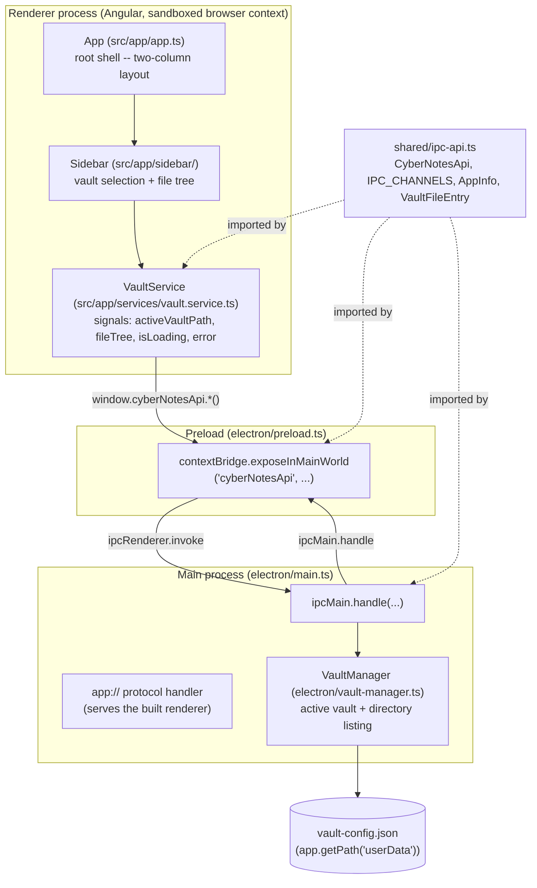

# 5. Building Block View

## 5.1 Whitebox Overall System (as of milestone 2)

Electron main process, Angular renderer, the IPC bridge between them, and
now vault selection + file listing. No editor or capture flow yet (those
land starting milestone 3 — see `CLAUDE.md`, "Build Order").



## 5.2 Folder Structure

```
electron/           Main process + preload (compiled to dist-electron/, CommonJS/Node16)
  main.ts           App lifecycle, window creation, IPC handlers, app:// protocol
  preload.ts        contextBridge exposure only -- no other logic
  vault-manager.ts  Active vault (persisted in userData), directory listing
  tsconfig.json      Node-targeted compile config, separate from the Angular one

src/                Angular renderer (standalone components, esbuild via Angular CLI)
  app/
    app.ts            Root component -- two-column shell (sidebar + main placeholder)
    services/
      vault.service.ts  Wraps cyberNotesApi's vault methods as signals; no logic beyond that
    sidebar/
      sidebar.ts        Vault selection + recursive file tree (milestone-2 slice only --
                         no calendar/tabs/settings yet, see CLAUDE.md "UI/UX Design")
  index.html
  main.ts             Angular bootstrap
  styles.css          Global dark-theme defaults

shared/             TypeScript interfaces crossing the IPC boundary. Imported by
                     both electron/ and src/ (two separate tsconfig compile
                     contexts -- see docs/09_architecture_decisions/0001-*.md).
  ipc-api.ts

docs/               This arc42 documentation
specs/              Binding concept/schema/classifier specs (not modified by the app build)
scripts/
  run-electron.js    Launcher that strips a leaked ELECTRON_RUN_AS_NODE before
                      spawning Electron (see inline comment for why)

.tools/node/        Portable, project-local Node.js runtime (gitignored)
env.ps1             Puts .tools/node on PATH for the current shell session
```

## 5.3 Renderer ↔ Main IPC

| Channel | Purpose |
|---|---|
| `app:get-info` | Milestone-1 smoke test for the IPC bridge (`AppInfo`) -- not itself a Phase-1 feature. |
| `vault:get-active` | Returns the persisted active vault path, or `null`. |
| `vault:select` | Opens the native folder picker; returns the resulting active vault path (unchanged if cancelled). |
| `vault:list-files` | Recursively lists the active vault's contents (`VaultFileEntry[]`); rejects if no vault is active or the folder is unreadable. |

Each follows the same pattern: a channel name + request/response types in
`shared/ipc-api.ts`, a handler in `electron/main.ts` (here delegating to
`VaultManager`), and an exposed method in `electron/preload.ts`. Real
channels for file read/write and classifier calls get added the same way
in later milestones.

## 5.4 Notable implementation decisions from this milestone

- **`app://` custom protocol instead of `file://`** for loading the built
  renderer in production. Angular's esbuild output is
  `<script type="module">`; Chromium refuses module-script loads under
  `file://` as a CORS violation, so the page would load with silently zero
  content. `protocol.handle('app', ...)` (registered as a privileged
  scheme before `app.whenReady()`) serves the built files from a normal
  origin instead. This is the same protocol-handler mechanism the roadmap
  already earmarks for safe local image rendering in Phase 3 — one
  pattern, reused later for a second purpose.
- **Preload is not sandboxed** (`sandbox: false`), while `contextIsolation`
  and `nodeIntegration: false` are on, as ADR-0001 commits to. A sandboxed
  preload's `require()` is restricted to a handful of Electron/Node
  built-ins and cannot load a project-local file like the compiled
  `shared/ipc-api.js` — it fails silently at runtime with no error
  surfaced anywhere obvious (`window.cyberNotesApi` just never appears).
  Tracked as technical debt in
  [11_risks_and_technical_debt.md](11_risks_and_technical_debt.md); revisit
  once preload has a bundling step that can inline `shared/` into one file.
- **Active-vault persistence is a hand-written JSON file in
  `app.getPath('userData')`**, not a package like `electron-store`. It's
  ~15 lines (`vault-manager.ts`'s `readConfig`/`writeConfig`) with full
  control over the failure modes that matter here (corrupt file → treat as
  unset, not crash; configured path that no longer exists → treat as
  unset for this session without touching the file, since the vault can
  live on removable/networked storage like OneDrive and may just not be
  mounted yet). This is app *settings*, not vault content -- doesn't
  conflict with "no database as source of truth" (`specs/roadmap.md`),
  which is about notes, not app configuration.
- **`listVaultFiles()` skips dotfiles/dotfolders** (`.git`, `.obsidian`,
  ...) unconditionally. Nothing in the Phase-1 spec needs them surfaced.
  Revisit if a future milestone needs to see them (unlikely).
