# 6. Runtime View

Sequence diagrams get added here one at a time, as each flow actually
lands — not speculatively up front.

## 6.1 Vault selection + file listing (milestone 2)

Two related flows: picking a vault, and loading (or reloading) its file
tree. Both go through the same `VaultService` → `contextBridge` →
`VaultManager` path described in
[05_building_block_view.md](05_building_block_view.md).

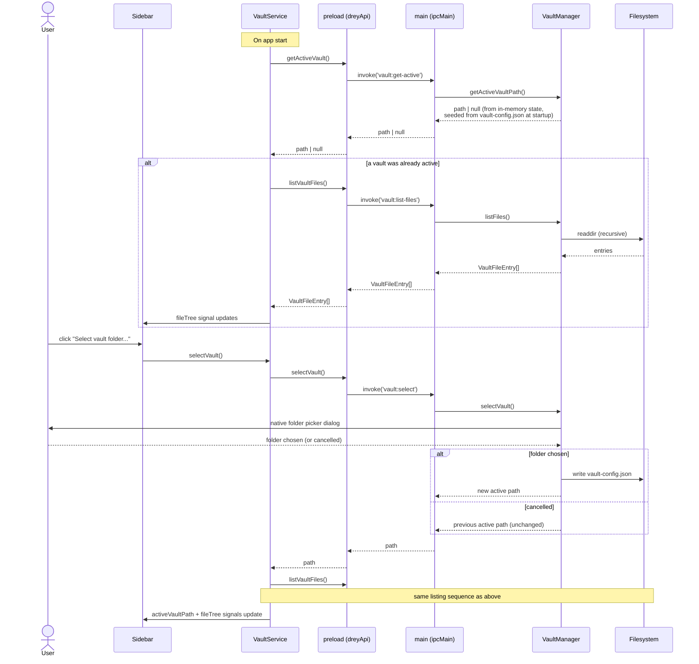

Deliberately out of scope for this milestone: reacting to _external_
changes to the vault folder while the app is running (chokidar file
watching, frontmatter-change vs. body-change vs. untracked-new-file
detection per CLAUDE.md's `FileWatcher` component). This flow is a
one-shot read, re-triggered manually by picking a vault or restarting the
app. Live watching becomes necessary once there's editor autosave to
conflict with it — deferred to whichever milestone builds that (see
[11_risks_and_technical_debt.md](11_risks_and_technical_debt.md),
"Autosave-vs-watcher conflict").

## 6.2 Open file → edit → save (milestone 3)

Clicking a file in the sidebar loads it into the editor; typing marks the
buffer dirty; Ctrl+S (or the Save button) writes it back. All document
state lives in `EditorService` signals — `Editor` owns only the
CodeMirror instance (source) and the markdown-it render (preview).

Since milestone 32, opening **replaces the view**: if the focused pane's
active tab is *clean*, it closes once the new file is open, so clicking
through the tree follows documents instead of accumulating tabs. A dirty
tab stays and the new file opens alongside; a registered plugin doc kind
(browser tab) is never the victim — its state is not behind the file.
Switching itself never prompts (the milestone-3 `confirm()` is long gone).

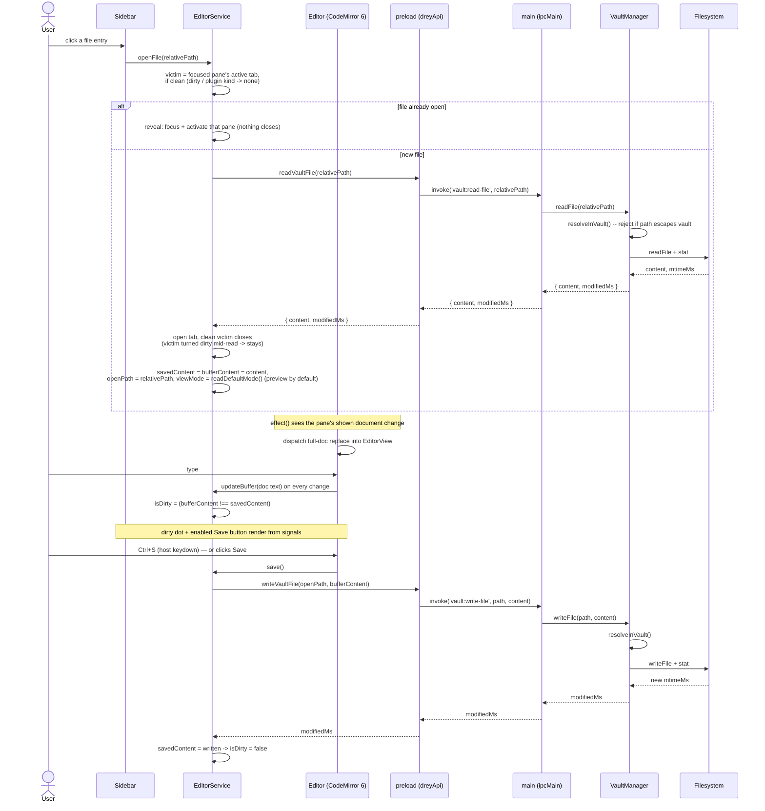

Deliberately out of scope for this milestone (unchanged from 6.1): no
reaction to _external_ changes while a file is open (file watcher), no
autosave, and no `updated:` frontmatter bump on save (deferred to
milestone 5 — needs YAML frontmatter handling; see
[05_building_block_view.md](05_building_block_view.md) §5.5).

## 6.3 Quick-capture → daily note (milestone 4)

The global hotkey raises the main window and opens today's daily note in
the editor, creating it from `templates/daily.md` if needed, then starting
a fresh `## HH:mm` entry. The note lives under the configured daily folder
(`AppConfig.daily.dir`, default `daily/`; `dailyPathFor` in
`shared/daily.ts`) — below, `<daily.dir>` stands for it. No popup — see
[05_building_block_view.md](05_building_block_view.md) §5.6 and
[ADR-0002](09_architecture_decisions/0002-quick-capture-opens-daily-note.md).

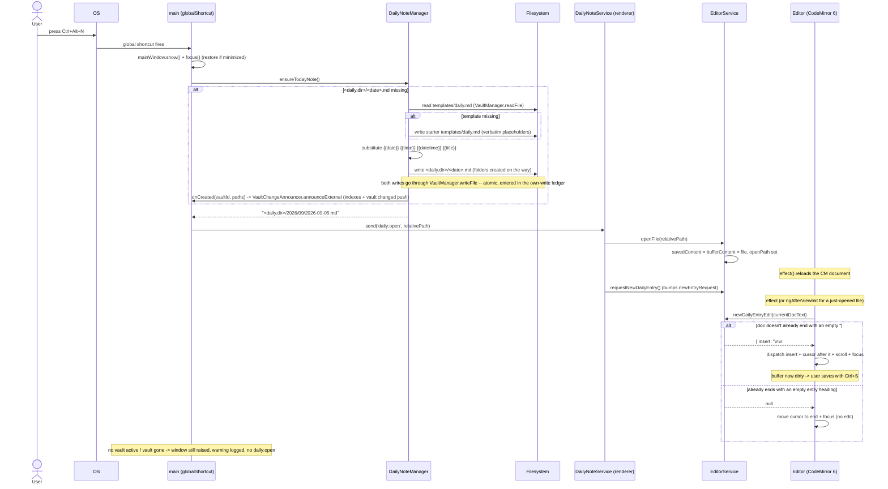

Out of scope for this milestone: inline `#tag` autocomplete and
deterministic routing (milestone 5), task/note classification (milestone
6), `updated:` frontmatter bump on save (milestone 5), and any reaction to
a daily note being changed on disk while open (file watcher, deferred).
Placeholder substitution is a fixed small set; template errors aren't
validated.

## 6.4 Mode switch + click-to-edit ([ADR-0008](09_architecture_decisions/0008-editor-mode-menu-and-rendered-preview.md), supersedes ADR-0004)

There is no auto-switch and no caret sync. `source` is CodeMirror; `preview`
is a read-only markdown-it render. The `⋯` menu flips `EditorService.viewMode`
(a per-tab field; `setViewMode` also persists `{ defaultMode }` to
`localStorage` as the landing mode for new notes). The one `EditorView` stays
mounted (`display:none` in preview) so undo history survives the switch.

A click anywhere in the preview drops to source at the clicked block's line:

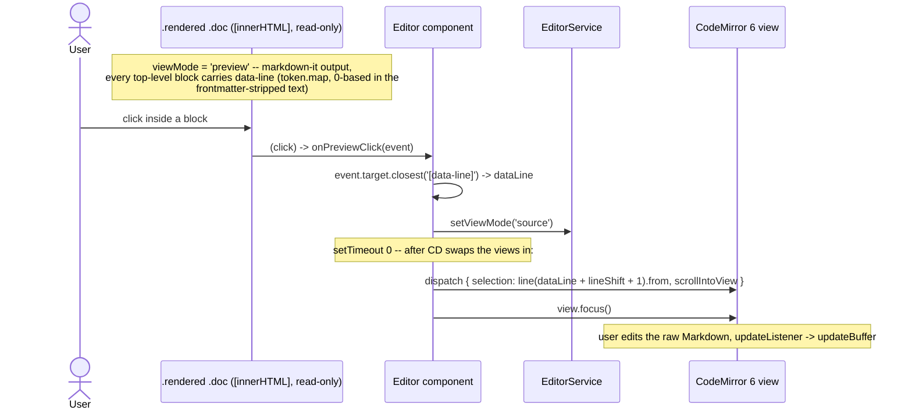

Line granularity only -- the caret lands at the start of the block's line,
not the exact character (the per-character `source-map.ts` mapping from
ADR-0004 is gone). A click that misses every `[data-line]` block still
switches to source, leaving the caret where it was.

> The read-only `preview` mode above is largely superseded by **Live
> Preview** ([ADR-0009](09_architecture_decisions/0009-live-preview-decorations.md)):
> one editable `EditorView` where a rendered table / diagram / image / HTML
> block is a `Decoration.replace` widget only while the selection is
> *outside* it. Reveal for edit = get the selection to touch the node:
> clicking the widget's corner **`</>` View source** button
> (`clickToReveal` → `view.dispatch({ selection: posAtDOM(widget) })`), or
> arrowing in. On reveal the raw lines gain a `.lp-reveal` rounded
> container, and an image additionally keeps a read-only `ImagePreviewWidget`
> rendered below its `` markup (Req-1). The widget/atomic layer
> and this reveal layer are one `StateField` value `{ atoms, reveal }`;
> only `atoms` feeds `EditorView.atomicRanges`.

## 6.5 Save → tag merge + `updated:` bump → route entries to master History (milestone 6)

> **Superseded by §6.11
> ([ADR-0017](09_architecture_decisions/0017-tags-as-labels-and-section-index.md)).**
> `note:save` no longer merges `#tag`s into the frontmatter and no longer
> routes entries into a master document. It bumps `updated:` on a fenced
> file, writes, and re-indexes that one file into `TagIndex`. The diagram
> below is kept for the record.

Saving a `.md` note no longer writes the buffer verbatim. `Ctrl+S` goes
through the main-process `note:save` pipeline (`NoteManager`), which:

1. parses the frontmatter, merges inline body `#tag`s into `tags`, bumps
   `updated:`, and writes the file **in place** (milestone 6a);
2. **routes** (milestone 6b): for every dated entry (`## HH:mm` block) that
   carries a known tag, appends a `### <date> <time>` copy of that entry to
   the tag's master-document `## History` — the source note keeps its copy,
   nothing moves. An HTML-comment marker
   (`<!-- drey:src <path>@<date> <time> -->`) on the heading line makes
   re-saves idempotent.

It returns the rewritten note text (the editor adopts it so the merged
frontmatter shows and the tab is clean) plus `appendedTo` — master paths
that gained a History entry; a clean open tab for one of those is reloaded
from disk. All decision logic is pure `shared/` code
([ADR-0007](09_architecture_decisions/0007-on-save-tag-pipeline.md)).

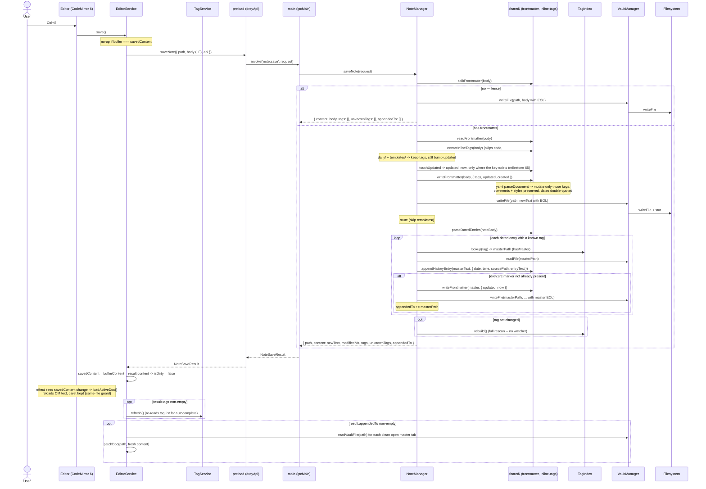

Not routed: files under `templates/`, entries with no known-tag / no
master, and an entry whose target master is the note being saved. A dirty
open master tab is **not** auto-reloaded (that conflict is the file
watcher's job, later).

## 6.6 Run an Action → shared confirmation → apply (Settings / Actions)

A manual Action from the editor `⋯` menu (or an `on-save` trigger from the
`note:save` pipeline) produces a proposed rewrite that goes through the one
confirmation dialog before it touches the document
([ADR-0011](09_architecture_decisions/0011-unified-confirmation-flow.md)).
The example is the (historical) built-in **Autotagging** action; user
templates follow the same shape, differing only in how `after` is
computed inside `ActionRunner`. _(Update — ADR-0017: "Autotagging" as a
document-rewriting Action is gone; tag suggestion is now the drawer's
`autotag` button, which only pre-fills a field — see §6.13. "Update
summary" is gone with master documents. The confirmation flow itself is
unchanged and still used by user templates and Ask edits.)_

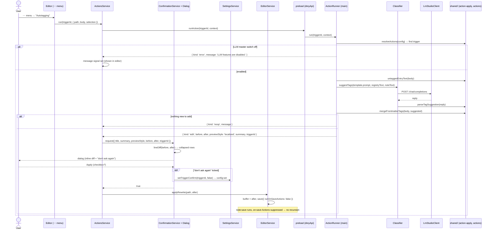

For an `on-save` trigger the entry point differs: `NoteManager` runs the
trigger after writing the file. A `confirm` trigger's `'edit'` outcome
rides back on `NoteSaveResult.pendingActions`; `EditorService` stores it
in a signal, and an `effect` in `ActionsService` drains the queue through
the exact `ConfirmationService` path above. A non-`confirm` trigger is
applied in the main process before the save result returns.

## 6.7 Assistant panel Ask (chat note + full-history replay, ADR-0048)

Milestone 25: the conversation lives in a **chat note** under `chats/`
(the source of truth), the panel went chat-first, and a follow-up
**replays the whole persisted history** — or resumes a provider session
(claude-code `--resume`) when the capability, the `session:` frontmatter
and an unchanged provider all line up. Tool calls/results and applied
edits persist as `drey-tool` entries inside the turn, which is what lets
the replay rebuild the provider loop exactly (the bug-10(b) resolution;
the old ~12-message cap and the `history` IPC field are gone). The
context chips still work as before: the open note rides along by default
with its live buffer, extra files are read at send time, and the note
chip off means an answer-only standalone chat.

Since ADR-0044 stage 7 the whole flow lives in the assistant plugin; the
renderer reaches the plugin main through the fixed `plugin:invoke` channel.

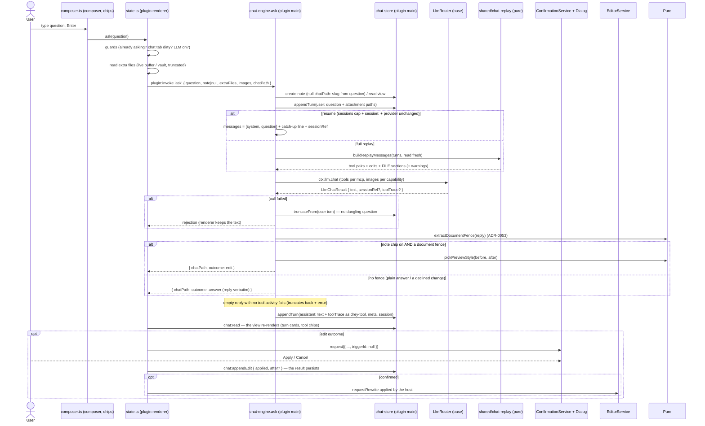

## 6.8 Opening a note: the automatic summary (Feature A)

> **Removed.** The automatic summary is gone — no summary generation on
> open, no sidecar reads/writes, no `thread:*`/`summarize` IPC
> ([ADR-0012](09_architecture_decisions/0012-note-assistant-sidecar-thread.md)
> superseded). The diagram below is kept only as history; today opening a
> tab touches nothing but the editor.

Opening a tab loads that note's sidecar thread and, under one specific
condition, generates its summary. The condition is deliberately narrow so
that re-opening a note never re-bills an LLM call:
[ADR-0012](09_architecture_decisions/0012-note-assistant-sidecar-thread.md).

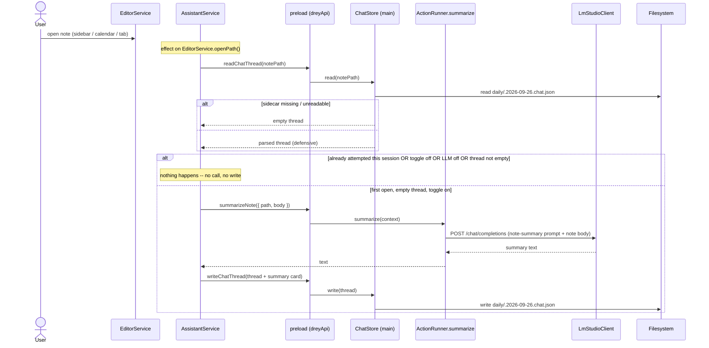

The panel's "Automatic summary" switch decides the `toggle on`
branch. It starts from `assistant.autoSummaryDefault` (Settings →
Assistant) and overrides it **for that note only** — switching it on
after the fact re-runs the same rule once; switching it off never writes
back to the global default.

## 6.9 Adding an entry from the drawer (Feature B)

"Add to document" composes the entry from pure shared code,
dispatches it into CodeMirror as an ordinary edit, and saves.

> **Update — ADR-0017.** `EntryDraft` is `{ topic, text, tags }` (no
> People/Meetings), the meta line is `#tag`-only, TOPIC is optional so
> there is no `'needs-topic-confirmation'` branch or `force` argument any
> more (`submit()` is now `'appended' | 'empty'`), and the save that
> follows just re-indexes the file (§6.11) — it does not route anything.
> The diagram's shape is otherwise current.

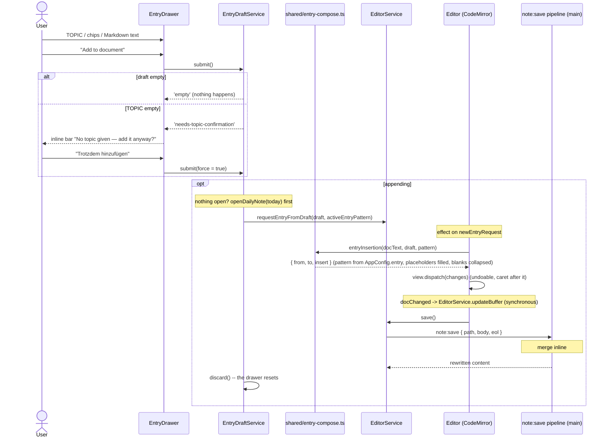

## 6.10 Inline spellcheck (Feature B)

Typing in either editing surface — the drawer body or the document —
triggers a debounced check whose answer arrives asynchronously. The
interesting part is the version guard that discards a reply the document
has already moved past
([ADR-0013](09_architecture_decisions/0013-inline-spellcheck.md)).
Since [ADR-0056](09_architecture_decisions/0056-spellcheck-language-autodetect.md)
the words are grouped by their paragraph's detected language and each
group is judged by its own dictionary; a block too short to detect, or in
a language without an installed dictionary, falls back to the configured
one.

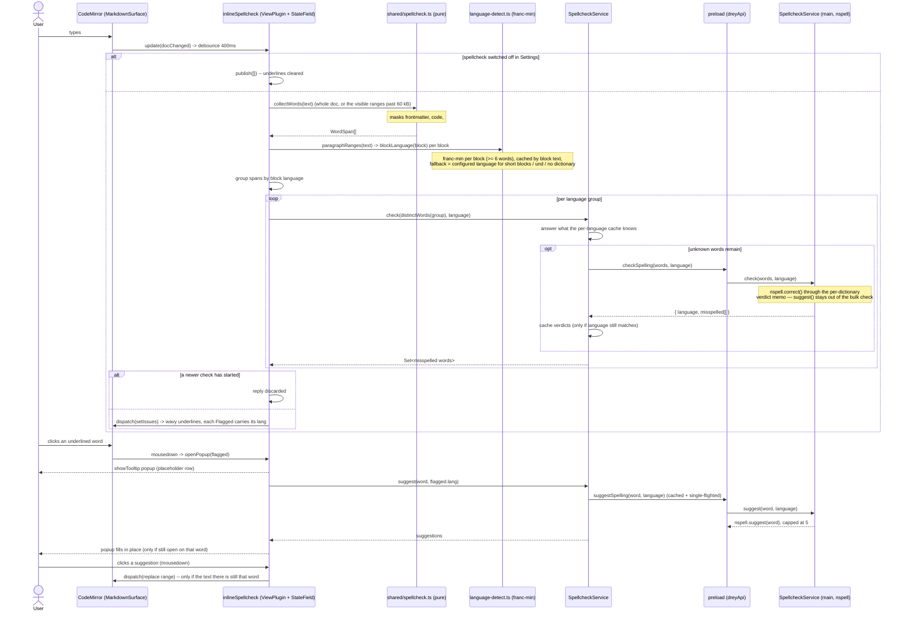

## 6.11 Save → `updated:` bump → incremental re-index (milestone 11, supersedes §6.5)

`Ctrl+S` on a `.md` note goes through `note:save` (`NoteManager`). On a
file with a `---` fence: bump `updated:`, fill `created:` if missing,
rewrite (the pure `shared/` `yaml` round-trip, EOL restored). No fence:
write the bytes verbatim. Either way, the just-written file is re-indexed
into `TagIndex`, and the `on-save` Actions run (§6.6). No `#tag`
frontmatter merge, no routing, no `appendedTo`.

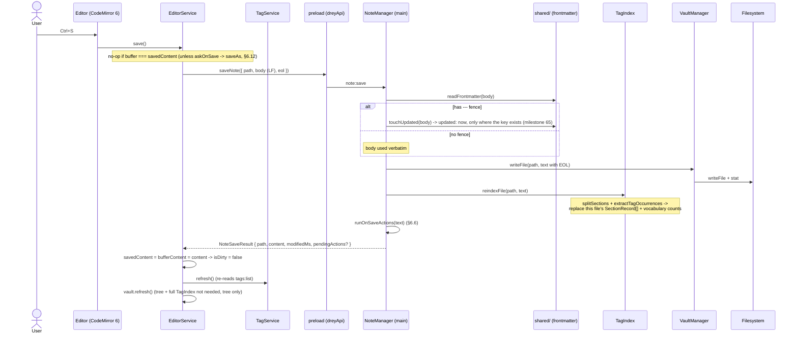

## 6.12 Tag search → hits → open-at-line / Export → Save-as (milestone 11)

The sidebar search panel (or a `Ctrl`/`Cmd`-click on a `#tag` pill, or
`Ctrl+Shift+F`) runs a fast, LLM-free query over `TagIndex`'s tagged
sections. A hit opens the file at its line; **Export** dumps the hits
into an unsaved `search-results.md` tab that `Ctrl+S` then routes through
Save-as.

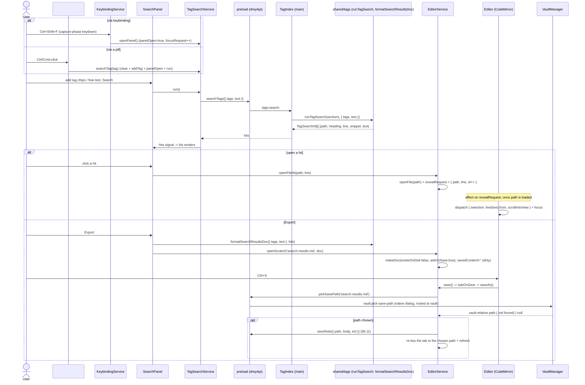

## 6.13 Autotag button → suggestTags → chips (milestone 11)

> _(Historical: the drawer and its Autotag button are gone since
> [ADR-0044](09_architecture_decisions/0044-runtime-plugin-system.md) /
> [ADR-0057](09_architecture_decisions/0057-ui-refinement-icon-chrome-anthrazit-and-slash-capture.md).
> Since milestone 45 (req-36) the flow lives in the editor `⋯` menu's
> **Suggest tags** row: the same `tags:suggest` call (`TagSuggester`), but
> the payload is the heading section under the caret
> (`shared/note-sections.ts`) and the reply is appended into that section
> directly — deduplicated, one undo step, saved — instead of pre-filling
> chips. The diagram below is the pre-plugin shape.)_

The drawer's **Autotag** button sends the current entry text plus the tag
vocabulary to the model; the reply pre-fills the tag chip row. Nothing is
saved — the user still confirms by adding the entry.

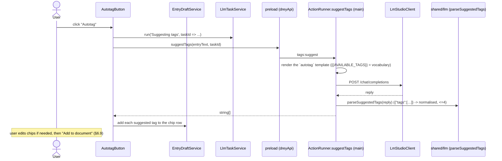

## 6.14 Drag a panel between docks → drop → persist (milestone 14)

`mousedown` on a panel header opens a *press* gesture in `DockService`. A
release before the pointer moves ~4px is a click → `toggleCollapse` (the
whole header is the collapse target; there is no separate chevron button).
Moving past the threshold promotes it to a drag: a `window` `mousemove`
recomputes the drop target/index every frame (the header reorders under the
pointer, so the listeners can't live on the element) and a small title chip
follows the cursor; `mouseup` applies the move and writes the layout.

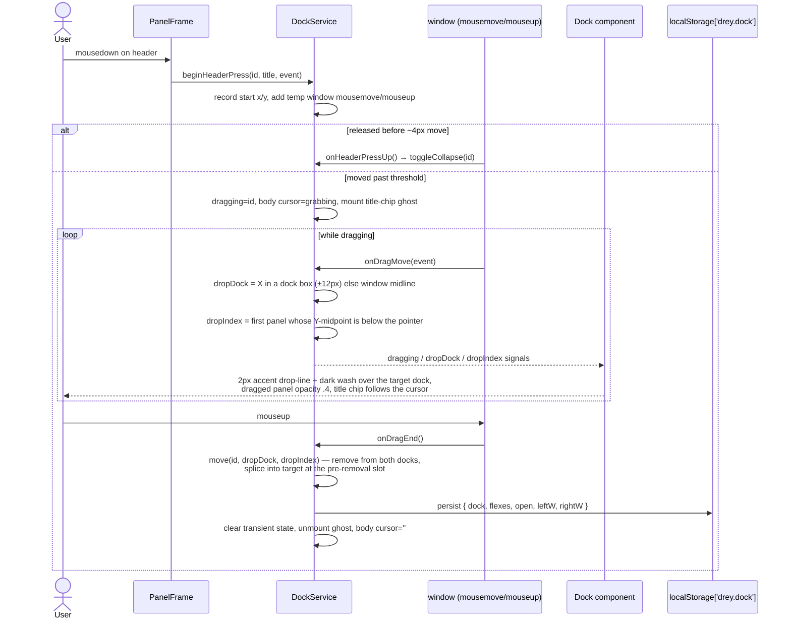

Splitters (`startSplit`, keeps the summed height of the two open
neighbours constant, min 40px each) and the dock-edge resizers
(`startDockResize`, clamp 180–560px) use pointer capture instead and
write the same `drey.dock` blob. `View → Reset layout` is
`DockService.reset()`.

### View menu → hide / show a whole widget (ADR-0034)

The View menu rows are generated from `WIDGETS.filter(w => w.removable)`.
A row's check mark tracks `!DockService.isHidden(id)`; clicking it calls
`hide(id)` or `show(id)` — distinct from collapsing to the header.

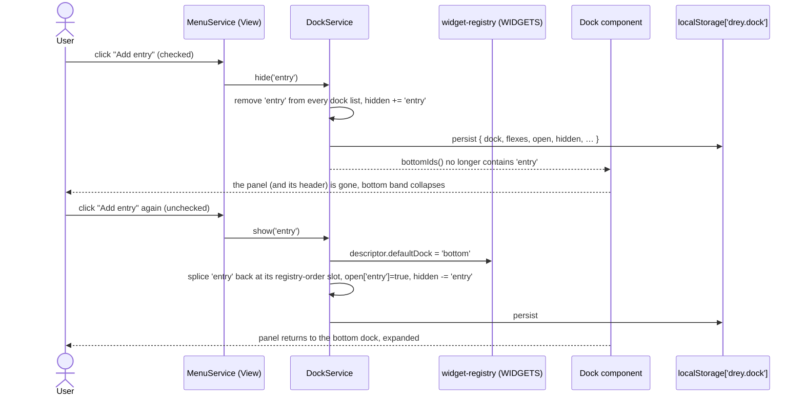

`DockService.move()` (drag) and `openAndExpand()` (a command that reveals a
widget, e.g. `search.open`) also drop the id from `hidden`, so dragging a
hidden widget back or invoking its command un-hides it. `reset()` clears
`hidden` entirely.

## 6.15 Titlebar menu action → command (milestone 14)

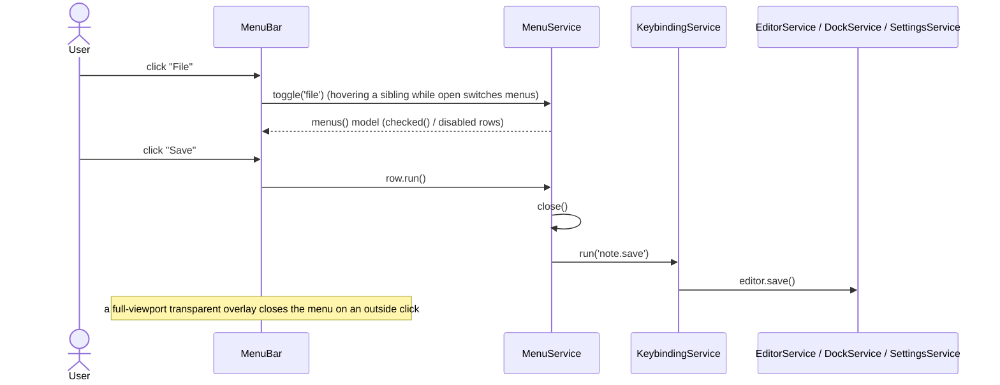

Wired rows: File → New note (`note.new`), Switch vault … (`vault.selectVault`

- `dock.openAndExpand('files')`), Save / Save all (`note.save` /
  `note.saveAll`), Settings (`settings.openScreen`); Edit → Search all notes
  (`search.open` + `dock.openAndExpand('search')`); View → Line numbers
  (`editor.toggleLineNumbers`), one collapse toggle per panel
  (`dock.toggleCollapse`), Reset layout (`dock.reset`). Everything else is a
  disabled placeholder.

## 6.16 MCP client `vault_write` → confirm diff → apply (ADR-0021)

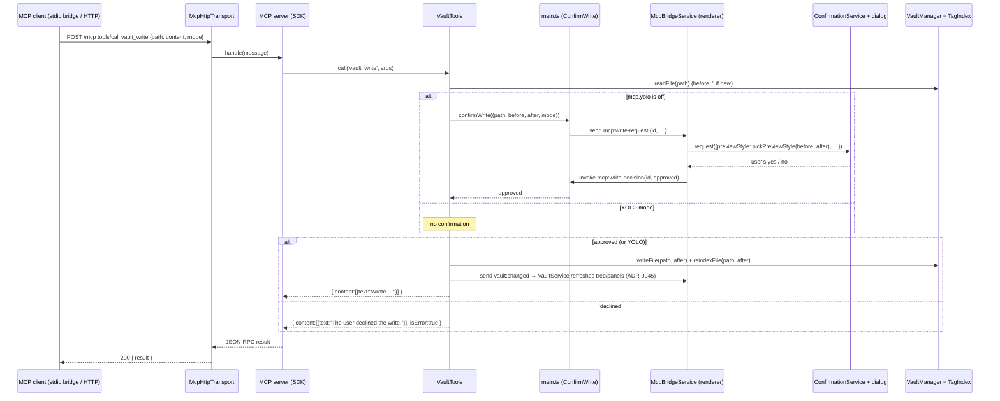

The built-in assistant takes the in-process path instead:
`ActionRunner.ask` passes `VaultTools.openAiToolSpec()` +
`runVaultTool` into `LmStudioClient.chat`, whose tool-calling loop invokes
`VaultTools.call` directly (same `ConfirmWrite` gate) between model
rounds; since ADR-0053 the final message is plain prose, or a
`document` fence when the note was changed.

## 6.17 Paste / drop an image → save into `attachments/` → render ([ADR-0024](09_architecture_decisions/0024-binary-vault-asset-write.md))

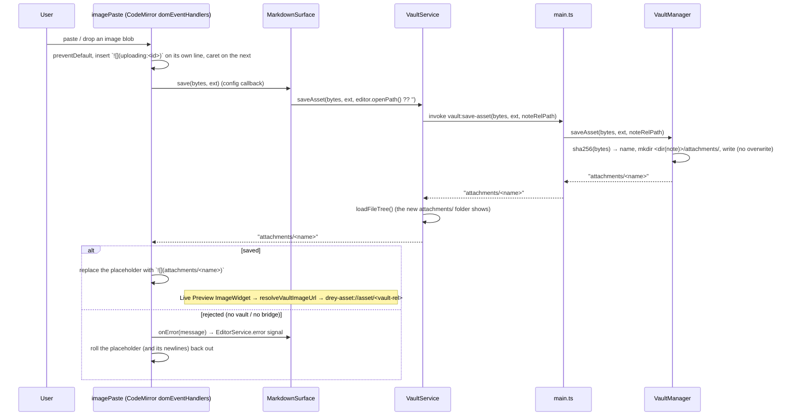

## 6.18 Startup → open today's daily note (ADR-0029)

`App`'s one-shot effect opens today's note as an unsaved draft once the
vault path and the persisted config are both known. Reuses the §6.3
`openDailyNote` path (draft tab, no disk write).

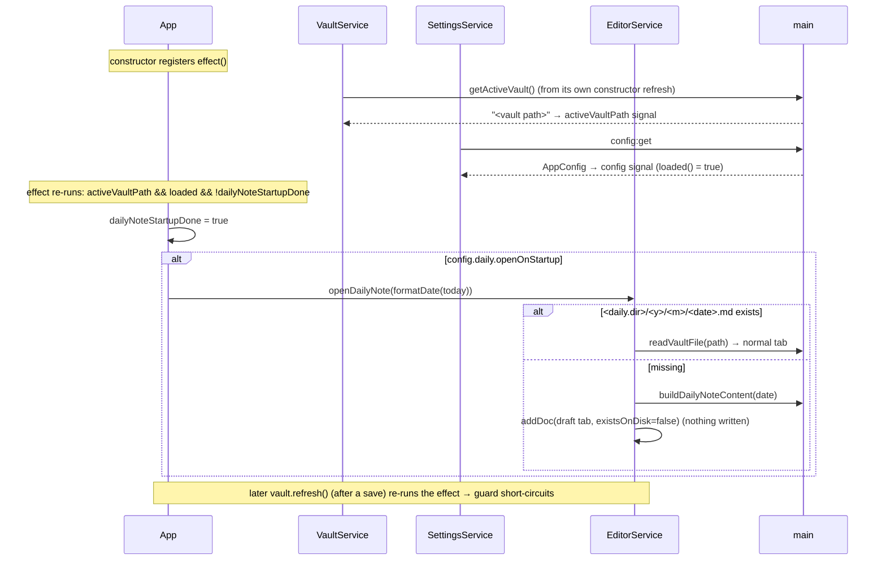

## 6.19 Insert a template (ADR-0029)

Panel click / `Mod+T` picker / editor context menu / drag all funnel to
`TemplateLibraryService.insert()`. The drag path keeps the drop coordinate;
the others insert at the caret.

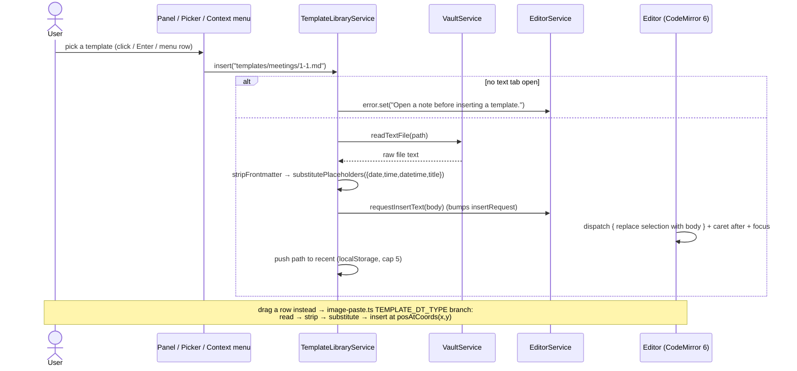

## 6.20 Files panel: copy / paste / duplicate / rename / delete (ADR-0018 refresh model; delete → recycle bin since milestone 52)

Context-menu rows on the file tree. "Copy" only stashes a `{ path, name }`
on `VaultService.clipboard`; the fs work happens on "Paste" / "Duplicate" /
"Rename". Each mutating IPC handler rebuilds the tag index (same reason as
`vault:delete` — a `.md` file can move in or out of scope), and the
renderer reloads the tree. A rename also re-points open tabs.

**Delete goes to the OS recycle bin (milestone 52).** After the confirm
dialog, `vault:delete(-many)` moves the target — and a `.md` note's
`.{name}.chat.json` sidecar — via `shell.trashItem`
(`electron/trash-delete.ts`, injected IO). A volume without a recycle bin
(network share, some removable drives) falls back to the permanent
`fsp.rm`; the IPC then resolves to the fallback paths and the Files panel
messages the user. `{ trash: false }` keeps move-semantics callers
permanent (Save-as out of `.drafts/`), and the cross-vault move's delete
leg inside `renameEntry` keeps its plain `rm` — the content already lives
at the target, a bin copy would only litter.

```mermaid
sequenceDiagram
    actor User
    participant Panel as FilesPanel
    participant VaultService
    participant EditorService
    participant IPC as main.ts handler
    participant VM as VaultManager
    participant Idx as TagIndex

    User->>Panel: right-click entry → Copy
    Panel->>VaultService: clipboard.set({ path, name })
    User->>Panel: right-click folder → Paste
    Panel->>VaultService: copyEntry(src, destDir)
    VaultService->>IPC: vault:copy-entry
    IPC->>VM: copyEntry(src, destDir)
    VM->>VM: resolveInVault(both) · fsp.cp(recursive) · uniqueCopyName on clash · copy .md sidecar
    IPC->>Idx: rebuild()
    VaultService->>VaultService: loadFileTree()

    Note over User,Idx: Rename: prompt-less inline input → renameEntry(from,to)<br/>→ VM.fsp.rename (+ sidecar) → Idx.rebuild → loadFileTree<br/>→ EditorService.retargetTabs(from,to) keeps unsaved buffers
```

**Drag & drop within the tree (req-23, ADR-0039 later change):** the same
`renameEntry` round, triggered by an HTML5 drag inside the panel instead
of the context menu. Folder rows are draggable too; a folder carries no
`application/x-drey-vault-path` (a pane must not open a folder), so the
dragged entry rides a component signal the row handlers read.
`dragover` on a row prevents default only when the move is valid (not a
same-folder no-op, not a folder into its own subtree — the main process
guards the latter as well), which drives the native no-drop cursor; drop
destinations are the folder row (into it), a file row (its parent) and
the tree background (vault root). The commit is exactly the rename
sequence above: `renameEntry` → `retargetTabs` → clipboard remap → expand
destination → tree reload.

## 6.21 Tasks panel: list + tick a task ([ADR-0033](09_architecture_decisions/0033-tasks-panel-and-index.md))

> _(Since [ADR-0044](09_architecture_decisions/0044-runtime-plugin-system.md)
> stage 6 this flow runs in `plugins/tasks/` — panel widget + main-side
> index over the plugin bridge — instead of `TaskService` /
> `EditorService.setTaskDone`; the shape below is unchanged.)_

The panel shows `TaskService.visible()`. In **document** scope that is
`scanTasks` over the live editor buffer, so it tracks unsaved edits with no
IPC. In **vault** scope it is `listTasks()` from the main-process
`TaskIndex`, refreshed on construct / after each save / on
`vault:changed` (ADR-0045). Ticking a row toggles the source line and saves;
the line is re-resolved against the *current* content at tick time, and
when duplicate task texts make that resolution ambiguous the toggle is
skipped — a safe no-op, never a guess at the wrong twin
(ADR-0033, "considered and rejected").

```mermaid
sequenceDiagram
    actor User
    participant Panel as TasksPanel
    participant Svc as TaskService
    participant Ed as EditorService
    participant IPC as main.ts handler
    participant NM as NoteManager
    participant TI as TaskIndex

    Note over Panel,Svc: document scope — no IPC
    User->>Panel: open panel / edit a "- [ ]" line in the editor
    Panel->>Svc: visible() = scanTasks(openPath, bufferContent())

    Note over Panel,TI: vault scope
    Svc->>IPC: tasks:list
    IPC->>TI: all()
    TI-->>Svc: TaskRecord[]

    User->>Panel: tick a row's checkbox
    Panel->>Svc: toggle(task)
    Svc->>Ed: setTaskDone(path, line, !done)
    alt file is an open text tab
        Ed->>Ed: setDoneOnLine(buffer) · patchDoc · save()
    else not open
        Ed->>IPC: vault:read-file → setDoneOnLine → note:save
    end
    IPC->>NM: saveNote(...)
    NM->>TI: reindexFile(path, written)
    Svc->>Svc: refresh() → tasks:list
    User->>Panel: click a row body
    Panel->>Ed: openFileAt(path, line)
```

## 6.22 Open a web tab, navigate, and yield to an overlay (ADR-0042)

> _(Since [ADR-0044](09_architecture_decisions/0044-runtime-plugin-system.md)
> stage 8B the browser is the `plugins/browser/` plugin: the
> `WebContentsView` lives in the plugin's main entry, the chrome is a
> plugin-contributed `browser` doc kind, and the view↔chrome traffic runs
> over the generic plugin bridge (`backend.invoke` / `backend.on`) instead
> of the old dedicated `browser:*` channels. The flow below is unchanged
> in shape; §6.26 shows the transport it now rides.)_

`File -> New browser tab` / `Ctrl+Shift+B` opens a `browser://<n>` tab. The
page is a main-process `WebContentsView`; the renderer holds only the
chrome and streams the placeholder rect as the view's bounds. While any
Angular overlay is open the view is hidden so it cannot paint over it.

```mermaid
sequenceDiagram
    actor User
    participant Menu as MenuService / keybinding
    participant BVS as BrowserViewService
    participant Ed as EditorService
    participant Tab as BrowserTab
    participant IPC as browser-handlers
    participant Mgr as BrowserViewManager
    participant WCV as WebContentsView
    participant Guard as OverlayGuardService

    User->>Menu: New browser tab
    Menu->>BVS: openTab()
    BVS->>Ed: addBrowserDoc("browser://1", "New tab")
    Ed-->>Tab: PaneLeaf renders <app-browser-tab> for kind:'browser'
    BVS->>IPC: browser:create { tabId, url: "about:blank" }
    IPC->>Mgr: create()
    Mgr->>WCV: new WebContentsView(persist:webtab) · addChildView · loadURL

    Tab->>BVS: setBounds(rect)  (ResizeObserver + rAF)
    BVS->>IPC: browser:set-bounds
    IPC->>Mgr: setBounds() → rect × getZoomFactor(), clamp
    Mgr->>WCV: setBounds(...)

    User->>Tab: type "example.com" ↵
    Tab->>BVS: navigate(tabId, "example.com")
    BVS->>IPC: browser:navigate { url: "https://example.com" }
    IPC->>Mgr: navigate() → WCV.loadURL
    WCV-->>Mgr: did-navigate / page-title-updated / page-favicon-updated
    Mgr-->>BVS: browser:event (push)
    BVS->>BVS: reduce() → BrowserTabState
    BVS->>Ed: setBrowserMeta(tabId, { name, favicon, url })
    Ed-->>Tab: TabBar shows favicon + title StatusBar shows URL

    User->>Guard: opens a dialog / Settings / a menu ([appOverlayGuard])
    Guard->>BVS: suppressed() = true
    BVS->>IPC: browser:set-visible { visible: false } (every tab)
    IPC->>Mgr: setVisible(false) → WCV.setVisible(false)
    User->>Guard: closes it
    Guard->>Tab: suppressed() = false → effect re-runs
    Tab->>BVS: setVisible(true) + measure()

    User->>Tab: close the tab (X)
    Tab->>Ed: closeTab("browser://1")
    Ed-->>BVS: openDocs() effect: key gone
    BVS->>IPC: browser:destroy
    IPC->>Mgr: destroy() → removeChildView + webContents.close()
```


## 6.23 Restore the previous session on launch (ADR-0043)

```mermaid
sequenceDiagram
    actor User
    participant App as App (startup effect)
    participant Sess as SessionService
    participant LS as localStorage['drey.session']
    participant IPC as session-handlers
    participant Store as SessionBackupStore
    participant Ed as EditorService
    participant BVS as BrowserViewService
    participant Panes as PaneService

    App->>Sess: restore()  (vault + config ready)
    Sess->>LS: getItem -> SessionSnapshot
    alt no session / other vault / corrupt
        Sess-->>App: false  -> App opens today's daily note
    else
        loop each tab
            alt browser
                Sess->>BVS: restoreTab("browser://n", url)
            else text with backupId
                Sess->>IPC: session:read-backup(id)
                IPC->>Store: read(id)
                Store-->>Sess: buffer text
                alt onDisk
                    Sess->>Ed: openFile(path) then updateBuffer(backup)
                else scratch
                    Sess->>Ed: openScratch(path, backup)
                end
            else clean disk file / image
                Sess->>Ed: openFile(path)
            end
        end
        Sess->>Panes: restore(layout, keepPath = restored)
        Panes-->>Sess: prune dropped tabs + empty panes
        Sess-->>App: true  -> daily-note fallback skipped
        Sess->>IPC: session:list-backups -> delete orphans
    end

    Note over Sess: thereafter, one debounced effect writes<br/>drey.session (400ms) + backups (700ms),<br/>beforeunload / visibilitychange flush
```

## 6.24 Drag an `.ics` / `.msg` onto the editor → meeting section ([ADR-0041](09_architecture_decisions/0041-calendar-file-drop-meeting-section.md))

```mermaid
sequenceDiagram
    participant User
    participant CM as imagePaste (CodeMirror domEventHandlers)
    participant MS as MeetingService
    participant Main as meeting:decode handler
    participant Imp as MeetingImporter
    participant Dec as ics-decode / msg-decode
    participant Tpl as templates/meeting.md
    participant Render as renderMeetingSection (shared/meeting)

    User->>CM: drop invite.ics / invite.msg on .cm-content
    CM->>CM: meetingFile(dataTransfer) matches → preventDefault, set caret to drop coord
    CM->>MS: decodeMeeting(new Uint8Array(await file.arrayBuffer()), file.name)
    MS->>Main: invoke meeting:decode(bytes, filename)
    Main->>Imp: decode(bytes, filename)
    Imp->>Dec: sniff (ext → BEGIN:VCALENDAR → OLE2 magic) → parse
    Dec->>Dec: ical.js: register embedded VTIMEZONE → DTSTART/DTEND .toJSDate() local
    Dec-->>Imp: ParsedMeeting  (or throw "not a calendar invite" / "no event")
    Imp->>Tpl: read templates/meeting.md (scaffold STARTER_MEETING_TEMPLATE on first use)
    Imp->>Render: renderMeetingSection(meeting, template)
    Render->>Render: slugifyMeetingTitle, meetingWhen, renderTemplate ({{#if}}/{{#each}})
    Render-->>Imp: "## 📅 <title>\n#mtg/<slug>\n…"
    Imp-->>Main: section markdown
    Main-->>MS: section markdown
    MS-->>CM: section markdown
    alt decoded
        CM->>CM: sectionInsert() at the drop coord (blank line padded), tab goes dirty
        Note over User: user saves with Ctrl+S, save → re-index picks up #mtg/<slug>
    else rejected
        CM->>CM: config.onError(message) → EditorService.error signal
    end
```

The **File → Import meeting …** menu row runs the same decode via
`meeting:import` (native picker in main) and inserts through
`EditorService.requestInsertText` — the fallback for an Outlook calendar
drag that delivers no real `File`.

## 6.25 Plugin discovery + activation ([ADR-0044](09_architecture_decisions/0044-runtime-plugin-system.md))

Before the window and long before Angular bootstraps, the main process
scans the plugin roots; the renderer activates inside
`provideAppInitializer`, so every registry is complete before the shell,
menus or session restore read them. Since milestone 31, plugin
**activation itself is fast**: the tags/tasks indexes no longer await a
full-vault scan inside `activate` — the registry-level refresh round
that follows activation triggers one background build per index, and
each finished sweep pushes `index-updated` over the plugin bridge so the
panels re-pull (SDK minor 7 added `ctx.vault.listMarkdownFiles` for the
walk).

```mermaid
sequenceDiagram
    participant Main as main.ts
    participant Disc as plugin-discovery
    participant HostM as plugin-host (main)
    participant HostR as PluginHostService
    participant Mod as plugin renderer module

    Main->>Disc: discover(roots, pluginsConfig)
    Note over Disc: roots: dist-electron/plugins/<id> (built-ins),<br/><userData>/plugins/*, DREY_EXTRA_PLUGIN_DIR
    Disc->>Disc: read plugin.json -> validateManifest<br/>(id ^[a-z][a-z0-9-]{1,63}$, apiVersion)
    Note over Disc: invalid manifest -> skip + log,<br/>built-in wins an id collision
    Disc->>Disc: disabled id -> status 'disabled',<br/>apiVersion major mismatch -> 'incompatible'
    Disc-->>Main: DiscoveredPlugin[]
    loop each active plugin with a main entry
        Main->>HostM: activate(plugin)
        HostM->>HostM: await import(pathToFileURL(entry)) -> mod.default
        HostM->>HostM: activate(ctx) -- ctx.app/vault/llm/ipc/save/search...
        alt activate throws
            Note over HostM: status 'failed', logged, app continues
        end
    end
    Main->>HostM: rendererRootFor(id) -- for the plugin:// scheme
    Note over Main: window created -> notifyMainWindowCreated<br/>(plugins bind BrowserWindows / views now)
    HostR->>HostR: provideAppInitializer -> loadAll() -- gates bootstrap
    HostR->>Main: pluginList()
    Main-->>HostR: PluginDescriptorForRenderer[]
    HostR->>HostR: plugins.set(descriptors) -- Settings reads these
    loop each descriptor with status 'active' + rendererUrl
        HostR->>Mod: import('plugin://<id>/renderer/index.js')
        HostR->>Mod: activate(api) -- registers widgets/pages/kinds/extensions
        alt activate throws
            Note over HostR: quarantine: run disposables,<br/>status 'failed' + error (Settings shows it)
        end
        HostR->>HostR: injectStyles(descriptor) -- css list over plugin://
    end
    Note over HostR: loaded.set(true)
    Note over Main: Angular bootstraps NOW -- DockService.defaultState(),<br/>the View menu and session restore see complete registries
```

## 6.26 Plugin IPC: `backend.invoke` roundtrip + `backend.on` push ([ADR-0044](09_architecture_decisions/0044-runtime-plugin-system.md))

Two **fixed** channels serve every plugin — the hand-written preload can
only expose those, so per-plugin traffic is namespaced in the payload,
not in the channel name.

```mermaid
sequenceDiagram
    participant PR as plugin renderer code
    participant API as api.backend
    participant Pre as preload (dreyApi)
    participant R as ipcMain 'plugin:invoke'
    participant PM as plugin main handler

    PR->>API: invoke('tasks:list', { scope: 'vault' })
    API->>Pre: pluginInvoke({ pluginId, method, payload })
    Pre->>R: ipcRenderer.invoke('plugin:invoke', payload)
    R->>R: pluginId matches the id pattern?<br/>method registered by THAT plugin?
    alt unknown plugin or method
        R-->>API: rejection (stringified error)
    else registered
        R->>PM: fn(payload)
        PM-->>R: result
        R-->>Pre: result (structured clone)
        Pre-->>API: resolves
        API-->>PR: Promise<TaskEntry[]>
    end

    note over PM,PR: Main -> renderer push (one channel, fanned out per plugin):
    PM->>R: ctx.ipc.emit('event', browserEvent)
    R->>Pre: webContents.send('plugin:event', { pluginId, event, data })
    Pre->>API: pluginOnEvent listener
    API->>API: PluginHostService: single subscription -><br/>that plugin's backendListeners.get(event) fan-out
    API-->>PR: listener(data)
```

Errors cross the bridge as **strings** (a structured clone cannot carry
an `Error`), and every plugin callback the host invokes is wrapped in
try/catch so a throwing plugin quarantines instead of breaking the app.

## 6.27 Editor extension registration + reconfigure ([ADR-0044](09_architecture_decisions/0044-runtime-plugin-system.md))

Plugins never build CodeMirror extensions from their own `@codemirror`
copies — they compose from the **host's** module instances
(`api.editor.cm`) and register factories; the surface reconfigures a
Compartment when the registry changes.

```mermaid
sequenceDiagram
    participant TP as plugins/tags renderer
    participant Reg as EditorExtensionRegistry
    participant MS as MarkdownSurface
    participant CM as CodeMirror EditorView

    TP->>TP: const { state, view, ... } = api.editor.cm (host instances)
    TP->>Reg: registerExtension('document', (ctx) => tagExtensions(ctx))
    Reg-->>TP: Unsubscribe
    Note over Reg: revision bump
    MS->>Reg: extensions signal re-reads on revision
    MS->>MS: pluginCompartment.reconfigure([factory(ctx), ...])
    MS->>CM: dispatch effects -- tag pills + completion live on the surface
    Note over MS,CM: A factory runs per reconfigure with the host's CM module<br/>instances -- a plugin's own copy would break facets silently,<br/>so plugins/ is lint-banned from runtime @codemirror imports.
    TP->>Reg: unsubscribe() -- registry bumps, surface reconfigures clean
```

The same pattern drives the other editor seams: a drop decoder is
consulted by the base paste/drop pipeline *before* the base file/image
branches, and context-menu items / menu rows append to their menus.

## 6.28 Save → save-hook chain → pending Actions (plugin era, extends §6.11)

`NoteManager` keeps the frontmatter bump + write; every feature indexes
(or acts) through the async **save-hook registry**. The `applyingAction`
short-circuit keeps a rewrite-applying save from re-firing hooks.

```mermaid
sequenceDiagram
    participant Ed as EditorService
    participant NM as NoteManager
    participant HK as plugin-host (main) saveHooks
    participant TP as tags plugin hook
    participant TK as tasks plugin hook
    participant AP as assistant plugin hook
    participant HR as PluginHostService (renderer)

    Ed->>NM: note:save { path, body, eol }
    NM->>NM: frontmatter bump (updated:) + write
    NM->>HK: emitNoteSaved({ path, content, ... })
    Note over HK: event.applyingAction? -> return [] (no recursion)
    par tags
        HK->>TP: await hook(event)
        TP-->>HK: TagIndex.reindexFile(path)
    and tasks
        HK->>TK: await hook(event)
        TK-->>HK: TaskIndex.reindexFile(path)
    and on-save Actions
        HK->>AP: await hook(event)
        AP->>AP: LLM edit (if configured) -> confirmed rewrite
        AP-->>HK: { content, pendingActions } (or void)
    end
    HK-->>NM: SaveHookResult[]
    NM-->>Ed: NoteSaveResult { content, modifiedMs, pendingActions? }
    Ed->>Ed: adopt returned content, queue pendingActions
    Ed->>HR: emitDocumentEvent('pending-actions')
    HR->>HR: handlePluginEvent -> drains into the owner plugin
    Note over AP,Ed: each pending Action -> documents.requestRewrite -><br/>ConfirmationDialog -> applyRewrite -> save(applyingAction)
```

A throwing hook is logged and skipped — one plugin's failure must not
lose the user's save.

## 6.29 Session restore with a plugin doc kind ([ADR-0044](09_architecture_decisions/0044-runtime-plugin-system.md), ADR-0043)

A plugin tab persists as the generic `{ path, kind, data }` session
member; the kind's owner recreates it from the payload. Because plugin
activation gates bootstrap (§6.25), every kind is registered *before*
`App` runs `SessionService.restore()`.

```mermaid
sequenceDiagram
    participant App as App (startup effect)
    participant SS as SessionService
    participant DK as DocKindRegistry
    participant BP as plugins/browser renderer
    participant Ed as EditorService

    App->>SS: restore() -- after plugins loaded, once vault + config known
    SS->>Main: session:read-backup
    Main-->>SS: SessionState { vaultPath, tabs: SessionTab[] }
    loop each tab
        alt kind 'image'
            SS->>Ed: openFile(path)
        else kind 'text'
            SS->>Ed: openFile(path) (+ line/pane placement)
        else plugin kind (e.g. 'browser')
            SS->>DK: get('browser')
            alt not registered (plugin disabled since)
                Note over SS: tab dropped silently
            else registered
                DK-->>SS: contrib.restore
                SS->>BP: restore(path, data) -- data = { url }
                BP->>BP: store.restoreTab(path, url) -> new browser://<n> key
                BP->>Ed: documents.addDoc('browser', key, 'New tab')
                Note over SS: legacy snapshots carried the payload at the<br/>top level -- handed to the kind as-is
            end
        end
    end
    SS-->>App: restoredAny -- false lets the daily-note fallback run
```

## 6.30 Close/quit with dirty documents — the exit confirm bridge (bug-5)

Every close path funnels into one `BrowserWindow 'close'` interception.
Main holds the window and asks the renderer — which owns the dirty-document
registry — over `exit:confirm-request` / `exit:decision` (`ExitBridge`, no
timeout: a hung renderer keeps the window open, and the ADR-0043 backups
have the buffer text regardless). An app-level quit (`before-quit`: taskbar
"Quit", Cmd+Q) is routed through the same prompt via the `quitIntent` flag;
the `!mainWindow` clause keeps the post-approved quit cascade from
re-intercepting. An untitled scratch tab saves into the hidden
`.drafts/` (§5.3 `draft:save`) instead of a Save-As dialog, and on-save
Actions are suppressed on this path — no LLM round trips during shutdown.

The request is **readiness-gated** (`exit:listener-ready`): `wc.send` is
fire-and-forget, so a close racing the renderer's bootstrap — the window is
closable within the first second, before the app UI registered its exit
listener — would lose the request and leave the window permanently
unclosable. The preload reports readiness exactly when the listener exists
(`ExitConfirmService.start()` → `onExitConfirmRequest` registration), and
requests raised before that are held by the bridge and delivered on
readiness.

```mermaid
sequenceDiagram
    participant User
    participant Main as main (BrowserWindow 'close')
    participant EB as ExitBridge
    participant XC as ExitConfirmService
    participant Ed as EditorService
    participant SS as SessionService

    Note over XC: at app bootstrap:<br/>onExitConfirmRequest registration fires<br/>exit:listener-ready -> EB.rendererReady = true
    User->>Main: close intent (X / Alt+F4 / taskbar Quit)
    Main->>Main: exitApproved? no -> event.preventDefault()
    Main->>EB: requestDecision()
    alt renderer not ready yet (close raced bootstrap)
        Note over EB: request held, delivered on exit:listener-ready
    end
    EB->>XC: exit:confirm-request { id }
    alt no dirty text documents
        XC->>EB: exit:decision 'discard' (no dialog)
    else dirty documents
        XC->>User: dialog (Save all / Exit without saving / Cancel)
        alt Save all
            XC->>Ed: saveAll({ drafts: true, runOnSaveActions: false })
            Note over Ed: real files via note:save,<br/>scratch tabs via draft:save -> .drafts/unnamed-N.md
            alt still dirty afterwards (a save failed)
                XC->>EB: 'cancel' -- the app stays open
            else clean
                XC->>SS: flushNow() (layout + backup writes, awaited)
                XC->>EB: 'save'
            end
        else Exit without saving
            XC->>SS: flushNow()
            XC->>EB: 'discard'
        else Cancel
            XC->>EB: 'cancel'
        end
    end
    EB-->>Main: decision
    alt cancel
        Main->>User: window stays open (quitIntent reset)
    else save / discard
        Main->>Main: exitApproved = true, window.close()
        Note over Main: non-darwin quits via window-all-closed,<br/>darwin finishes an app-level quit via quitIntent
    end
```

## 6.31 External vault change → watcher round → clean-tab reload ([ADR-0045](09_architecture_decisions/0045-optional-vault-file-watcher.md))

The watcher is off by default (Settings → Vault). When on, chokidar
events flow through the own-write ledger (so the app's own saves never
echo) into one debounced round: per-file plugin index events for `.md`
changes, then the `vault:changed` push — the same push the manual
refresh button (`vault:refresh`) and an MCP `vault_write` produce. The
renderer's half: `VaultService` reloads the tree, the plugin panels
re-pull on their `api.vault.onChanged`, and `EditorService` re-reads
every **clean** open tab among the changed paths (a dirty tab is never
touched; a vanished file flips its tab to draft semantics).

```mermaid
sequenceDiagram
    participant OS as Filesystem (OneDrive / other editor)
    participant CW as chokidar (VaultWatcher)
    participant L as OwnWriteLedger
    participant A as VaultChangeAnnouncer
    participant P as PluginHost (tags/tasks indexes)
    participant R as Renderer (VaultService / EditorService / panels)

    OS->>CW: add / change / unlink (after awaitWriteFinish)
    CW->>L: isOwnEvent(path, kind, mtimeMs)?
    alt own echo (mtime match / structural TTL)
        L-->>CW: drop
    else external
        CW->>CW: accumulate, (re)arm 300 ms debounce
    end
    Note over CW: on debounce fire: one round per burst
    CW->>A: announceExternal({ changedPaths, deletedPaths })
    A->>P: emitVaultChange({ kind:'write'|'delete', path }) per .md
    A->>R: push vault:changed { paths }
    R->>R: VaultService reloads file tree, panels re-pull
    R->>R: EditorService re-reads clean tabs in paths<br/>(read failure -> existsOnDisk=false, draft semantics)
```

The manual refresh button runs the same round without the watcher
(`vault:refresh` → `announceFullRefresh()`: a whole-vault `refresh`
plugin event + a payload-less push).

## 6.32 Ctrl+click a `[[wikilink]]` → resolve → open at heading / create ([ADR-0046](09_architecture_decisions/0046-wikilinks.md))

Everything below the decoration layer happens in the renderer: the
`WikilinkService` keeps a note index derived from `vault.fileTree()`, so
resolution needs no vault-side index and no IPC unless the target must
be created or the `#heading` anchor's line has to be read from disk.

```mermaid
sequenceDiagram
    participant U as User
    participant CM as Editor (wikilinks ViewPlugin)
    participant W as WikilinkService
    participant V as VaultService / dreyApi
    participant E as EditorService

    Note over CM: marks carry data-wikilink / data-anchor
    U->>CM: Ctrl/Cmd-mousedown on .cm-wikilink
    CM->>W: open(target, anchor, fromPath)
    W->>W: resolve(target, fromPath)<br/>(fileTree-derived index)
    alt resolved
        W->>W: headingLine(path, anchor)?<br/>open buffer, else vault.read-file
        W->>E: openFileAt(path, line ?? 1)
        E->>E: revealRequest -> caret + scroll
    else unresolved (editor only)
        W->>V: createVaultFile("<target>.md")<br/>(parents auto-created)
        V-->>W: ok / "Already exists" (race -> just open)
        W->>V: loadFileTree (tree shows the note)
        W->>E: openFile(path)
    end
```

The entry drawer binds `openResolvedOnly` instead: an unresolved target
is inert (no file creation from text that may be discarded).

## 6.33 Dock an editor pane, drag it back, restore it (milestone 20,
[ADR-0038](09_architecture_decisions/0038-editor-panes-in-docks.md))

Sibling of §6.14 (a panel dragged between docks) — same drag chrome,
different payload. The tab context menu or the band header starts the
move; `PaneService` owns the region state; the session effect persists
it like any layout change.

```mermaid
sequenceDiagram
    participant U as User
    participant TB as TabBar (context menu)
    participant P as PaneService
    participant D as Dock (band)
    participant S as SessionService

    U->>TB: right-click tab -> "Move to right dock"
    TB->>P: detachToDock(paneId, 'right')
    note over P: occupied dock -> reattachToCenter(occupant) first
    P->>P: removeLeaf(centre tree)<br/>(sole leaf -> fresh empty placeholder)
    P-->>D: dockPanes.right = paneId (focus follows)
    D->>D: render .editor-band above the widget stack<br/>(title = active tab name, splitter below)

    U->>D: drag band header over the centre column
    D->>D: dropDock = 'center' (main-pane shows the drop wash)
    D->>P: mouseup -> reattachToCenter(paneId)
    note over P: replaces a tabless placeholder / wraps in a row split<br/>/ appends to a split root

    U->>U: later, quits and relaunches
    S->>P: restore(layout, keepPath)
    note over P: layout.dock.right = {paneId, height} — an entry whose<br/>tabs no longer resolve drops the region
    P-->>D: band re-rendered with its tabs and band height
```

## 6.34 One chat completion through the provider router ([ADR-0047](09_architecture_decisions/0047-llm-provider-abstraction.md))

The assistant plugin's Ask is the worked example; every other consumer
(Autotag, on-save Actions, `drey.llm.chat`) rides the same router. What
changed with the provider abstraction is only the middle: the router
picks the backend per call, and the provider owns its dialect — message
adapters, tool wire format, SSE framing.

```mermaid
sequenceDiagram
    participant AR as Assistant renderer (state.ask)
    participant AM as Assistant main (ActionEngine)
    participant PH as PluginHost (ctx.llm.chat)
    participant TR as LlmTaskRegistry
    participant R as LlmRouter
    participant P as Provider (openai-compat / anthropic-messages)
    participant S as Model endpoint

    AR->>AM: backend.invoke('ask', { context, question, taskId, history })
    AM->>PH: ctx.llm.chat(messages, { taskId, vaultTools?, onDelta? })
    PH->>TR: run(taskId, work)
    TR->>R: chat(messages, options) with AbortSignal
    R->>R: pick() = config.llm.provider (per call, hot-swap)
    R->>P: chat(messages, options)
    P->>P: adapt: ToolSpec -> wire format, system lift-out (anthropic)
    loop tool rounds (max 5, tools only)
        P->>S: POST /chat/completions | /v1/messages
        S-->>P: tool_calls / tool_use blocks
        P-->>PH: onToolCall(name, args)
        PH-->>P: tool result text (vault_write still confirm-gated)
    end
    P->>S: final request (stream: true when onDelta && no tools)
    loop SSE frames
        P-->>PH: onDelta(delta)  (non-streamers: exactly once)
        PH-->>AR: llm:delta push { taskId, text }
    end
    P-->>R: LlmChatResult { text, usage? }
    R-->>TR: resolve
    TR-->>PH: resolve
    PH-->>AM: LlmChatResult (engine's ChatFn unwraps .text)
    AM-->>AR: AskOutcome
```

Cancellation cuts across the diagram: the renderer's Cancel aborts the
`AbortController` the registry holds under the renderer-minted
`taskId`; the provider's fetch (or the CLI's process-tree kill, from
milestone 23) rejects with an `AbortError`, which the engine converts to
a `noop` outcome. No provider applies a generation timeout (ADR-0014).

## 6.35 One chat completion through a CLI provider (Claude Code, milestone 23,
[ADR-0047](09_architecture_decisions/0047-llm-provider-abstraction.md))

Same consumers as §6.34; the difference is the provider's back end: no
HTTP, a process. The router picks `claude-code`; the CLI base spawns,
feeds stdin, kills the tree on Cancel, and the provider only describes
its argv and its event dialect.

```mermaid
sequenceDiagram
    participant AM as Assistant main (ActionEngine)
    participant PH as PluginHost (ctx.llm.chat)
    participant R as LlmRouter
    participant CC as ClaudeCodeCliProvider
    participant CB as CliProviderBase
    participant CLI as claude -p (child process)

    AM->>PH: ctx.llm.chat(messages, { taskId, sessionRef? })
    PH->>R: chat(messages, options)
    R->>CC: chat(messages, options)
    CC->>CC: buildArgs: -p --output-format stream-json --verbose<br/>[--include-partial-messages] [--model id] [--resume sessionRef]
    note over CC: model id + session ref are strict-token validated,<br/>the flattened prompt (shared/llm flattenMessages) rides stdin, never argv
    CC->>CB: spawn + stdin + line loop
    CB->>CLI: spawn (shell:true on win32, windowsHide)
    CLI-->>CB: {"type":"system","subtype":"init","session_id":"..."}
    CB-->>AM: (sessionRef captured for the next call)
    CLI-->>CB: stream_event content_block_delta frames
    CB-->>AM: onDelta(delta) -> llm:delta push
    CLI-->>CB: {"type":"assistant"...} then {"type":"result","result":"...","usage":{...}}
    CB->>CLI: stdin end / process exit 0
    CB-->>R: LlmChatResult { text, sessionRef, usage }
    R-->>PH: resolve
    PH-->>AM: resolve
```

Cancellation: the renderer's Cancel aborts the signal; `CliProviderBase`
kills the process tree (`taskkill /pid <pid> /T /F` on Windows) and
rejects with `name: 'AbortError'` -- the exact shape `isAbortError`
already matches, so the engine's noop path is unchanged. No timeout
(ADR-0014). There is no Drey-side tool loop (`capabilities().tools` is
false -- `-p` runs Claude Code's own agent loop with write-class tools
auto-denied), and no model listing (`modelListing` false -- the id is
typed by hand). A nonzero exit or a missing executable surfaces as
`LlmError('spawn')` on the error card.

## 6.36 One live-edit ask turn (ADR-0049)

The composer's "Live edit" chip is on: the ask targets the open note,
the model edits it through the `doc_*` tools over the provider loop, and
every mutating call appears in the editor while the model keeps working.
A per-turn opt-in exception to ADR-0011 — nothing is confirmed; each
push is one Ctrl+Z step, Ctrl+S saves.

```mermaid
sequenceDiagram
    participant P as Assistant panel (renderer)
    participant ES as EditorService / surface
    participant M as ChatEngine (plugin main)
    participant PR as Provider tool loop

    P->>ES: setEditLock(path, true) — input blocked, "Assistant is editing…"
    P->>M: ask { question, note (live buffer), liveEdit: true, chatPath }
    M->>M: guard capabilities().tools (visible error when false)
    M->>M: append user turn, create LiveEditSession(note.body)
    M->>PR: chat(messages, tools: doc_* (+ vault set), maxToolRounds: 16)
    loop per mutating tool call
        PR->>M: onToolCall("doc_apply_diff", hunks)
        M->>M: validate ALL hunks atomically, apply to session.work
        M->>P: chat:liveEdit { path, content }
        P->>ES: documents.setBuffer — one undo step, caret kept
        M-->>PR: tool result text (touched lines / hunk error)
    end
    PR-->>M: LlmChatResult { text (summary), toolTrace }
    M->>M: append assistant turn + edit fence entry { applied: true, after }
    M-->>P: outcome { kind: liveEdit, applied, text }
    P->>ES: setEditLock(path, false) — always (success, error, cancel)
    P->>P: notice "Applied N edit(s) to <path>."
```

Cancellation mid-loop aborts the signal (ADR-0014); the engine truncates
back the dangling user turn, but already-applied edits stay in the
buffer (undo walks them back one push each). The lock is advisory — the
model's own pushes keep flowing, which is exactly why the lock uses the
`editable` facet, not `EditorState.readOnly`.

## 6.37 Recognize text (OCR) via the vision provider ([ADR-0050](09_architecture_decisions/0050-ocr-via-vision-llm.md))

Right-click an image — embedded in a note or opened as its own tab — and
the `ocr` plugin's "Recognize text" row runs the transcription through
the connected vision-capable LLM. The row exists only while the active
provider declares the `imageAttachments` capability; a Settings save
re-pushes capabilities, so the row flips without a restart.

```mermaid
sequenceDiagram
    participant U as Right-click (editor / image tab)
    participant CM as EditorContextMenuService
    participant R as ocr plugin (renderer)
    participant M as ocr plugin (main)
    participant VM as VaultManager
    participant PR as Provider (LlmRouter)

    U->>CM: contextmenu (capture)
    CM->>CM: buildMenuTarget → EditorContextMenuTarget<br/>(data-drey-doc + findFromDOM/posAtDOM, or data-drey-image)
    CM->>R: registry.items(target) — row gated on llm.enabled() && vision cache
    R->>R: resolve image (img src reverse map, else  line regex)
    R->>M: backend.invoke('ocr', { imageVaultPath, taskId })
    M->>VM: resolveAssetPath(path)
    VM-->>M: absolute path
    M->>M: readFile → base64 ChatAttachment
    M->>PR: chat([system, user], { attachments, taskId, maxOutputTokens, onDelta })
    loop streaming
        M-->>R: ctx.ipc.emit('ocr:delta', { taskId, text })
        R->>R: progress modal appends partial text
    end
    PR-->>M: LlmChatResult { text }
    M-->>R: { kind: 'ok', text } (fence stripped)
    alt embedded image
        R->>R: composeInsertedBelow(buffer, lineNumber, text)
        R->>R: documents.requestRewrite → ADR-0011 dialog → applyRewrite saves
    else image tab
        R->>R: documents.openScratch('<basename>.md', text)
    end
```

Cancel rides the base registry: the modal's Cancel calls
`api.llm.cancelTask(taskId)` → `llm:cancel` → the provider rejects with
an AbortError → main resolves `{ kind: 'cancelled' }` → the modal closes
quietly, nothing is inserted (ADR-0014: no timeout, the user decides).
A real error (e.g. a non-vision model behind a vision-capable provider)
renders in the same modal with a Close button.

## 6.38 Add a vault / switch the active vault ([ADR-0051](09_architecture_decisions/0051-multi-vault-registry.md))

```mermaid
sequenceDiagram
    participant User
    participant FP as FilesPanel
    participant VS as VaultService (renderer)
    participant VH as vault-handlers (main)
    participant VM as VaultManager
    participant Ann as VaultChangeAnnouncer

    User->>FP: vault row context menu → "Add vault …" / "Set active"
    FP->>VS: addVault() / setActiveVault(id)
    VS->>VH: vault:add / vault:set-active (id)
    VH->>VM: addVault() [native picker, mint id, dup check] / setActiveVault(id)
    VM->>VM: persist vault-config.json v2
    VH->>VH: syncVaultWatcher()
    VH->>Ann: announceFullRefresh() — the ALL-vaults round
    Ann->>Ann: pluginHost.emitVaultChange({ kind:'refresh' }) — every plugin index rebuilds
    Ann-->>VS: vault:changed push (no vaultId ⇒ registry-level)
    VS->>VS: loadRegistry() + re-pull every vault's tree
    VS-->>FP: vaults() / trees() signals update (active dot moves, new root row appears)
```

A watcher batch or an MCP write is the same round **scoped**: the push
carries `vaultId` + `paths`, so only that vault's tree reloads, only its
clean open tabs auto-reload, and the tags/tasks indexes touch only that
vault (per-vault indexes land with the M-B scopes). Open tabs carry the
composite key `vaultId::relativePath`, so the same-named note in two
vaults coexists; a cross-vault drag & drop move renames across the two
namespaces (copy + delete in `VaultManager`, the assistant sidecar
travels along) and retargets the open tab's key.

## 6.39 Export a note as PDF (editor `⋯` / right-click menu, tab context menu, Files panel row)

```mermaid
sequenceDiagram
    participant User
    participant UI as Editor ⋯ / TabBar / FilesPanel
    participant ES as EditorService / VaultService (renderer)
    participant EH as export-handlers (main)
    participant PX as pdf-export.ts
    participant HW as hidden BrowserWindow
    participant VM as VaultManager

    User->>UI: "Export as PDF…" on a Markdown note
    UI->>ES: exportPdf(key) / exportPdf(path, vaultId)
    ES->>EH: export:note-pdf { path, vaultId?, content? }
    Note over ES,EH: open docs always send the live buffer (dirty + scratch tabs export WYSIWYG) — the Files panel sends none, main reads from disk
    EH->>PX: exportNoteToPdf(deps, request)
    PX->>VM: readFile (when no content) / resolveAssetPath (images, default folder)
    PX->>PX: shared/pdf-html.ts — frontmatter off, task glyphs, images → file:// URLs, paper CSS
    PX->>PX: ```mermaid fence? inline the mermaid UMD bundle (once per session) + bootstrap
    PX->>User: native save dialog (any folder — NOT vault-restricted)
    User-->>PX: target path (or cancel → null, silent no-op)
    PX->>HW: write temp HTML, loadFile, wait for images (10 s cap)
    HW->>HW: bootstrap swaps each rendered SVG in for its ```mermaid code block (20 s cap/diagram, parse error → the code block stays)
    HW->>PX: printToPDF({ A4, printBackground, footer "n / m" })
    PX-->>ES: saved absolute path
```

`shared/pdf-html.ts` is pure (string in/out, the `shared/frontmatter.ts`
precedent) and unit-tested from `shared/pdf-html.spec.ts` — the
bootstrap itself is executed there against a stub mermaid in a real
iframe. Since milestone 32 a ` ```mermaid ` fence no longer stays a code
block: main inlines the bundled `mermaid/dist/mermaid.min.js` (read from
the packaged `dependencies` tree, ~3.5 MB, only when the note has such a
fence) and the bootstrap renders each fence to a light-themed SVG figure
before the print; a parse error, the 20 s per-diagram cap or a missing
bundle leaves the plain code block. `[[wikilink]]` stays literal text by
decision (it names an in-vault target a PDF reader can't follow). The
temp page and hidden window are destroyed in a `finally`, so a failed
print leaves nothing behind.

### Parity checklist — every editor element carries into the export (or its absence is a decision)

The PDF export is a **second renderer of the note**. When the editor
gains a new rendered element, `shared/pdf-html.ts` (plus
`electron/pdf-export.ts`, when the element needs a runtime) must be
revisited **in the same change**: the element either carries into the
PDF, or its absence is recorded in this list. Standing rule since
milestone 32; the state of the list:

| Editor element | Export treatment | Since |
| --- | --- | --- |
| Frontmatter fence | stripped (`splitFrontmatter`) | M30 |
| GFM task checkboxes | ☐/☑ glyph replacement outside code fences (`replaceTaskMarkers`) | M30 |
| `` images and raw `` | resolved to `file://` URLs through the shared candidate chain (`shared/asset-refs.ts`); unresolvable → alt text stays | M30 |
| Raw note HTML | `<script>` blocks and `on*=` handler attributes stripped (`stripActiveHtml`) | M30 |
| Tables, code fences, blockquotes, headings | plain markdown-it output under the paper stylesheet | M30 |
| `![[media]]` embeds | rewritten to standard image syntax first (`rewriteEmbedWikilinks`) | M31 |
| ` ```mermaid ` fences | light-theme SVG figures rendered by the inlined runtime; parse error / 20 s cap / missing bundle → the code block | M32 |
| `==highlight==`, `~sub~`/`^sup^`, `:emoji:`, bare-URL linkify | `<mark>` / `<sub>`/`<sup>` / the glyph / `<a href>` — the shared extended rule pack (`shared/markdown/markdown-it-extended.ts`) | M72 |
| Callouts (`> [!TYPE]`) | styled `div.callout callout-<kind>` boxes with icon/title bar (light palette) | M72 |
| Footnotes (`[^1]` / `[^1]: …`) | markdown-it-footnote: superscript refs + a footnotes section | M72 |
| `$…$` / `$$…$$` math | `.drey-math` placeholders typeset by the inlined KaTeX runtime (script + font-`data:`-URL stylesheet, only when the note has math; parse error → the LaTeX stays visible) | M72 |
| Editor math-in-table-cells source span | the same `.drey-math-src` styled span the editor shows (a table cell carries no runtime) | M72 |
| `[[wikilinks]]`, `![[note#anchor]]` | literal text — they name in-vault targets a PDF reader can't follow | M30 |
| `![[x.pdf]]` embeds (and a hand-written ``) | a bordered note — "PDF embed — not printable: `<name>`. The file stays in the vault." — replaces the ``, which cannot rasterize a PDF and printed empty (M31's known limitation, closed) | M32 |
| `#tag` pills, hover chrome, gutters, editor widgets | absent by definition — the PDF is the document, not the editor | — |

## 6.40 Drop a PDF into a note → staged, embedded, readable in place (ADR-0052)

```mermaid
sequenceDiagram
    participant User
    participant CM as image-paste drop cascade
    participant VS as VaultService (renderer)
    participant VM as VaultManager (main)
    participant AP as drey-asset protocol
    participant LP as Live Preview / PdfWidget

    User->>CM: drop a .pdf on the editor
    CM->>VS: saveNamedAsset(bytes, fileName, notePath, vaultId)
    VS->>VM: vault:save-asset (+ preferredName)
    VM-->>VS: attachments/<original name> (note-relative, -2 on collision)
    VS-->>CM: path
    CM->>CM: insert  (uploading placeholder swapped)
    Note over LP: selection outside the node → the embed renders
    LP->>AP: HEAD drey-asset://<vaultId>/asset/<path> (candidates in order)
    AP-->>LP: 200, Content-Type: application/pdf (pinned main-side)
    LP->>LP: <iframe> mounts — built-in PDFium viewer (plugins: true)
    User->>LP: </> reveal → raw line + read-only mirror below
    User->>LP: lens → openFile(path, vaultId) → kind:'pdf' tab (PdfTab)
    User->>CM: (or) Files panel / Ctrl+click a plain link → the same tab
```

The embed keeps the Req-1 image affordances: the revealed raw line sits
in the rounded container with a read-only `PdfPreviewWidget` kept below
it; all candidates dead at probe time → a compact `PDF not found:` box
whose click drops the caret into the source line. Opening a `.pdf` from
anywhere (Files panel, link, lens, session restore) routes through
`EditorService.openFile` → a `kind: 'pdf'` viewer doc — the file is
never read as text (the mojibake-buffer path this milestone removes).

## 6.41 Scoped search → grouped results → bundled replace (milestone 33)

```mermaid
sequenceDiagram
    participant User
    participant SP as Search panel (Tags plugin)
    participant TI as TagIndex (per-vault, plugin main)
    participant BV as TagVocabularyService (base)
    participant PH as PluginHost (main)
    participant VM as VaultManager

    Note over TI: boot: one coalesced sweep per registered vault
    TI-->>PH: sweep done → ctx.search.notifyChanged()
    PH-->>BV: search:changed push → re-pull search:vocabulary (+prefix styles)
    User->>SP: query (tags · text · Aa/ab/.* · scope)
    SP->>SP: buildTextMatcher → broken regex shows inline, stops here
    alt scope file
        SP->>SP: runTagSearch over the active buffer (sectionRecordsFor)
    else scope vault / all
        SP->>PH: drey.search.sections {query, scope}
        PH->>TI: index.search(query, scope, active@call time)
        TI-->>SP: hits stamped vaultId (dirty open buffers folded on top)
    end
    SP-->>User: results grouped per file, click → documents.open(path, line, {vaultId})
    User->>SP: Replace all (vault/all scope)
    SP->>TI: replace-preview {query, replacement, scope}
    TI-->>SP: per-file ops (fresh patches, line diffs)
    SP->>SP: api.ui.showModal — one bundled confirmation
    User->>SP: Replace all (apply)
    SP->>TI: replace-apply → per file: re-read, re-match, writeAnnounced (CRLF kept)
    TI-->>PH: writes announced → index re-read + search:changed + vault:changed
    Note over BV: base pills/chips recolor live on styles changes (same push)
```

Replace touches only occurrences inside the matching sections (the
search model, applied as a batch); the file-scope variant patches the
open buffer directly (a normal undoable edit, no confirmation round).

**Tag rename / merge (milestone 53)** rides the same discipline from
Settings → Tags: `rename-preview`/`rename-apply` walk every `.md` of the
selected vault(s) (templates folders excluded like the index),
`renameTagInContent` rewrites the tag tokens the grammar sees (fences
and code never match; `#old/…` descendants by default; a merge drops
the duplicate it would create), and apply re-reads + re-patches each
file right before its announced write — the bundled per-file-diff
confirmation is the same modal.

## 6.42 Explorer double-click → tab ([ADR-0054](09_architecture_decisions/0054-opening-files-from-the-os.md))

```mermaid
sequenceDiagram
    participant OS as Windows Explorer
    participant M as main (external-open.ts)
    participant R as Renderer (ExternalOpenService)
    participant E as EditorService

    OS->>M: drey.exe notes.md (cold start)
    M->>M: extractOpenPaths(argv) → gate.enqueue (queued, not ready)
    Note over R: vault registry + settings + session restore finish
    R->>M: external:take-pending
    M->>M: classify each: locateInVaults → vault | external (+ read/write allowlist)
    M-->>R: OpenRequest[] (gate is now ready)
    alt kind vault
        R->>E: openFile(path, vaultId) — ordinary editable tab
    else kind external
        R->>M: external:read(absPath) — allowlist + extension + size gate
        M-->>R: { content, modifiedMs }
        R->>E: openExternalFile → pinned, editable tab (external://…)
    end
    Note over R: launch opened a file → startup daily-note fallback skipped

    OS->>M: drey.exe other.md (Drey already running)
    M->>M: second-instance → enqueue → classify (gate ready)
    M-->>R: external:open-request push (window restored + focused)
    R->>E: same routing as above
```

Ctrl+S on an external tab calls `external:write` (allowlisted path only;
the file's line endings restored; no vault pipeline) and clears the dirty
state; a refused write keeps the tab dirty with the error shown. "Save as…"
still writes a *copy* into the active vault and swaps the tab for that vault
file (pin kept).

## Planned flows (added as their milestone is built)

- Dedicated keyword-search / FTS surface — the search panel's free-text
  mode covers the common case for now (`specs/roadmap.md` Phase 2)

_(Dropped: the batch-tag-suggestion inbox — see [ADR-0017] and
[ADR-0018](09_architecture_decisions/0018-manual-refresh-no-file-watcher.md).
The chokidar file-watcher reaction, originally dropped with ADR-0018,
came back as the opt-in §6.31 / [ADR-0045](09_architecture_decisions/0045-optional-vault-file-watcher.md).
The vault-wide chat/RAG scope shipped as §6.44 / milestone 41 /
[ADR-0055](09_architecture_decisions/0055-semantic-vault-retrieval.md).)_
## 6.43 Search summarise → LLM digest → `search-summary.md` (milestone 37)

The Search panel's **Summarize** button (next to Export; hidden while no
LLM is configured, ADR-0014's "cancel instead of timeout" applies) turns
the current hit list into a streamed, cancellable topic digest. The call
lives in the tags plugin's main entry: the renderer owns the hit set
(already merged with unsaved buffers), main owns the editable prompt and
the LLM transport. The digest streams into an unsaved
`search-summary.md` scratch tab — Save-as keeps it, same as Export.

```mermaid
sequenceDiagram
    actor User
    participant Panel as Search panel (tags plugin, renderer)
    participant Backend as tags plugin main ('summarise')
    participant Config as AppConfigStore
    participant Chat as ctx.llm.chat → LlmTaskRegistry → provider
    participant EditorService

    User->>Panel: Summarize
    Panel->>Panel: taskId = crypto.randomUUID()
    Panel->>EditorService: openScratch('search-summary.md', header + '_Generating…_')
    Panel->>Backend: invoke('summarise', { query, hits, taskId })
    Backend->>Config: actions.templates → 'builtin:search-summary' prompt
    Backend->>Backend: buildSearchSummaryMaterial (whole sections, ≤ 60 000 chars)
    Backend->>Chat: chat(system, user) with taskId + onDelta
    loop while generating
        Chat-->>Backend: onDelta(text)
        Backend--)Panel: 'summary:delta' { taskId, text }
        Panel->>EditorService: setBuffer('search-summary.md', header + text) (throttled 150 ms)
    end
    alt user clicks Stop
        User->>Panel: Stop
        Panel->>Chat: llm:cancel(taskId) → AbortController
        Chat-->>Backend: AbortError
        Backend-->>Panel: { kind: 'cancelled' }
        Panel->>EditorService: flush '(cancelled)' tail
    else completed
        Chat-->>Backend: LlmChatResult
        Backend-->>Panel: { kind: 'ok', text, included, total }
        Panel->>Panel: buildSearchSummarySources(hits, included, vaultNames)
        Panel->>EditorService: setBuffer(digest + '## Sources' + truncation note if included < total)
    end
    User->>EditorService: Ctrl+S → Save-as (keeps the digest as a note)
```

Since milestone 49 the settled digest (a stopped one too) ends with a
`## Sources` section built deterministically by the panel — one
`[[extension-less-path#heading]]` wikilink per covered section, the
exact `path:line` as plain text beside it (wikilinks have no line
anchor), and the vault's name in the label when the hits span several
vaults. The model never writes links itself. The scratch tab is
vault-less, so its wikilinks resolve through `WikilinkService`'s merged
cross-vault index (active vault preferred) and open the note in its
owning vault — an unresolved target is reported, never created
(ADR-0046's milestone-49 addendum).

Scrolling during generation is stick-to-bottom: each 150 ms flush is an
external in-place reload (`setContent`), which measures whether the view
is pinned near the bottom (≤ 32 px) BEFORE the swap and restores the pin
after it — the view follows the growing tail by default, keeps the user's
position while they have scrolled up, and resumes following once they
scroll back down. (The old `anchor === 0 → scrollTop = 0` snap in
`setContent` is gone; fresh opens still start at the top via
`loadDocument`.)

The digest reaches the assistant as context via the composer's **+**
picker: its Files tab lists unsaved scratch tabs (saved-empty + dirty
text docs) above the vault files. A scratch chip rides as the tab's live
buffer, and each send snapshots the current text to
`.drafts/assistant/<vaultId>-<name>.md` — that vault path is what the
turn cites and what follow-up replays re-read, so the context survives
the tab being closed (ADR-0048's paths-not-bodies rule stays intact).

## 6.44 Semantic vault retrieval — the ask's Vault chip (milestone 41, ADR-0055)

The assistant composer's **Vault chip** opens a picker: three shortcut
rows — off, the active vault, all vaults — and one checkbox row per
registered vault (remembered per app). Checking a subset (e.g. a
non-active Git vault, without making it the default target for new
content) sends `vaultScope: 'custom'` plus the selected `vaultIds`. The
assistant plugin's main side retrieves the top-k note sections most
similar to the question — embeddings via the plugin's own
transformers.js WASM worker, one JSON index per vault (all registered
vaults, independent of the scope) kept fresh by the save-hook /
vault-change registries, section text hydrated from the vault at answer
time. Citations carry the vault's name (`vault · path:line`), so equal
paths across vaults stay distinguishable. Independent of
`mcp.enabled`; ignored for live-edit turns; a retrieval failure
degrades to no context plus a quiet notice. A custom selection whose
vaults have all been removed from the registry degrades visibly to an
"unregistered" context status — never a silent fallback to the active
vault.

```mermaid
sequenceDiagram
    actor User
    participant Panel as Assistant panel (renderer)
    participant Ask as main 'ask' → ChatEngine
    participant Sem as SemanticService (plugin main)
    participant W as embed-worker (WASM, transformers.js)
    participant Vault as ctx.vault
    participant LLM as ctx.llm.chat → provider

    User->>Panel: open Vault chip picker (off / active / all / subset)
    User->>Panel: send question (vaultScope, vaultIds?)
    Panel->>Ask: invoke('ask', request)
    Ask->>Sem: retrieveContext(question, scope, vaultIds)
    Sem->>Sem: resolveTargetVaultIds (custom ∩ registry, no fallback)
    Sem->>W: embed("query: …")
    W-->>Sem: query vector (384 dims)
    Sem->>Sem: cosine top-k over the scoped vaults' indexes (min score floor)
    loop each hit
        Sem->>Vault: read(path)
        Sem->>Sem: section text fresh from disk (hydration)
    end
    Sem-->>Ask: RetrievedSection[] (vault, path, heading, line, score, text)
    Ask->>Ask: system prompt += VAULT CONTEXT block
    Ask->>LLM: chat(system, replay…, question)
    LLM-->>Ask: answer
    Ask-->>Panel: outcome + contextCount (+ contextError?)
    Note over Ask: chat note turn persists a compact<br/>```drey-context fence (vault/path/heading/line);
    Note over Ask: follow-up replays one [Vault context used —] line
```

Index freshness is the tags-index pattern: a save hook re-embeds the
saved file (one worker round per batch of sections), a vault-change
round deletes / re-reads / rebuilds, and enabling the feature (or a
model change) triggers a background catch-up build with progress in
Settings → "Assistant retrieval" (per-vault status + Rebuild). Vectors
are stamped with the embedding model; a mismatch marks the vault stale
and search skips it until rebuilt. Retrieved text rides only the current
call — it is never persisted into the note and never replayed, so a
follow-up's context stays small (the small-model budget).

Since milestone 68 the same index serves two browse consumers through
the base `SemanticSearchProvider` seam (SDK 1.18; the assistant plugin
registers the provider only while retrieval is enabled, so "no
provider" is the degrade signal):

```mermaid
sequenceDiagram
    actor User
    participant Panel as Search panel (tags plugin, renderer)
    participant Host as plugin host 'drey.search.semantic'
    participant Sem as SemanticService.search (assistant main)
    participant MCP as external MCP client
    participant W as embed-worker

    User->>Panel: toggle brain icon ON, type a question, Enter
    Panel->>Host: api.search.searchSemantic(question, scope, 12)
    alt no provider registered (retrieval disabled)
        Host-->>Panel: reject → error row ("enable Assistant retrieval")
    else provider present
        Host->>Sem: search(question, scope, limit)
        Sem->>W: embed("query: …")
        Sem->>Sem: top-limit cosine (configured score floor)
        loop each hit
            Sem->>Sem: hydrate section text + snippet from disk
        end
        Sem-->>Host: SemanticSectionHit[] (score desc)
        Host-->>Panel: hits
        Panel->>Panel: tag chips post-filter (sectionCarriesTags)<br/>group per file, render % score badges
    end
    MCP->>Host: vault_search {mode:"semantic", text, vault?, maxResults?}
    Host->>Sem: same search()
    Host-->>MCP: "vault · path:line — heading (score 0.87) — snippet" lines
```

Pause/resume of large rebuilds on interactive use was considered and
dropped: an ask queues behind at most one 16-passage embed batch (the
worker is FIFO and synchronous), never a whole rebuild — and a
mid-rebuild index being incomplete is not a problem pausing fixes
(ADR-0055 later change).

## 6.45 Capture through the `/` menu — Entry block and templates (milestone 43, ADR-0057)

Replaces the entry-drawer flow (§6.9 and the Autotag flow §6.13 are
historical: the drawer is gone).

```mermaid
sequenceDiagram
    actor User
    participant CM as CodeMirror (MarkdownSurface)
    participant Base as makeSlashCommandSource (base)
    participant Tpl as templateSlashExtension (templates plugin)
    participant Lib as TemplateLibrary
    participant Vault as vault (IPC)

    User->>CM: types "/" at a line start
    CM->>Base: completion source(context)
    Base-->>CM: Entry (section Templates) + Formatting options
    CM->>Tpl: completion source(context)
    Tpl-->>CM: one option per library template (section Templates)
    Note over CM: one popup, sections merged by name

    User->>CM: arrow to a template
    CM->>Tpl: option.info()
    Tpl->>Lib: render(path)
    Lib->>Vault: readFile(path)
    Vault-->>Lib: content
    Lib-->>Tpl: frontmatter stripped, placeholders filled
    Tpl-->>CM: preview card (plain text)

    alt Enter on "Entry"
        CM->>Base: apply
        Base->>CM: replace "/…" with composeEntry(empty draft, active pattern), caret after the time
    else Enter on a template
        CM->>Tpl: apply
        Tpl->>Lib: render(path)
        Tpl->>CM: replace "/…" with the rendered body, mark recent
    end
```

The note is saved by the user like any edit; nothing is appended behind
their back. With no note open, the calendar's **Today** button (or the
quick-capture hotkey) opens the daily note first.

## 6.46 The Backlinks panel — focus → query → open at the line (milestone 54, `plugins/backlinks/`)

```mermaid
sequenceDiagram
    actor User
    participant Panel as Backlinks panel (plugin renderer)
    participant Doc as documents API
    participant BE as plugin main (BacklinkIndex)
    participant FS as VaultManager

    Note over BE: boot: one coalesced sweep per vault (list + read every .md,<br/>extract [[targets]] — frontmatter/fences/code skipped)
    BE-->>Panel: links-updated push
    User->>Doc: focus a note (tab switch)
    Doc-->>Panel: active-changed (path + vaultId)
    Panel->>BE: backlinks {path, vaultId}
    BE->>BE: buildNoteIndex(current file list)
    BE->>BE: collectBacklinks: every OTHER file's link where<br/>resolveNoteTarget(target, fromPath) === path<br/>(shared/wikilinks.ts, the editor's own resolution)
    BE-->>Panel: rows (path · heading · line · snippet)
    User->>Panel: click a row
    Panel->>Doc: open(row.path, row.line, {vaultId})
```

Freshness rides the hook registries (the tag-index shape): a save
re-indexes that one file, a scoped vault-change write/delete does the
same through the announcer, every other round (refresh, renames,
registry changes) rebuilds the vaults — each mutation pushes
`links-updated` and the panel re-queries. Resolution happens at QUERY
time against the current file list, so a rename or a new file reshapes
the backlinks without re-reading every note's links. Known v1 limits:
same-vault only, `.md` files only, unsaved buffers don't count.

## 6.47 Back / forward through the document history (milestone 55, `DocHistoryService`)

```mermaid
sequenceDiagram
    actor User
    participant Ed as EditorService / PaneService
    participant H as DocHistoryService
    participant TB as Titlebar arrows<br/>(Alt+Left / Alt+Right)

    User->>Ed: open / activate a document<br/>(tree, calendar, hit, tab click, pane focus)
    Ed-->>H: activePath changed
    H->>H: effect: not suspended, nav == 0,<br/>not a duplicate -> push (truncate forward branch,<br/>circular drop past HISTORY_LIMIT)

    User->>TB: Go back
    TB->>H: back() (serialized on the step queue)
    H->>H: walk pointer down to the next showable entry<br/>(nav guard held across every await)
    alt document still open
        H->>Ed: activate(key) -> the pane focuses it
    else document closed
        H->>Ed: openFile / openExternalFile<br/>(keepFocused: never a clean-tab replace)
        Ed-->>H: docFor(key) again -> shown
    else nothing behind it (scratch / plugin kind / read failed)
        H->>H: prune the entry, keep walking
    end
    Note over H: state written back, the walk's own<br/>activation never records itself
    Note over Ed: the fresh state restores caret + scroll<br/>through the milestone-50 memory
```

## 6.48 The assistant creates / deletes a template (milestone 58, SDK 1.14)

```mermaid
sequenceDiagram
    actor User
    participant P as Assistant panel
    participant CE as ChatEngine (main)
    participant TT as template-tools.ts
    participant V as ctx.vault<br/>(writeAnnounced / delete)
    participant VM as VaultManager + announcer

    User->>P: "Create a meeting template"
    P->>CE: ask (non-live)
    CE->>CE: build ask tool set:<br/>template specs + tasks_list spec<br/>(independent of mcp.enabled)
    CE->>TT: template_list {} (fresh bundle —<br/>current templates.dir in the descriptions)
    TT->>V: listMarkdownFiles()
    V-->>TT: flat .md listing
    TT-->>CE: paths under templates/ (one per line)
    CE->>TT: template_write {name, content, overwrite:false}
    TT->>TT: resolveTemplate: normalize, refuse ../absolute,<br/>reserved prompts/, refuse silent overwrite
    TT->>V: writeAnnounced("templates/meetings/retro.md", body)
    V->>VM: writeFile (own-write ledger)
    VM-->>P: vault:changed push (changedPaths)
    Note over P: Templates panel, slash menu and Mod+T<br/>reload on the same round — no extra wiring
    TT-->>CE: "Created the template …"
    CE-->>P: answer turn (tool pair persisted as drey-tool entries)

    User->>P: "Delete the retro template"
    P->>CE: ask (non-live)
    CE->>TT: template_delete {name:"meetings/retro"}
    TT->>V: ctx.vault.delete (NEW SDK 1.14 surface)
    V->>VM: deleteEntry → OS recycle bin (milestone 52)
    VM-->>P: vault:changed push (deletedPaths)
    TT-->>CE: "Deleted … (moved to the recycle bin)"
```

Guard rails baked into the pure resolver, not the prompt: `daily.md` is
refused on delete (it seeds new daily notes; overwrite stays allowed),
`prompts/` is refused everywhere (the composer prompt picker's format),
and `template_write` without `overwrite: true` fails on an existing
template instead of replacing it. No confirmation dialog — ADR-0011's
later-change: structural, low-risk content, and deletes stay
recoverable through the bin.

## 6.49 Rename a note → links rewritten, attachments follow (milestone 59, [ADR-0059](09_architecture_decisions/0059-link-integrity-on-rename.md))

```mermaid
sequenceDiagram
    actor User
    participant FP as FilesPanel
    participant LU as LinkUpdateService
    participant D as LinkUpdateDialog
    participant LR as LinkRewriter (main)
    participant PL as planRename (shared)
    participant VM as VaultManager
    participant ES as EditorService

    User->>FP: rename "Old.md" → "New.md" (or drag to a folder)
    FP->>LU: rename(vault, from, vault, to)
    alt vault.updateLinksOnRename = never
        LU->>VM: vault:rename-entry
    else ask / always
        LU->>LR: vault:rename-preview { from, to, buffers: dirty open notes }
        LR->>VM: listFiles + read every note (buffer wins over file)
        LR->>PL: planRename(files, contents, from → to)
        PL-->>LR: patches (notes to rewrite) + assets (files that travel)
        LR-->>LU: preview
        opt nothing affected
            LU->>VM: vault:rename-entry (no dialog)
        end
        opt mode = ask
            LU->>D: show notes + changed lines + attachments
            User->>D: Update links / Rename only / Cancel (+ Don't ask again)
            D-->>LU: answer (persisted as always / never when ticked)
        end
        LU->>LR: vault:rename-with-links (same request)
        LR->>PL: planRename again — fresh, not the preview's
        LR->>VM: renameEntry(from, to)
        loop each patch
            alt note was sent as a dirty buffer
                LR-->>LU: patched content (not written)
            else
                LR->>VM: writeFile(newPath, content, CRLF restored)
            end
        end
        loop each attachment
            LR->>VM: renameEntry / copyEntry, removeDirIfEmpty
        end
        LR-->>LU: { path, written, buffers, assets, failed }
        LU->>ES: retargetTabs (entry + moved attachments)
        LU->>ES: updateBuffer (dirty notes), reloadFromVaultChange (clean ones)
    end
    LU-->>FP: new path (null = cancelled)
```

The plan is computed twice on purpose: the preview is what the user
sees, the apply reads the vault again — a file changed in between
contributes what it matches then. The index round after the rename is
the plain rename's (`refresh` + the `rename` vault-change event).

## 6.50 Save → the file changed on disk → merge (milestone 60, [ADR-0060](09_architecture_decisions/0060-save-conflicts-and-local-note-history.md))

```mermaid
sequenceDiagram
    actor User
    participant ES as EditorService
    participant NM as NoteManager (main)
    participant VM as VaultManager
    participant H as NoteHistoryStore
    participant CD as ConflictDialog

    User->>ES: Ctrl+S (dirty tab)
    ES->>NM: note:save { body, baseModifiedMs }
    NM->>VM: readFile (mtime + text)
    alt mtime matches the base
        NM->>VM: writeFile(origin: save, throttled)
        VM->>H: capture(previous text)
        NM-->>ES: { content, modifiedMs }
    else file changed since the tab read it
        NM-->>ES: { conflict: { content, modifiedMs } } — nothing written
        alt disk text == what the tab last read
            ES->>NM: note:save { force } (timestamp-only change, no question)
        else real conflict
            ES->>CD: merge view: On disk | Result | Your version
            User->>CD: tick blocks / edit the result, then Save result (or Cancel)
            CD-->>ES: merged text, or null
            alt result == disk version
                ES->>H: history:capture(buffer, conflict)
                ES->>VM: readVaultFile → tab reloads, clean
            else any other result
                opt result differs from the buffer
                    ES->>H: history:capture(buffer, conflict)
                    Note over ES: buffer := result
                end
                ES->>NM: note:save { body: result, force, origin: conflict }
                NM->>VM: writeFile
                VM->>H: capture(disk version, conflict)
            else Cancel
                Note over ES: tab stays dirty, nothing written
            end
        end
    end
```

With the watcher on, the same dialog is reachable before the save: the
`vault:changed` round marks the dirty tab (`diskChanged`), the meta bar
shows "Changed on disk", and `resolveDiskChange` asks without writing —
a result other than the disk version records both versions, becomes the
buffer and re-bases the tab so the next save goes through.

"File history…" reads the other way: `history:list` → pick a version →
`history:read` → diff against the buffer → **Restore** replaces the
buffer (one undo step); the save that follows records what it replaces.


## 6.51 Startup (milestone 61, [ADR-0061](09_architecture_decisions/0061-window-first-startup.md))

```mermaid
sequenceDiagram
    participant M as Main (main.ts)
    participant PH as PluginHost (main)
    participant W as Main window
    participant R as Renderer (Angular)
    participant VS as VaultService

    Note over M: [startup] marks land in drey.log the whole way
    M->>M: whenReady -> cheap services, protocols, IPC handlers
    M->>PH: discoverAndActivate() -- completion promise assigned NOW
    M->>W: createMainWindow + loadURL(app://...)
    Note over PH: imports + activate() run<br/>while the renderer parses
    W->>R: app:// bundle (parse ~0.5 s)
    PH-->>M: activation finished (+per-plugin ms logged)
    R->>PH: plugins:list -- awaits activationDone()
    PH-->>R: descriptors
    R->>R: prefetch ALL plugin:// modules (Promise.all),<br/>then activate sequentially
    Note over R: plugins loaded+activated (~70 ms)
    R->>VS: constructor fires vault:refresh
    VS->>M: vault:refresh -- awaits activationDone()
    M-->>VS: announcer round: plugin indexes rebuild (background)<br/>+ vault:changed push (tree)
    R->>R: first paint (shell painted)
    Note over R: session restore: all reads in parallel,<br/>applied in order, then panes.restore
```

The gated handlers (`plugins:list`, `plugin:invoke`, `search:vocabulary`
/ `tags:suggest`, `vault:refresh`) are what make the overlap safe: the
renderer boots against a host that is either already activated or
completes activation before the answer. There is exactly one boot index
round (the renderer's; main's own emission was removed), and
`onMainWindowCreated` replays the existing window to plugins that
activate after it exists.


## 6.52 Startup splash + handover (milestone 62, [ADR-0062](09_architecture_decisions/0062-splash-window.md))

```mermaid
sequenceDiagram
    participant M as Main (main.ts)
    participant S as Splash window
    participant R as Renderer (Angular)

    M->>S: create + show (frameless, skipTaskbar)
    S->>S: paints instantly (inline page, no bundle)
    M->>S: Starting… 3 % · version
    M->>S: Loading settings 10 %
    loop each main-side plugin
        M->>S: Loading plugin {name} 15–60 %
    end
    M->>R: createMainWindow (show: false) + loadURL
    M->>S: Starting the interface 68 %
    Note over R: boots hidden — renders anyway<br/>(paintWhenInitiallyHidden)
    R->>M: startup:progress "Preparing workspace" 85 %
    R->>M: startup:progress "Restoring session…" 92 %
    R->>M: startup:ready
    M->>R: show() — then splash.close() ~120 ms later
    Note over M: fail-opens reach the same handover:<br/>30 s absolute, 15 s after page load,<br/>render-process-gone, window closed, quit
```

The splash's progress feed is one shared scale: main owns the pre-render
stages (its per-plugin steps ride the `onPluginActivated` host hook with
index/total), the renderer owns everything after `did-finish-load`
(fire-and-forget `startup:progress` sends; `startup:ready` triggers the
handover). `SplashController` latches the latest payload and replays it
once the splash page listens.


## 6.53 Ask → external tool → approval → result (milestone 63, [ADR-0063](09_architecture_decisions/0063-mcp-client-and-assistant-tool-groups.md))

```mermaid
sequenceDiagram
    actor User
    participant Panel as Assistant panel
    participant CE as ChatEngine (plugin)
    participant Host as PluginHost (ctx.llm.chat)
    participant LLM as Provider tool loop
    participant TB as AssistantToolbox
    participant AD as ToolApprovalDialog
    participant MCP as McpClientManager
    participant Srv as External MCP server

    User->>Panel: question
    Panel->>CE: ask
    CE->>CE: read tools config (groups on / off)
    CE->>Host: chat(messages, { externalTools: true, … })
    Host->>TB: specs()
    TB->>MCP: toolSpecs() (connected servers only)
    Host->>LLM: chat with the merged tool set
    LLM-->>Host: tool call mcp__brave__web_search { query }
    Host->>TB: run(name, args, signal)
    alt the server's rule is "ask"
        TB->>AD: tools:approval-request (source, tool, arguments)
        User->>AD: Allow / Always allow / Deny
        opt Always allow
            AD->>AD: persist approval: allow for this source
        end
        AD-->>TB: approved?
    end
    alt approved or rule is "allow"
        TB->>MCP: call(name, args)
        MCP->>Srv: tools/call web_search
        Srv-->>MCP: result
        MCP-->>TB: text, capped
    else denied
        TB-->>Host: "The user declined this call."
    end
    Host-->>LLM: tool result
    LLM-->>Host: answer (with sources)
    Host-->>CE: text + toolTrace
    CE->>CE: persist the turn, tool pairs as drey-tool lines
    CE-->>Panel: answer card with tool chips
```

`web_fetch` takes the same path with `runWebFetch` in place of the MCP
call. A denial is an ordinary tool result: the model reads it and
answers without the call. Cancelling the generation aborts a running
call through the task's abort signal.

## 6.54 Edit a diagram → autosave → the picture in the note follows (milestone 64, [ADR-0064](09_architecture_decisions/0064-drawio-diagrams.md))

```mermaid
sequenceDiagram
    actor User
    participant ES as EditorService.openFile
    participant Reg as FileOpenerRegistry
    participant Tab as Diagram tab (plugin)
    participant Sess as EmbedSession
    participant Frame as draw.io frame (plugin://drawio/webapp)
    participant Main as vault handlers (main)
    participant Img as Pictures in open notes

    User->>ES: open plan.drawio.svg (Files panel, link, "Edit diagram")
    ES->>Reg: open(path, vaultId)
    Reg->>Tab: longest suffix → addDoc('drawio', drawio://vault/path)
    Tab->>Main: read the file (text, or bytes for a PNG)
    Tab->>Tab: take the diagram XML out of the picture
    Tab->>Frame: load index.html?embed=1&proto=json&offline=1
    Frame-->>Sess: {event: init}
    Sess->>Frame: {action: load, xml, autosave: 1}
    Frame-->>Sess: {event: load}
    User->>Frame: draws
    Frame-->>Sess: {event: autosave, xml}
    alt picture format (.drawio.svg / .drawio.png)
        Sess->>Frame: {action: export, format: xmlsvg | xmlpng}
        Frame-->>Sess: {event: export, data: picture with the diagram inside}
    end
    Sess->>Sess: wait for 1 s without a change
    Sess->>Main: vault.writeFile / writeBinary { announce }
    Main-->>Img: vault:changed { vaultId, paths }
    Img->>Img: drey-asset URL gets ?v=n → the picture reloads
    Sess->>Frame: {action: status, modified: false}
```

A plain `.drawio` skips the export: the XML of the `autosave` event is
written as it is. Closing the tab writes what is pending at once; if an
export is still out, the last picture is written with the newest XML put
into it. A file that disappears while its tab is open stops the session
("Diagram not found") instead of recreating the old path.
## 6.55 Git vault: save → status → Files panel; commit; switch branch (milestone 65, [ADR-0065](09_architecture_decisions/0065-git-vaults-source-control-plugin.md))

```mermaid
sequenceDiagram
    participant Ed as EditorService
    participant NM as NoteManager (main)
    participant Git as git plugin (main)
    participant CLI as git (process)
    participant Panel as Source control panel
    participant Deco as FileDecorationService
    participant Files as FilesPanel

    Ed->>NM: note:save
    NM->>NM: touchUpdated — only an existing updated: changes
    NM-->>Git: onNoteSaved(vaultId)
    Git->>Git: debounce 250 ms
    Git->>CLI: status --porcelain=v2 -z --branch -- .
    CLI-->>Git: records
    Git->>Git: parseStatus(prefix) → VaultGitState
    Git-->>Panel: status-updated [states]
    Panel->>Deco: setFileDecorations(vaultId, decorationsFor(status))
    Deco-->>Files: tone per row, badge per file
    Panel->>Panel: render lists
```

A save of a file that is not a note reaches the same path through the
panel: the tab turning clean makes it ask for a fresh status. So does
the window regaining focus (somebody may have used git elsewhere).

```mermaid
sequenceDiagram
    participant User
    participant Panel as Source control panel
    participant Git as git plugin (main)
    participant CLI as git (process)
    participant Host as plugin host (main)
    participant App as tree · indexes · tabs

    User->>Panel: Commit
    alt tabs of the vault are unsaved
        Panel->>User: Commit anyway / Save all and commit
    end
    Panel->>Git: commit { vaultId, message }
    Git->>CLI: commit -F -   (message on stdin)
    Git-->>Panel: new states

    User->>Panel: pick a branch
    alt tabs of the vault are unsaved
        Panel->>User: refused — save or close them first
    else
        Panel->>Git: checkout { vaultId, name }
        Git->>CLI: rev-parse HEAD (before)
        Git->>CLI: switch name
        Git->>CLI: diff --name-status --relative before after
        Git->>Host: ctx.vault.announceChanges({ changedPaths, deletedPaths })
        Host->>App: external-change round (ADR-0045): index events, vault:changed push
        App->>App: tree reloads, clean tabs of the changed files reload
        Git-->>Panel: new states
    end
```

Pull follows the checkout path with `git pull` in the middle and can be
cancelled; a pull that stops in a conflict still announces (the whole
vault) before the error is shown. A row click compares through
`fileAt` — last commit ↔ staged for a staged row, staged ↔ working copy
(the open tab's text, when there is one) for a changed row — in
`api.ui.showDiff`.

## 6.56 Git: merge with conflicts → settle → complete; commit and push; file history (milestone 67, [ADR-0065 later change](09_architecture_decisions/0065-git-vaults-source-control-plugin.md))

```mermaid
sequenceDiagram
    participant User
    participant Panel as Source control panel
    participant Git as git plugin (main)
    participant CLI as git (process)
    participant Host as plugin host (main)

    User->>Panel: More → Merge a branch… → pick feature/x
    Panel->>User: Merge "feature/x" into "main"?
    Panel->>Git: merge { vaultId, name }
    Git->>CLI: merge --no-edit feature/x
    CLI-->>Git: exit 1 (CONFLICT …)
    Git->>CLI: MERGE_HEAD exists? (fs access)
    Git->>Host: announceChanges({ vaultId })  — markers are on disk
    Git-->>Panel: states (operation = merge, conflicts = 2)
    Panel->>Panel: banner "Merging feature/x · 2 conflicts left", commit icon disabled

    User->>Panel: Keep theirs on a.md
    Panel->>User: confirm (a.md takes the incoming version)
    Panel->>Git: resolve { path: a.md, side: theirs }
    Git->>CLI: checkout --theirs -- a.md
    alt that side deleted the file
        Git->>CLI: rm -f --quiet -- a.md
    else
        Git->>CLI: add -- a.md
    end
    Git->>Host: announceChanges({ changedPaths | deletedPaths })
    Git-->>Panel: states (1 conflict left)

    Note over User,Panel: the second file is settled by hand in the editor, then Mark as resolved (stage)
    User->>Panel: Complete the merge (empty message)
    Panel->>Git: commit { message: '' }
    Git->>CLI: commit --no-edit  (git's MERGE_MSG)
    Git-->>Panel: states (operation = null)
```

Abort (`merge --abort`) asks first and announces the whole vault. While
the merge is open the branch switch, stash and amend are disabled; a
`git pull` that stops on conflicts lands in the same state.

```mermaid
sequenceDiagram
    participant User
    participant Panel as Source control panel
    participant Git as git plugin (main)
    participant CLI as git (process)

    User->>Panel: Commit and push (Ctrl+Shift+Enter)
    Panel->>Git: commit { message, amend, push: true }
    Git->>CLI: commit -F -   (or --amend / --no-edit)
    alt push fails
        Git->>CLI: push [-u origin branch]
        CLI-->>Git: rejected
        Git-->>Panel: error "The commit was created, but pushing it failed: …"
    else
        Git->>CLI: push [-u origin branch]
        Git-->>Panel: states (ahead = 0)
    end

    User->>Panel: Git history… (editor menu, command)
    Panel->>Git: fileLog { path }
    Git->>CLI: log -n 100 --pretty=… -- <repo path>
    Panel->>Git: filePatch { path, hash }
    Git->>CLI: show --format= -p <hash> -- <repo path>
    Git-->>Panel: unified diff → parsePatch → lines
    User->>Panel: Restore this version
    Panel->>Git: fileAt { path, rev: hash }
    Git-->>Panel: content
    Panel->>Panel: documents.open + documents.setBuffer (unsaved until saved)
```

Amend is refused when the last commit is already on the upstream (it
would need a force-push); the history rows get their "↑ not pushed"
marker from `rev-list <upstream>..HEAD`.

## 6.57 Install / remove a plugin package (milestone 70, [ADR-0068](09_architecture_decisions/0068-local-plugin-packages.md))

```mermaid
sequenceDiagram
    participant User
    participant Settings as Panels & plugins
    participant Host as plugin host (main)
    participant Inst as PluginInstaller
    participant Disk as <userData>/plugins
    participant App as next app start

    User->>Settings: Install from file…
    Settings->>Inst: plugin:pick-package
    Inst-->>Settings: .zip path (native dialog)
    Settings->>Inst: plugin:install-package(path)
    Inst->>Inst: read zip (central directory, size caps)
    Inst->>Inst: entry safety (zip-slip refused, junk skipped)
    Inst->>Inst: manifest + apiVersion + entries + builtin-collision
    alt invalid
        Inst-->>Settings: { status: error, reason, message } → dialog
    else valid
        Inst->>Disk: extract .staging-<id>/ (config.json carried over)
        Inst->>Disk: swap into <id>/
        Inst-->>Settings: { status: installed, upgraded }
        Settings->>Settings: pluginChangePending — restart hint
        User->>Settings: Restart now
        Settings->>App: app:relaunch (graceful close + app.relaunch)
        App->>Host: discovery finds <id>/ → activate
    end
```

Removal is the mirror: the Remove action on an installed row (never a
built-in — its `config.json` lives in the same tree) confirms, deletes
the folder (recycle bin first), shows the same restart hint. Neither
action touches the running session's discovery snapshot: activation
state changes only at the next start, exactly like `plugins.disabled`.

## 6.58 Ask about a selection (milestone 74, [ADR-0048 later change](09_architecture_decisions/0048-chats-as-vault-notes.md))

```mermaid
sequenceDiagram
    participant User
    participant CM as editor (selection-button extension)
    participant Pop as selection popover
    participant State as assistant state (renderer)
    participant Engine as ChatEngine (main)
    participant Note as chat note
    participant LLM

    User->>CM: select text, release the mouse button
    CM->>CM: tooltip at the selection head (focused, not dragging, enabled)
    User->>CM: click the button (or Ctrl+Shift+A)
    CM->>Pop: open at the selection (prompts folder + manual Actions)
    alt question typed or prompt picked
        Pop->>State: ask(question, { selection })
        State->>Engine: plugin:invoke ask (AskRequest + selection)
        Engine->>Note: append user turn ("> selection" + question)
        Engine->>LLM: QUESTION · SELECTED SECTION · DOCUMENT · FILEs
        LLM-->>Engine: answer or whole-document edit
        Engine->>Note: append assistant turn
        Engine-->>State: outcome
        State->>User: answer in the panel, or the confirmation dialog (ADR-0011)
    else manual Action picked
        Pop->>State: run the Action (same path as its ⋯ menu row)
        State->>User: confirmation dialog for the rewrite
    end
```

The selection is read from the editor when the popover opens, so the
question is about what was selected then, even if the selection changes
while the model answers. The document itself is still sent in full when
the note chip is on; with the chip off, the selection is the only
document text in the call.
