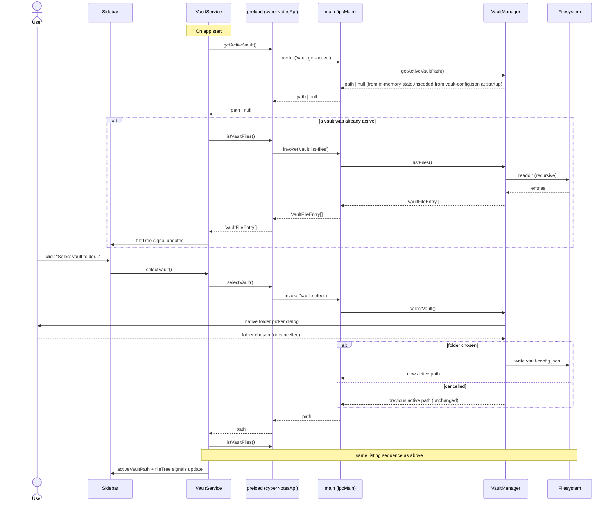

# 6. Runtime View

Sequence diagrams get added here one at a time, as each flow actually
lands — not speculatively up front.

## 6.1 Vault selection + file listing (milestone 2)

Two related flows: picking a vault, and loading (or reloading) its file
tree. Both go through the same `VaultService` → `contextBridge` →
`VaultManager` path described in
[05_building_block_view.md](05_building_block_view.md).

Deliberately out of scope for this milestone: reacting to *external*
changes to the vault folder while the app is running (chokidar file
watching, frontmatter-change vs. body-change vs. untracked-new-file
detection per CLAUDE.md's `FileWatcher` component). This flow is a
one-shot read, re-triggered manually by picking a vault or restarting the
app. Live watching becomes necessary once there's editor autosave to
conflict with it — deferred to whichever milestone builds that (see
[11_risks_and_technical_debt.md](11_risks_and_technical_debt.md),
"Autosave-vs-watcher conflict").

## Planned flows (added as their milestone is built)

- Quick-capture → routing (milestone 4–5)
- Batch tag suggestion (milestone 7)
- File-watcher reaction (frontmatter-change / body-change / untracked-new-file) (deferred, see above)
- Chat/RAG scope resolution (milestone 9+ / Phase 2 for "all notes" scope)
