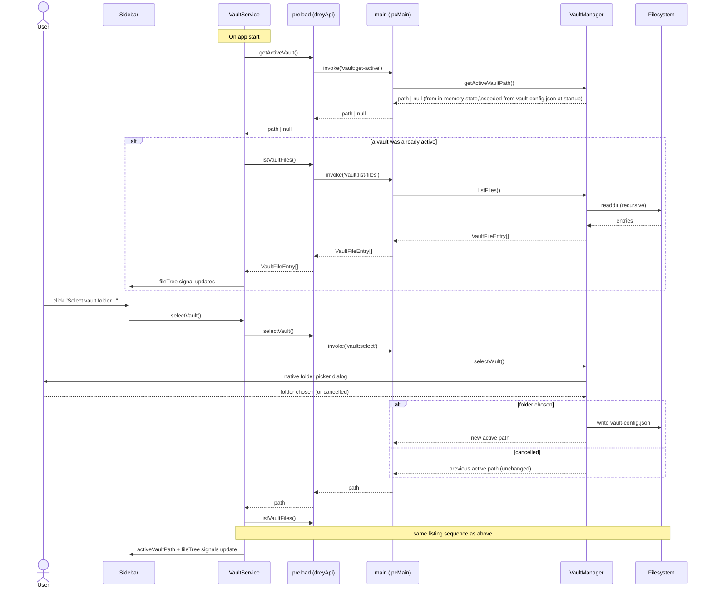
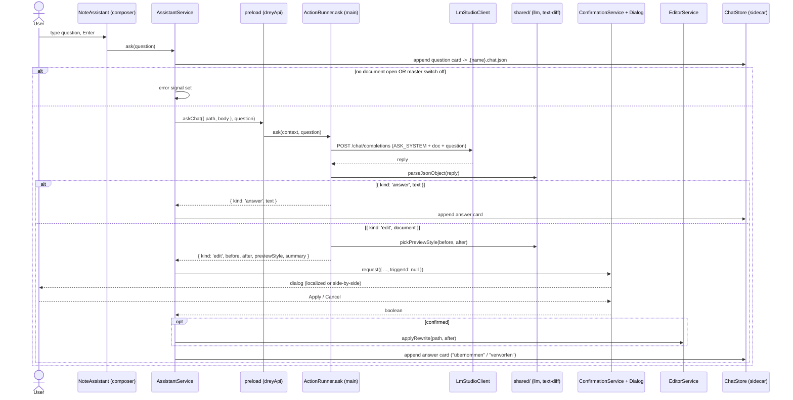
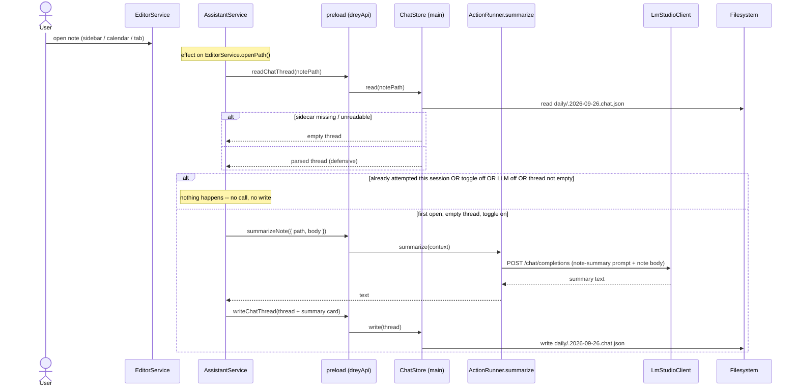
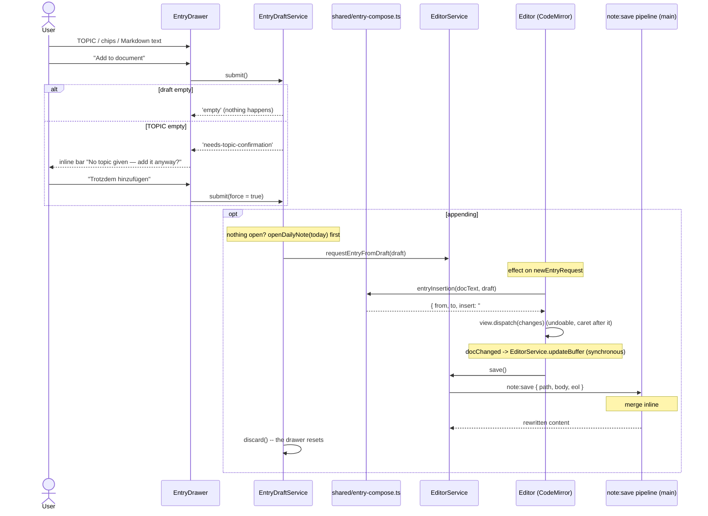
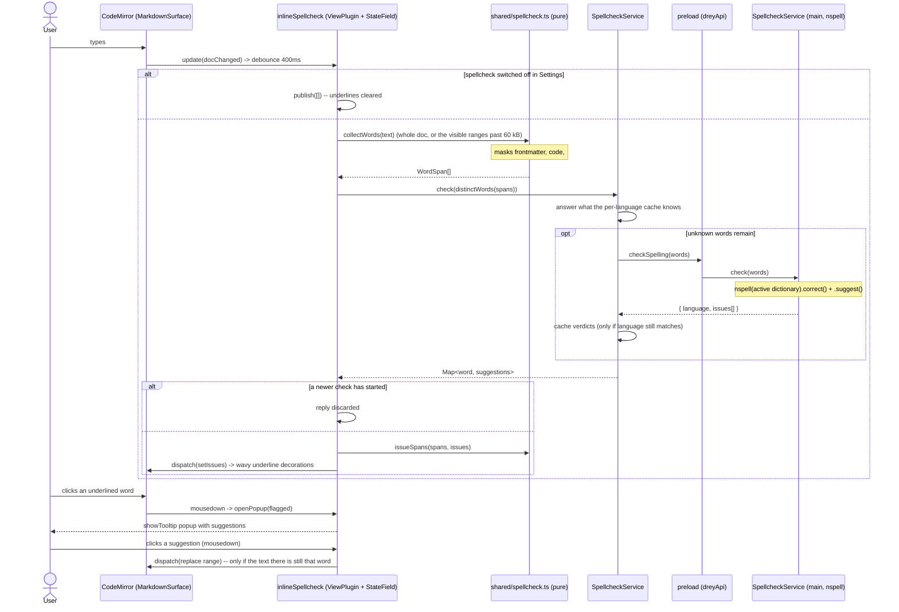

# 6. Runtime View

Sequence diagrams get added here one at a time, as each flow actually
lands — not speculatively up front.

## 6.1 Vault selection + file listing (milestone 2)

Two related flows: picking a vault, and loading (or reloading) its file
tree. Both go through the same `VaultService` → `contextBridge` →
`VaultManager` path described in
[05_building_block_view.md](05_building_block_view.md).



Deliberately out of scope for this milestone: reacting to *external*
changes to the vault folder while the app is running (chokidar file
watching, frontmatter-change vs. body-change vs. untracked-new-file
detection per CLAUDE.md's `FileWatcher` component). This flow is a
one-shot read, re-triggered manually by picking a vault or restarting the
app. Live watching becomes necessary once there's editor autosave to
conflict with it — deferred to whichever milestone builds that (see
[11_risks_and_technical_debt.md](11_risks_and_technical_debt.md),
"Autosave-vs-watcher conflict").

## 6.2 Open file → edit → save (milestone 3)

Clicking a file in the sidebar loads it into the editor; typing marks the
buffer dirty; Ctrl+S (or the Save button) writes it back. All document
state lives in `EditorService` signals — `Editor` owns only the
CodeMirror instance (source) and the markdown-it render (preview).

```mermaid
sequenceDiagram
    actor User
    participant Sidebar
    participant EditorService
    participant Editor as Editor (CodeMirror 6)
    participant Preload as preload (dreyApi)
    participant Main as main (ipcMain)
    participant VaultManager
    participant FS as Filesystem

    User->>Sidebar: click a file entry
    Sidebar->>EditorService: openFile(relativePath)
    alt current buffer is dirty
        EditorService->>User: confirm("discard unsaved changes?")
        User-->>EditorService: cancel -> abort / OK -> continue
    end
    EditorService->>Preload: readVaultFile(relativePath)
    Preload->>Main: invoke('vault:read-file', relativePath)
    Main->>VaultManager: readFile(relativePath)
    VaultManager->>VaultManager: resolveInVault() -- reject if path escapes vault
    VaultManager->>FS: readFile + stat
    FS-->>VaultManager: content, mtimeMs
    VaultManager-->>Main: { content, modifiedMs }
    Main-->>Preload: { content, modifiedMs }
    Preload-->>EditorService: { content, modifiedMs }
    EditorService->>EditorService: savedContent = bufferContent = content;\nopenPath = relativePath; viewMode = readDefaultMode() (preview by default)
    Note over Editor: effect() sees openPath/savedContent change
    Editor->>Editor: dispatch full-doc replace into EditorView

    User->>Editor: type
    Editor->>EditorService: updateBuffer(doc text) on every change
    EditorService->>EditorService: isDirty = (bufferContent !== savedContent)
    Note over Sidebar,Editor: dirty dot + enabled Save button render from signals

    User->>Editor: Ctrl+S (host keydown) — or clicks Save
    Editor->>EditorService: save()
    EditorService->>Preload: writeVaultFile(openPath, bufferContent)
    Preload->>Main: invoke('vault:write-file', path, content)
    Main->>VaultManager: writeFile(path, content)
    VaultManager->>VaultManager: resolveInVault()
    VaultManager->>FS: writeFile + stat
    FS-->>VaultManager: new mtimeMs
    VaultManager-->>Main: modifiedMs
    Main-->>Preload: modifiedMs
    Preload-->>EditorService: modifiedMs
    EditorService->>EditorService: savedContent = written -> isDirty = false
```

Deliberately out of scope for this milestone (unchanged from 6.1): no
reaction to *external* changes while a file is open (file watcher), no
autosave, and no `updated:` frontmatter bump on save (deferred to
milestone 5 — needs YAML frontmatter handling; see
[05_building_block_view.md](05_building_block_view.md) §5.5).

## 6.3 Quick-capture → daily note (milestone 4)

The global hotkey raises the main window and opens today's daily note in
the editor, creating it from `templates/daily.md` if needed, then starting
a fresh `## HH:mm` entry. No popup — see
[05_building_block_view.md](05_building_block_view.md) §5.6 and
[ADR-0002](09_architecture_decisions/0002-quick-capture-opens-daily-note.md).

```mermaid
sequenceDiagram
    actor User
    participant OS
    participant Main as main (globalShortcut)
    participant Daily as DailyNoteManager
    participant FS as Filesystem
    participant DailyService as DailyNoteService (renderer)
    participant EditorService
    participant Editor as Editor (CodeMirror 6)

    User->>OS: press Ctrl+Alt+N
    OS->>Main: global shortcut fires
    Main->>Main: mainWindow.show() + focus() (restore if minimized)
    Main->>Daily: ensureTodayNote()
    alt daily/<date>.md missing
        Daily->>FS: read templates/daily.md
        alt template missing
            Daily->>FS: write starter templates/daily.md (verbatim placeholders)
        end
        Daily->>Daily: substitute {{date}} {{time}} {{datetime}} {{title}}
        Daily->>FS: mkdir daily/ + write daily/<date>.md
    end
    Daily-->>Main: "daily/2026-09-05.md"
    Main->>DailyService: send('daily:open', relativePath)
    DailyService->>EditorService: openFile(relativePath)
    EditorService->>EditorService: savedContent = bufferContent = file; openPath set
    Note over Editor: effect() reloads the CM document
    DailyService->>EditorService: requestNewDailyEntry()  (bumps newEntryRequest)
    Note over Editor: effect (or ngAfterViewInit for a just-opened file)
    Editor->>EditorService: newDailyEntryEdit(currentDocText)
    alt doc doesn't already end with an empty "## HH:mm"
        EditorService-->>Editor: { insert: "\n\n## 14:32\n", at: docEnd }
        Editor->>Editor: dispatch insert + cursor after it + scroll + focus
        Note over Editor: buffer now dirty -> user saves with Ctrl+S
    else already ends with an empty entry heading
        EditorService-->>Editor: null
        Editor->>Editor: move cursor to end + focus (no edit)
    end

    Note over Main: no vault active / vault gone -> window still raised, warning logged, no daily:open
```

Out of scope for this milestone: inline `#tag` autocomplete and
deterministic routing (milestone 5), task/note classification (milestone
6), `updated:` frontmatter bump on save (milestone 5), and any reaction to
a daily note being changed on disk while open (file watcher, deferred).
Placeholder substitution is a fixed small set; template errors aren't
validated.

## 6.4 Mode switch + click-to-edit ([ADR-0008](09_architecture_decisions/0008-editor-mode-menu-and-rendered-preview.md), supersedes ADR-0004)

There is no auto-switch and no caret sync. `source` is CodeMirror; `preview`
is a read-only markdown-it render. The `⋯` menu flips `EditorService.viewMode`
(a per-tab field; `setViewMode` also persists `{ defaultMode }` to
`localStorage` as the landing mode for new notes). The one `EditorView` stays
mounted (`display:none` in preview) so undo history survives the switch.

A click anywhere in the preview drops to source at the clicked block's line:

```mermaid
sequenceDiagram
    actor User
    participant Preview as .rendered .doc ([innerHTML], read-only)
    participant Editor as Editor component
    participant EditorService
    participant CM as CodeMirror 6 view

    Note over Preview: viewMode = 'preview' -- markdown-it output;\nevery top-level block carries data-line (token.map, 0-based in the\nfrontmatter-stripped text)
    User->>Preview: click inside a block
    Preview->>Editor: (click) -> onPreviewClick(event)
    Editor->>Editor: event.target.closest('[data-line]') -> dataLine
    Editor->>EditorService: setViewMode('source')
    Note over Editor: setTimeout 0 -- after CD swaps the views in:
    Editor->>CM: dispatch { selection: line(dataLine + lineShift + 1).from, scrollIntoView }
    Editor->>CM: view.focus()
    Note over CM: user edits the raw Markdown; updateListener -> updateBuffer
```

Line granularity only -- the caret lands at the start of the block's line,
not the exact character (the per-character `source-map.ts` mapping from
ADR-0004 is gone). A click that misses every `[data-line]` block still
switches to source, leaving the caret where it was.

## 6.5 Save → tag merge + `updated:` bump → route entries to master History (milestone 6)

Saving a `.md` note no longer writes the buffer verbatim. `Ctrl+S` goes
through the main-process `note:save` pipeline (`NoteManager`), which:

1. parses the frontmatter, merges inline body `#tag`s into `tags`, bumps
   `updated:`, and writes the file **in place** (milestone 6a);
2. **routes** (milestone 6b): for every dated entry (`## HH:mm` block) that
   carries a known tag, appends a `### <date> <time>` copy of that entry to
   the tag's master-document `## History` — the source note keeps its copy,
   nothing moves. An HTML-comment marker
   (`<!-- drey:src <path>@<date> <time> -->`) on the heading line makes
   re-saves idempotent.

It returns the rewritten note text (the editor adopts it so the merged
frontmatter shows and the tab is clean) plus `appendedTo` — master paths
that gained a History entry; a clean open tab for one of those is reloaded
from disk. All decision logic is pure `shared/` code
([ADR-0007](09_architecture_decisions/0007-on-save-tag-pipeline.md)).

```mermaid
sequenceDiagram
    actor User
    participant Editor as Editor (CodeMirror 6)
    participant EditorService
    participant TagService
    participant Preload as preload (dreyApi)
    participant Main as main (ipcMain)
    participant NoteManager
    participant Pure as shared/ (frontmatter, inline-tags)
    participant TagIndex
    participant VaultManager
    participant FS as Filesystem

    User->>Editor: Ctrl+S
    Editor->>EditorService: save()
    Note over EditorService: no-op if buffer === savedContent
    EditorService->>Preload: saveNote({ path, body (LF), eol })
    Preload->>Main: invoke('note:save', request)
    Main->>NoteManager: saveNote(request)

    NoteManager->>Pure: splitFrontmatter(body)
    alt no --- fence
        NoteManager->>VaultManager: writeFile(path, body with EOL)
        VaultManager->>FS: writeFile
        NoteManager-->>Main: { content: body, tags: [], unknownTags: [], appendedTo: [] }
    else has frontmatter
        NoteManager->>Pure: readFrontmatter(body)
        NoteManager->>Pure: extractInlineTags(body)  (skips code, ## HH:mm, #task/#important)
        Note over NoteManager: daily/ + templates/ -> keep tags, still bump updated
        NoteManager->>Pure: bumpUpdated(fm)  ->  { updated: now, created }
        NoteManager->>Pure: writeFrontmatter(body, { tags, updated, created })
        Note over Pure: yaml parseDocument -> mutate only those keys;\ncomments + styles preserved; dates double-quoted
        NoteManager->>VaultManager: writeFile(path, newText with EOL)
        VaultManager->>FS: writeFile + stat

        Note over NoteManager: route (skip templates/)
        NoteManager->>Pure: parseDatedEntries(noteBody)
        loop each dated entry with a known tag
            NoteManager->>TagIndex: lookup(tag) -> masterPath (hasMaster)
            NoteManager->>VaultManager: readFile(masterPath)
            NoteManager->>Pure: appendHistoryEntry(masterText, { date, time, sourcePath, entryText })
            alt drey:src marker not already present
                NoteManager->>Pure: writeFrontmatter(master, { updated: now })
                NoteManager->>VaultManager: writeFile(masterPath, ... with master EOL)
                Note over NoteManager: appendedTo += masterPath
            end
        end

        opt tag set changed
            NoteManager->>TagIndex: rebuild()  (full rescan -- no watcher)
        end
        NoteManager-->>Main: { path, content: newText, modifiedMs, tags, unknownTags, appendedTo }
    end

    Main-->>Preload: NoteSaveResult
    Preload-->>EditorService: NoteSaveResult
    EditorService->>EditorService: savedContent = bufferContent = result.content -> isDirty = false
    Note over Editor: effect sees savedContent change -> loadActiveDoc()\nreloads CM text, caret kept (same-file guard)
    opt result.tags non-empty
        EditorService->>TagService: refresh()  (re-reads tag:list for autocomplete)
    end
    opt result.appendedTo non-empty
        EditorService->>VaultManager: readVaultFile(path) for each clean open master tab
        EditorService->>EditorService: patchDoc(path, fresh content)
    end
```

Not routed: files under `templates/`, entries with no known-tag / no
master, and an entry whose target master is the note being saved. A dirty
open master tab is **not** auto-reloaded (that conflict is the file
watcher's job, later).

## 6.6 Run an Action → shared confirmation → apply (Settings / Actions)

A manual Action from the editor `⋯` menu (or an `on-save` trigger from the
`note:save` pipeline) produces a proposed rewrite that goes through the one
confirmation dialog before it touches the document
([ADR-0011](09_architecture_decisions/0011-unified-confirmation-flow.md)).
The example is the built-in **Autotagging** action; **Update summary** and
user templates follow the same shape, differing only in how `after` is
computed inside `ActionRunner`.

```mermaid
sequenceDiagram
    actor User
    participant Editor as Editor (⋯ menu)
    participant ActionsService
    participant Confirm as ConfirmationService + Dialog
    participant Settings as SettingsService
    participant EditorService
    participant Preload as preload (dreyApi)
    participant Runner as ActionRunner (main)
    participant Classifier
    participant LM as LmStudioClient
    participant Pure as shared/ (action-apply, actions)

    User->>Editor: ⋯ menu → "Autotagging"
    Editor->>ActionsService: run(triggerId, { path, body, selection })
    ActionsService->>Preload: runAction(triggerId, context)
    Preload->>Runner: run(triggerId, context)
    Runner->>Pure: resolveActions(config) → find trigger
    alt LLM master switch off
        Runner-->>ActionsService: { kind: 'error', message: 'LLM features are disabled.' }
        ActionsService->>ActionsService: message signal set (shown in editor)
    else enabled
        Runner->>Pure: untaggedEntryText(body)
        Runner->>Classifier: suggestTags(template.prompt, registryText, noteText)
        Classifier->>LM: POST /chat/completions
        LM-->>Classifier: reply
        Classifier->>Pure: parseTagSuggestion(reply)
        Runner->>Pure: mergeFrontmatterTags(body, suggested)
        alt nothing new to add
            Runner-->>ActionsService: { kind: 'noop', message }
        else
            Runner-->>ActionsService: { kind: 'edit', before, after, previewStyle: 'localized', summary, triggerId }
            ActionsService->>Confirm: request({ title, summary, previewStyle, before, after, triggerId })
            Confirm->>Confirm: lineDiff(before, after) → collapsed rows
            Confirm-->>User: dialog (inline diff + "don't ask again")
            User-->>Confirm: Apply (checkbox?)
            opt "don't ask again" ticked
                Confirm->>Settings: setTriggerConfirm(triggerId, false) → config:set
            end
            Confirm-->>ActionsService: true
            ActionsService->>EditorService: applyRewrite(path, after)
            EditorService->>EditorService: buffer = after; save({ runOnSaveActions: false })
            Note over EditorService: note:save runs, on-save Actions suppressed → no recursion
        end
    end
```

For an `on-save` trigger the entry point differs: `NoteManager` runs the
trigger after writing the file. A `confirm` trigger's `'edit'` outcome
rides back on `NoteSaveResult.pendingActions`; `EditorService` stores it
in a signal, and an `effect` in `ActionsService` drains the queue through
the exact `ConfirmationService` path above. A non-`confirm` trigger is
applied in the main process before the save result returns.

## 6.7 Assistant panel Ask (answer vs. document edit)

The assistant panel's composer sends the active document plus the user's
question to the LLM. A question comes back as text and becomes an answer
card; a "change the document" instruction comes back as a full rewrite that
reuses the 6.6 confirmation flow (`triggerId: null`, so no "don't ask
again" checkbox), and what the user decided is recorded as a card too.

This flow used to live in the bottom chat bar's Ask mode. The bar is gone
(§5.11/5.12); the plumbing below is unchanged apart from its caller.



## 6.8 Opening a note: the automatic summary (Feature A)

Opening a tab loads that note's sidecar thread and, under one specific
condition, generates its summary. The condition is deliberately narrow so
that re-opening a note never re-bills an LLM call:
[ADR-0012](09_architecture_decisions/0012-note-assistant-sidecar-thread.md).



The panel's "Automatic summary" switch decides the `toggle on`
branch. It starts from `assistant.autoSummaryDefault` (Settings →
Assistant) and overrides it **for that note only** — switching it on
after the fact re-runs the same rule once; switching it off never writes
back to the global default.

## 6.9 Adding an entry from the drawer (Feature B)

"Add to document" composes the entry from pure shared code,
dispatches it into CodeMirror as an ordinary edit, and saves — which is
what pulls the entry's `#tag`s through the routing pipeline of §6.5.



## 6.10 Inline spellcheck (Feature B)

Typing in either editing surface — the drawer body or the document —
triggers a debounced check whose answer arrives asynchronously. The
interesting part is the version guard that discards a reply the document
has already moved past
([ADR-0013](09_architecture_decisions/0013-inline-spellcheck.md)).



## Planned flows (added as their milestone is built)

- Batch tag suggestion in the inbox (milestone 7 — the Autotagging action is the same classifier call, run per-document for now)
- File-watcher reaction (frontmatter-change / body-change / untracked-new-file) (deferred, see above)
- Keyword search over all notes, on its own surface now that the bar is gone (milestone 8)
- Chat/RAG scope resolution for a vault-wide scope (Phase 2)
