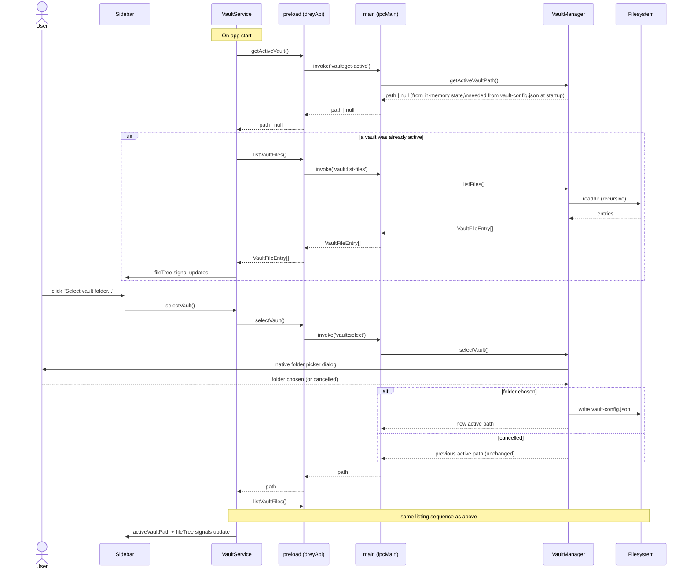

# 6. Runtime View

Sequence diagrams get added here one at a time, as each flow actually
lands — not speculatively up front.

## 6.1 Vault selection + file listing (milestone 2)

Two related flows: picking a vault, and loading (or reloading) its file
tree. Both go through the same `VaultService` → `contextBridge` →
`VaultManager` path described in
[05_building_block_view.md](05_building_block_view.md).



Deliberately out of scope for this milestone: reacting to *external*
changes to the vault folder while the app is running (chokidar file
watching, frontmatter-change vs. body-change vs. untracked-new-file
detection per CLAUDE.md's `FileWatcher` component). This flow is a
one-shot read, re-triggered manually by picking a vault or restarting the
app. Live watching becomes necessary once there's editor autosave to
conflict with it — deferred to whichever milestone builds that (see
[11_risks_and_technical_debt.md](11_risks_and_technical_debt.md),
"Autosave-vs-watcher conflict").

## 6.2 Open file → edit → save (milestone 3)

Clicking a file in the sidebar loads it into the editor; typing marks the
buffer dirty; Ctrl+S (or the Save button) writes it back. All document
state lives in `EditorService` signals — `Editor` owns only the
CodeMirror instance and the rendered-view DOM.

```mermaid
sequenceDiagram
    actor User
    participant Sidebar
    participant EditorService
    participant Editor as Editor (CodeMirror 6)
    participant Preload as preload (dreyApi)
    participant Main as main (ipcMain)
    participant VaultManager
    participant FS as Filesystem

    User->>Sidebar: click a file entry
    Sidebar->>EditorService: openFile(relativePath)
    alt current buffer is dirty
        EditorService->>User: confirm("discard unsaved changes?")
        User-->>EditorService: cancel -> abort / OK -> continue
    end
    EditorService->>Preload: readVaultFile(relativePath)
    Preload->>Main: invoke('vault:read-file', relativePath)
    Main->>VaultManager: readFile(relativePath)
    VaultManager->>VaultManager: resolveInVault() -- reject if path escapes vault
    VaultManager->>FS: readFile + stat
    FS-->>VaultManager: content, mtimeMs
    VaultManager-->>Main: { content, modifiedMs }
    Main-->>Preload: { content, modifiedMs }
    Preload-->>EditorService: { content, modifiedMs }
    EditorService->>EditorService: savedContent = bufferContent = content;\nopenPath = relativePath; viewMode = 'source'
    Note over Editor: effect() sees openPath/savedContent change
    Editor->>Editor: dispatch full-doc replace into EditorView

    User->>Editor: type
    Editor->>EditorService: updateBuffer(doc text) on every change
    EditorService->>EditorService: isDirty = (bufferContent !== savedContent)
    Note over Sidebar,Editor: dirty dot + enabled Save button render from signals

    User->>Editor: Ctrl+S (host keydown) — or clicks Save
    Editor->>EditorService: save()
    EditorService->>Preload: writeVaultFile(openPath, bufferContent)
    Preload->>Main: invoke('vault:write-file', path, content)
    Main->>VaultManager: writeFile(path, content)
    VaultManager->>VaultManager: resolveInVault()
    VaultManager->>FS: writeFile + stat
    FS-->>VaultManager: new mtimeMs
    VaultManager-->>Main: modifiedMs
    Main-->>Preload: modifiedMs
    Preload-->>EditorService: modifiedMs
    EditorService->>EditorService: savedContent = written -> isDirty = false
```

Deliberately out of scope for this milestone (unchanged from 6.1): no
reaction to *external* changes while a file is open (file watcher), no
autosave, and no `updated:` frontmatter bump on save (deferred to
milestone 5 — needs YAML frontmatter handling; see
[05_building_block_view.md](05_building_block_view.md) §5.5).

## 6.3 Quick-capture → daily note (milestone 4)

The global hotkey raises the main window and opens today's daily note in
the editor, creating it from `templates/daily.md` if needed, then starting
a fresh `## HH:mm` entry. No popup — see
[05_building_block_view.md](05_building_block_view.md) §5.6 and
[ADR-0002](09_architecture_decisions/0002-quick-capture-opens-daily-note.md).

```mermaid
sequenceDiagram
    actor User
    participant OS
    participant Main as main (globalShortcut)
    participant Daily as DailyNoteManager
    participant FS as Filesystem
    participant DailyService as DailyNoteService (renderer)
    participant EditorService
    participant Editor as Editor (CodeMirror 6)

    User->>OS: press Ctrl+Alt+N
    OS->>Main: global shortcut fires
    Main->>Main: mainWindow.show() + focus() (restore if minimized)
    Main->>Daily: ensureTodayNote()
    alt daily/<date>.md missing
        Daily->>FS: read templates/daily.md
        alt template missing
            Daily->>FS: write starter templates/daily.md (verbatim placeholders)
        end
        Daily->>Daily: substitute {{date}} {{time}} {{datetime}} {{title}}
        Daily->>FS: mkdir daily/ + write daily/<date>.md
    end
    Daily-->>Main: "daily/2026-09-05.md"
    Main->>DailyService: send('daily:open', relativePath)
    DailyService->>EditorService: openFile(relativePath)
    EditorService->>EditorService: savedContent = bufferContent = file; openPath set
    Note over Editor: effect() reloads the CM document
    DailyService->>EditorService: requestNewDailyEntry()  (bumps newEntryRequest)
    Note over Editor: effect (or ngAfterViewInit for a just-opened file)
    Editor->>EditorService: newDailyEntryEdit(currentDocText)
    alt doc doesn't already end with an empty "## HH:mm"
        EditorService-->>Editor: { insert: "\n\n## 14:32\n", at: docEnd }
        Editor->>Editor: dispatch insert + cursor after it + scroll + focus
        Note over Editor: buffer now dirty -> user saves with Ctrl+S
    else already ends with an empty entry heading
        EditorService-->>Editor: null
        Editor->>Editor: move cursor to end + focus (no edit)
    end

    Note over Main: no vault active / vault gone -> window still raised, warning logged, no daily:open
```

Out of scope for this milestone: inline `#tag` autocomplete and
deterministic routing (milestone 5), task/note classification (milestone
6), `updated:` frontmatter bump on save (milestone 5), and any reaction to
a daily note being changed on disk while open (file watcher, deferred).
Placeholder substitution is a fixed small set; template errors aren't
validated.

## 6.4 Auto-switch mode: preview caret → edit → save → preview (milestone 3, opt-in)

Only when `EditorService.autoSwitch` is on (a persisted preference, off by
default — [ADR-0004](09_architecture_decisions/0004-auto-switch-editor-mode.md)).
The rendered view is the resting state; a click only positions a caret,
the first keystroke commits to editing, and Ctrl+S returns to the rendered
view at the same spot. `caretOffset` (offset into `bufferContent`) is the
value both views sync on.

```mermaid
sequenceDiagram
    actor User
    participant Preview as Rendered .doc (contenteditable=plaintext-only)
    participant Editor as Editor component
    participant SM as source-map.ts / preview-caret.ts
    participant EditorService
    participant CM as CodeMirror 6 view

    Note over Preview: viewMode = 'rendered', autoSwitch on
    User->>Preview: click inside a paragraph
    Preview->>Editor: (click) -> onPreviewClick()
    Editor->>SM: blockIndexForNode + domPointToTextOffset + alignRenderedToSource
    SM-->>Editor: source offset within block
    Editor->>EditorService: setCaretOffset(shift + span.start + localSource)
    Note over Preview: native caret shown (accent colour); clicks/arrows just re-read caret

    User->>Preview: type "x" (or Enter / Backspace / paste)
    Preview->>Editor: (beforeinput) -> preventDefault(), syncCaretFromDom(), map inputType to intent
    Editor->>EditorService: setViewMode('source')
    Editor->>CM: dispatch { changes at caretOffset: insert "x", selection after }
    CM->>EditorService: updateListener -> updateBuffer + setCaretOffset(head)
    Note over Editor: deferToDom (setTimeout 0) -> after CD swaps the views:\nview.focus() + re-dispatch selection (focusing a display:none editor is a no-op)
    Note over CM: user keeps editing in source

    User->>Editor: Ctrl+S
    Editor->>EditorService: save() (writes file, savedContent = buffer)
    Editor->>EditorService: setViewMode('rendered')  (autoSwitch + was source)
    Note over Editor: effect sees viewMode='rendered' -> deferToDom (setTimeout 0)
    Editor->>SM: blockIndexForSourceOffset + sourceToRenderedOffset + textOffsetToDomPoint
    SM-->>Editor: DOM (node, offset)
    Editor->>Preview: root.focus() then Selection range (best-effort, try/catch)
```

When `autoSwitch` is off this whole flow is absent: a click on the preview
does nothing (it no longer switches to source), and none of the mapping
runs (§6.2 unchanged).

Best-effort by design: the character alignment is exact for prose,
headings and fenced code, and a few characters off inside dense inline
markup — never throwing, never altering text. Indented (four-space) code
blocks aren't marked with `cm-src-<n>`, so a caret there falls back to the
nearest mapped ancestor.

## Planned flows (added as their milestone is built)

- Quick-capture routing: a typed known `#tag` routes a note to its target file (milestone 5)
- Batch tag suggestion (milestone 7)
- File-watcher reaction (frontmatter-change / body-change / untracked-new-file) (deferred, see above)
- Chat/RAG scope resolution (milestone 9+ / Phase 2 for "all notes" scope)
