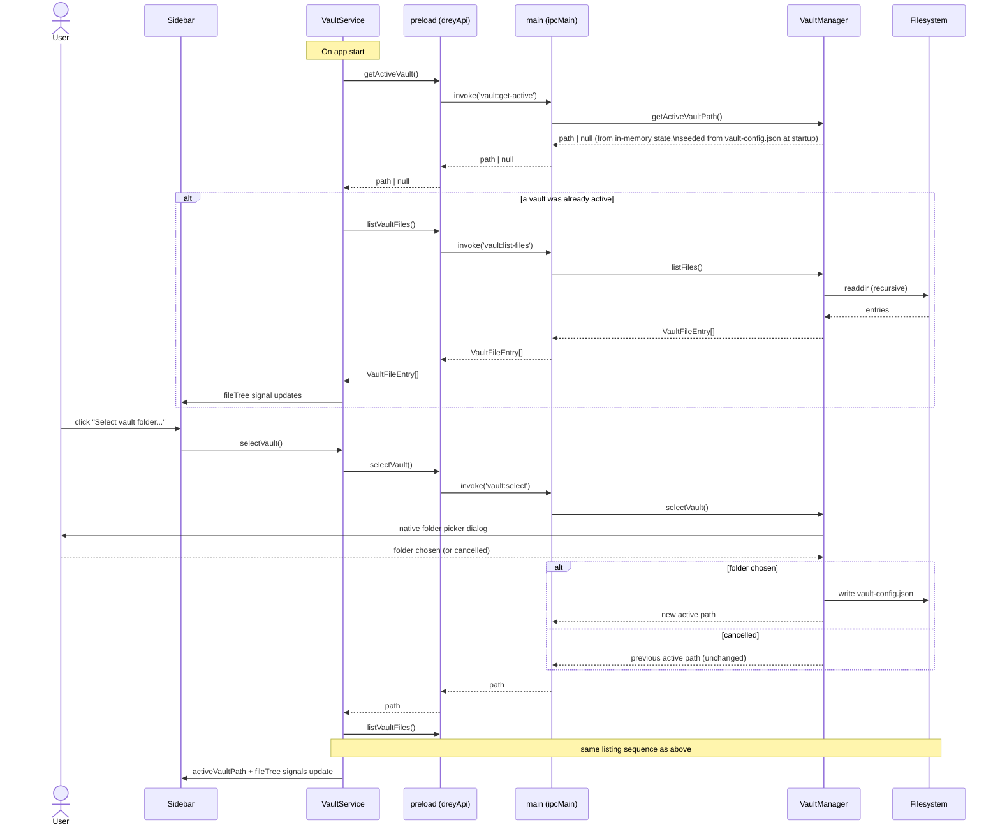
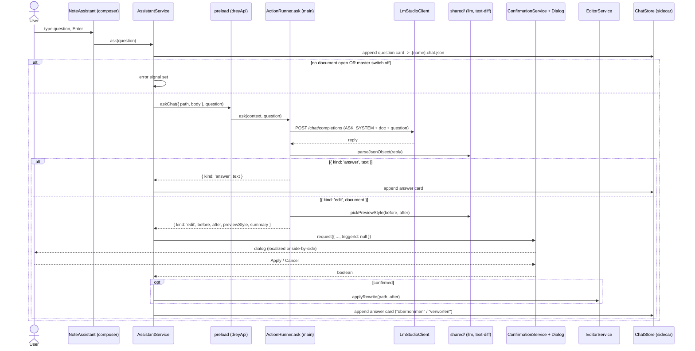
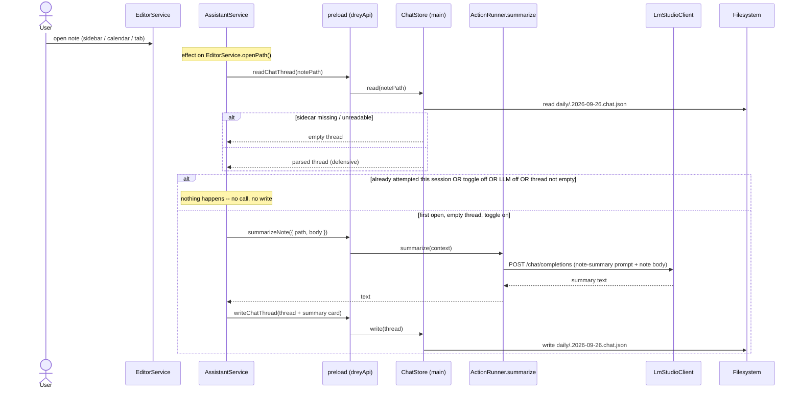
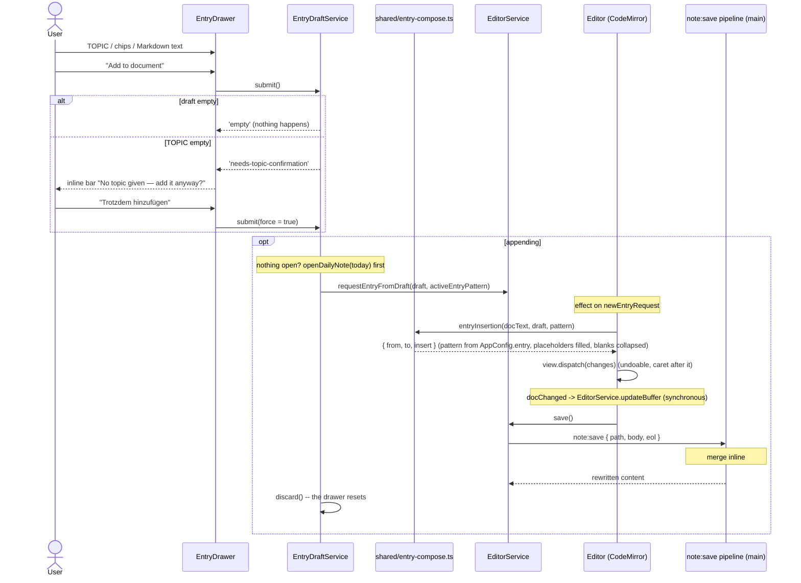
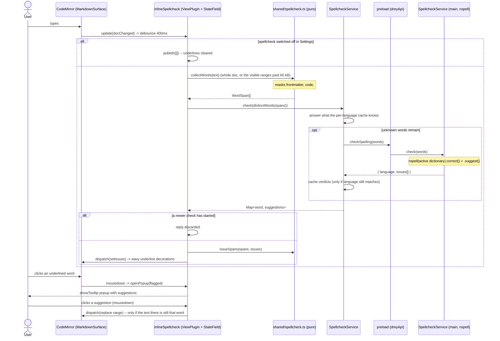
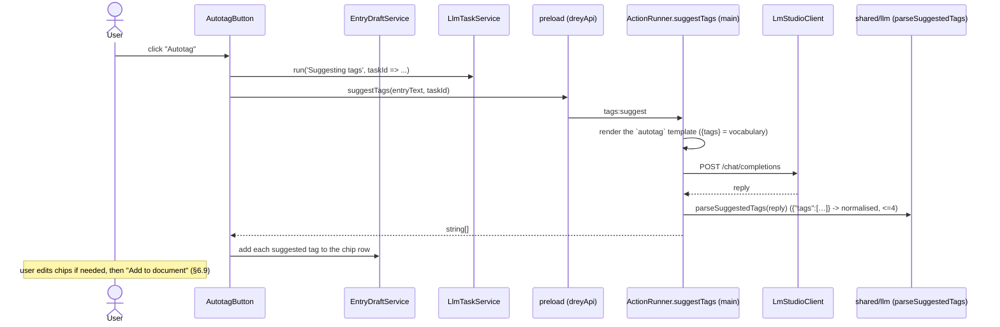
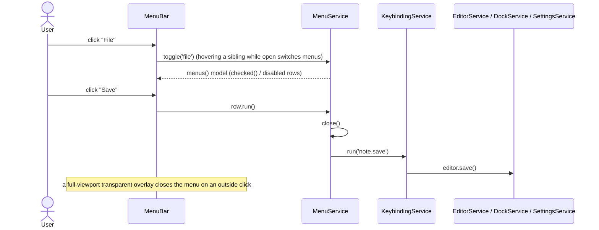
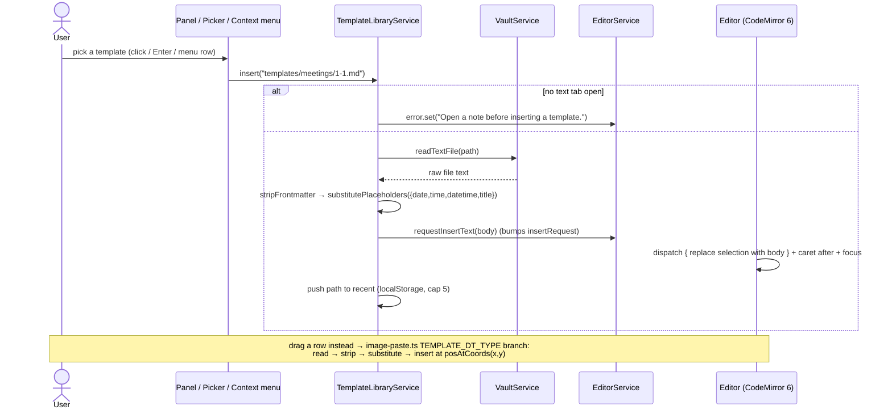
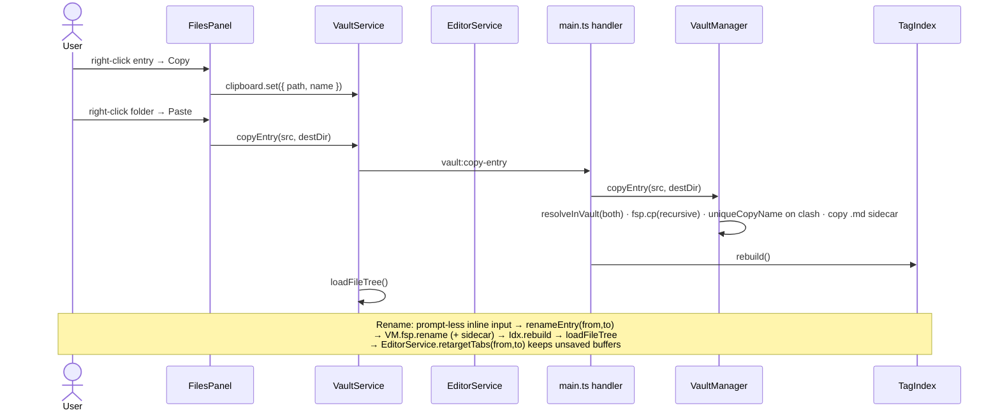

# 6. Runtime View

Sequence diagrams get added here one at a time, as each flow actually
lands — not speculatively up front.

## 6.1 Vault selection + file listing (milestone 2)

Two related flows: picking a vault, and loading (or reloading) its file
tree. Both go through the same `VaultService` → `contextBridge` →
`VaultManager` path described in
[05_building_block_view.md](05_building_block_view.md).



Deliberately out of scope for this milestone: reacting to _external_
changes to the vault folder while the app is running (chokidar file
watching, frontmatter-change vs. body-change vs. untracked-new-file
detection per CLAUDE.md's `FileWatcher` component). This flow is a
one-shot read, re-triggered manually by picking a vault or restarting the
app. Live watching becomes necessary once there's editor autosave to
conflict with it — deferred to whichever milestone builds that (see
[11_risks_and_technical_debt.md](11_risks_and_technical_debt.md),
"Autosave-vs-watcher conflict").

## 6.2 Open file → edit → save (milestone 3)

Clicking a file in the sidebar loads it into the editor; typing marks the
buffer dirty; Ctrl+S (or the Save button) writes it back. All document
state lives in `EditorService` signals — `Editor` owns only the
CodeMirror instance (source) and the markdown-it render (preview).

```mermaid
sequenceDiagram
    actor User
    participant Sidebar
    participant EditorService
    participant Editor as Editor (CodeMirror 6)
    participant Preload as preload (dreyApi)
    participant Main as main (ipcMain)
    participant VaultManager
    participant FS as Filesystem

    User->>Sidebar: click a file entry
    Sidebar->>EditorService: openFile(relativePath)
    alt current buffer is dirty
        EditorService->>User: confirm("discard unsaved changes?")
        User-->>EditorService: cancel -> abort / OK -> continue
    end
    EditorService->>Preload: readVaultFile(relativePath)
    Preload->>Main: invoke('vault:read-file', relativePath)
    Main->>VaultManager: readFile(relativePath)
    VaultManager->>VaultManager: resolveInVault() -- reject if path escapes vault
    VaultManager->>FS: readFile + stat
    FS-->>VaultManager: content, mtimeMs
    VaultManager-->>Main: { content, modifiedMs }
    Main-->>Preload: { content, modifiedMs }
    Preload-->>EditorService: { content, modifiedMs }
    EditorService->>EditorService: savedContent = bufferContent = content;\nopenPath = relativePath; viewMode = readDefaultMode() (preview by default)
    Note over Editor: effect() sees openPath/savedContent change
    Editor->>Editor: dispatch full-doc replace into EditorView

    User->>Editor: type
    Editor->>EditorService: updateBuffer(doc text) on every change
    EditorService->>EditorService: isDirty = (bufferContent !== savedContent)
    Note over Sidebar,Editor: dirty dot + enabled Save button render from signals

    User->>Editor: Ctrl+S (host keydown) — or clicks Save
    Editor->>EditorService: save()
    EditorService->>Preload: writeVaultFile(openPath, bufferContent)
    Preload->>Main: invoke('vault:write-file', path, content)
    Main->>VaultManager: writeFile(path, content)
    VaultManager->>VaultManager: resolveInVault()
    VaultManager->>FS: writeFile + stat
    FS-->>VaultManager: new mtimeMs
    VaultManager-->>Main: modifiedMs
    Main-->>Preload: modifiedMs
    Preload-->>EditorService: modifiedMs
    EditorService->>EditorService: savedContent = written -> isDirty = false
```

Deliberately out of scope for this milestone (unchanged from 6.1): no
reaction to _external_ changes while a file is open (file watcher), no
autosave, and no `updated:` frontmatter bump on save (deferred to
milestone 5 — needs YAML frontmatter handling; see
[05_building_block_view.md](05_building_block_view.md) §5.5).

## 6.3 Quick-capture → daily note (milestone 4)

The global hotkey raises the main window and opens today's daily note in
the editor, creating it from `templates/daily.md` if needed, then starting
a fresh `## HH:mm` entry. No popup — see
[05_building_block_view.md](05_building_block_view.md) §5.6 and
[ADR-0002](09_architecture_decisions/0002-quick-capture-opens-daily-note.md).

```mermaid
sequenceDiagram
    actor User
    participant OS
    participant Main as main (globalShortcut)
    participant Daily as DailyNoteManager
    participant FS as Filesystem
    participant DailyService as DailyNoteService (renderer)
    participant EditorService
    participant Editor as Editor (CodeMirror 6)

    User->>OS: press Ctrl+Alt+N
    OS->>Main: global shortcut fires
    Main->>Main: mainWindow.show() + focus() (restore if minimized)
    Main->>Daily: ensureTodayNote()
    alt daily/<date>.md missing
        Daily->>FS: read templates/daily.md
        alt template missing
            Daily->>FS: write starter templates/daily.md (verbatim placeholders)
        end
        Daily->>Daily: substitute {{date}} {{time}} {{datetime}} {{title}}
        Daily->>FS: mkdir daily/ + write daily/<date>.md
    end
    Daily-->>Main: "daily/2026-09-05.md"
    Main->>DailyService: send('daily:open', relativePath)
    DailyService->>EditorService: openFile(relativePath)
    EditorService->>EditorService: savedContent = bufferContent = file; openPath set
    Note over Editor: effect() reloads the CM document
    DailyService->>EditorService: requestNewDailyEntry()  (bumps newEntryRequest)
    Note over Editor: effect (or ngAfterViewInit for a just-opened file)
    Editor->>EditorService: newDailyEntryEdit(currentDocText)
    alt doc doesn't already end with an empty "## HH:mm"
        EditorService-->>Editor: { insert: "\n\n## 14:32\n", at: docEnd }
        Editor->>Editor: dispatch insert + cursor after it + scroll + focus
        Note over Editor: buffer now dirty -> user saves with Ctrl+S
    else already ends with an empty entry heading
        EditorService-->>Editor: null
        Editor->>Editor: move cursor to end + focus (no edit)
    end

    Note over Main: no vault active / vault gone -> window still raised, warning logged, no daily:open
```

Out of scope for this milestone: inline `#tag` autocomplete and
deterministic routing (milestone 5), task/note classification (milestone
6), `updated:` frontmatter bump on save (milestone 5), and any reaction to
a daily note being changed on disk while open (file watcher, deferred).
Placeholder substitution is a fixed small set; template errors aren't
validated.

## 6.4 Mode switch + click-to-edit ([ADR-0008](09_architecture_decisions/0008-editor-mode-menu-and-rendered-preview.md), supersedes ADR-0004)

There is no auto-switch and no caret sync. `source` is CodeMirror; `preview`
is a read-only markdown-it render. The `⋯` menu flips `EditorService.viewMode`
(a per-tab field; `setViewMode` also persists `{ defaultMode }` to
`localStorage` as the landing mode for new notes). The one `EditorView` stays
mounted (`display:none` in preview) so undo history survives the switch.

A click anywhere in the preview drops to source at the clicked block's line:

```mermaid
sequenceDiagram
    actor User
    participant Preview as .rendered .doc ([innerHTML], read-only)
    participant Editor as Editor component
    participant EditorService
    participant CM as CodeMirror 6 view

    Note over Preview: viewMode = 'preview' -- markdown-it output;\nevery top-level block carries data-line (token.map, 0-based in the\nfrontmatter-stripped text)
    User->>Preview: click inside a block
    Preview->>Editor: (click) -> onPreviewClick(event)
    Editor->>Editor: event.target.closest('[data-line]') -> dataLine
    Editor->>EditorService: setViewMode('source')
    Note over Editor: setTimeout 0 -- after CD swaps the views in:
    Editor->>CM: dispatch { selection: line(dataLine + lineShift + 1).from, scrollIntoView }
    Editor->>CM: view.focus()
    Note over CM: user edits the raw Markdown; updateListener -> updateBuffer
```

Line granularity only -- the caret lands at the start of the block's line,
not the exact character (the per-character `source-map.ts` mapping from
ADR-0004 is gone). A click that misses every `[data-line]` block still
switches to source, leaving the caret where it was.

## 6.5 Save → tag merge + `updated:` bump → route entries to master History (milestone 6)

> **Superseded by §6.11
> ([ADR-0017](09_architecture_decisions/0017-tags-as-labels-and-section-index.md)).**
> `note:save` no longer merges `#tag`s into the frontmatter and no longer
> routes entries into a master document. It bumps `updated:` on a fenced
> file, writes, and re-indexes that one file into `TagIndex`. The diagram
> below is kept for the record.

Saving a `.md` note no longer writes the buffer verbatim. `Ctrl+S` goes
through the main-process `note:save` pipeline (`NoteManager`), which:

1. parses the frontmatter, merges inline body `#tag`s into `tags`, bumps
   `updated:`, and writes the file **in place** (milestone 6a);
2. **routes** (milestone 6b): for every dated entry (`## HH:mm` block) that
   carries a known tag, appends a `### <date> <time>` copy of that entry to
   the tag's master-document `## History` — the source note keeps its copy,
   nothing moves. An HTML-comment marker
   (`<!-- drey:src <path>@<date> <time> -->`) on the heading line makes
   re-saves idempotent.

It returns the rewritten note text (the editor adopts it so the merged
frontmatter shows and the tab is clean) plus `appendedTo` — master paths
that gained a History entry; a clean open tab for one of those is reloaded
from disk. All decision logic is pure `shared/` code
([ADR-0007](09_architecture_decisions/0007-on-save-tag-pipeline.md)).

```mermaid
sequenceDiagram
    actor User
    participant Editor as Editor (CodeMirror 6)
    participant EditorService
    participant TagService
    participant Preload as preload (dreyApi)
    participant Main as main (ipcMain)
    participant NoteManager
    participant Pure as shared/ (frontmatter, inline-tags)
    participant TagIndex
    participant VaultManager
    participant FS as Filesystem

    User->>Editor: Ctrl+S
    Editor->>EditorService: save()
    Note over EditorService: no-op if buffer === savedContent
    EditorService->>Preload: saveNote({ path, body (LF), eol })
    Preload->>Main: invoke('note:save', request)
    Main->>NoteManager: saveNote(request)

    NoteManager->>Pure: splitFrontmatter(body)
    alt no --- fence
        NoteManager->>VaultManager: writeFile(path, body with EOL)
        VaultManager->>FS: writeFile
        NoteManager-->>Main: { content: body, tags: [], unknownTags: [], appendedTo: [] }
    else has frontmatter
        NoteManager->>Pure: readFrontmatter(body)
        NoteManager->>Pure: extractInlineTags(body)  (skips code, ## HH:mm, #task/#important)
        Note over NoteManager: daily/ + templates/ -> keep tags, still bump updated
        NoteManager->>Pure: bumpUpdated(fm)  ->  { updated: now, created }
        NoteManager->>Pure: writeFrontmatter(body, { tags, updated, created })
        Note over Pure: yaml parseDocument -> mutate only those keys;\ncomments + styles preserved; dates double-quoted
        NoteManager->>VaultManager: writeFile(path, newText with EOL)
        VaultManager->>FS: writeFile + stat

        Note over NoteManager: route (skip templates/)
        NoteManager->>Pure: parseDatedEntries(noteBody)
        loop each dated entry with a known tag
            NoteManager->>TagIndex: lookup(tag) -> masterPath (hasMaster)
            NoteManager->>VaultManager: readFile(masterPath)
            NoteManager->>Pure: appendHistoryEntry(masterText, { date, time, sourcePath, entryText })
            alt drey:src marker not already present
                NoteManager->>Pure: writeFrontmatter(master, { updated: now })
                NoteManager->>VaultManager: writeFile(masterPath, ... with master EOL)
                Note over NoteManager: appendedTo += masterPath
            end
        end

        opt tag set changed
            NoteManager->>TagIndex: rebuild()  (full rescan -- no watcher)
        end
        NoteManager-->>Main: { path, content: newText, modifiedMs, tags, unknownTags, appendedTo }
    end

    Main-->>Preload: NoteSaveResult
    Preload-->>EditorService: NoteSaveResult
    EditorService->>EditorService: savedContent = bufferContent = result.content -> isDirty = false
    Note over Editor: effect sees savedContent change -> loadActiveDoc()\nreloads CM text, caret kept (same-file guard)
    opt result.tags non-empty
        EditorService->>TagService: refresh()  (re-reads tag:list for autocomplete)
    end
    opt result.appendedTo non-empty
        EditorService->>VaultManager: readVaultFile(path) for each clean open master tab
        EditorService->>EditorService: patchDoc(path, fresh content)
    end
```

Not routed: files under `templates/`, entries with no known-tag / no
master, and an entry whose target master is the note being saved. A dirty
open master tab is **not** auto-reloaded (that conflict is the file
watcher's job, later).

## 6.6 Run an Action → shared confirmation → apply (Settings / Actions)

A manual Action from the editor `⋯` menu (or an `on-save` trigger from the
`note:save` pipeline) produces a proposed rewrite that goes through the one
confirmation dialog before it touches the document
([ADR-0011](09_architecture_decisions/0011-unified-confirmation-flow.md)).
The example is the (historical) built-in **Autotagging** action; user
templates follow the same shape, differing only in how `after` is
computed inside `ActionRunner`. _(Update — ADR-0017: "Autotagging" as a
document-rewriting Action is gone; tag suggestion is now the drawer's
`autotag` button, which only pre-fills a field — see §6.13. "Update
summary" is gone with master documents. The confirmation flow itself is
unchanged and still used by user templates and Ask edits.)_

```mermaid
sequenceDiagram
    actor User
    participant Editor as Editor (⋯ menu)
    participant ActionsService
    participant Confirm as ConfirmationService + Dialog
    participant Settings as SettingsService
    participant EditorService
    participant Preload as preload (dreyApi)
    participant Runner as ActionRunner (main)
    participant Classifier
    participant LM as LmStudioClient
    participant Pure as shared/ (action-apply, actions)

    User->>Editor: ⋯ menu → "Autotagging"
    Editor->>ActionsService: run(triggerId, { path, body, selection })
    ActionsService->>Preload: runAction(triggerId, context)
    Preload->>Runner: run(triggerId, context)
    Runner->>Pure: resolveActions(config) → find trigger
    alt LLM master switch off
        Runner-->>ActionsService: { kind: 'error', message: 'LLM features are disabled.' }
        ActionsService->>ActionsService: message signal set (shown in editor)
    else enabled
        Runner->>Pure: untaggedEntryText(body)
        Runner->>Classifier: suggestTags(template.prompt, registryText, noteText)
        Classifier->>LM: POST /chat/completions
        LM-->>Classifier: reply
        Classifier->>Pure: parseTagSuggestion(reply)
        Runner->>Pure: mergeFrontmatterTags(body, suggested)
        alt nothing new to add
            Runner-->>ActionsService: { kind: 'noop', message }
        else
            Runner-->>ActionsService: { kind: 'edit', before, after, previewStyle: 'localized', summary, triggerId }
            ActionsService->>Confirm: request({ title, summary, previewStyle, before, after, triggerId })
            Confirm->>Confirm: lineDiff(before, after) → collapsed rows
            Confirm-->>User: dialog (inline diff + "don't ask again")
            User-->>Confirm: Apply (checkbox?)
            opt "don't ask again" ticked
                Confirm->>Settings: setTriggerConfirm(triggerId, false) → config:set
            end
            Confirm-->>ActionsService: true
            ActionsService->>EditorService: applyRewrite(path, after)
            EditorService->>EditorService: buffer = after; save({ runOnSaveActions: false })
            Note over EditorService: note:save runs, on-save Actions suppressed → no recursion
        end
    end
```

For an `on-save` trigger the entry point differs: `NoteManager` runs the
trigger after writing the file. A `confirm` trigger's `'edit'` outcome
rides back on `NoteSaveResult.pendingActions`; `EditorService` stores it
in a signal, and an `effect` in `ActionsService` drains the queue through
the exact `ConfirmationService` path above. A non-`confirm` trigger is
applied in the main process before the save result returns.

## 6.7 Assistant panel Ask (answer vs. document edit)

The assistant panel's composer sends the active document plus the user's
question to the LLM. A question comes back as text and becomes an answer
card; a "change the document" instruction comes back as a full rewrite that
reuses the 6.6 confirmation flow (`triggerId: null`, so no "don't ask
again" checkbox), and what the user decided is recorded as a card too.

This flow used to live in the bottom chat bar's Ask mode. The bar is gone
(§5.11/5.12); the plumbing below is unchanged apart from its caller.



## 6.8 Opening a note: the automatic summary (Feature A)

Opening a tab loads that note's sidecar thread and, under one specific
condition, generates its summary. The condition is deliberately narrow so
that re-opening a note never re-bills an LLM call:
[ADR-0012](09_architecture_decisions/0012-note-assistant-sidecar-thread.md).



The panel's "Automatic summary" switch decides the `toggle on`
branch. It starts from `assistant.autoSummaryDefault` (Settings →
Assistant) and overrides it **for that note only** — switching it on
after the fact re-runs the same rule once; switching it off never writes
back to the global default.

## 6.9 Adding an entry from the drawer (Feature B)

"Add to document" composes the entry from pure shared code,
dispatches it into CodeMirror as an ordinary edit, and saves.

> **Update — ADR-0017.** `EntryDraft` is `{ topic, text, tags }` (no
> People/Meetings), the meta line is `#tag`-only, TOPIC is optional so
> there is no `'needs-topic-confirmation'` branch or `force` argument any
> more (`submit()` is now `'appended' | 'empty'`), and the save that
> follows just re-indexes the file (§6.11) — it does not route anything.
> The diagram's shape is otherwise current.



## 6.10 Inline spellcheck (Feature B)

Typing in either editing surface — the drawer body or the document —
triggers a debounced check whose answer arrives asynchronously. The
interesting part is the version guard that discards a reply the document
has already moved past
([ADR-0013](09_architecture_decisions/0013-inline-spellcheck.md)).



## 6.11 Save → `updated:` bump → incremental re-index (milestone 11, supersedes §6.5)

`Ctrl+S` on a `.md` note goes through `note:save` (`NoteManager`). On a
file with a `---` fence: bump `updated:`, fill `created:` if missing,
rewrite (the pure `shared/` `yaml` round-trip, EOL restored). No fence:
write the bytes verbatim. Either way, the just-written file is re-indexed
into `TagIndex`, and the `on-save` Actions run (§6.6). No `#tag`
frontmatter merge, no routing, no `appendedTo`.

```mermaid
sequenceDiagram
    actor User
    participant Editor as Editor (CodeMirror 6)
    participant EditorService
    participant TagService
    participant Preload as preload (dreyApi)
    participant NoteManager as NoteManager (main)
    participant Pure as shared/ (frontmatter)
    participant TagIndex
    participant VaultManager
    participant FS as Filesystem

    User->>Editor: Ctrl+S
    Editor->>EditorService: save()
    Note over EditorService: no-op if buffer === savedContent (unless askOnSave -> saveAs, §6.12)
    EditorService->>Preload: saveNote({ path, body (LF), eol })
    Preload->>NoteManager: note:save
    NoteManager->>Pure: readFrontmatter(body)
    alt has --- fence
        NoteManager->>Pure: bumpUpdated(fm) -> { updated: now, created }
        NoteManager->>Pure: writeFrontmatter(body, { updated, created })
    else no fence
        Note over NoteManager: body used verbatim
    end
    NoteManager->>VaultManager: writeFile(path, text with EOL)
    VaultManager->>FS: writeFile + stat
    NoteManager->>TagIndex: reindexFile(path, text)
    Note over TagIndex: splitSections + extractTagOccurrences ->\nreplace this file's SectionRecord[] + vocabulary counts
    NoteManager->>NoteManager: runOnSaveActions(text)  (§6.6)
    NoteManager-->>EditorService: NoteSaveResult { path, content, modifiedMs, pendingActions? }
    EditorService->>EditorService: savedContent = bufferContent = content -> isDirty = false
    EditorService->>TagService: refresh()  (re-reads tags:list)
    EditorService->>EditorService: vault.refresh()  (tree + full TagIndex not needed; tree only)
```

## 6.12 Tag search → hits → open-at-line / Export → Save-as (milestone 11)

The sidebar search panel (or a `Ctrl`/`Cmd`-click on a `#tag` pill, or
`Ctrl+Shift+F`) runs a fast, LLM-free query over `TagIndex`'s tagged
sections. A hit opens the file at its line; **Export** dumps the hits
into an unsaved `search-results.md` tab that `Ctrl+S` then routes through
Save-as.

```mermaid
sequenceDiagram
    actor User
    participant Pill as #tag pill (tag-pill.ts)
    participant Keys as KeybindingService
    participant Panel as SearchPanel
    participant Search as TagSearchService
    participant Preload as preload (dreyApi)
    participant TagIndex as TagIndex (main)
    participant Pure as shared/tags (runTagSearch, formatSearchResultsDoc)
    participant EditorService
    participant Editor as Editor (CodeMirror)
    participant VaultManager

    alt via keybinding
        User->>Keys: Ctrl+Shift+F (capture-phase keydown)
        Keys->>Search: openPanel()  (panelOpen=true, focusRequest++)
    else via a pill
        User->>Pill: Ctrl/Cmd-click
        Pill->>Search: searchTag(tag)  (clear + addTag + panelOpen + run)
    end
    User->>Panel: add tag chips / free text, Search
    Panel->>Search: run()
    Search->>Preload: searchTags({ tags, text })
    Preload->>TagIndex: tags:search
    TagIndex->>Pure: runTagSearch(sections, { tags, text })
    Pure-->>TagIndex: TagSearchHit[] (path, heading, line, snippet, text)
    TagIndex-->>Search: hits
    Search->>Panel: hits signal -> list renders

    alt open a hit
        User->>Panel: click a hit
        Panel->>EditorService: openFileAt(path, line)
        EditorService->>EditorService: openFile(path) + revealRequest = { path, line, id++ }
        Note over Editor: effect on revealRequest, once path is loaded
        Editor->>Editor: dispatch { selection: line(line).from, scrollIntoView } + focus
    else Export
        User->>Panel: Export
        Panel->>Pure: formatSearchResultsDoc({ tags, text }, hits)
        Panel->>EditorService: openScratch('search-results.md', doc)
        EditorService->>EditorService: makeDoc(existsOnDisk:false, askOnSave:true); savedContent='' (dirty)
        User->>Editor: Ctrl+S
        Editor->>EditorService: save()  ->  askOnSave -> saveAs()
        EditorService->>Preload: pickSavePath('search-results.md')
        Preload->>VaultManager: vault:pick-save-path (native dialog, rooted at vault)
        VaultManager-->>EditorService: vault-relative path (.md forced) | null
        opt path chosen
            EditorService->>Preload: saveNote({ path, body, eol })  (§6.11)
            EditorService->>EditorService: re-key the tab to the chosen path + refresh
        end
    end
```

## 6.13 Autotag button → suggestTags → chips (milestone 11)

The drawer's **Autotag** button sends the current entry text plus the tag
vocabulary to the model; the reply pre-fills the tag chip row. Nothing is
saved — the user still confirms by adding the entry.



## 6.14 Drag a panel between docks → drop → persist (milestone 14)

`mousedown` on a panel header opens a *press* gesture in `DockService`. A
release before the pointer moves ~4px is a click → `toggleCollapse` (the
whole header is the collapse target; there is no separate chevron button).
Moving past the threshold promotes it to a drag: a `window` `mousemove`
recomputes the drop target/index every frame (the header reorders under the
pointer, so the listeners can't live on the element) and a small title chip
follows the cursor; `mouseup` applies the move and writes the layout.

```mermaid
sequenceDiagram
    actor User
    participant Frame as PanelFrame
    participant Dock as DockService
    participant Win as window (mousemove/mouseup)
    participant Cmp as Dock component
    participant LS as localStorage['drey.dock']

    User->>Frame: mousedown on header
    Frame->>Dock: beginHeaderPress(id, title, event)
    Dock->>Dock: record start x/y; add temp window mousemove/mouseup
    alt released before ~4px move
        Win->>Dock: onHeaderPressUp() → toggleCollapse(id)
    else moved past threshold
        Dock->>Dock: dragging=id; body cursor=grabbing; mount title-chip ghost
        loop while dragging
            Win->>Dock: onDragMove(event)
            Dock->>Dock: dropDock = X in a dock box (±12px) else window midline
            Dock->>Dock: dropIndex = first panel whose Y-midpoint is below the pointer
            Dock-->>Cmp: dragging / dropDock / dropIndex signals
            Cmp-->>User: 2px accent drop-line + dark wash over the target dock;\ndragged panel opacity .4; title chip follows the cursor
        end
        User->>Win: mouseup
        Win->>Dock: onDragEnd()
        Dock->>Dock: move(id, dropDock, dropIndex) — remove from both docks,\nsplice into target at the pre-removal slot
        Dock->>LS: persist { dock, flexes, open, leftW, rightW }
        Dock->>Dock: clear transient state; unmount ghost; body cursor=''
    end
```

Splitters (`startSplit`, keeps the summed height of the two open
neighbours constant, min 40px each) and the dock-edge resizers
(`startDockResize`, clamp 180–560px) use pointer capture instead and
write the same `drey.dock` blob. `View → Reset layout` is
`DockService.reset()`.

## 6.15 Titlebar menu action → command (milestone 14)



Wired rows: File → New note (`note.new`), Switch vault … (`vault.selectVault`

- `dock.openAndExpand('files')`), Save / Save all (`note.save` /
  `note.saveAll`), Settings (`settings.openScreen`); Edit → Search all notes
  (`search.open` + `dock.openAndExpand('search')`); View → Line numbers
  (`editor.toggleLineNumbers`), one collapse toggle per panel
  (`dock.toggleCollapse`), Reset layout (`dock.reset`). Everything else is a
  disabled placeholder.

## 6.16 MCP client `vault_write` → confirm diff → apply (ADR-0021)

```mermaid
sequenceDiagram
    participant Client as MCP client (stdio bridge / HTTP)
    participant HTTP as McpHttpTransport
    participant Srv as McpServer
    participant Tools as VaultTools
    participant Main as main.ts (ConfirmWrite)
    participant Bridge as McpBridgeService (renderer)
    participant Conf as ConfirmationService + dialog
    participant Vault as VaultManager + TagIndex

    Client->>HTTP: POST /mcp  tools/call vault_write {path, content, mode}
    HTTP->>Srv: handle(message)
    Srv->>Tools: call('vault_write', args)
    Tools->>Vault: readFile(path)  (before; '' if new)
    alt mcp.yolo is off
        Tools->>Main: confirmWrite({path, before, after, mode})
        Main->>Bridge: send mcp:write-request {id, …}
        Bridge->>Conf: request({previewStyle: pickPreviewStyle(before, after), …})
        Conf-->>Bridge: user's yes / no
        Bridge->>Main: invoke mcp:write-decision(id, approved)
        Main-->>Tools: approved
    else YOLO mode
        Note over Tools: no confirmation
    end
    alt approved (or YOLO)
        Tools->>Vault: writeFile(path, after) + reindexFile(path, after)
        Tools->>Bridge: send mcp:vault-changed → TagService/VaultService.refresh()
        Tools-->>Srv: { content:[{text:"Wrote …"}] }
    else declined
        Tools-->>Srv: { content:[{text:"The user declined the write."}], isError:true }
    end
    Srv-->>HTTP: JSON-RPC result
    HTTP-->>Client: 200 { result }
```

The built-in assistant takes the in-process path instead:
`ActionRunner.ask` passes `VaultTools.openAiToolSpec()` +
`runVaultTool` into `LmStudioClient.chat`, whose tool-calling loop invokes
`VaultTools.call` directly (same `ConfirmWrite` gate) between model
rounds, then parses the final message as the `{"kind":"answer"|"edit"}`
verdict.

## 6.17 Paste / drop an image → save into `attachments/` → render ([ADR-0024](09_architecture_decisions/0024-binary-vault-asset-write.md))

```mermaid
sequenceDiagram
    participant User
    participant CM as imagePaste (CodeMirror domEventHandlers)
    participant Surface as MarkdownSurface
    participant VS as VaultService
    participant Main as main.ts
    participant Vault as VaultManager

    User->>CM: paste / drop an image blob
    CM->>CM: preventDefault; insert `` on its own line, caret on the next
    CM->>Surface: save(bytes, ext)  (config callback)
    Surface->>VS: saveAsset(bytes, ext, editor.openPath() ?? '')
    VS->>Main: invoke vault:save-asset(bytes, ext, noteRelPath)
    Main->>Vault: saveAsset(bytes, ext, noteRelPath)
    Vault->>Vault: sha256(bytes) → name; mkdir <dir(note)>/attachments/; write (no overwrite)
    Vault-->>Main: "attachments/<name>"
    Main-->>VS: "attachments/<name>"
    VS->>VS: loadFileTree()  (the new attachments/ folder shows)
    VS-->>CM: "attachments/<name>"
    alt saved
        CM->>CM: replace the placeholder with ``
        Note over Surface: Live Preview ImageWidget → resolveVaultImageUrl → drey-asset://asset/<vault-rel>
    else rejected (no vault / no bridge)
        CM->>Surface: onError(message) → EditorService.error signal
        CM->>CM: roll the placeholder (and its newlines) back out
    end
```

## 6.18 Startup → open today's daily note (ADR-0029)

`App`'s one-shot effect opens today's note as an unsaved draft once the
vault path and the persisted config are both known. Reuses the §6.3
`openDailyNote` path (draft tab, no disk write).


## 6.19 Insert a template (ADR-0029)

Panel click / `Mod+T` picker / editor context menu / drag all funnel to
`TemplateLibraryService.insert()`. The drag path keeps the drop coordinate;
the others insert at the caret.



## 6.20 Files panel: copy / paste / duplicate / rename (ADR-0018 refresh model)

Context-menu rows on the file tree. "Copy" only stashes a `{ path, name }`
on `VaultService.clipboard`; the fs work happens on "Paste" / "Duplicate" /
"Rename". Each mutating IPC handler rebuilds the tag index (same reason as
`vault:delete` — a `.md` file can move in or out of scope), and the
renderer reloads the tree. A rename also re-points open tabs.



## Planned flows (added as their milestone is built)

- Dedicated keyword-search / FTS surface — the search panel's free-text
  mode covers the common case for now (`specs/roadmap.md` Phase 2)
- Chat/RAG scope resolution for a vault-wide scope (Phase 2)

_(Dropped: the batch-tag-suggestion inbox and the chokidar file-watcher
reaction — see [ADR-0017] and
[ADR-0018](09_architecture_decisions/0018-manual-refresh-no-file-watcher.md).)_
