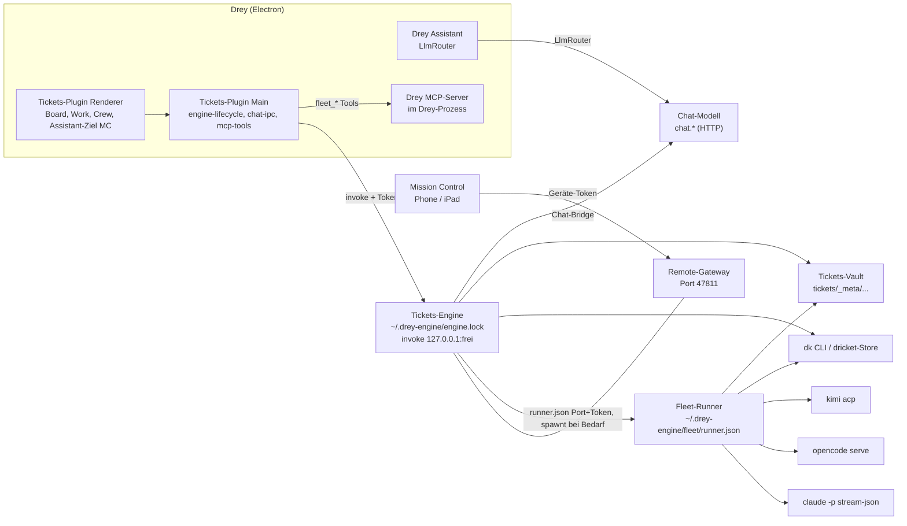
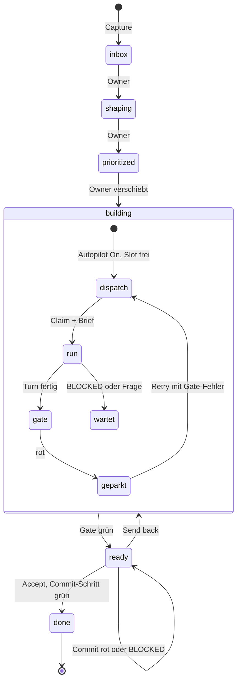
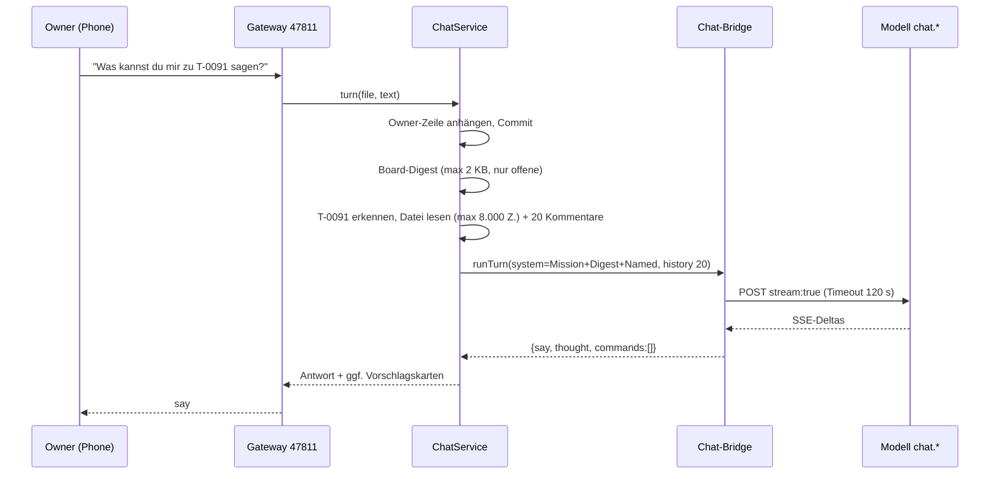
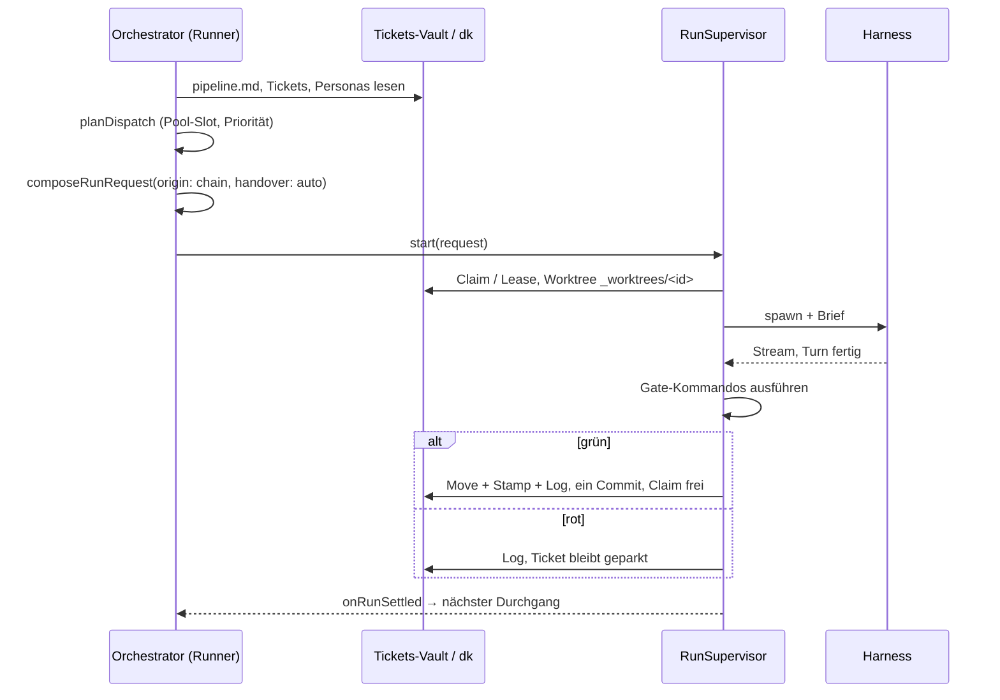

# Crew, Personas, Wissen, Runner und Phasen — wie es heute läuft (und was entschieden ist)

Diese Datei ist auf Wunsch des Owners (2026-11-08) bewusst auf Deutsch geschrieben; alle anderen Dokumente des Repos sind englisch.

Stand: Branch `desktop-integration`, aus dem Code gelesen. Wo Code und Dokumentation auseinanderlaufen, steht dabei, was gilt; gefolgt bin ich immer dem Code.

---

## 1. Die Bausteine

**Drey** ist die Electron-App. Das **Tickets-Plugin** (`plugins/tickets/`) hat einen Main-Teil, der die Engine startet oder übernimmt, und einen Renderer-Teil mit Board, Work-Panel, Crew-Ansicht und dem Mission-Control-Ziel des Assistant. Der Main-Teil rechnet selbst nichts aus: Er reicht Aufrufe über einen Loopback-„invoke“-Kanal an die Engine weiter. Das gilt auch für die Chat-Handler `mc*`. (Datei: `plugins/tickets/main/chat-ipc.ts`, `plugins/tickets/main/engine-lifecycle.ts`)

Die **Tickets-Engine** ist ein eigener Node-Prozess (`engine-main.ts`, gestartet mit `ELECTRON_RUN_AS_NODE`). Pro Rechner läuft genau eine. Ihr Zuhause ist `~/.drey-engine/`, und dort liegt die Lockdatei `engine.lock` mit pid, invoke-Port und Token. Drey übernimmt eine laufende Engine, statt eine zweite zu starten. Der invoke-Kanal lauscht auf `127.0.0.1` auf einem freien Port. In der Engine stecken der Board-Service, der Chat-Service, der Fleet-Client, der Notes-Service und das Remote-Gateway für die Telefone. (Datei: `packages/tickets-engine/src/server/engine-main.ts`, `packages/tickets-engine/src/server/engine.ts`)

Der **Fleet-/Crew-Runner** ist ein zweiter, losgelöster Prozess. Er besitzt die Worker-Prozesse, die Stream-Dateien und den Chain-Orchestrator. Er bietet einen Loopback-HTTP-Endpunkt mit Bearer-Token an, und Port und Token stehen in `<fleet-root>/runner.json`. Eine zweite Instanz beendet sich, sobald sie einen gesunden Peer findet. Ohne laufenden Run und mit Autopilot Off beendet sich der Runner nach einer Leerlaufspanne (req-110). Der Kommentar in `runner.ts` nennt `<userData>/fleet/` als Wurzel. Die Engine übergibt aber `path.join(home, 'fleet')`, also `~/.drey-engine/fleet/`; ich folge dem Code. (Datei: `packages/tickets-engine/src/fleet/runner.ts`, `packages/tickets-engine/src/server/engine.ts`)

Für die **Worker-Harnesse** gibt es kein `adapters/`-Verzeichnis. Die drei Adapter stehen in `fleet/providers.ts` und `fleet/kimi.ts`:

- `claude-code` startet `claude -p --input-format stream-json --output-format stream-json`.
- `opencode` startet `opencode serve` auf Loopback und spricht dessen HTTP- und SSE-API.
- `kimi` startet `kimi acp` und spricht JSON-RPC über stdio.

(Datei: `packages/tickets-engine/src/fleet/providers.ts`, `packages/tickets-engine/src/fleet/kimi.ts`)

**Mission Control** ist der Client für Telefon und iPad. Das Remote-Gateway der Engine liefert ihn aus, standardmäßig auf Port `47811`. Gebunden wird an Loopback oder im Modus `lan` an eine LAN-Adresse, und der Zugang läuft über gepairte Geräte-Tokens. (Datei: `packages/tickets-engine/src/server/config.ts`, `packages/tickets-engine/src/server/service.ts`)

Der **dricket-Store** ist das Tickets-Repository. Die Engine ruft dafür das installierte Programm `dk` mit `--json` auf (mindestens v0.6.0). Claims, Leases, Epochen und Stages entscheidet `dk`; die Engine reicht nur Bytes durch. (Datei: `packages/tickets-engine/src/store/dk-process.ts`, `packages/tickets-engine/src/fleet/run-lease.ts`)

---

## 2. Phasen und Pipeline

**Die Pipeline** steht in `tickets/_meta/pipeline.md`, im Frontmatter unter `phases:`. Jede Phase hat `id`, `title`, `handover` und optional `persona`, `wip`, `claim`, `worker`, `model`, `prompt`, `maxTurns` und `maxWorkMin`. Für `handover` gibt es vier Werte: `manual`, `agent <prompt-ref>[@worker]`, `ci` und `none`. Ein `handover: auto` gibt es nicht. `auto` taucht an zwei anderen Stellen auf: als `track:` eines Tickets (läuft allein, im Gegensatz zu `shape`) und als Handover-*Modus*, den der Dispatcher für die Sitzungsübergabe anfordert. (Datei: `packages/tickets-engine/src/contracts/tickets.ts`, `packages/tickets-engine/src/fleet/request.ts`)

**Default-Pipeline.** Laut Changelog-Meilenstein 166 („E12-9c“) hat ein neues Board die Spalten Inbox · Plan · Build · Review · Sign Off · Done. Der Code schreibt heute etwas anderes. `DEFAULT_PIPELINE_TEXT` legt sechs Stages an (req-99a): `inbox`, `shaping`, `prioritized`, `building`, `ready` („Ready to try“) und `done`. Gefolgt bin ich dem Code. Vier Stages sind Owner-Spalten mit `handover: manual, persona: you`: Inbox, Shaping, Prioritized und Ready to try. **Building** ist die einzige Agent-Spalte, mit `agent build-default`, `claim: true` und `wip: 3`. Done hat `handover: none`. Plan, Build, Review und Test laufen als Phasen der Kette innerhalb von Building und sind keine eigenen Stages. Ältere Boards behalten ihre Spalten. (Datei: `packages/tickets-engine/src/core/pipeline-states.ts`, `plugins/tickets/BOARD.md`, `specs/changelog.md`)

**Gates.** Das *Machine Gate* sind die Zeilen `- [ ] \`command\`` unter `### Acceptance criteria`. Der Runner führt sie nach dem Turn des Workers selbst noch einmal aus. Ein grünes Gate bewegt das Ticket eine Spalte nach rechts. Ein *rotes* Gate parkt den Schritt: Das Ticket bleibt stehen und der Fehler wird protokolliert. Ohne ausführbare Kriterien wird der Start verweigert. Die einzige Ausnahme ist die erste Worker-Spalte, die strukturell gatet. Ein Scout-Ticket (`form: scout`) hat gar kein Gate und bewegt sich nicht. Endet ein Worker mit dem `BLOCKED`-Marker, läuft kein Gate und das Ticket wartet auf den Owner. (Datei: `packages/tickets-engine/src/fleet/request.ts`, `packages/tickets-engine/src/fleet/assignment.ts`, `packages/tickets-engine/src/fleet/chain.ts`)

**Bewegung.** Ein Wechsel der Spalte ist eine git-Bewegung: Move, Stamp, Log und genau ein Commit, wobei der Runner der einzige Schreiber ist (ADR-0076). In claim-Phasen bekommt das Ticket `claimed-by`/`claimed-at`. Auf einem dricket-Store holt der Runner vor dem Spawn über `dk` einen Claim mit Lease (`agent-<run>@<host>`) und verlängert ihn, solange der Worker läuft. Exit 13 (`claim-lost`) stoppt den Worker. Auf einem Store bekommt der Worker eine Arbeitskopie `_worktrees/<id>.ticket.md`. Nach dem Turn schreibt der Runner die Änderungen kapitelweise mit `put` zurück (D-30). (Datei: `packages/tickets-engine/src/fleet/runs.ts`, `packages/tickets-engine/src/fleet/run-lease.ts`, `specs/ticket-schema.md`, `specs/changelog.md`)

**Chain-Orchestrator und Autopilot.** Der Orchestrator läuft im Runner. Er liest den Vault selbst, plant mit den reinen Regeln aus `chain.ts` und startet Runs über die Supervisoren der einzelnen Provider. Ausgelöst wird er durch ein Ereignis oder spätestens nach dem Scan-Intervall. Die Slots gehören den Provider-Pools (`fleet.pool.<provider>.size`, Default 1) und nicht den Spalten. Ein freier Slot nimmt das wichtigste Ticket, zuerst nach Priorität, dann die Spalte ganz rechts. Master- und Spaltenzustand liegen in `<fleet-root>/chain.json`, niemals im Tickets-Repository. Der Autopilot kennt drei Zustände: On, Paused (optional mit Fortsetzungszeit) und Off. Nur bei On wird dispatcht. Jeder Start des Runners beginnt mit Off. (Datei: `packages/tickets-engine/src/fleet/orchestrator.ts`, `packages/tickets-engine/src/fleet/autopilot.ts`, `packages/tickets-engine/src/contracts/fleet-defaults.ts`, `docs/09_architecture_decisions/0077-continuous-orchestration.md`)

**Regeln seit Meilenstein 204.** Jeder Start läuft durch `composeRunRequest`. Diese Funktion verweigert einen Run aus einer Spalte ohne Agent-Handover, egal wer ihn anfordert. Ausgenommen sind nur der interaktive Dialog des Owners und der Commit-Schritt von Accept (D-29). Außerdem braucht jeder Start ein `origin`, zum Beispiel `chain`, `accept`, `mcp`, `drey:run-dialog`, `drey:plan-dialog`, `handoff of <run>` oder `device <name> (<id>)`. Ohne `origin` lehnen Board und Runner den Start ab (D-41). Das `origin` landet in `engine.log`, in `runner.log` und im Run-Record. (Datei: `packages/tickets-engine/src/fleet/request.ts`, `packages/tickets-engine/src/fleet/runs.ts`, `specs/changelog.md`)

**Meilenstein 207.** Der Autopilot steuert nur noch den Dispatch. Ein Durchgang über alle Chat-Oberflächen hat ergeben, dass keine einen Chain- oder Autopilot-Guard hat. Gemeint sind Mission Control im Assistant, Shape mit Paul, der 1:1 und das Telefon. Sie brauchen nur die Chat-Bridge (`chat.*`). Die einzige Ausnahme ist eine Nachricht an einen laufenden Agent-Run; dafür startet `FleetClient.send` den Runner bei Bedarf. (Datei: `specs/changelog.md`, `packages/tickets-engine/src/services/fleet-client.ts`)

---

## 3. Personas

Eine **Persona** ist ein Verzeichnis `tickets/_meta/personas/<id>/` mit folgenden Dateien:

| Datei | Inhalt | Wer schreibt | Wer liest |
|---|---|---|---|
| `persona.md` | Frontmatter: `title`, `kind` (`agent`/`human`), `role`, `worker`, `models.default/pool/router`, `color`, `skills`, `budget`; darunter Prosa | Owner (Persona-Seite, `personaPatch`) | Dispatch, UI |
| `prompt.md` | Persona-Prompt; **ersetzt** den Phasen-Prompt im Brief | Owner, angenommener Vorschlag | Brief |
| `memory.md` | `# Memory`, eine Zeile pro Eintrag, max. 200 Zeilen, `[pinned]` | nur Owner-Aktionen (siehe 4) | Brief (`## Memory`) |
| `thread.md` | Coaching-Thread des 1:1 | `personaThreadAppend` | Brief (`## Coaching`) |
| `skills/<name>.md` oder `skills/<name>/SKILL.md` | Skill-Text; Fallback `_meta/skills/` | Owner | Brief (`## Skills`) |
| `friction.md`, `improvements.md` | Reibungszeilen; Vorschläge der Aggregation | Worker (theoretisch), Aggregator | Persona-Seite |

(Datei: `packages/tickets-engine/src/core/persona.ts`, `packages/tickets-engine/src/services/persona-store.ts`, `packages/tickets-engine/src/services/persona-loader.ts`, `packages/tickets-engine/src/core/improvements.ts`)

Eine Datei `persona-skills.ts` oder `persona-improvements.ts` gibt es unter `services/` nicht. Dort liegen nur die Specs gleichen Namens. Die Skill-Logik steckt in `loadPersonaSkills` (`core/persona.ts`), die Vorschlagslogik in `core/improvements.ts` und `services/improvements-service.ts`. (Datei: `packages/tickets-engine/src/core/persona.ts`, `packages/tickets-engine/src/services/improvements-service.ts`)

**Default-Personas.** „Initialize board“ schreibt `pipeline.md`, `repos.md`, die mitgelieferten Prompts und genau eine Persona: `you`. `build-default` und `commit-default` sind **keine Personas**. Es sind Prompt-Refs (`handover: agent build-default`, `COMMIT_STEP_PROMPT`), die als `tickets/_meta/prompts/<ref>.md` geseedet werden. (Datei: `packages/tickets-engine/src/services/board-service.ts`, `packages/tickets-engine/src/core/pipeline-states.ts`, `docs/design/work-panel/default-names-audit.md`)

**`you`** ist die Persona mit `kind: human`, also der Owner selbst als Teammitglied. Ein Gate, das `you` zugewiesen ist, startet keinen Run, sondern parkt das Ticket. Die Persona zählt weder für Kapazität noch für Budget oder Pool. Ihr Titel kommt aus `personas.humanName` und ist standardmäßig „You“. (Datei: `packages/tickets-engine/src/core/persona.ts`, `packages/tickets-engine/src/core/manual-gate.ts`)

**Zuordnung.** Wer ein Ticket bearbeitet, entscheidet eine Leiter: zuerst der Pin im Ticket (`persona:`), dann die Phasen-Persona aus `pipeline.md`, dann die Default-Persona aus der Engine-Konfiguration (`defaultPersona`). Hat die gewinnende Persona einen lesbaren `worker`, liefert sie Harness und Modell (`models.default`). Ohne Persona gilt der alte Ring: Ticket-`worker:`, Spalte, `@worker` im Handover, Repo und Default `opencode`. Eine Worker-Wahl des Owners im Startdialog schlägt die Persona. Den Router reicht der Dispatch nicht durch, denn er übergibt `personaModelFor(persona, null)`. Pool und `router` einer Persona haben auf den Dispatch daher heute keinen Einfluss. (Datei: `packages/tickets-engine/src/services/persona-loader.ts`, `packages/tickets-engine/src/fleet/request.ts`, `packages/tickets-engine/src/fleet/assignment.ts`, `packages/tickets-engine/src/fleet/orchestrator.ts`)

**Pia, Paul, Ben, Ralf und Tessa** sind eine Beispiel-Crew aus den Fixtures und Tests: Planer, Builder, Reviewer und Testerin. Pia ist laut Audit Mission Control selbst. Verpflichtend ist keine von ihnen. Zwei Stellen setzen die Namen allerdings fest voraus. `SHAPE_SYSTEM_PROMPT` und `FLOW_SYSTEM_PROMPT` sagen dem Modell „ben builds, ralf reviews, tessa tests, paul plans“. (Datei: `docs/design/work-panel/default-names-audit.md`, `packages/tickets-engine/src/services/chat-llm.ts`)

---

## 4. Wissen: was ein Run zu lesen bekommt

`composeRunRequest` baut den Brief, und `composeInstruction` setzt ihn zusammen. Alles ist deterministischer Text ohne Modell, und die stabilen Teile stehen vorne, damit der Prompt-Cache greift. Die Reihenfolge ist:

1. Die Agent-Anweisungen des Repos, wörtlich übernommen. Gelesen wird zuerst die Datei aus `repos.md` `instructions:`, sonst `CLAUDE.md`, sonst `AGENTS.md`. Fallback-Dateien werden bei 16 KB abgeschnitten.
2. Der Prompt: der Persona-Prompt, falls vorhanden, sonst `_meta/prompts/<ref>.md` ohne Versionsmarker.
3. `## Skills` (seit 204).
4. `## Plan` wörtlich.
5. Wer, wo und welcher Branch, dazu der Pfad der Ticketdatei und die Beschreibung.
6. Der variable Teil: `## Memory` (die letzten max. 20 Zeilen bzw. 500 Tokens), `## Coaching` (die letzten 5 Owner-Nachrichten aus `thread.md`), der `## Handover` des vorigen Schritts (max. 2.000 Zeichen), der Diff-Stat und bei einem Retry das Ende des Gate-Fehlers.
7. Die Gate-Kommandos, die Completion- oder Dialog-Disziplin, die Handover-Disziplin und die Frageform an den Owner.

(Datei: `packages/tickets-engine/src/fleet/request.ts`, `packages/tickets-engine/src/fleet/assignment.ts`, `packages/tickets-engine/src/fleet/context-pack.ts`, `packages/tickets-engine/src/fleet/orchestrator.ts`)

**Handover-Modi.** Es gibt `fresh`, `resume` und `resume-compact`. Der Dispatcher fordert `auto` an, `resolveHandover` entscheidet. Review startet immer frisch. Fortgesetzt wird nur bei gleichem Provider, gleichem Modell und gleicher Phase, und nur wenn die Pause warm ist (Default 15 min). Ab 60k Tokens Kontext wird vorher kompaktiert, das können nur opencode und kimi nativ. `fleet.contextCapTokens` (Default 160.000) ist das Fenster, in dem der Provider mitten im Run kompaktiert. Ein fortgesetzter Run bekommt nur die `continuation`, also den variablen Teil, nicht den ganzen Brief. (Datei: `packages/tickets-engine/src/fleet/handover.ts`, `packages/tickets-engine/src/fleet/protocol.ts`, `packages/tickets-engine/src/contracts/fleet-defaults.ts`)

**Rückfluss in die Persona.** `memory.md` wird nur in drei Fällen geschrieben: über `personaLearn` („teach“), über `personaMemoryAppend` und wenn der Owner einen Vorschlag annimmt (`decideImprovement`). Die Coaching-Zeilen fließen ohne Freigabe in den nächsten Brief. Die Friction-Schleife sieht so aus: Die Prompts bitten den Worker, eine Zeile nach `friction.md` zu schreiben. Der `ImprovementsService` fasst bei 3 Funden, oder bei 3 Funden plus 5 abgeschlossenen Runs, über die Chat-Bridge Vorschläge in `improvements.md` zusammen. Übernommen wird ein Vorschlag erst, wenn der Owner ihn annimmt. (Datei: `packages/tickets-engine/src/services/board-service.ts`, `packages/tickets-engine/src/services/improvements-service.ts`, `packages/tickets-engine/prompts/build-default.md`)

---

## 5. Welche Prompts gehen wohin

| Prompt / Builder | Empfänger | Auslöser | Inhalt in einem Satz | Datei |
|---|---|---|---|---|
| `build-default.md` (v5) | Worker-Run über Harness | Dispatch in Building, Run-Dialog | Implementieren auf `t/<id>`: zuerst orientieren, Gate grün halten, Handover und Friction schreiben. | `packages/tickets-engine/prompts/build-default.md` |
| `plan-default.md` (v2) | Worker-Run | Agent-Spalte mit diesem Ref (ältere Boards) | Plan ins Ticket schreiben, nichts implementieren. | `packages/tickets-engine/prompts/plan-default.md` |
| `plan-interactive-default.md` (v2) | Worker-Run, interaktiv | `drey:plan-dialog` | Erst den Owner interviewen, dann Ziel, Entscheidungen und AC schreiben. | `packages/tickets-engine/prompts/plan-interactive-default.md` |
| `review-default.md` (v2) | Worker-Run, immer `fresh` | Review-Phase der Kette | Den Branch unabhängig gegen Plan und Diff prüfen. | `packages/tickets-engine/prompts/review-default.md` |
| `qa-default.md` (v1) | Worker-Run | Verify-Schritt | Screenshots pro Kriterium beurteilen. | `packages/tickets-engine/prompts/qa-default.md` |
| `scout-default.md` (v1) | Worker-Run, kein Gate | `form: scout` | Nur lesen und einen `## Report` schreiben. | `packages/tickets-engine/prompts/scout-default.md` |
| `commit-default.md` (v3) | Worker-Run | Accept auf Ready to try | Branch auf den Integrationsbranch mergen und pushen. | `packages/tickets-engine/prompts/commit-default.md` |
| `MISSION_SYSTEM_PROMPT` + Board-Digest + genannte Tickets + `reference` | Chat-Bridge `chat.*` | Mission-Control-Frage (Phone, iPad, Assistant-Ziel) | Sechs Intents, striktes JSON `{say, thought, commands}`. | `packages/tickets-engine/src/services/chat-llm.ts`, `chat-service.ts` |
| `SHAPE_SYSTEM_PROMPT` + Ticket-Text | Chat-Bridge | Shape mit Paul | Nur `## Plan` schreiben, bis zu 3 Leserunden im Repo. | `chat-llm.ts` |
| `FLOW_SYSTEM_PROMPT` + `## Flow` | Chat-Bridge | Flow-Entwurf | Genau ein `setChain`-Vorschlag. | `chat-llm.ts` |
| `AGGREGATOR_SYSTEM_PROMPT` | Chat-Bridge | Schwelle der Friction-Funde | Höchstens 3 Verbesserungsentwürfe. | `chat-llm.ts`, `improvements-service.ts` |
| Assistant-Systemprompt (`ASK_*`, `askToolsSystem`, `liveEditSystem`, Vault-Kontext) | Drey Assistant über `LlmRouter` | Frage im Assistant-Panel | Rolle, Umgebung, Vault-Block; Tools werden nur genannt, wenn sie angehängt sind. | `plugins/assistant/main/system-prompt.ts`, `specs/classifier-spec.md` |
| `AUTOTAG_PROMPT`, `SEARCH_SUMMARY_PROMPT` | `LlmRouter` | „Suggest tags“, Search → Summarize | Tags vorschlagen bzw. Treffer zusammenfassen. | `shared/config/schema.ts` (über `shared/app-config.ts`) |
| Task-Klassifikator (`buildTaskMessages`) | keiner | nicht verdrahtet | Task oder Notiz; nur die reinen Hälften existieren. | `shared/llm/classifier.ts`, `specs/classifier-spec.md` |
| Capture-Tidy | `LlmRouter` | „Tidy up“ beim Anlegen eines Tickets | Diktat wird zu Titel und Beschreibung. | `specs/classifier-spec.md` |

Die Prompt-Dateien `refine-interactive-default`, `shape-…` und `test-…` gibt es nicht. Shape ist ein Systemprompt im Code, und den Test übernimmt `qa-default`. (Datei: `packages/tickets-engine/prompts/`, `docs/design/work-panel/default-names-audit.md`)

---

## 6. Was heute NICHT passiert

- **Ein 1:1 geht an kein Modell.** `personaThreadAppend` hängt eine Zeile an `thread.md` an und committet. Niemand antwortet. Der Text landet nur als `## Coaching` im nächsten Run dieser Persona. (Datei: `packages/tickets-engine/src/services/board-service.ts`, `packages/tickets-engine/src/fleet/context-pack.ts`)
- **Memory wird nicht automatisch geschrieben.** `appendMemory` hat nur Aufrufer auf der Owner-Seite. Beim Settle schreibt der Runner nichts in die Persona. (Datei: `packages/tickets-engine/src/services/board-service.ts`)
- **Friction aus Build-Runs kommt praktisch nicht an.** Der Ship-Brief nennt die Persona-ID nicht; nur der Scout-Brief führt `personaId`. `build-default` sagt dem Worker „No persona in your brief: skip it“. (Datei: `packages/tickets-engine/src/fleet/assignment.ts`, `packages/tickets-engine/prompts/build-default.md`)
- **Runner haben keinen MCP-Vault-Zugriff.** Der claude-Adapter übergibt kein `--mcp-config`, und kimi bekommt ausdrücklich `mcpServers: []`. (Datei: `packages/tickets-engine/src/fleet/providers.ts`, `packages/tickets-engine/src/fleet/kimi.ts`)
- **Skills stehen erst seit 204 im Brief**, und zwar vollständig, im stabilen Teil. (Datei: `specs/changelog.md`, `packages/tickets-engine/src/fleet/context-pack.ts`)
- **Das Modell pro Runner ist nicht wählbar (req-156).** Mission Control hat genau einen `chat.model`. Provider ohne HTTP-Dialekt (`claude-code`, `copilot-*`) verweigert die Bridge. (Datei: `specs/roadmap.md`, `packages/tickets-engine/src/services/chat-model.ts`)
- **Eine Frage zu einer Notiz trägt nur den Pfad mit (req-158).** `reference` ist der Text des Vault-Chips, auf 12.000 Zeichen begrenzt. Laut Roadmap steht darin heute der Pfad der Notiz, nicht ihr Inhalt. (Datei: `specs/roadmap.md`, `plugins/tickets/main/chat-ipc.ts`)

---

## 7. Was entschieden ist und kommt

Die Grundlage sind die Rulings R1–R14 der Design-Session vom 2026-11-07/08. Gebaut ist davon nichts. (Datei: `docs/design/work-panel/crew-internals-concept.md`)

- **req-164 Drey Service:** Engine, Crew-Runner, MCP-Server und Gateway werden ein sichtbarer Prozess; laut Owner-Ruling ist er optional und standardmäßig aus (R6, ADR-0092).
- **req-165/166 Service-UI und Sessions:** Tray, Fenster und Logs; jede Harness-Session roh, mit stdin, Interrupt und Resume.
- **req-167 Vault-MCP:** Das ADR-0071-Toolset ohne `vault_delete`, Token pro Run, standardmäßig alles lesen und nichts schreiben (R5, R7, ADR-0094).
- **req-168 1:1 als Persona-Session:** Eine echte Session auf Harness und Modell der Persona, `thread.md` wird migriert (R1–R3, ADR-0093).
- **req-169 Memory/Journal:** `reviews.md` pro Run, Lektion direkt nach `memory.md`, nur auf ein Signal, in einer Schlussrunde nach dem Gate (R4, R14).
- **req-170 Modelltabelle und Pool:** Klasse, Kostenfaktor, Kapazitätsdeckel, kein Downgrade, drei Ledger; ersetzt `fleet.pool.<provider>.size` (R10, ADR-0095).
- **req-171 Persona-Seite v2:** Markdown-Editor direkt in Instructions, „Allowed to“, Skills mit Schaltern, Proposals (R11).
- **req-172 Skills als Agent Skills:** `_meta/skills/<name>/SKILL.md`, vollständig im Brief (R8).
- **req-173 Sessions als Datensätze:** Arten `run`/`1:1`/`shape`/`free`, explizites Arbeitsverzeichnis, drei Konfigurationsschichten, `chain.json` pro Vault (R12, R13).

(Datei: `specs/roadmap.md`, `docs/design/work-panel/crew-internals-concept.md`)

---

## Quellen

- `CLAUDE.md` (Projektkontext)
- `packages/tickets-engine/src/fleet/request.ts`
- `packages/tickets-engine/src/fleet/assignment.ts`
- `packages/tickets-engine/src/fleet/context-pack.ts`
- `packages/tickets-engine/src/fleet/runner.ts`
- `packages/tickets-engine/src/fleet/runs.ts`
- `packages/tickets-engine/src/fleet/orchestrator.ts`
- `packages/tickets-engine/src/fleet/autopilot.ts`
- `packages/tickets-engine/src/fleet/chain.ts`
- `packages/tickets-engine/src/fleet/handover.ts`
- `packages/tickets-engine/src/fleet/protocol.ts`
- `packages/tickets-engine/src/fleet/providers.ts`
- `packages/tickets-engine/src/fleet/kimi.ts`
- `packages/tickets-engine/src/fleet/run-lease.ts`
- `packages/tickets-engine/src/contracts/fleet-defaults.ts`
- `packages/tickets-engine/src/contracts/tickets.ts`
- `packages/tickets-engine/src/contracts/chain.ts`
- `packages/tickets-engine/src/core/persona.ts`
- `packages/tickets-engine/src/core/pipeline-states.ts`
- `packages/tickets-engine/src/core/manual-gate.ts`
- `packages/tickets-engine/src/core/plan-parts.ts`
- `packages/tickets-engine/src/core/improvements.ts`
- `packages/tickets-engine/src/core/default-prompts.ts`
- `packages/tickets-engine/src/core/chain-delta.ts`
- `packages/tickets-engine/src/migrate/pipeline-text.ts`
- `packages/tickets-engine/src/services/persona-loader.ts`
- `packages/tickets-engine/src/services/persona-store.ts`
- `packages/tickets-engine/src/services/improvements-service.ts`
- `packages/tickets-engine/src/services/board-service.ts`
- `packages/tickets-engine/src/services/chat-llm.ts`
- `packages/tickets-engine/src/services/chat-service.ts`
- `packages/tickets-engine/src/services/chat-model.ts`
- `packages/tickets-engine/src/services/fleet-client.ts`
- `packages/tickets-engine/src/server/engine-main.ts`
- `packages/tickets-engine/src/server/engine.ts`
- `packages/tickets-engine/src/server/service.ts`
- `packages/tickets-engine/src/server/config.ts`
- `packages/tickets-engine/src/store/dk-process.ts`
- `packages/tickets-engine/prompts/*.md` (build, commit, plan, plan-interactive, qa, review, scout)
- `plugins/tickets/main/chat-ipc.ts`
- `plugins/tickets/main/engine-lifecycle.ts`
- `plugins/tickets/main/mcp-tools.ts`
- `plugins/tickets/renderer/conversation/targets.ts`
- `plugins/tickets/BOARD.md`
- `plugins/assistant/main/system-prompt.ts`
- `shared/app-config.ts`, `shared/config/schema.ts`, `shared/config/defaults.ts`
- `specs/ticket-schema.md`
- `specs/classifier-spec.md`
- `specs/changelog.md` (Meilensteine 166, 203–207)
- `specs/roadmap.md` (req-152–173)
- `docs/design/work-panel/crew-internals-concept.md`
- `docs/design/work-panel/default-names-audit.md`
- `docs/09_architecture_decisions/` (Dateinamen 0075–0077, 0088, 0092–0095)
