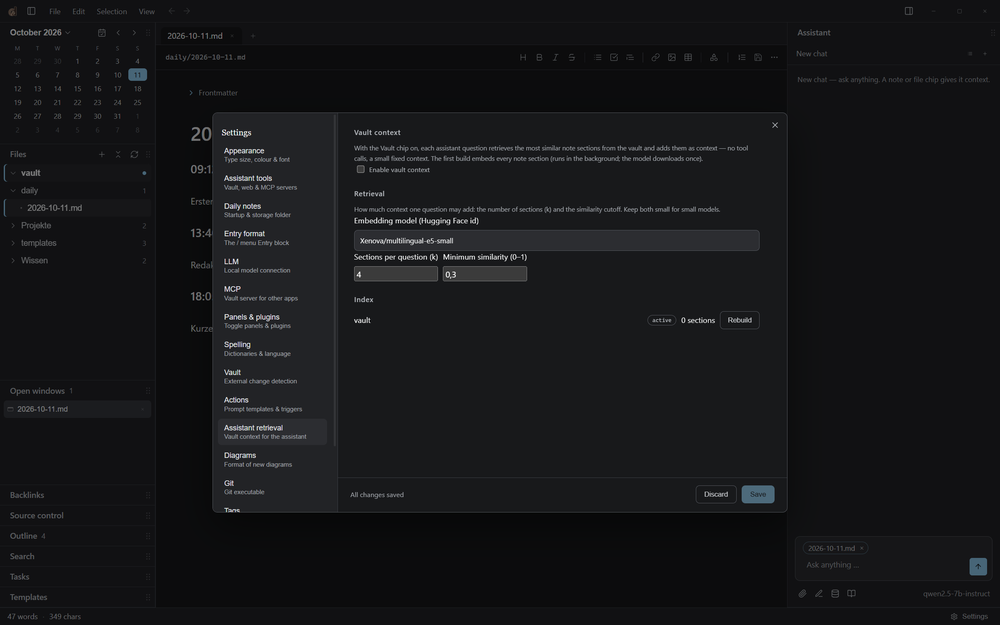

# Drey — User Manual

Drey is a private, local-first knowledge vault: your notes are plain
Markdown files in a folder you own, and the app around them — editor,
search, tasks, an optional AI assistant — runs entirely on your machine.
Nothing leaves it unless you explicitly switch on a hosted AI provider.

> All screenshots in this manual were taken from the app's default
> **Anthrazit** theme (neutral charcoal, blue accent) on Windows. The demo
> vault shown is German — your notes can be in any language; the interface
> itself is English.

**Contents**

1. [First steps](#1-first-steps)
2. [The window at a glance](#2-the-window-at-a-glance)
3. [Vaults and files](#3-vaults-and-files)
4. [Writing notes](#4-writing-notes)
5. [Daily notes and quick capture](#5-daily-notes-and-quick-capture)
6. [Tasks](#6-tasks)
7. [Tags and search](#7-tags-and-search)
8. [Templates, snippets and prompts](#8-templates-snippets-and-prompts)
9. [The Assistant](#9-the-assistant)
10. [AI providers (LLM)](#10-ai-providers-llm)
11. [Assistant tools and MCP](#11-assistant-tools-and-mcp)
12. [Git source control](#12-git-source-control)
13. [Diagrams (draw.io)](#13-diagrams-drawio)
14. [Images, PDFs and Office documents](#14-images-pdfs-and-office-documents)
15. [Panes, tabs and layout](#15-panes-tabs-and-layout)
16. [Quick switcher and command palette](#16-quick-switcher-and-command-palette)
17. [Version history and save conflicts](#17-version-history-and-save-conflicts)
18. [Settings reference](#18-settings-reference)
19. [Keyboard shortcuts](#19-keyboard-shortcuts)
20. [Where your data lives](#20-where-your-data-lives)
21. [Troubleshooting](#21-troubleshooting)

---

## 1. First steps

### Installing

- **Installer** (`drey-<version>-setup.exe`): per-user setup, the
  installation directory is selectable. It registers Drey as an "Open
  with" program for `.md` / `.markdown` / `.mdx` / `.txt` files.
- **Portable** (`drey-<version>-portable.exe`): single file, no
  installation, registers nothing.

### Your vault is just a folder

On first start Drey asks for a vault folder. A vault is an ordinary
directory (it can live on OneDrive or any sync share) containing your
Markdown notes. Drey never wraps them in a database: open the folder in
any editor and the files are all there. You can register several vaults
and switch between them (see [Vaults and files](#3-vaults-and-files)).

The app imposes only a few conventional folders inside a vault:

| Folder | Purpose |
| --- | --- |
| `templates/` | note templates, snippet prompts (`templates/prompts/`) |
| `daily/` | daily notes (configurable, `daily.dir`) |
| `chats/` | assistant conversations, one Markdown note per chat |
| `attachments/` | images and other assets you paste or drop |
| `.drafts/` | hidden auto-saves of unsaved tabs at exit |

### The two surfaces of "settings"

- **App settings** (Settings screen, `Ctrl+,`) — appearance, AI
  connection, plugins and so on. Stored in the operating system's user
  data directory, *never* in the vault.
- **Vault content** — templates, tag prefix colours' effect on notes,
  the daily-note layout. These live in the vault's files.

---

## 2. The window at a glance


The frameless window is built from:

- **Titlebar** — the accent square, the dock toggles (`Ctrl+B` left,
  `Ctrl+Alt+B` right), the **File / Edit / Selection / View** menus, the
  back/forward arrows (see below), and minimize/maximize/close.
- **Left dock** — Calendar, Files, Templates, Search, Tasks, Open
  windows, Outline, Backlinks, Source control. Every panel can be
  collapsed to its header, dragged to another dock, or resized against
  its neighbours.
- **Centre column** — the tab bar, the meta bar (path, formatting
  buttons, save, `⋯` menu) and the editor.
- **Right dock** — the Assistant panel by default.
- **Status bar** (bottom, 28 px) — word/character count, a context hint
  while panels are being moved, and the Settings entry.

### Back and forward

The arrows right of the menus walk the session's document history —
like a browser, across all open panes. `Alt+Left` / `Alt+Right` do the
same, and the mouse side buttons (XButton1/2) are bound VS Code-style.
Stepping back to a closed note reopens it.


The **View** menu toggles every panel, the docks, full screen (`F11`)
and *Reset layout*, which restores the default dock arrangement and
undocks docked editor panes.

---

## 3. Vaults and files


The **Files panel** shows one section per registered vault: a header row
with the vault's name (the dot marks the active vault) and that vault's
file tree.

- **Register more vaults** with *Add vault…* in the panel header. The
  vault header row's context menu (right-click) offers *Set active*,
  *Rename*, *Open in File Explorer* and *Remove*.
- The **active vault** is the default target for new daily notes, quick
  capture and chats. Every operation can still address another vault
  explicitly (search scopes, the tasks panel, drag & drop).
- Click a file to open it. Right-click a file or folder for **New
  file / New folder / Rename / Delete** — names are edited in place.
- **Drag & drop** moves files and folders within a vault, into another
  vault's header row, or onto a folder or file row. Renames and moves
  can automatically rewrite wikilinks that pointed at the old path
  (see [Settings → Vault](#settings-vault)).


### Files from outside

- A vault file with an Office extension (`.docx`, `.xlsx`, `.pptx`, …)
  never opens as a tab — Drey hands it to the operating system, so it
  opens in Word/Excel/PowerPoint. Dropping such a file into a note
  copies it into `attachments/` and links it; **Alt-dropping** links the
  original file instead.
- Text files from anywhere on disk (Explorer "Open with" → Drey) open
  as **pinned external tabs**, are saved in place, and "Save as…"
  copies them into the active vault.

### Staying in sync

By default Drey does **not** watch the vault folder — external changes
appear after the **Refresh** button in the Files panel header (or
`vault.refresh` from the command palette). An opt-in watcher that
reacts to outside changes immediately can be enabled in
[Settings → Vault](#settings-vault).

---

## 4. Writing notes

### Modes

One editor, three reading/writing modes, switched in the meta bar's `⋯`
menu:

- **Live Preview** (default) — a true in-place preview: the cursor sits
  in the rendered document, Markdown markers reveal only around the
  selection, tables/images/diagrams render as widgets that show their
  raw source while the caret is inside them.
- **View** — read-only rendering; plain clicks follow links.
- **Source** — raw Markdown.


The `⋯` menu also holds *Formatting toolbar*, *Lines* (line numbers),
*Suggest tags* (AI), *File history…*, *Export as PDF…*, *Save as…* and
any manual Assistant Actions you have configured.


### The slash menu and capture

Typing `/` on an empty line opens the **slash menu**:

- **Entry** — the quick-capture block: a `## HH:mm` heading with an
  optional topic, exactly what daily-note journaling uses. The inserted
  format is configurable (Settings → *Entry format*).
- **Templates** — every template in your vault's `templates/` folder,
  each with a preview card.
- **Formatting** — headings, lists, quotes, tables, code blocks.


### Snippets

Typing a snippet trigger — `tbl`, `code`, `task`, … — offers a
multi-line block with `${1:placeholder}` tabstops: accept with `Enter`,
then jump between placeholders with `Tab`. The library is yours to edit
in Settings → *Templates*.


### Tags and wikilinks

- `#tag` words render as **pills**; `Ctrl`/`Cmd`-click a pill to search
  it. Typing `#` autocompletes from your existing vocabulary. Tags are
  free labels — `#project/relaunch` style namespaces give structure
  without folders.
- `[[Note name]]` renders as an internal link (unresolved targets are
  muted and dotted). `Ctrl`/`Cmd`-click **opens** the target — creating
  the note if it does not exist — and `[[Note#Heading]]` jumps to a
  heading. `[[Note|alias]]` shows the alias text. Typing after `[[`
  autocompletes note names across all vaults.

### Editing aids

- **Formatting toolbar** — icon-only Markdown buttons in the meta bar
  (hideable via `⋯`).
- **Folding** — headings collapse Obsidian-style; the chevron appears on
  hover in the gutter.
- **Line numbers** — the *Lines* toggle (`Ctrl+G`), an app-wide
  preference.
- **Spell checking** — Hunspell dictionaries (English and German
  bundled), per-language and personal word lists in Settings →
  *Spelling*.
- **Find in note** — from the `Selection`/context menu; CodeMirror's
  search panel.
- Selection menu helpers: *Select line*, *Move line up/down*,
  *Duplicate selection*, *Toggle task done*.
- Every embed that shows its raw source (`</>` *View source* button or
  caret inside) draws it in a visibly contained block; an image's source
  line shows **above** the still-rendered picture, never replacing it.

### Saving

`Ctrl+S` saves the focused note, `Ctrl+Shift+S` saves into a new file,
`Ctrl+Alt+S` saves all dirty tabs. Saving never adds frontmatter you did
not have; an existing `updated:` field is touched only where present.
Every save keeps the overwritten text as a restorable version
([Version history](#17-version-history-and-save-conflicts)).

---

## 5. Daily notes and quick capture


- The **Calendar panel**'s header is the month/year picker itself, with
  a **Today** button (opens today's daily note) and month arrows. Days
  that have a note carry a dot.
- Daily notes live in `daily/YYYY-MM-DD.md` (folder and naming
  configurable in Settings → *Daily notes*).
- New daily notes are generated from `templates/daily.md`; the file is
  created with a starter layout on first use and is yours to edit.
  Placeholders: `{{date}}`, `{{time}}`, `{{datetime}}`, `{{title}}`.
- **Quick capture**: press `Ctrl+Alt+N` anywhere in Windows while Drey
  is running — the window comes forward, today's daily note opens, and a
  fresh `## HH:mm` section starts. Type, then `Ctrl+S`. (The main window
  must be open — there is no tray mode. If the hotkey does nothing,
  another program owns it.)

Journal entries through the day are exactly the slash menu's **Entry**
block — heading with time, your text, optional `#tags`.

---

## 6. Tasks

A task is any `- [ ]` checklist line — or a plain text line carrying
`#task`. Tasks understand Obsidian-compatible inline metadata:

- a due date: `📅 2026-10-14`
- a priority glyph: one of `🔺` `⏫` `🔽`

```markdown
- [ ] Clarify image rights with the editor 📅 2026-10-14 ⏫
```


The **Tasks panel** lists tasks from

- **Doc** — the open document's live buffer,
- **Vault** — every note in the active vault,
- **All** — every registered vault, grouped per file with a vault badge.

The toolbar offers *hide done*, a kind filter (checkbox tasks vs.
`#task` lines) and a sort cycle (file order / due / priority). Rows show
a due badge (coloured when overdue or due today) and the priority glyph
— both are buttons that re-open their pickers. In the editor, typing
`due` / `prio` on a task line (or clicking a metadata chip) opens the
same pickers in place.

- Ticking a row in the panel rewrites and saves the note (the open
  buffer if the file is open).
- Clicking a row opens the file at that line, in its vault.
- `Mod+Enter` toggles the task under the cursor done/undone.

---

## 7. Tags and search

Tags are free inline `#tag` labels (never directories, no frontmatter
list). The **Tags plugin** keeps a per-vault index of every
heading-delimited section — tagged or not — so full-text search reaches
unindexed-looking notes too.


The **Search panel** (open with `Ctrl+Shift+F`) has:

- A **scope switch**: this document / the active vault / all vaults.
- **One field** for everything: free text, and `#tag` words that lift
  into chips as you type them.
- Match toggles: `Aa` case-sensitive, `ab` whole word, `.*` regular
  expression (an invalid regex shows an inline error, not an empty
  list).
- **Include chats** (speech-bubble toggle): `chats/` notes stay indexed
  but are excluded from vault/all results — and from replace — unless
  this is on.
- **Semantic** (brain toggle): ranks the text query by meaning using
  the Assistant's local embedding index — percent-score badges, tag
  chips still an exact filter. Requires *Assistant retrieval* enabled in
  Settings; otherwise a clear error row points there.

Results are sections grouped per file; a click opens the file at the
section's line, in the file's vault.

### Replace

The replace row patches the **open buffer** in document scope (an
unsaved edit, like typing). Vault-wide replace first shows **one bundled
confirmation** listing every affected file with its diff:


### Export and Summarize

On the result line: **Export** dumps the hits into an unsaved
`search-results.md` scratch tab; **Summarize** (needs an LLM) streams a
digest of the hits into an editable scratch tab, cancellable, over the
`builtin:search-summary` prompt template.

### Tag management

Settings → **Tags** colours tag prefixes (longest `/`-namespace wins,
otherwise a deterministic palette) and renames/merges tags across the
whole vault — a grammar-faithful token rewrite, descendants included by
default. `#task` is reserved and never suggested for renaming.

---

## 8. Templates, snippets and prompts


- **Note templates** are Markdown files in `templates/`. They appear in
  the Templates panel, in the slash menu (with preview cards) and in
  "New note" flows.
- **Snippet triggers** (`tbl`, `code`, …) are edited in Settings →
  *Templates* — the library is user-owned app config, with `${n:placeholder}`
  tabstops.
- **Prompts** for the Assistant are Markdown files in
  `templates/prompts/`: a `# Title` heading, a `> Description` line and
  the prompt body. They surface in the composer's *Prompts* picker.

---

## 9. The Assistant


The **Assistant panel** is chat-first:

- The head shows the active conversation plus a chat-list button and
  `+` for a new chat. At startup the newest chat loads once; otherwise
  the panel keeps its chat while you move around the app. Opening a
  chat's own note tab hydrates the panel with it — that is the only
  implicit switch.
- **Every turn is persisted** as ordinary Markdown under
  `chats/<year>/<month>/…` (`kind: chat`). Chat notes auto-save; a
  follow-up replays the whole history, tool calls and applied edits
  included. There is no length cap and no hidden state — the note *is*
  the transcript.
- The **composer** grows with its text and understands `@` to attach
  note chips (autocomplete over vault paths), paste/drop of images, and
  a `+` button to stage external files (they are copied into the vault).
  The tool row: **Attach** · **Live edit** · **Vault context** ·
  **Prompts** · **model picker**.


### Context chips

Attach the notes the model should see: `@`-completion, images
(providers with vision), or scratch text. A small arrow on an answer
inserts it into the open note.

### Vault context (semantic retrieval)

The **Vault chip** opens a picker — *Off / Active vault / All vaults*
plus one checkbox per registered vault, so a non-active vault can be
targeted without switching. When on, your question is embedded locally
(see Settings → *Assistant retrieval*) and the most similar note
sections are injected into that one call. Chat notes are excluded so
past questions do not drown out the notes that answer them.

### Live edit

The **Live edit** chip opts a single question into direct editing: the
model edits the open note through `doc_apply_diff` / `doc_write` /
`doc_read` tools, each change lands in the editor as one undoable step,
the document is locked against your typing while the turn runs, and the
result is recorded in the chat note. Providers without tool support
fail visibly.

### Actions

**Actions** are saved prompts with behaviour — *Autotag* (suggest
tags), *Search summary*, and your own: name + prompt + result kind
(inline diff or whole-document preview). Triggers run **manually** from
the editor's `⋯` menu or **on save**. Writing results pass through the
shared confirmation dialog with a "don't ask again" switch. Managed in
Settings → *Actions*.

### Suggest tags

`⋯` → *Suggest tags* sends the caret's heading section to the model and
applies its tag suggestions to that section directly — the classifier
only ever suggests; `#task` stays reserved.

---

## 10. AI providers (LLM)


Drey is local-first: the default provider is any **OpenAI-compatible
endpoint** on your machine — LM Studio (the documented default,
`http://localhost:1234/v1`), Unsloth Desktop, llama.cpp, vLLM, Ollama.

- **Master switch** — off means classification, Actions and the chat
  all degrade with a clear message instead of failing silently.
- **Model id** — pick from `GET /models` or type it by hand (CLI/web
  providers advertise no model list at all; the field stays free-form).
- **No generation timeout** — a local model may think for minutes;
  you cancel instead of the app cutting it off.
- A request log with runnable `curl` equivalents sits at the bottom of
  the page.

Hosted presets — **OpenRouter, Anthropic API, Z.ai GLM** — and CLI
providers — **Claude Code (headless)**, **GitHub Copilot CLI**, and the
removable **Copilot Web** scraper — are strictly opt-in and off by
default. API keys are stored in plain text in `app-config.json` in your
user data directory (like every desktop client of a local endpoint).

---

## 11. Assistant tools and MCP


### What the assistant may call

Settings → **Assistant tools** is the tool contract: one switch per
group (vault, tasks, templates, web fetch, each external MCP server),
`write: confirm | auto` on the writing groups, and
`approval: ask | allow` on everything that leaves the machine. An
external tool call under *ask* shows the shared approval dialog
(source, tool, arguments — *Allow / Always allow / Deny*).

### Drey as an MCP *client*

Add external MCP servers (stdio or Streamable HTTP); their tools reach
the model as `mcp__<server>__<tool>`. The built-in `web_fetch` group is
a tool like the rest.

### Drey as an MCP *server*


Settings → **MCP** exposes the vault *to other programs*: the same
opt-in discipline, off by default.

- Tools: `vault_search` (text or `mode: 'semantic'`, optional `vault`
  argument, regex filter, `maxResults`), `vault_read`, `vault_write`.
- `vault_write` goes through the confirmation diff unless **YOLO mode**
  is on.
- Transports: a localhost `POST /mcp` HTTP endpoint and a standalone
  stdio bridge for CLI clients.

---

## 12. Git source control


A vault can be a Git repository (its root or a folder inside one). The
**git plugin** runs your installed `git` — no bundled reimplementation.
The panel shows the repository of the focused document's vault:

- **Branch button** → switch, track a remote branch, create.
- **Commit** box — `Ctrl+Enter`, or *Commit and push*
  (`Ctrl+Shift+Enter`). Drey asks before committing with unsaved tabs,
  and refuses checkout/pull while the vault has unsaved tabs.
- **Merge conflicts / Staged changes / Changes** lists — row click
  compares through the diff view; stage, unstage, discard, open from
  each row.
- **History** (collapsible) — commits not on the upstream carry a
  "↑ not pushed" marker.
- Header icons: Fetch · Pull · Push · More (merge a branch, stash,
  stashes, amend — never of a pushed commit — file history) · Refresh.
- A merge shows a banner with an abort button; the conflict surface is
  keep mine / keep theirs / mark resolved.


Changed files carry status badges (`M` modified, `U` untracked) and
tones in the Files panel. The `git.path` is configurable in Settings →
*Git*.


---

## 13. Diagrams (draw.io)


Drey bundles **draw.io** offline — nothing is sent anywhere.

- Insert a diagram from the formatting bar's shapes button, `/diagram`
  in the slash menu, or the editor context menu. Until first drawn it
  is a placeholder picture in the note.
- Files: `.drawio` (XML), `.drawio.svg` and `.drawio.png` — the two
  picture formats are ordinary images that carry the diagram inside, so
  notes embed them with the normal image syntax and PDF export needs
  nothing extra. Which format a new diagram gets is set in Settings →
  *Diagrams* (SVG by default).


Opening a diagram file opens draw.io in its own tab — **auto-saving**,
no manual `Ctrl+S`. A changed picture reloads in open notes
automatically.

---

## 14. Images, PDFs and Office documents

- **Paste or drop** images into a note — they are stored under
  `attachments/` and referenced with a relative path. Images pasted from
  the web are downloaded and get a `[Source]` link line beneath.
- Click an image's magnifier to zoom (the picture opens in an image
  tab). PDFs in the vault open in a PDF tab.
- **Office documents never render in Drey** — they open in their own
  program (see [Vaults and files](#3-vaults-and-files)). A note link may
  also be a local `file:` URL to a document outside the vault; nothing
  else may use `file:`, and never a network share.
- Dragging text files from the OS into the vault copies them in
  (`Alt`-drop links the original instead, for Office files).

---

## 15. Panes, tabs and layout


- **Split the editor**: a tab's context menu (*Split right / Split
  down*), or `Ctrl+Alt+Enter` / `Ctrl+Alt+Shift+Enter`. `F6` /
  `Shift+F6` cycle pane focus. The layout is an arbitrary tree of rows
  and columns with draggable splitters.
- **Tabs** — drag to reorder or to move between panes (ghost chip +
  drop line; `Esc` cancels). The pin in a tab's context menu keeps it
  from being replaced. Opening a file replaces the focused pane's
  *clean, unpinned* tab; `Ctrl+Enter` in the quick switcher opens
  beside the current tab.
- **Docked editor bands** — any pane can be dragged into the left/right
  dock (above the panels) or docked from its tab menu; it persists with
  the session. *View → Reset layout* undocks them.
- **Panels** — every panel header is a drag grip: move panels between
  the left, right and bottom docks, resize them with the splitters,
  collapse them to their 32 px headers. The whole layout persists
  across restarts.
- **Open windows** panel lists every open document across panes:


Other panels: **Outline** shows the open note's heading tree (click to
jump, fold levels) …


… and **Backlinks** lists every note that links to the open one, grouped
by file and section.


---

## 16. Quick switcher and command palette


`Ctrl+P` opens the **quick switcher**: fuzzy-search every file of every
vault, session-visited documents first, `Ctrl+Enter` opens beside the
current tab, and a no-match query offers *Create note*.


`Ctrl+Shift+P` opens the **command palette** — every registered command
with its shortcut (same actions as the menus, plus *Reset layout*,
*Refresh vault*, *Open today's daily note*, *Toggle source mode*,
*Export as PDF…*, *File history…*, …).

---

## 17. Version history and save conflicts

### Local history

Every save that overwrites text keeps the previous version in the app's
history store (never in the vault; bounded in Settings → *Vault*).
`⋯` → *File history…* (also the tab context menu and the command
palette) lists versions with a diff against your current buffer;
**Restore** loads a version into the editor — saving keeps it.


### Save conflicts

When a file changed on disk after your tab last saw it, `Ctrl+S`
refuses to overwrite: the **merge view** opens — *on disk | result |
mine* — with per-block checkboxes and an editable result column. The
meta bar's "Changed on disk" button opens the same view early.


### Further safety nets

- **Exit auto-save**: unsaved untitled tabs are parked in the hidden
  `.drafts/` folder and offered back on the next start (Notepad++
  style) — chats and scratch tabs never raise the exit prompt, only
  your own unsaved notes do.
- **Session restore** reopens tabs, panes, carets and scroll positions.
- **Renames rewrite links** that would break (ask / always / never in
  Settings → *Vault*), and attachments used only by a moved note
  travel with it.

---

## 18. Settings reference

Open with the status-bar entry or `Ctrl+,`. Core categories are
alphabetical, plugin-contributed ones follow, *About* closes the list.
Every plugin page saves immediately; core pages save on *Save* with a
live preview.

| Category | What lives there |
| --- | --- |
| [Appearance](#settings-appearance) | theme, accent, UI scale, editor typeface and scale |
| [Assistant tools](#settings-assistant-tools) | tool groups, write/approval rules, external MCP servers |
| [Daily notes](#settings-daily-notes) | daily folder and template behaviour |
| [Entry format](#settings-entry-format) | the slash menu's Entry block |
| [LLM](#settings-llm) | provider, endpoint, key, model |
| [MCP](#settings-mcp) | Drey's own vault server for other programs |
| [Panels & plugins](#settings-panels-plugins) | panel and plugin switches, live plugin status |
| [Spelling](#settings-spelling) | dictionaries, personal words |
| [Vault](#settings-vault) | watcher, link rewriting, history bounds |
| Actions | Assistant Action templates and triggers |
| Assistant retrieval | semantic search: model, k, score floor, per-vault index |
| Diagrams | format of new diagrams (SVG/PNG) |
| Git | `git` executable path |
| Tags | prefix colours, rename/merge |
| Templates | snippet trigger library, templates folder |
| About | version, licences |

### Settings: Appearance {#settings-appearance}


Two bespoke themes ship — **Drey** (terracotta) and **Anthrazit**
(neutral charcoal, blue accent, AA contrast; the default) — plus a
catalogue of published CodeMirror themes. The accent colour follows the
theme by default or can be pinned; the UI scale resizes the whole app;
the editor typeface and font scale affect only the writing surface.

### Settings: Assistant tools {#settings-assistant-tools}

See [Assistant tools and MCP](#11-assistant-tools-and-mcp).

### Settings: Daily notes {#settings-daily-notes}

The daily notes root folder (default `daily/`) and template behaviour.

### Settings: Entry format {#settings-entry-format}

What the slash menu's **Entry** block inserts: built-in *classic* and
*ruled* patterns or your own, with the `{{time}}` / `{{date}}` /
`{{datetime}}` / `{{title}}` / `{{tags}}` / `{{content}}` placeholders.

### Settings: LLM {#settings-llm}

See [AI providers](#10-ai-providers-llm).

### Settings: MCP {#settings-mcp}

See [Assistant tools and MCP](#11-assistant-tools-and-mcp).

### Settings: Panels & plugins {#settings-panels-plugins}


One switch per dock panel and per discovered plugin (`plugins.disabled`
applies on restart), plus each plugin's live status. Third-party
plugins install into `<userData>/plugins/<id>/`.

### Settings: Spelling {#settings-spelling}

Bundled English/German Hunspell dictionaries, additional dictionaries,
and the personal word list.

### Settings: Vault {#settings-vault}


- **Watch for external changes** (off by default) — the opt-in file
  watcher; with it off, use Refresh.
- **Rewrite links on rename** — `ask` / `always` / `never`.
- **Local note history** — enabled, keep days (30), max versions per
  file (50).

### Plugin-contributed pages





---

## 19. Keyboard shortcuts

`Ctrl` is `Cmd` on macOS. `Mod` below means exactly that.

| Shortcut | Action |
| --- | --- |
| `Ctrl+Alt+N` | Quick capture into today's daily note (global, while Drey runs) |
| `Mod+N` | New note |
| `Mod+S` / `Mod+Shift+S` / `Mod+Alt+S` | Save / Save as… / Save all |
| `Mod+P` | Quick switcher (files) |
| `Mod+Shift+P` | Command palette |
| `Mod+,` | Settings |
| `Mod+Shift+F` | Search panel |
| `Mod+G` | Toggle line numbers |
| `Mod+B` / `Mod+Alt+B` | Toggle left / right dock |
| `Alt+Left` / `Alt+Right` | Back / forward (also mouse buttons 3/4) |
| `Mod+Alt+Enter` / `Mod+Alt+Shift+Enter` | Split editor right / down |
| `F6` / `Shift+F6` | Focus next / previous pane |
| `F11` | Full screen |
| `Mod+Enter` | Toggle task done (on a task line) |
| `/` on an empty line | Slash menu (Entry, templates, formatting) |
| `Esc` | Close menus, dialogs, drag operations |

The command palette lists every command with its current shortcut.

---

## 20. Where your data lives

| Data | Location |
| --- | --- |
| Notes, templates, chats, attachments | your vault folder — plain Markdown, YAML frontmatter, files |
| App settings + API keys | `<userData>/app-config.json` (plain text) |
| Vault registry (which folders, which active) | `<userData>/vault-config.json` |
| Local note history | `<userData>/history/<vaultId>/` |
| Semantic index | `<UserData>/plugins/assistant/semantic-index/` |
| Installed plugins | `<userData>/plugins/<id>/` |

Because the vault is just files, any file-based backup covers your
notes completely — Drey adds no hidden state inside the vault (the
history store is deliberately outside it).

---

## 21. Troubleshooting

- **"LLM features are off"** — the master switch in Settings → LLM is
  off, or no model is selected. The request log on the same page shows
  exactly what was (not) sent.
- **A hosted provider rejects the key** — 401/403 is almost always the
  API key, not the URL; the log's `curl` command lets you verify
  outside the app.
- **Generation seems stuck** — there is deliberately no timeout; cancel
  the turn instead.
- **Quick capture hotkey does nothing** — another program owns
  `Ctrl+Alt+N`; Drey logs a warning to the main-process console.
- **External file changes don't show up** — the watcher is off by
  default; press Refresh in the Files panel or enable it in Settings →
  Vault.
- **A plugin's panel is missing** — check Settings → *Panels & plugins*
  (changes apply on restart), and the plugin's status line there.
- **MCP clients can't write** — `vault_write` waits for the
  confirmation dialog unless YOLO mode is on.
- **Git panel is empty** — the vault is not inside a Git repository, or
  `git` is not on `PATH` (set it in Settings → *Git*); press Refresh
  after initializing a repository.

---

*Manual for Drey 0.3.0. Screenshots were captured automatically from
the built app (Anthrazit theme, 1600×1000) by
`e2e/manual-screenshots.spec.ts` — run
`$env:DREY_MANUAL_SHOTS='1'; npm run e2e:run -- manual-screenshots`
after `npm run build` to regenerate them.*
