# Drey — User Manual

Drey is a private, local-first note vault that runs your work: your
notes are plain Markdown files in a folder you own, and the app around
them — editor, search, tasks, an optional AI assistant with
permissioned tools — runs entirely on your machine. Nothing leaves it
unless you explicitly switch on a hosted AI provider.

> All screenshots in this manual were taken from the app's default
> **Anthrazit** theme (neutral charcoal, blue accent) on Windows. The demo
> vault shown is German — your notes can be in any language; the interface
> itself is English.

**Contents**

1. [First steps](#1-first-steps)
2. [The window at a glance](#2-the-window-at-a-glance)
3. [Vaults and files](#3-vaults-and-files)
4. [Writing notes](#4-writing-notes)
5. [Daily notes and quick capture](#5-daily-notes-and-quick-capture)
6. [Tasks](#6-tasks)
7. [Tags and search](#7-tags-and-search)
8. [Templates, snippets and prompts](#8-templates-snippets-and-prompts)
9. [The Assistant](#9-the-assistant)
10. [AI providers (LLM)](#10-ai-providers-llm)
11. [Assistant tools and MCP](#11-assistant-tools-and-mcp)
12. [Git source control](#12-git-source-control)
13. [Tickets](#13-tickets)
14. [Diagrams (draw.io)](#14-diagrams-drawio)
15. [Images, PDFs and Office documents](#15-images-pdfs-and-office-documents)
16. [Panes, tabs and layout](#16-panes-tabs-and-layout)
17. [Quick switcher and command palette](#17-quick-switcher-and-command-palette)
18. [Version history and save conflicts](#18-version-history-and-save-conflicts)
19. [Settings reference](#19-settings-reference)
20. [Getting help](#20-getting-help)
21. [Keyboard shortcuts](#21-keyboard-shortcuts)
22. [Where your data lives](#22-where-your-data-lives)
23. [Troubleshooting](#23-troubleshooting)

---

## 1. First steps

### Installing

- **Installer** (`drey-<version>-setup.exe`): per-user setup, the
  installation directory is selectable. It registers Drey as an "Open
  with" program for `.md` / `.markdown` / `.mdx` / `.txt` files.
- **Portable** (`drey-<version>-portable.exe`): single file, no
  installation, registers nothing.

### Your vault is just a folder

On first start Drey asks for a vault folder. A vault is an ordinary
directory (it can live on OneDrive or any sync share) containing your
Markdown notes. Drey never wraps them in a database: open the folder in
any editor and the files are all there. You can register several vaults
and switch between them (see [Vaults and files](#3-vaults-and-files)).

The app imposes only a few conventional folders inside a vault:

| Folder | Purpose |
| --- | --- |
| `templates/` | note templates, snippet prompts (`templates/prompts/`) |
| `daily/` | daily notes (configurable, `daily.dir`) |
| `chats/` | assistant conversations, one Markdown note per chat |
| `attachments/` | images and other assets you paste or drop |
| `.drafts/` | hidden auto-saves of unsaved tabs at exit |

### The two surfaces of "settings"

- **App settings** (Settings screen, `Ctrl+,`) — appearance, AI
  connection, plugins and so on. Stored in the operating system's user
  data directory, *never* in the vault.
- **Vault content** — templates, tag prefix colours' effect on notes,
  the daily-note layout. These live in the vault's files.

---

## 2. The window at a glance

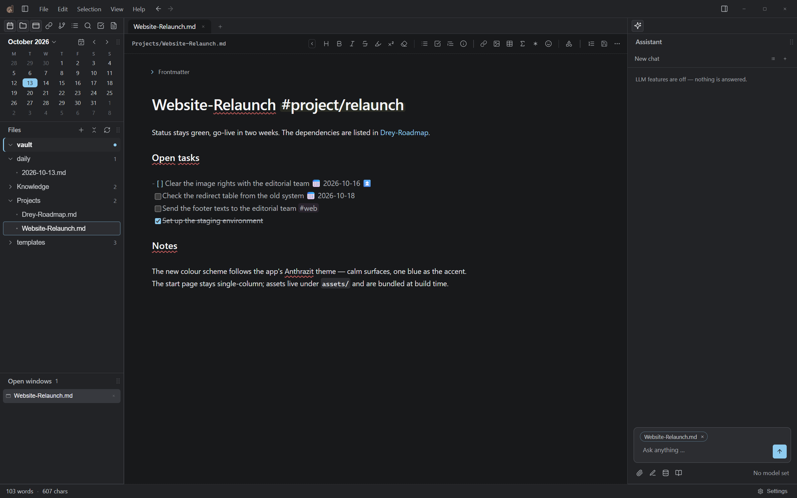

The frameless window is built from:

- **Titlebar** — the accent square, the dock toggles (`Ctrl+B` left,
  `Ctrl+Alt+B` right), the **File / Edit / Selection / View** menus, the
  back/forward arrows (see below), and minimize/maximize/close.
- **Left dock** — Calendar, Files, Templates, Search, Tasks, Open
  windows, Outline, Backlinks, Source control. Every panel can be
  collapsed to its header, dragged to another dock, or resized against
  its neighbours.
- **Centre column** — the tab bar, the meta bar (path, formatting
  buttons, save, `⋯` menu) and the editor.
- **Right dock** — the Assistant panel by default.
- **Status bar** (bottom, 28 px) — word/character count, a context hint
  while panels are being moved, and the Settings entry.

### Back and forward

The arrows right of the menus walk the session's document history —
like a browser, across all open panes. `Alt+Left` / `Alt+Right` do the
same, and the mouse side buttons (XButton1/2) are bound VS Code-style.
Stepping back to a closed note reopens it.

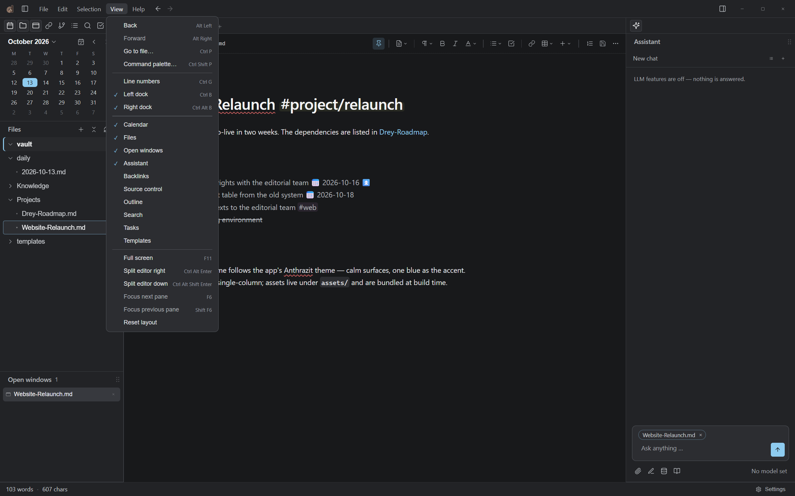

The **View** menu toggles every panel, the docks, zen mode (`Ctrl+Alt+Z`),
full screen (`F11`) and *Reset layout*, which restores the default dock
arrangement and undocks docked editor panes.

### Zen mode

*View → Zen mode* (or `Ctrl+Alt+Z`) hides the titlebar, all docks and
the status bar and leaves just the editor with its tab bar and meta bar —
a plain page for writing or reading. It combines freely with `F11` full
screen. While it is on the menu bar is hidden too; the same chord and the
command palette (`Mod+Shift+P`) stay available. `Ctrl+Alt+Z` again brings
everything back exactly as it was — zen never rearranges your layout, and
it is not remembered across restarts.

---

## 3. Vaults and files

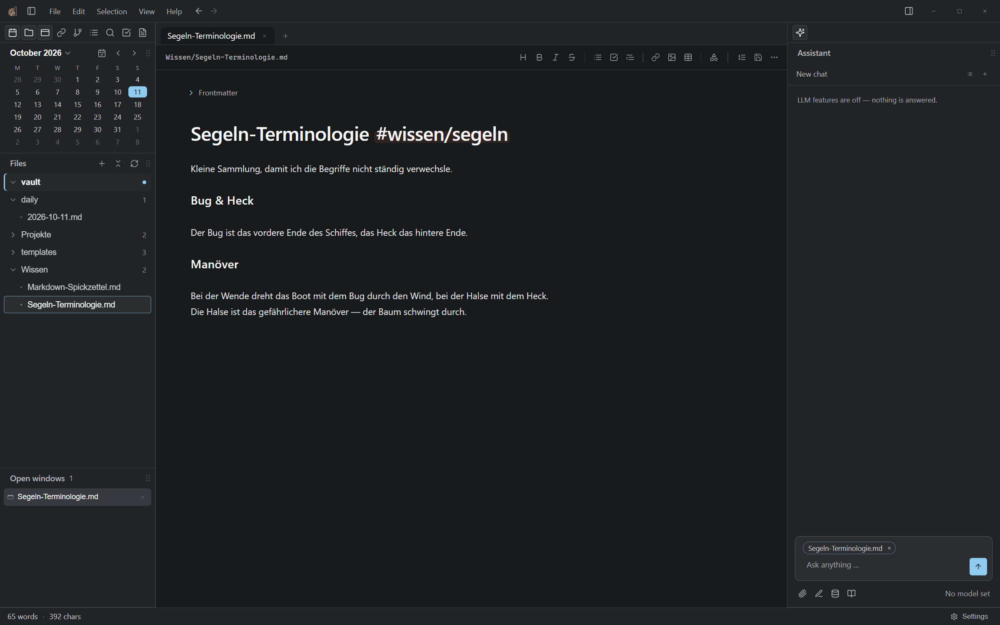

The **Files panel** shows one section per registered vault: a header row
with the vault's name (the dot marks the active vault) and that vault's
file tree.

- **Register more vaults** with *Add vault…* in the panel header. The
  vault header row's context menu (right-click) offers *Set active*,
  *Rename*, *Open in File Explorer* and *Remove*.
- The **active vault** is the default target for new daily notes, quick
  capture and chats. Every operation can still address another vault
  explicitly (search scopes, the tasks panel, drag & drop).
- Click a file to open it. Right-click a file or folder for **New
  file / New folder / Rename / Delete** — names are edited in place.
- **Drag & drop** moves files and folders within a vault, into another
  vault's header row, or onto a folder or file row. Renames and moves
  can automatically rewrite wikilinks that pointed at the old path
  (see [Settings → Vault](#settings-vault)).
- Some vaults are **managed by a plugin** (the tickets vault): their
  files have meaning the plugin owns, so the panel guards them. A
  refused operation explains itself in a message — inside `tickets/`,
  files are created on the board (New ticket), the filename is the
  ticket's identity, columns come from the pipeline, and deletion goes
  through the archive. **Dragging a ticket between phase folders (or
  into `tickets/archive/`) IS a board move** — stamp, log line, one
  commit, exactly like dragging the card (see
  [Tickets](#13-tickets)). Plugins can also add their own rows to the
  context menus (for example *Archive ticket* on a ticket file).

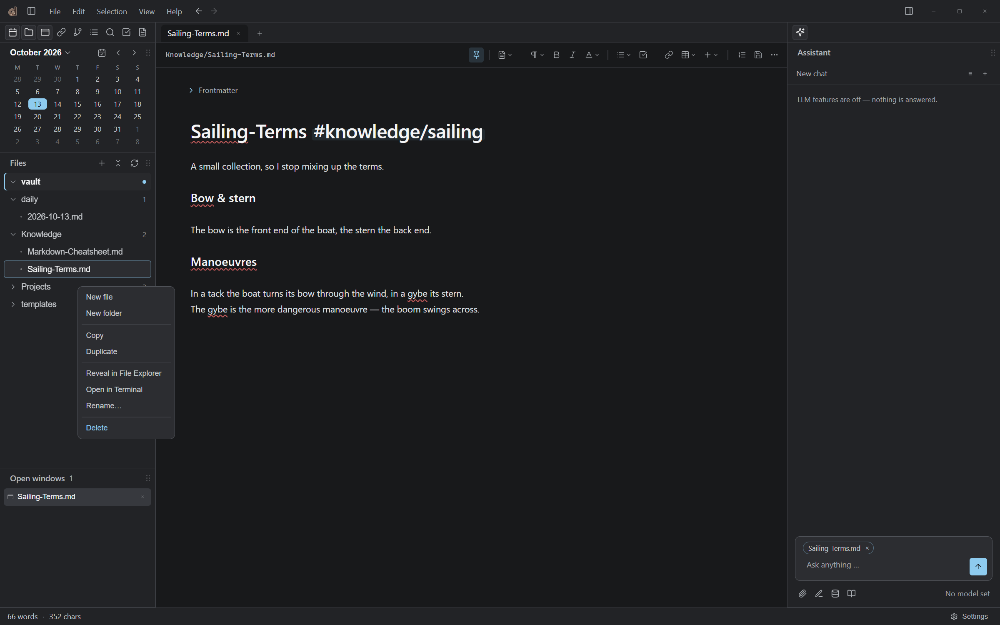

### Files from outside

- A vault file with an Office extension (`.docx`, `.xlsx`, `.pptx`, …)
  never opens as a tab — Drey hands it to the operating system, so it
  opens in Word/Excel/PowerPoint. Dropping such a file into a note
  copies it into `attachments/` and links it; **Alt-dropping** links the
  original file instead.
- Text files from anywhere on disk (Explorer "Open with" → Drey) open
  as **pinned external tabs**, are saved in place, and "Save as…"
  copies them into the active vault.

### Staying in sync

By default Drey does **not** watch the vault folder — external changes
appear after the **Refresh** button in the Files panel header (or
`vault.refresh` from the command palette). An opt-in watcher that
reacts to outside changes immediately can be enabled in
[Settings → Vault](#settings-vault).

---

## 4. Writing notes

### Modes

One editor, three reading/writing modes, switched in the meta bar's `⋯`
menu:

- **Live Preview** (default) — a true in-place preview: the cursor sits
  in the rendered document, Markdown markers reveal only around the
  selection, tables/images/diagrams render as widgets that show their
  raw source while the caret is inside them. A link in the text opens
  with `Ctrl`+click (a plain click places the caret); a link inside a
  rendered table or block opens with a plain click.
- **View** — read-only rendering; plain clicks follow links.
- **Source** — raw Markdown.

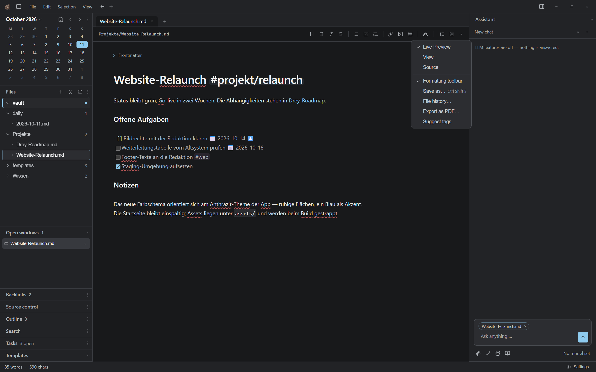

The `⋯` menu also holds *Suggest tags* (AI), *File history…*,
*Export as PDF…*, *Save as…* and any manual Assistant Actions you have
configured.

The editor's text size zooms with `Ctrl +` / `Ctrl -` / `Ctrl 0` or
`Ctrl`+wheel; while it differs from 100%, the meta bar shows the
percentage — click it to reset.

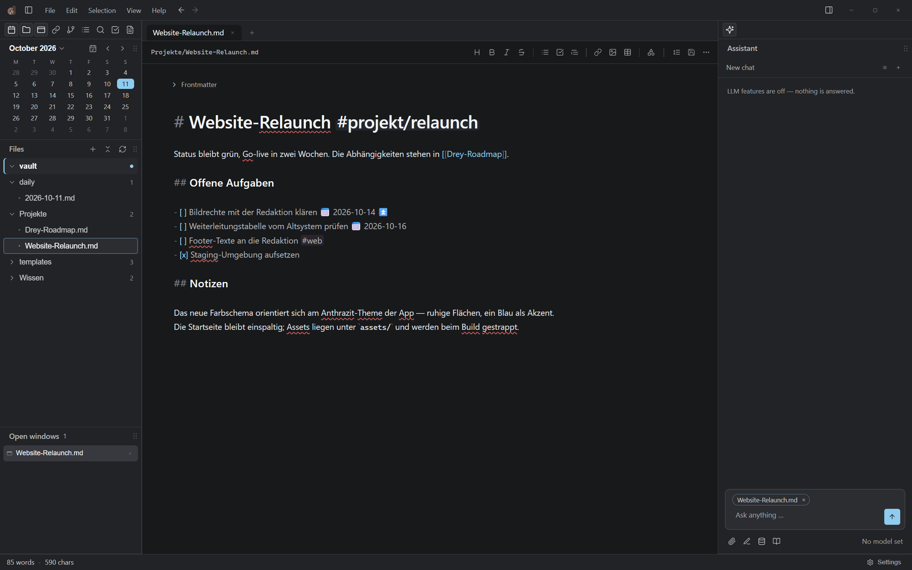

### The slash menu and capture

Typing `/` on an empty line opens the **slash menu**:

- **Entry** — the quick-capture block: a `## HH:mm` heading with an
  optional topic, exactly what daily-note journaling uses. The inserted
  format is configurable (Settings → *Entry format*).
- **Templates…** — opens the template picker at the caret (see
  *Editing aids* below). Typing a template's name after the slash
  (`/stand`) offers it directly, with a preview card.
- **Formatting** — headings, lists, quotes, tables, code blocks.

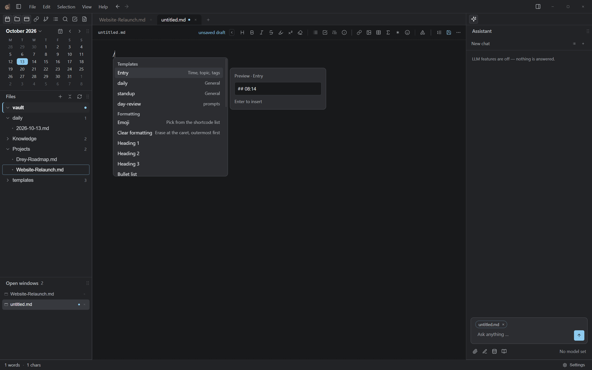

### Snippets

Typing a snippet trigger — `tbl`, `code`, `task`, … — offers a
multi-line block with `${1:placeholder}` tabstops: accept with `Enter`,
then jump between placeholders with `Tab`. The library is yours to edit
in Settings → *Templates*.

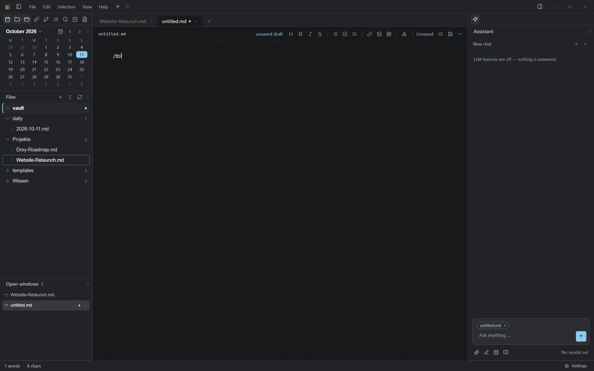

### Tags and wikilinks

- `#tag` words render as **pills**; `Ctrl`/`Cmd`-click a pill to search
  it. Typing `#` autocompletes from your existing vocabulary. Tags are
  free labels — `#project/relaunch` style namespaces give structure
  without folders.
- `[[Note name]]` renders as an internal link (unresolved targets are
  muted and dotted). `Ctrl`/`Cmd`-click **opens** the target — creating
  the note if it does not exist — and `[[Note#Heading]]` jumps to a
  heading. `[[Note|alias]]` shows the alias text. Typing after `[[`
  autocompletes note names across all vaults.

### Editing aids

- **Formatting strip** — one row of icons: the template picker,
  paragraph style (body text, headings, blockquote, callouts — a
  callout written `> [!note]-` starts folded and `> [!note]+` open; a
  click on its title folds or unfolds it), Bold,
  Italic, more text formats (strikethrough, highlight, sub- and
  superscript, *Clear formatting*), lists, Task list, Link, Table (a
  size grid) and an *Insert* menu (image, emoji, footnote, math,
  diagram). A button with a small caret opens a menu, one at a time;
  the others act at once. The strip is the head of the editor's
  **right-click menu**, where it acts on the text you clicked: there
  its first menu is the usual *Cut / Copy / Paste* list, open from the
  start. Its **pin** docks the strip into the meta bar and releases it
  again (also *Pin formatting toolbar* in the command palette).
- **Template picker** — the strip's first button, and *Templates…* in
  the slash menu: type to filter, `↑`/`↓` move through the list,
  `→`/`←` open and close a folder, `Enter` inserts the template at the
  caret, `Esc` closes. The right half previews the selected template.
  Subfolders of `templates/` show as folders; `templates/prompts/`
  (the Assistant's prompts) is left out.
- **Folding** — headings collapse Obsidian-style; the chevron appears on
  hover in the gutter.
- **Line numbers** — the *Lines* toggle (`Ctrl+G`), an app-wide
  preference.
- **Spell checking** — Hunspell dictionaries (English and German
  bundled), per-language and personal word lists in Settings →
  *Spelling*.
- **Find in note** — from the `Selection`/context menu; CodeMirror's
  search panel.
- Selection menu helpers: *Select line*, *Move line up/down*,
  *Duplicate selection*, *Toggle task done*.
- Every embed that shows its raw source (`</>` *View source* button or
  caret inside) draws it in a visibly contained block; an image's source
  line shows **above** the still-rendered picture, never replacing it.

### Saving

`Ctrl+S` saves the focused note, `Ctrl+Shift+S` saves into a new file,
`Ctrl+Alt+S` saves all dirty tabs. Saving never adds frontmatter you did
not have; an existing `updated:` field is touched only where present.
Every save keeps the overwritten text as a restorable version
([Version history](#18-version-history-and-save-conflicts)).

---

## 5. Daily notes and quick capture

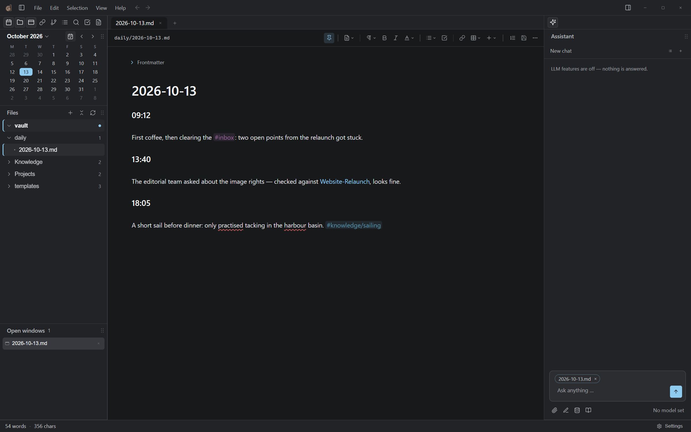

- The **Calendar panel**'s header is the month/year picker itself, with
  a **Today** button (opens today's daily note) and month arrows. Days
  that have a note carry a dot.
- Daily notes live in `daily/YYYY-MM-DD.md` (folder and naming
  configurable in Settings → *Daily notes*).
- New daily notes are generated from `templates/daily.md`; the file is
  created with a starter layout on first use and is yours to edit.
  Placeholders: `{{date}}`, `{{time}}`, `{{datetime}}`, `{{title}}`.
- **Quick capture**: press `Ctrl+Alt+N` anywhere in Windows while Drey
  is running — the window comes forward, today's daily note opens, and a
  fresh `## HH:mm` section starts. Type, then `Ctrl+S`. (The main window
  must be open — there is no tray mode. If the hotkey does nothing,
  another program owns it.)

Journal entries through the day are exactly the slash menu's **Entry**
block — heading with time, your text, optional `#tags`.

---

## 6. Tasks

A task is any `- [ ]` checklist line — or a plain text line carrying
`#task`. Tasks understand Obsidian-compatible inline metadata:

- a due date: `📅 2026-10-14`
- a priority glyph: one of `🔺` `⏫` `🔽`

```markdown
- [ ] Clarify image rights with the editor 📅 2026-10-14 ⏫
```

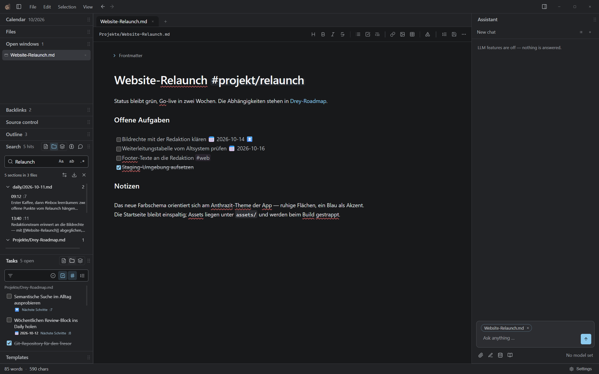

The **Tasks panel** lists tasks from

- **Doc** — the open document's live buffer,
- **Vault** — every note in the active vault,
- **All** — every registered vault, grouped per file with a vault badge.

The toolbar offers *hide done*, a kind filter (checkbox tasks vs.
`#task` lines) and a sort cycle (file order / due / priority). Rows show
a due badge (coloured when overdue or due today) and the priority glyph
— both are buttons that re-open their pickers. In the editor, typing
`due` / `prio` on a task line (or clicking a metadata chip) opens the
same pickers in place.

- Ticking a row in the panel rewrites and saves the note (the open
  buffer if the file is open).
- Clicking a row opens the file at that line, in its vault.
- `Mod+Enter` toggles the task under the cursor done/undone.

---

## 7. Tags and search

Tags are free inline `#tag` labels (never directories, no frontmatter
list). The **Tags plugin** keeps a per-vault index of every
heading-delimited section — tagged or not — so full-text search reaches
unindexed-looking notes too.

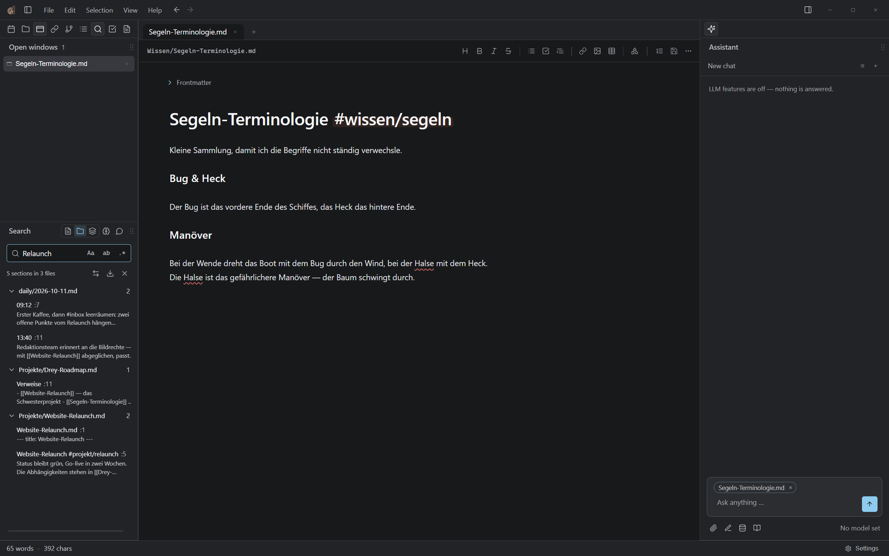

The **Search panel** (open with `Ctrl+Shift+F`) has:

- A **scope switch**: this document / the active vault / all vaults.
- **One field** for everything: free text, and `#tag` words that lift
  into chips as you type them.
- Match toggles: `Aa` case-sensitive, `ab` whole word, `.*` regular
  expression (an invalid regex shows an inline error, not an empty
  list).
- **Include chats** (speech-bubble toggle): `chats/` notes stay indexed
  but are excluded from vault/all results — and from replace — unless
  this is on.

Results are sections grouped per file; a click opens the file at the
section's line, in the file's vault.

### Replace

The replace row patches the **open buffer** in document scope (an
unsaved edit, like typing). Vault-wide replace first shows **one bundled
confirmation** listing every affected file with its diff:

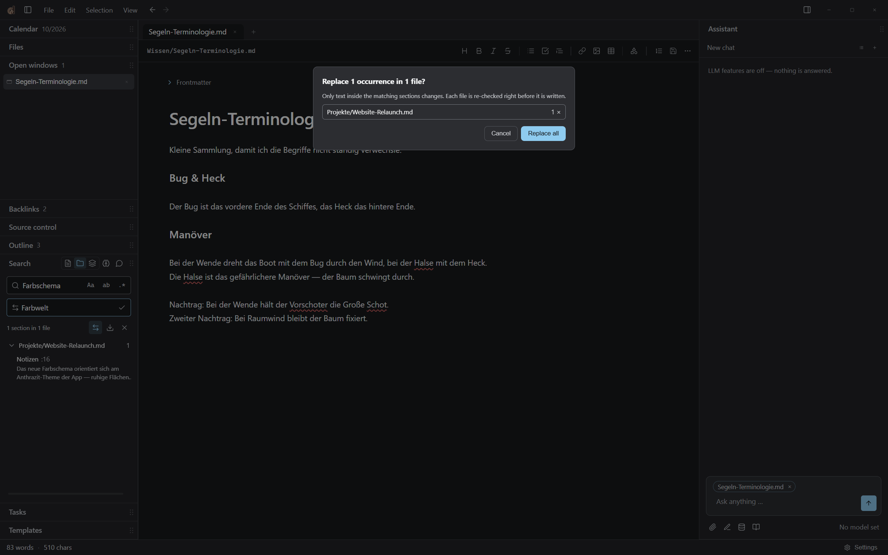

### Export and Summarize

On the result line: **Export** dumps the hits into an unsaved
`search-results.md` scratch tab; **Summarize** (needs an LLM) streams a
digest of the hits into an editable scratch tab, cancellable, over the
`builtin:search-summary` prompt template.

### Tag management

Settings → **Tags** colours tag prefixes (longest `/`-namespace wins,
otherwise a deterministic palette) and renames/merges tags across the
whole vault — a grammar-faithful token rewrite, descendants included by
default. `#task` is reserved and never suggested for renaming.

---

## 8. Templates, snippets and prompts

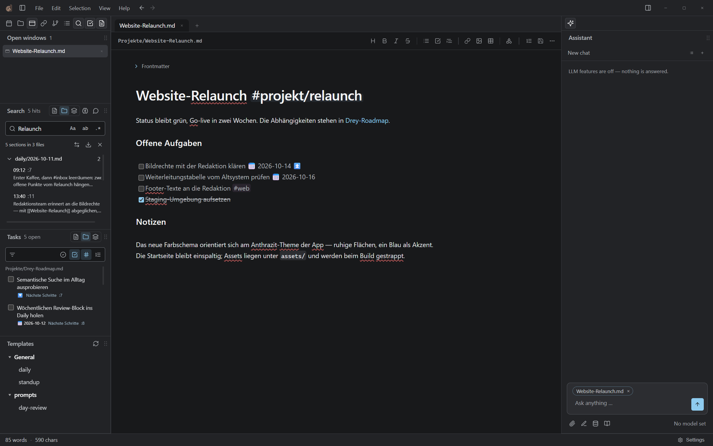

- **Note templates** are Markdown files in `templates/`, in subfolders
  if you like. They appear in the Templates panel, in the template
  picker (the formatting strip's first button, *Templates…* in the
  slash menu) and in "New note" flows.
- **Snippet triggers** (`tbl`, `code`, …) are edited in Settings →
  *Templates* — the library is user-owned app config, with `${n:placeholder}`
  tabstops.
- **Prompts** for the Assistant are Markdown files in the `prompts`
  folder of your templates folder (`templates/prompts/` by default): a
  `# Title` heading, a `> Description` line and the prompt body. They
  surface in the composer's *Prompts* picker and in the popover at a
  selection (section 9).

---

## 9. The Assistant

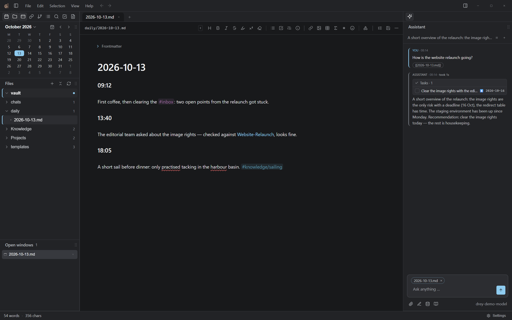

The **Assistant panel** is chat-first:

- The head shows the active conversation plus a chat-list button and
  `+` for a new chat. At startup the newest chat loads once; otherwise
  the panel keeps its chat while you move around the app. Opening a
  chat's own note tab hydrates the panel with it — that is the only
  implicit switch.
- **Every turn is persisted** as ordinary Markdown under
  `chats/<year>/<month>/…` (`kind: chat`). Chat notes auto-save; a
  follow-up replays the whole history, tool calls and applied edits
  included. There is no length cap and no hidden state — the note *is*
  the transcript.
- The **composer** grows with its text and understands `@` to attach
  note chips (autocomplete over vault paths), paste/drop of images, and
  a `+` button to stage external files (they are copied into the vault).
  The tool row: **Attach** · **Live edit** · **Vault context** ·
  **Prompts** · **model picker**.

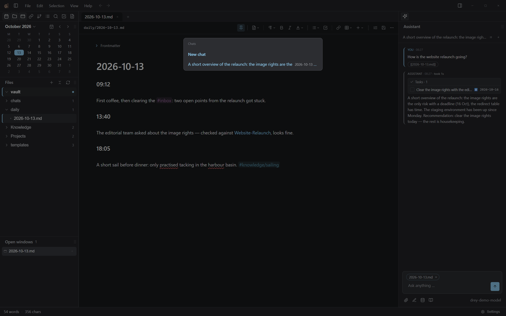

### Asking about a selection

Select text in a note and a small assistant button appears next to the
selection. It opens a popover with:

- a **question field** — type and press `Enter`;
- your **prompts** (the files in the prompts folder, see section 8) —
  one click asks that prompt;
- your **manual Actions** — one click runs the Action with the selection
  as its focus.

A question or prompt is answered in the Assistant panel; the selection
is sent along with the note and quoted above your question in the chat.
`Ctrl+Shift+A` opens the same popover from the keyboard. If you do not
want the button, switch it off in Settings → *Actions*.

### Context chips

Attach the notes the model should see: `@`-completion, images
(providers with vision), or scratch text. A small arrow on an answer
inserts it into the open note.

### Vault context

The **Vault chip** opens a picker — *Off / Active vault / All vaults*
plus one checkbox per registered vault, so a non-active vault can be
targeted without switching. When on, the note sections that contain
words of your question are added to that one call — up to four, the
ones with the rarest words first, a word in a heading counting more.
Nothing has to be switched on or built for this. It matches words, not
meaning: ask with a word the note uses. A model that can call tools
searches and reads the vault further on its own when these sections do
not answer the question. Chat notes are excluded so past questions do
not drown out the notes that answer them. The sections come from the
Tags plugin's index; with that plugin disabled there are none.

### Live edit

The **Live edit** chip opts a single question into direct editing: the
model changes the open note piece by piece (`vault_edit`), each change
lands in the editor as one undoable step — without a confirmation and
**without saving**; you save when you are happy with it. The document is
locked against your typing while the turn runs, and the result is
recorded in the chat note. It also works on a new tab you have not
saved anywhere yet. Live edit needs a model that can call tools;
otherwise it says so.

Without live edit the assistant changes the open note the same way, but
shows you each change as a diff first and saves the note once you
accept. This works with the Vault chip off as well — the note attached
to the question is always within reach, the rest of the vault only with
the chip. The assistant works on what the tab shows, so text you have
not saved yet is seen and kept. (A model or provider that cannot call
tools returns the whole changed document instead; you confirm it in the
same dialog.)

### Actions

**Actions** are saved prompts with behaviour — *Autotag* (suggest
tags), *Search summary*, *Structure note (lossless)*, and your own:
name + prompt + result kind (inline diff or whole-document preview).
Triggers run **manually** from the editor's `⋯` menu or **on save**.
Writing results pass through the shared confirmation dialog with a
"don't ask again" switch. Managed in Settings → *Actions*.

*Structure note (lossless)* turns a raw note into structured Markdown —
headings and lists where they help, obvious typos fixed — without
adding, dropping or interpreting anything, and tags it only with tags
your vault already uses. It is in the `⋯` menu on a fresh install; if
you had Drey before, add a manual trigger for it in Settings →
*Actions*. You see the whole rewrite side by side before anything
changes — check the tags there, the model is told to invent none but
nothing forces it.

In any Action prompt, `{{AVAILABLE_TAGS}}` is replaced with your vault's
tags (one per line) when the Action runs. The note itself is always sent
along; you do not need a placeholder for it.

### Suggest tags

`⋯` → *Suggest tags* sends the caret's heading section to the model and
applies its tag suggestions to that section directly — the classifier
only ever suggests; `#task` stays reserved.

---

## 10. AI providers (LLM)

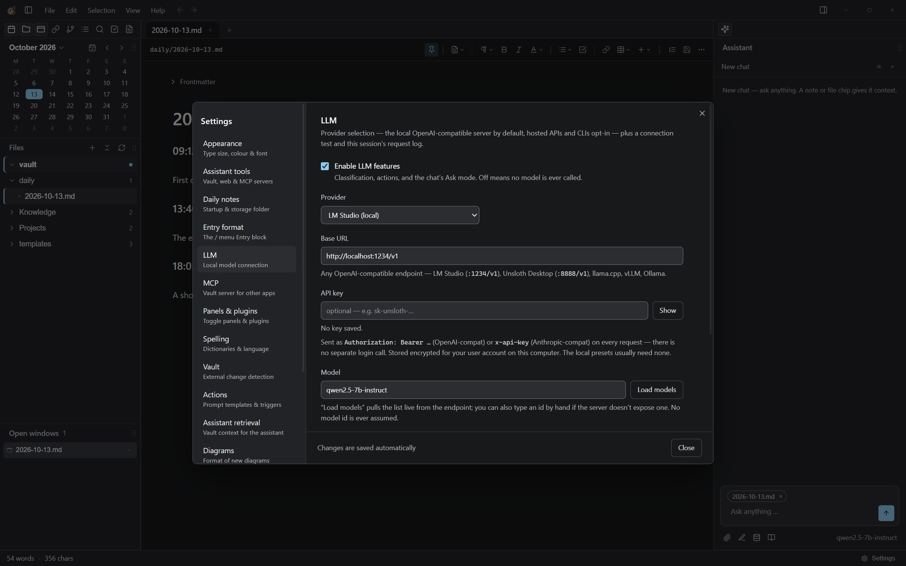

Drey is local-first: the default provider is any **OpenAI-compatible
endpoint** on your machine — LM Studio (the documented default,
`http://localhost:1234/v1`), Unsloth Desktop, llama.cpp, vLLM, Ollama.

- **Master switch** — off means classification, Actions and the chat
  all degrade with a clear message instead of failing silently.
- **Model id** — pick from `GET /models` or type it by hand (CLI/web
  providers advertise no model list at all; the field stays free-form).
- **No generation timeout** — a local model may think for minutes;
  you cancel instead of the app cutting it off.
- A request log with runnable `curl` equivalents sits at the bottom of
  the page.

Hosted presets — **OpenRouter, Anthropic API, Z.ai GLM** — and CLI
providers — **Claude Code (headless)**, **GitHub Copilot CLI**, and the
removable **Copilot Web** scraper — are strictly opt-in and off by
default. API keys are stored in plain text in `app-config.json` in your
user data directory (like every desktop client of a local endpoint).

---

## 11. Assistant tools and MCP

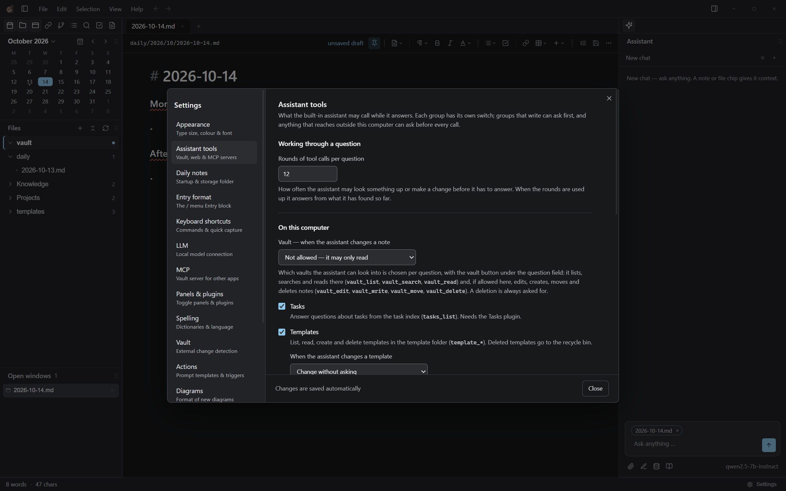

### What the assistant may call

Settings → **Assistant tools** is the tool contract: what the assistant
may do, and when it has to ask.

**The vault.** Which vaults the assistant can look into you choose per
question, with the **Vault** button under the question field (off, the
active vault, all vaults, or a selection). In those vaults it can list
what exists, search for exact words — also inside one note —, and read
a note whole or in parts. With the button off it sees only what you attached
to the question — and the open note, when it is attached, is the one
file it can still read and change.

Whether it may also **change** notes there is the *Vault* choice in
Settings → Assistant tools:

- **Not allowed** — it only reads. The one exception is the note
  attached to your question: a change you ask for there is shown as a
  diff and applied when you accept.
- **Show the change and ask first** — every edit, new file or appended
  text opens the diff dialog; you accept or decline.
- **Change without asking** — edits apply at once. Use it when you trust
  the model and the task.

A **move** asks in a small dialog under *ask first*; a **deletion**
always asks, and the file goes to the recycle bin. The assistant changes
part of a note by replacing exact text, so a small change stays small
in the diff. It never touches a vault the Vault button did not select,
and it leaves your chat notes and drafts alone. A note that is open in
a tab is read as the tab shows it and changed in the tab, so unsaved
text is neither missed nor overwritten; the same goes for programs
connected to Drey's MCP server.

**The other groups** — tasks, templates, web search, web fetch and each
external MCP server — have a switch each, `write: confirm | auto` where they write,
and `approval: ask | allow` on everything that leaves the machine. An
external tool call under *ask* shows the shared approval dialog (source,
tool, arguments — *Allow / Always allow / Deny*).

**Rounds of tool calls per question** (default 12) is how often the
assistant may look something up or change something before it has to
answer. When the rounds are used up it answers from what it has found so
far. Raise it for long research questions; lower it if a small model
keeps circling.

While the assistant works, its answer card lists every tool call as it
starts, and marks one that failed. A failed call is not the end of the
turn — the model is told what was wrong and tries again. If your model
or its server does not accept tools at all, the assistant notices on the
first question and goes on without them.

### Web search and the Web button

Settings → **Assistant tools** → *Web search* lets the assistant search
the web (`web_search`). Pick a provider:

- **DuckDuckGo** — no account, works at once. Drey reads DuckDuckGo's
  ordinary result page, which is not made for programs: it can change or
  refuse requests. Fine to try things out.
- **Brave Search** or **Tavily** — dependable; each needs an API key
  from the provider. The key is stored encrypted on this computer.
- **SearXNG** — the address of an instance you run yourself. It must
  allow the JSON format (`search.formats` in its `settings.yml`).

A search returns titles, addresses and short excerpts. With *Web fetch*
on as well, the assistant can then read the pages it found. Your search
words go to the provider you chose — with *Ask every time* you see them
before each search.

Whether a question may use any of this is your choice per question: the
**globe button** under the question field. It appears once web search,
web fetch or an MCP server is switched on in Settings, starts off, and
stays the way you left it. Off means nothing leaves this computer
through a tool; on lets the assistant search, fetch pages and call your
MCP servers for that question.

### Drey as an MCP *client*

Add external MCP servers (stdio or Streamable HTTP); their tools reach
the model as `mcp__<server>__<tool>`. Like web search and web fetch they
ride a question only while the globe button is on.

### Drey as an MCP *server*

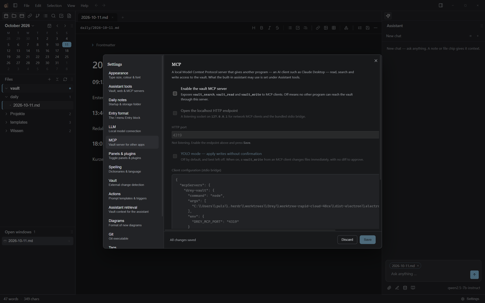

Settings → **MCP** exposes the vault *to other programs*: the same
opt-in discipline, off by default.

- Tools: `vault_list`, `vault_search` (words, a quoted phrase, a regular
  expression, tags; in the whole vault, a folder or one file),
  `vault_read` (numbered lines, a range or a section), `vault_edit`
  (exact text replacement), `vault_write` (`mode`: create, append or
  overwrite), `vault_move`, `vault_delete` and `tasks_list`. They take
  an optional `vault` argument; without it a search covers every
  registered vault.
- A change goes through the confirmation diff (a move through a small
  dialog) unless **YOLO mode** is on. A deletion always asks.
- Transports: a localhost `POST /mcp` HTTP endpoint and a standalone
  stdio bridge for CLI clients.

---

## 12. Git source control

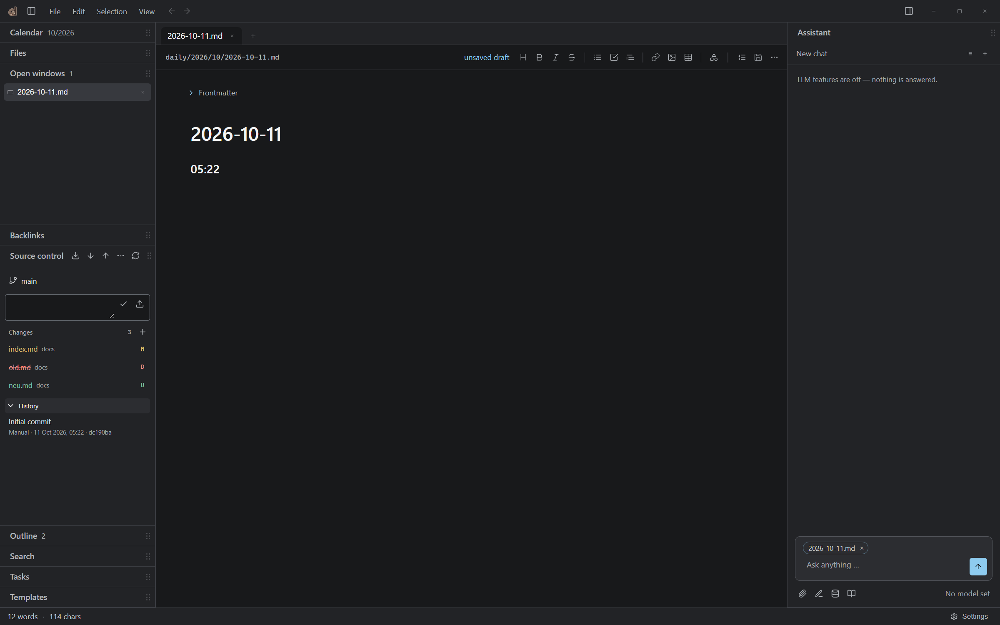

A vault can be a Git repository (its root or a folder inside one). The
**git plugin** runs your installed `git` — no bundled reimplementation.
The panel shows the repository of the focused document's vault:

- **Branch button** → switch, track a remote branch, create.
- **Commit** box — `Ctrl+Enter`, or *Commit and push*
  (`Ctrl+Shift+Enter`). Drey asks before committing with unsaved tabs,
  and refuses checkout/pull while the vault has unsaved tabs.
- **Merge conflicts / Staged changes / Changes** lists — row click
  compares through the diff view; stage, unstage, discard, open from
  each row.
- **History** (collapsible) — commits not on the upstream carry a
  "↑ not pushed" marker.
- Header icons: Fetch · Pull · Push · More (merge a branch, stash,
  stashes, amend — never of a pushed commit — file history) · Refresh.
- A merge shows a banner with an abort button; the conflict surface is
  keep mine / keep theirs / mark resolved.
- A **plugin-managed** repository (the tickets vault) is **read-only
  here**: a "Managed by Tickets" banner sits above the commit box and
  staging, discarding, committing (and amending), pulling and pushing
  are disabled — the plugin writes that repository's history itself
  (one ticket transition is one commit). Everything read-only stays:
  branch, dirty state, history, file history and the Files-panel badges.

### Found repositories (a vault that is only a parent folder)

A vault does not have to be a repository itself. If it is just a parent
folder — `E:\projects` with several repositories inside — Drey scans a
few levels below it (folders starting with a dot, `node_modules` and
reserved `_` folders are skipped) and surfaces every repository it
finds, up to 25 per vault, in the Source control panel **and** as Files
badges. A `.git` file (a linked worktree) counts like a `.git` folder.

A found repository is **read-only by design**: a hint row
*Found by scanning \<vault\> — read-only* sits above its changes, there
is no commit box, and stage/discard, fetch/pull/push, merge, stash and
amend are all disabled or refused — clicking a row still compares, and
history and file history still work. When a focused document lies
inside one of several found repositories, the panel shows exactly that
one; the selector at the top switches between them (its tooltip shows
each repository's absolute path).

**Register as vault** (the button in the hint row) turns a found
repository into a vault of its own with one click — after that you can
work with it like with any vault. The scan re-runs whenever the vault
list changes or you refresh the status, and repositories that already
belong to another registered vault are never listed twice.

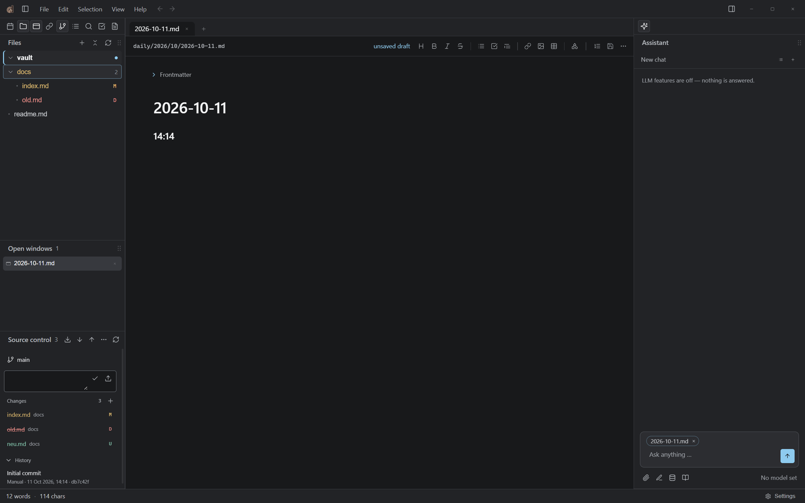

Changed files carry status badges (`M` modified, `U` untracked) and
tones in the Files panel. The `git.path` is configurable in Settings →
*Git*.

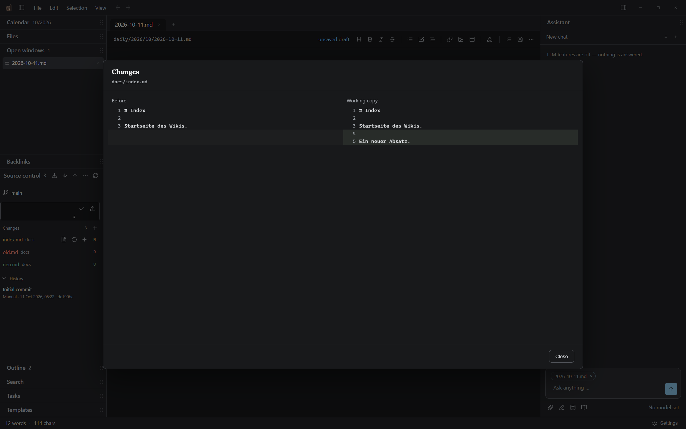

---

## 13. Tickets

The Tickets panel is a kanban board over a **tickets repository** — its
own git repo, registered in Drey like any vault, holding one Markdown
file per ticket. The board is not stored anywhere: columns, order and
claims are derived from the files on every refresh, and the files are
the single source of truth. A ticket's phase is simply the folder its
file sits in, and moving a ticket is a git move plus exactly one
commit — the repo's history is the ticket's timeline.

**Setup.** Create an empty git repository for your tickets (it can live
on GitHub, Azure DevOps or anywhere plain git works — the board never
talks to a host API), clone it locally and register the folder as a
vault (see [Vaults and files](#3-vaults-and-files)). Open the Tickets
panel; the empty state offers **Initialize the tickets board**, which
creates the three configuration files under `tickets/_meta/`:

- `pipeline.md` — the phases (columns) in order, each with a title, an
  optional WIP limit, a claim flag and what must happen for a ticket to
  leave (a manual move, an agent run, a check). Edit it like any note;
  the board follows on refresh.
- `order.md` — sparse order pins. The listed tickets form the top of
  their column; everything else follows priority, rank and age. Dragging
  in the board writes this file, not the tickets.
- `repos.md` — the work repositories a ticket can name, with their clone
  URL, integration branch and a note on which branch protection exists.

**Everyday use.** Capture with the **+** in the panel header: a title,
a priority, optionally a repository and a description land as
`T-00xx.md` in the inbox. Click a card to open the ticket file — it is
an ordinary note (description, plan, executable acceptance criteria and
an append-only log). In the editor the ticket opens with a **header**
instead of the folded frontmatter: the title as the headline, above it
the id, the phase, the priority, the repository, the worker and the
branch. Edit the headline in place (Enter or leaving the field applies
it, Escape restores it) and pick priority, repository and worker from
their menus — each change is an ordinary unsaved edit of the file, so
Save and Undo work as for any typing. The phase changes by moving the
card on the board. The code button at the right edits the frontmatter as
YAML; its header folds back to the ticket header. The **Log** section
opens folded the first time a ticket shows in a session — the fold
marker beside "Log" opens it. Drag cards between columns to move them through
the pipeline; drag within a column to pin an order. Phase folders are
numbered (`10-inbox` … `80-done`) — the number is cosmetics for
sorting in a file browser; everything inside a ticket keeps the plain
phase name. **Moving the file yourself counts as a board move**: drag
or `git mv` a ticket into another phase folder and the next board
refresh completes the transition exactly like a drag in the panel —
stamp, log line, one commit. **Fold a column**
with the chevron in its head: it shrinks to a narrow strip carrying
the count and the title rotated sideways — click the strip, or drag a
card onto it, to unfold it again. Which columns stay folded is
remembered across restarts (it is view state, never written to the
repo). The context menu
(right-click a card) opens the file, copies the deterministic branch
name `t/T-00xx` for the work repository, takes over or releases a
claim, and offers **Archive…** (armed: the first click only relabels
the item, the second moves the ticket to `tickets/archive/` — out of
the board, kept in git; delete files there yourself when you are sure;
moving one back into a phase folder revives it). Over-WIP columns show
a red count; validation findings (a
hand-edited file, an unknown repo, a ticket in two phases) show as
numbered badges — the board keeps rendering, nothing is guessed.

Claims: moving a ticket into a claim-flagged phase (Build by default)
stamps who works on it and when. A stale claim is visible by its age;
taking over replaces it and logs the previous holder.

**Dependencies (`blocked-by`).** A ticket that must not start before
another one is done carries `blocked-by: [T-0048]` in its frontmatter —
write the ids by hand, a list, and save like any edit. The blocked
state is derived from the board, never stored: the card shows a
**blocked by T-0048** chip naming the open blockers for exactly as long
as one of them has not reached the last phase, and the blocking card
shows **blocks T-0049**. Both chips hide once satisfied — no manual
unblock edit exists. The fleet never picks a blocked ticket (no
dispatch, no manual run start, no `ci` move); the chain log names it
and its blockers, so an idle column explains itself. You stay the
final authority: dragging a blocked card into a worker column asks
first (**Cancel** / **Move anyway**); anywhere else it just moves. A
blocker id that is not on the board — deleted, renamed, or archived —
warns and keeps the ticket blocked; nothing unblocks silently. The
filter icon above the columns hides the blocked cards when you want the
overview; they stay on the board and their order is never touched.

Dependencies: a ticket that must not start before another one is done
carries a `blocked-by: [T-00xx]` list in its frontmatter (comma and
space between several ids). The blocked state is derived — while any
referenced ticket has not reached the pipeline's last phase, the card
shows a **blocked by …** chip naming the open blockers, and the
blocking card shows **blocks …** listing what waits on it; both chips
disappear the moment every blocker is done, no manual unblock needed.
The fleet never picks up a blocked ticket (the chain log says which
blockers hold it), and starting a run on one refuses — but you stay in
charge: dragging a blocked card into a worker column only asks for
confirmation first. A blocker that was deleted, renamed or archived
leaves the ticket blocked with a warning — never silently unblocked.
The **filter** toggle above the columns hides all blocked cards for a
quieter board (view state only — nothing moves, the counts stay
honest).

The context menu also opens the ticket's **work folder in a terminal**
("Open work folder in terminal") — the local checkout configured as
`path:` for the ticket's repository in `repos.md`, so testing is one
click: `.\dev.ps1` for Drey, whatever the repo uses elsewhere. The
entry explains itself when the ticket names no repository or the
repository has no `path:` yet.

Pushing and pulling the tickets repo is ordinary git — use the
[Source control](#12-git-source-control) panel like for any other
vault. With a remote, two machines racing for the same ticket are
decided by the first push; the loser re-reads the board and picks the
next ticket. Pipelines that want it can add a `push: <remote>` key to
`pipeline.md`: every transition Drey or the fleet runner commits is
then pushed to that remote automatically (a failed push warns, it
never fails the move).

The complete format — every field, the grammar, the agent rules — is
specified in the repo's `specs/ticket-schema.md`.

### Running agents on tickets (the fleet)

A ticket can be worked by an **external agent CLI** — OpenCode or
Claude Code — while you watch from the board. Right-click a card and
choose **Run agent**: the dialog lets you pick the worker (the card
shows the one your pins resolve to: the ticket's `worker:` field wins,
then the phase's `@worker` pin in `pipeline.md`, then the repo's
`worker:` in `repos.md`, then the configured default) and how freely
it may act. The **Handover** choice says how the run's context reaches
the worker: **Fresh session** (the default the rules compute), **Resume
last session** (continue the previous run's conversation of the same
ticket, worker and model — worthwhile on a warm pause or a small
context) or **Resume + compact first** (the same, natively compacted
before the brief rides — offered only where the worker can). The line
under it shows the run these options would continue — its phase, how it
ended, its last context size and its age — and options that make no
sense are disabled with the reason instead of silently switched: a
review always starts fresh, another worker's session is never resumed,
and a worktree that was rebuilt invalidates the old session. The choice
applies to this run only; dispatched runs decide by the same rules
themselves, and a resume that cannot be established falls back to a
fresh run under the same ticket. The worker gets a checkout of the
ticket's repo on its own
branch (`t/<id>`), the ticket's description, plan and the phase's
prompt as its brief. Folders the checkout has but git ignores — its
toolchain, say `.tools` and `node_modules` — can be shared with every
such checkout instead of rebuilt: list them as `link: [.tools,
node_modules]` under the repository in `repos.md`, and the worker is
told to use them and install nothing.

While the run is live, its column shows a **Workers** strip with one
lane per run: a traffic light (green working, amber context nearly full
or stopping, red stalled for five minutes — always with the state in
words), the worker's current activity, its context window, token usage
While the run is live, its column shows a **Workers** strip with one
lane per run: a traffic light (green working, amber context nearly full
or stopping, red stalled for five minutes — always with the state in
words), the worker's current activity, its context window, token usage
and age, plus the run's telemetry chips — **ctx** (the last turn's real
context size), **turns** (model calls) and **reads** (read/search tool
calls) — once the worker reports them; the card carries a ▶ chip reading
the state, the turn count, the run's own tokens and its age
(`▶ running · 2 · 45k/1.2k · 03:41`). While workers run, the panel
header sums up the whole fleet next to its buttons
(`● 1 running · 18.9M tok · 26:22`): the worst light, the states in
words, the tokens in flight and how long the oldest live run has been
at it — hover it for the long form; a narrow panel keeps only the light
and the states. A lane is folded to one
line until you unfold it (a lane that needs a look opens by itself). In
a lane you can **Take over**, **Watch** (tail the run's output),
**Steer** (send a message into the live run — it lands in the ticket's
Log) or **Stop** it. **Take over** opens a tab with the worker's
conversation and a prompt box: you can **Interrupt** the running turn
(the session and its context stay), drive the worker with your own
prompts and **Hand back** the run — a worker that is idle by then ends
the run and the gate decides. While you hold a run the runner does not
end it. The tab's header names the ticket, the worker and its model,
and a pill says who is driving (**Runner driving** — your first message
takes over — or **You have control**); below it sit the turn count, how
full the context window is (a small bar that turns amber at 70 % and
red at 90 %), the tokens in (with the cached share) and out, and the
elapsed time — hover a value for its explanation. In the conversation
each tool call is one quiet row: a dot (green when it settled, red when
it failed), the tool, what it was called on — paths relative to the
run's worktree, the full path in the tooltip — and its result. More
than three calls in a row fold into one **N tool calls** line that is
open while the worker is still busy there. Each of the worker's
thoughts is a folded **Thinking** line that previews it; click it to
read the whole thought, and again to fold it — an unfolded thought
stays unfolded while the transcript updates. Code in replies and
thoughts is coloured like code in your notes, with its language on top
and a **Copy** button that shows when you point at the block. The transcript streams
live on OpenCode workers: a tool step appears as the worker calls it
and reply text grows while it is written. The view follows new output
while you are at the bottom; scrolled up, it stays put and a
**↓ New output** button brings you back. Only OpenCode workers can be
taken over for now. **Chain log** in the header's **⋯** menu opens the
fleet daemon's log in a read-only tab. When a run ends, the ticket's Log line records the
tokens it used — how much of the input came from the provider's cache,
and the cost, when the provider reports one (flat coding plans report
none). A run that continues an earlier session counts only its own
tokens. When the worker finishes, the runner executes the ticket's
**acceptance criteria** (the backticked commands under Plan): all green
means the ticket moves to the next phase on its own; a failure parks
the reason in the Log and leaves the ticket where it is — the next run
of that ticket carries the failed gate's output (its tail) so the
worker fixes it first and continues the branch instead of starting
over.

Every run's instruction is a **context pack**, assembled in a fixed
order: the repo's own agent instructions (its `CLAUDE.md` or
`AGENTS.md`), the phase's prompt, the ticket's plan verbatim, then the
run-specific parts (the worktree's diff so far, and on a retry the gate
failure). Long parts are capped — the gate failure keeps its tail, the
diff stat its head (40 lines / 4 KB and 50 lines / 4 KB by default; the
four caps are number fields under Settings → Tickets → Fleet). A
terminal can read the cost overview the same way the board does:
`GET /report` on the runner (see `plugins/tickets/FLEET.md`) groups the
runs' tokens by ticket, phase and model, and shows how much of each
run's input was spent before its first write — the exploration cost.

**When a worker needs you.** A worker that cannot go on without a
decision of yours asks: its run stops at the question instead of ending,
and keeps its session. The same happens when an OpenCode worker wants to
run a tool that needs approval. Drey then shows a Windows notification
(*T-0042 asks you*); clicking it opens the run's tab. The lane turns
amber and says what the worker asks, the card's chip reads *? waits for
you*, and the question also lands in the ticket's Log. In the tab the
question sits above the prompt box — type your answer and send it; the
worker goes on with its step and the run ends normally when it is done.
When the worker offers choices, they appear as buttons: with one
question a click is the answer; with several, pick one per question and
press **Send answer**. You can always type your own answer instead — for
several questions one line each, a choice by its number or its name.
An approval has three buttons instead: **Allow once**, **Always allow**
and **Deny**. A waiting run never counts as stalled, however long it
waits.

Runs survive closing Drey — the runner is its own small process — and,
for OpenCode workers, even a restart of the runner: the new runner takes the
still-running worker back. (A Claude Code worker cannot be taken back; its run
shows as **Detached** and can be stopped from its lane.)

Rebuilding Drey doesn't interrupt the fleet either, so you can work on Drey
tickets from the Drey you're changing. A rebuild that leaves the runner's code
unchanged keeps the runner as it is. When that code did change, the old runner
hands its runs over to the new one instead of stopping them: OpenCode workers are
taken back, and a Claude Code worker's session continues in a fresh worker under
the same run. Its last turn may be cut short, but the work in its folder stays.
Open run tabs come back after the restart and pick their run up again. A run
that is checking its acceptance criteria finishes first; the handover waits for
it. You
can reach it from a terminal, too: its address and token live in
`<user data>/plugins/fleet/runner.json`.

### The chain runs itself (milestone 85)

A column with a **worker** runs itself. Settings → *Tickets* shows the
tickets repository's folder at the top (the folder button opens it) and
the **Pipeline** as one table, a row per column in pipeline order: its
folder number (`10`, `20`, …), name, a *Runs itself* or *Checkpoint*
chip with the folder, then the **worker** (OpenCode or Claude Code;
*Manual* means a column only you move tickets through), the **model**
and the **prompt**. A manual column shows dashes there. The model field is a
picker: click it to see what the worker offers (OpenCode lists its own
`provider/model` ids, Claude Code its aliases), type to filter, or type
an id the list does not know. The prompt is chosen from the files in
`tickets/_meta/prompts/`. Every change is one commit; the board follows.

**Reordering columns.** Drag a row by its grip, or focus a row and press
Alt+↑ / Alt+↓. Inbox (where new tickets land) and Done stay first and
last. A move rewrites `pipeline.md` and renames the phase folders to
their new numbers in one commit; the line under the table says what
moved, with **Undo**. A column whose tickets are being worked on right
now cannot be renumbered — stop or finish the run first.

**Number folders.** Phase folders carry their column number
(`10-inbox`, `20-prioritized`, …). A repository from before that — or one
with a folder you numbered by hand — shows a banner; **Number folders**
renames every folder to its number in one commit. Tickets keep their
columns.

**Prompts** lists the files in `tickets/_meta/prompts/` exactly as they
are on disk; the buttons in its header create a prompt, open the folder
and reload it. Pick one on the left and edit it on the right, in the same
Markdown editor as your notes. It is saved and committed when you leave
the editor or press **Save**; the circular arrow discards unsaved
changes, and the clock button resets a prompt Drey ships
(`plan-default`, `build-default`, `review-default`, `commit-default`) to
Drey's version after you confirm — your text stays in the git history.
If the file changes outside Drey while you have unsaved text, a notice
offers **Load from disk**. An empty folder offers **Add Drey's
prompts**. A changed prompt reaches the next run, not one that is
already running.

The **master switch** sits in the board's header as one switch with
two halves, the active one filled: **▷ run** runs the chain — every
playing automatic column drains its queue; **❙❙ halt** halts gently
(running work finishes, nothing new starts). The **■ emergency stop**
next to it aborts every live run and halts — it turns red when you
point at it, one click. Each automatic
column carries its own **brakes** next to the fold chevron: pause (no
new dispatch), stop (abort this column's runs and hold it — the rest
keeps going), play again. All of it survives restarts.

The machine asks the agent to decide its own step's completion — the
brief ends with the completion discipline: run the acceptance commands
yourself, end the turn only when they pass. The runner still re-runs
the gate: green moves the ticket one column right, red parks it (the
failure lands in the Log, the ticket waits). A column that goes red
too often trips its **circuit breaker**: it holds, and its next ticket
parks in Inbox with a reason — re-prioritize it when you're ready.
After a red gate the column cools down for a minute before it fires
again.

Where a worker column meets your judgment, the pipeline stays yours: a
column without a worker between two worker columns is your
**checkpoint** (plan-review in the default pipeline) — the machine
never pulls across it; you review, edit, and move the ticket back to
plan, forward to build, or back to Inbox. A manual column *before* the
first worker column is a plain queue — the next pool drains it
(prioritized feeds plan). And a ticket held by `blocked-by` never
enters a pool while a blocker is open — the chain log line names it
and its blockers.

**How many runs go at once** is set per worker, not per column:
Settings → *Tickets* → *Fleet* has an **OpenCode pool** and a **Claude
Code pool** (one each when empty). Every run of that worker takes a
slot, wherever its column is. When a slot frees up, the next ticket is
chosen like this: tickets marked **urgent** or **high** first, then the
column furthest to the right (finishing work beats starting new work),
then the column's own order. A running ticket is never interrupted for
a more important one. If OpenCode talks to a llama.cpp server, put its
address into **OpenCode pool probe** — the server's own parallel slots
then cap the pool. A run that fails on the provider's rate limit makes
that pool one slot smaller for five minutes.

The board shows the chain's pulse: each column head carries its worker
(`opencode`) and its brakes; a one-row **status bar** under the
columns shows how long each column's tickets have been sitting there
on average (*Avg. time in column*), and — on its right — an amber pill
when worktree folders are waiting to be cleaned up (legacy leftovers
or orphans; hover it for the list, **Clean up worktrees…** in the
header's **⋯** menu removes them). The board's messages show at the
right end of that bar, just before the pill, so the cycle times never
move: an action in progress pulses there (*Cleaning up worktrees…*), a
result shows with a green tick and fades after a few seconds
(*Worktrees: 2 removed*), and a warning (amber) or failure (red) stays
until you close it with **×** — hover a cut-off message for its full
text. The `ci` handover works, too: a column with a `ci:`
command moves its tickets when the check passes in the work repo.
And the assistant can drive runs: ask it about the fleet — it sees
`fleet_status`, and can `fleet_run`, `fleet_stop`, `fleet_steer` and
`fleet_watch` through Drey's MCP server.


### The board from a phone or tablet

Settings → Tickets → **Remote access** offers the board to a phone or
tablet on your network or over Tailscale. It is off until you switch
it on, and only devices you pair get in.

1. Switch **Enabled** on. **Reach** chooses how the phone gets there:
   - *This computer only, through Tailscale Serve* (recommended): Drey
     listens only on this computer. Run `tailscale serve --bg 47811`
     once (the port shown), and enter the address Tailscale gives you —
     `https://<computer>.<tailnet>.ts.net` — as **Device address**. The
     connection is encrypted, also away from home.
   - *Local network (plain HTTP)*: Drey listens on the network interface
     you pick. Simpler, but anyone on the same Wi-Fi can read the
     traffic.
2. Under **Pair a device**, give the device a name and press **Pair**.
   Scan the QR code with the phone's camera — or open the address and
   type the code. The code works once and for five minutes.
3. On the phone, add the page to the home screen.

Every ticket move from a device is logged with the device's name
(`owner@ipad`), so the Log shows where it came from. **Paired devices**
lists each device with when it was last seen; **Revoke** locks one out
for good. A device paired **Read only** can look but not change
anything. Runs that skip permission prompts cannot be started from a
device unless you allow **Bypass runs**.

On the phone, four tabs sit at the bottom:

- **Needs you** — what waits on you: a worker's question or permission
  request, a red gate or a failed run, and below them the tickets in
  your checkpoint columns (Plan review, Commit). The badge counts the
  first group. Tap an entry to open its ticket.
- **Board** — one column at a time; the chips at the top switch
  columns and show their counts. **Swipe a card left** to move it to
  the next column (a card with a live run does not swipe — open it
  instead). Tap a card to open it.
- **Runs** — the live runs first (what each worker is doing right
  now), then the recent ones. Tap one to follow it.
- **Capture** — a new ticket into the Inbox: title, priority,
  repository, description.
- **Images.** Wherever a Description or Plan text is edited on the
  phone, an image can go straight in: paste it into the field, or tap
  **Image** and pick one. It is uploaded to the desk, saved in the
  tickets vault under `tickets/attachments/` and embedded where the
  cursor sits — PNG, JPEG, GIF or WebP, up to 6 MB. The desk shows it
  like any embedded image.

**Answering a worker.** A worker's question shows its choices as
buttons right in Needs you — a question with one choice is answered
with one tap; or type your own words. A permission request offers
**Once**, **Always** and **Reject**.

**Following a run.** A run shows the worker's steps (each tool call on
one line), its replies, and what it waits for. The ticket's title and
the run's numbers (state, model, tokens, how long it has been running)
stay pinned under the top bar while the transcript scrolls on. The one
button beside **Steer the run…** does both jobs: with something typed
it is **Send** (tell the worker something); over an empty field it is
**Stop**, which ends the run (tap twice). An ended run still takes a
message: type into **Message to reopen the run…** and **Send** picks
its session up again as a new run, which the view then shows. The same
works in the desk's run tab — its prompt box stays open after the run
ended.

**Refining a ticket.** On a ticket, **Edit** beside Description, Plan
or Acceptance criteria opens that part for editing (a missing part
shows as **+ Plan** and the like); **⋯ → Refine title, priority,
repository** edits the header. Description and Plan take pasted or
picked images (see **Images** above); Acceptance criteria do not —
they are the gate's commands. **Save** makes one commit and a Log line
naming your device. What you type is kept on the device until it is
saved, so leaving the screen loses nothing. If the ticket changed on the
desk in the meantime, the save is refused and your text stays: tap
**Reload**, check your text against the new version, and save again. A
ticket whose run is still going cannot be refined. If the same ticket is
open in Drey with unsaved changes, Drey shows its merge view when you
save there.

**On an iPad.** From tablet width the Board shows every column side by
side, scrolling sideways; in landscape the ticket you tap opens in a
pane beside the board, with the same buttons as on the phone. To move a
card, **press and hold it** until it lifts, then drag it — into another
column to move it there, or up and down in its column to change the
order (a blue line shows where it lands). Moving your finger before the
card lifts scrolls instead. **Move…** works here too.

**The fleet's switches.** The chip at the top right (*Running*,
*Halted*) opens the fleet switch: **Run** / **Halt** for every column,
and **Stop every live run** (tap twice). On the Board, the
*Playing* / *Held* chip of an agent column plays or holds that column,
or stops it.

A ticket shows its description, plan and acceptance criteria, its
Log on the second tab, and its latest run on the third. The text
renders its formatting — **bold**, *italic*, `code`, tables, rules
and smaller in-section headings — both in the ticket and in a run's
replies and results. The big button at the bottom is the step that
fits: **Approve → <next column>** in a checkpoint column, **Run
agent** in an agent column (starting a run opens its transcript, so
you see what the worker does), **Move to <next column>** otherwise.
**Move…** lists every column with the commit the move makes; **⋯**
claims, takes over or releases the ticket, and archives it (tap
twice). Everything updates live while the app is open.

---

## 14. Diagrams (draw.io)

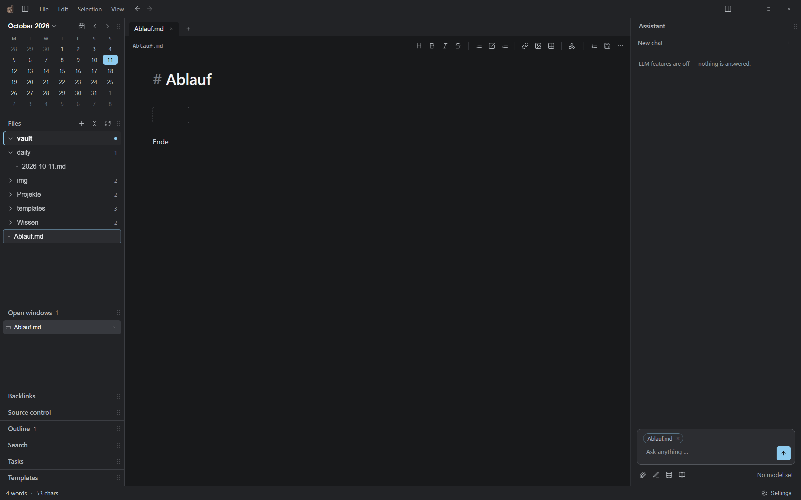

Drey bundles **draw.io** offline — nothing is sent anywhere.

- Insert a diagram from the formatting strip's *Insert* menu or with
  `/diagram` in the slash menu. Until first drawn it is a placeholder
  picture in the note.
- Files: `.drawio` (XML), `.drawio.svg` and `.drawio.png` — the two
  picture formats are ordinary images that carry the diagram inside, so
  notes embed them with the normal image syntax and PDF export needs
  nothing extra. Which format a new diagram gets is set in Settings →
  *Diagrams* (SVG by default).

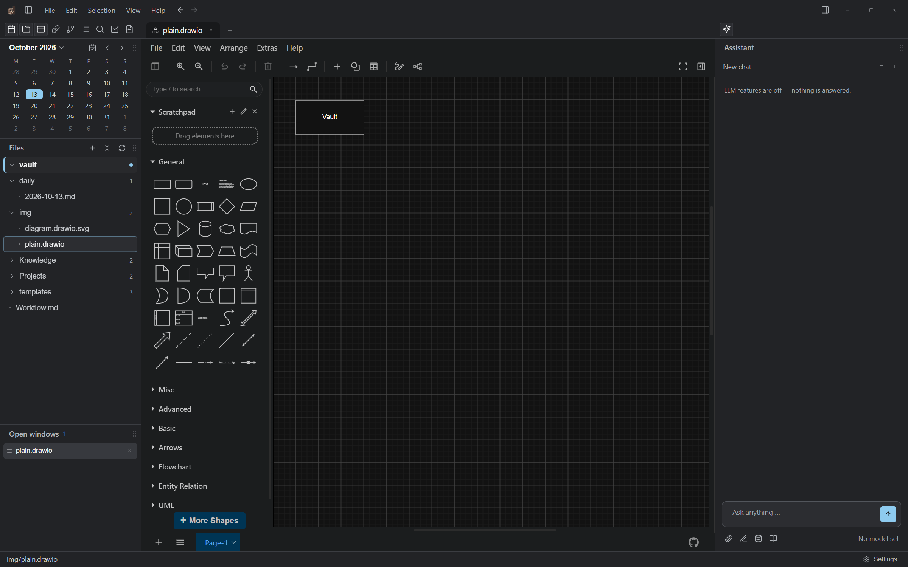

Opening a diagram file opens draw.io in its own tab — **auto-saving**,
no manual `Ctrl+S`. A changed picture reloads in open notes
automatically.

---

## 15. Images, PDFs and Office documents

- **Paste or drop** images into a note — they are stored under
  `attachments/` and referenced with a relative path. Images pasted from
  the web are downloaded and get a `[Source]` link line beneath.
- Click an image's magnifier to zoom (the picture opens in an image
  tab). PDFs in the vault open in a PDF tab.
- **Office documents never render in Drey** — they open in their own
  program (see [Vaults and files](#3-vaults-and-files)). A note link may
  also be a local `file:` URL to a document outside the vault; nothing
  else may use `file:`, and never a network share.
- Dragging text files from the OS into the vault copies them in
  (`Alt`-drop links the original instead, for Office files).

---

## 16. Panes, tabs and layout

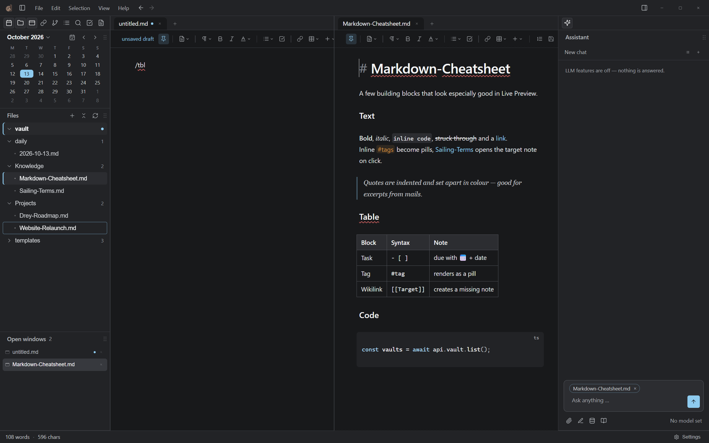

- **Split the editor**: a tab's context menu (*Split right / Split
  down*), or `Ctrl+Alt+Enter` / `Ctrl+Alt+Shift+Enter`. `F6` /
  `Shift+F6` cycle pane focus. The layout is an arbitrary tree of rows
  and columns with draggable splitters.
- **Tabs** — drag to reorder or to move between panes (ghost chip +
  drop line; `Esc` cancels). The pin in a tab's context menu keeps it
  from being replaced. Opening a file replaces the focused pane's
  *clean, unpinned* tab; `Ctrl+Enter` in the quick switcher opens
  beside the current tab.
- **Docked editor bands** — any pane can be dragged into the left/right
  dock (above the panels) or docked from its tab menu; it persists with
  the session. *View → Reset layout* undocks them.
- **Panels** — every panel header is a drag grip: move panels between
  the left, right and bottom docks, resize them with the splitters,
  collapse them to their 32 px headers. The whole layout persists
  across restarts.
- **Open windows** panel lists every open document across panes:

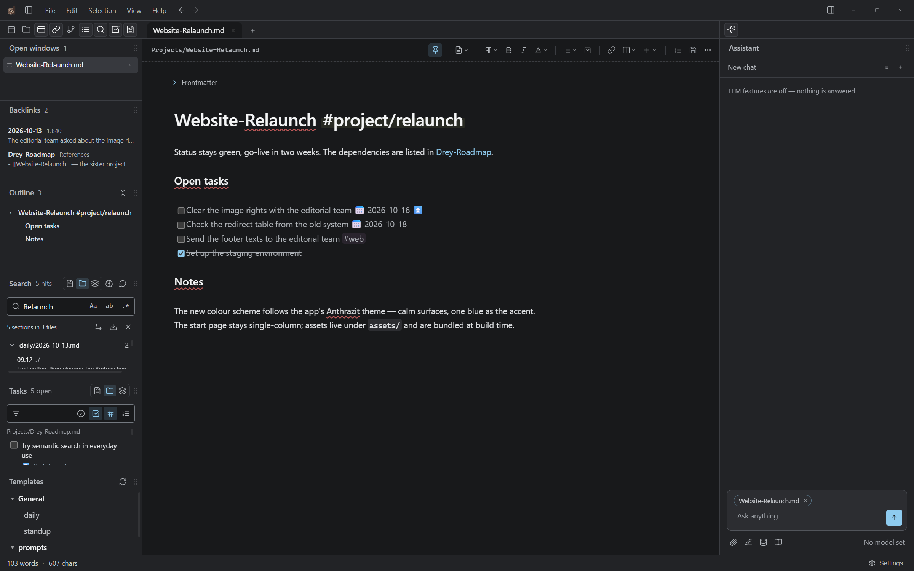

Other panels: **Outline** shows the open note's heading tree (click to
jump, fold levels) …

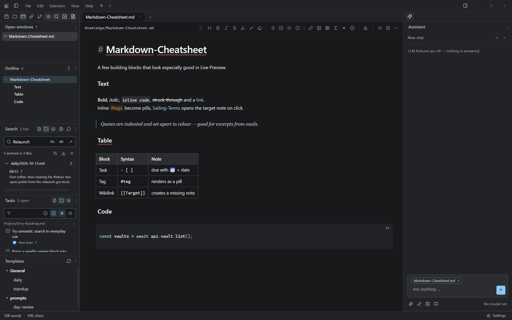

… and **Backlinks** lists every note that links to the open one, grouped
by file and section.


---

## 17. Quick switcher and command palette

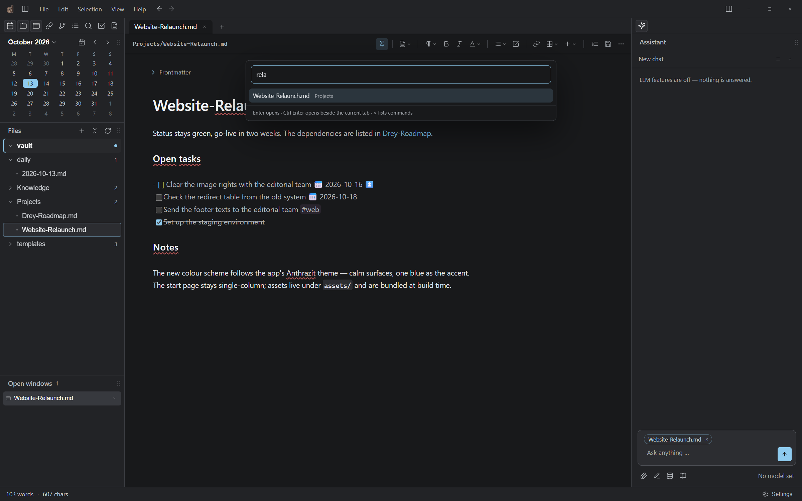

`Ctrl+P` opens the **quick switcher**: fuzzy-search every file of every
vault, session-visited documents first, `Ctrl+Enter` opens beside the
current tab, and a no-match query offers *Create note*.

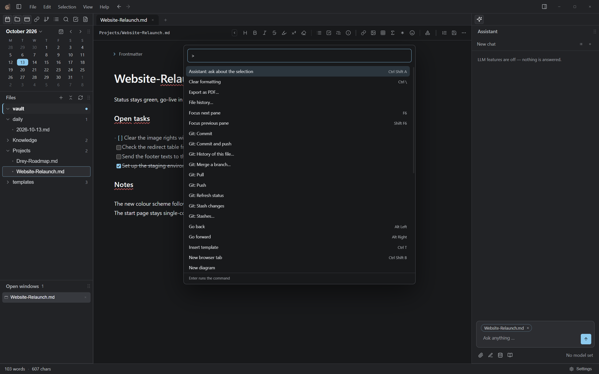

`Ctrl+Shift+P` opens the **command palette** — every registered command
with its shortcut (same actions as the menus, plus *Reset layout*,
*Refresh vault*, *Open today's daily note*, *Toggle source mode*,
*Export as PDF…*, *File history…*, …).

---

## 18. Version history and save conflicts

### Local history

Every save that overwrites text keeps the previous version in the app's
history store (never in the vault; bounded in Settings → *Vault*).
`⋯` → *File history…* (also the tab context menu and the command
palette) lists versions with a diff against your current buffer;
**Restore** loads a version into the editor — saving keeps it.

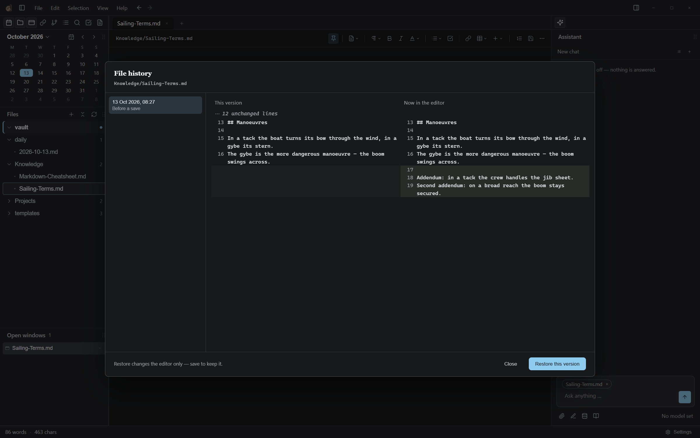

### Save conflicts

When a file changed on disk after your tab last saw it, `Ctrl+S`
refuses to overwrite: the **merge view** opens — *on disk | result |
mine* — with per-block checkboxes and an editable result column. The
meta bar's "Changed on disk" button opens the same view early.

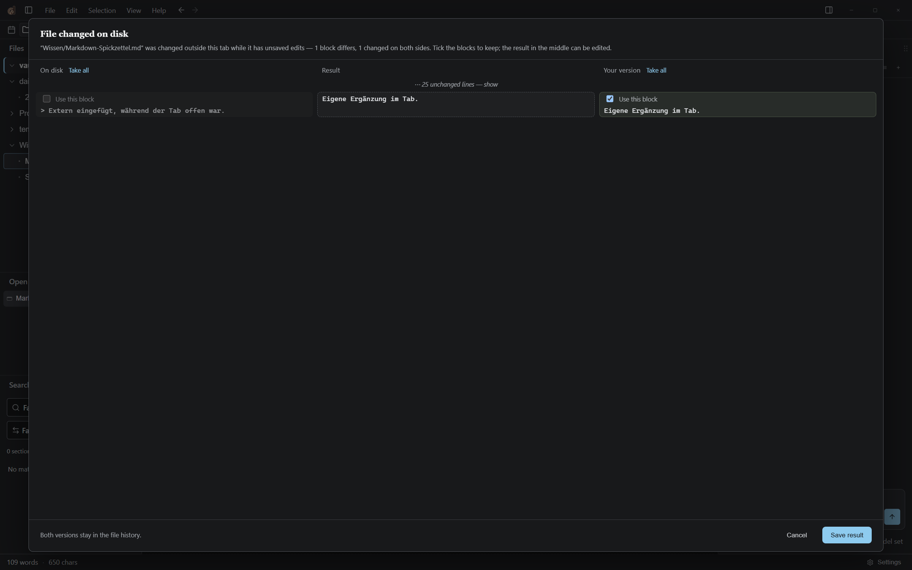

### Further safety nets

- **Exit auto-save**: unsaved untitled tabs are parked in the hidden
  `.drafts/` folder and offered back on the next start (Notepad++
  style) — chats and scratch tabs never raise the exit prompt, only
  your own unsaved notes do.
- **Session restore** reopens tabs, panes, carets and scroll positions.
- **Renames rewrite links** that would break (ask / always / never in
  Settings → *Vault*), and attachments used only by a moved note
  travel with it.

---

## 19. Settings reference

Open with the status-bar entry or `Ctrl+,`. Core categories are
alphabetical, plugin-contributed ones follow, *About* closes the list.
Every change applies as you make it — there is no *Save* and no
*Discard*. A switch or a list choice acts at once; a typed value is
stored when you leave the field or press Enter. The footer shows
"Changes are saved automatically" and one *Close* button.

| Category | What lives there |
| --- | --- |
| [Appearance](#settings-appearance) | theme, accent, UI scale, editor typeface and scale |
| [Assistant tools](#settings-assistant-tools) | tool groups, write/approval rules, external MCP servers |
| [Daily notes](#settings-daily-notes) | daily folder and template behaviour |
| [Entry format](#settings-entry-format) | the slash menu's Entry block |
| [Keyboard shortcuts](#settings-keyboard-shortcuts) | the shortcut of every command, the quick-capture hotkey |
| [LLM](#settings-llm) | provider, endpoint, key, model |
| [MCP](#settings-mcp) | Drey's own vault server for other programs |
| [Panels & plugins](#settings-panels-plugins) | panel and plugin switches, live plugin status |
| [Spelling](#settings-spelling) | dictionaries, personal words |
| [Vault](#settings-vault) | watcher, link rewriting, history bounds |
| Actions | Assistant Action templates and triggers |
| Diagrams | format of new diagrams (SVG/PNG) |
| Git | `git` executable path |
| Tags | prefix colours, rename/merge |
| Templates | snippet trigger library, templates folder |
| About | version, licences |

### Settings: Appearance {#settings-appearance}

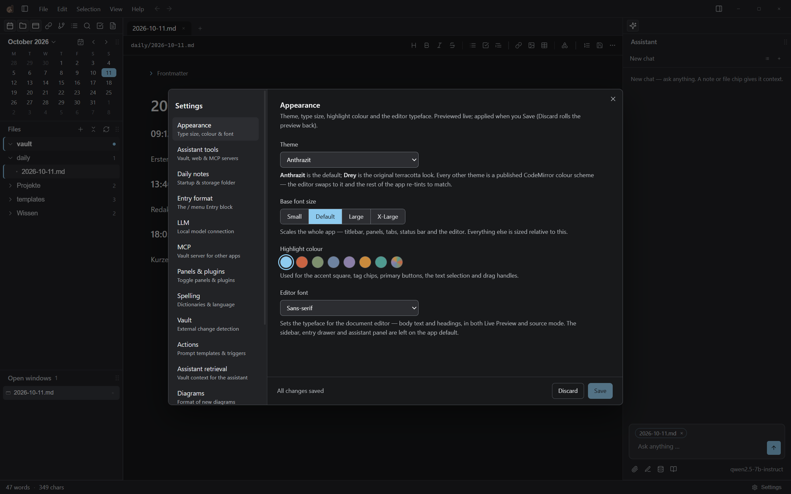

Three bespoke themes ship — **Anthrazit** (neutral charcoal, blue accent,
AA contrast; the default), **Drey** (terracotta) and **Cyberpunk**
(violet-black with neon pink and violet) — plus a
catalogue of published CodeMirror themes. The accent colour follows the
theme by default or can be pinned; the UI scale resizes the whole app;
the editor typeface and font scale affect only the writing surface.
Cyberpunk also brings its own app mark: the logo in the titlebar and the
taskbar icon change with it (the desktop shortcut keeps the usual icon).

### Settings: Assistant tools {#settings-assistant-tools}

See [Assistant tools and MCP](#11-assistant-tools-and-mcp).

### Settings: Daily notes {#settings-daily-notes}

The daily notes root folder (default `daily/`) and template behaviour.

### Settings: Entry format {#settings-entry-format}

What the slash menu's **Entry** block inserts: built-in *classic* and
*ruled* patterns or your own, with the `{{time}}` / `{{date}}` /
`{{datetime}}` / `{{title}}` / `{{tags}}` / `{{content}}` placeholders.

### Settings: Keyboard shortcuts {#settings-keyboard-shortcuts}

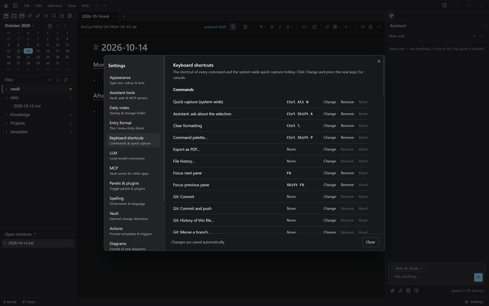

Every command and the system-wide **quick-capture** hotkey, each with
its shortcut. **Change** waits for you to press the new keys (Esc
cancels); **Remove** leaves the command without a shortcut; **Reset**
brings back the one Drey ships with. A shortcut needs `Ctrl` or `Alt`,
or a function key (`F1`–`F12`) — a plain letter would swallow typing —
and the editor's own keys (undo, the clipboard, find, zoom, …) cannot be
taken; they are listed under *Fixed*. If another command already has
the keys you press, Drey names it and offers **Replace**, which leaves
that command without a shortcut. When another program holds the
quick-capture keys, the row says so — choose another combination.
Your shortcuts show everywhere at once: the menus, the command palette
and Help → Keyboard shortcuts.

### Settings: LLM {#settings-llm}

See [AI providers](#10-ai-providers-llm).

### Settings: MCP {#settings-mcp}

See [Assistant tools and MCP](#11-assistant-tools-and-mcp).

### Settings: Panels & plugins {#settings-panels-plugins}

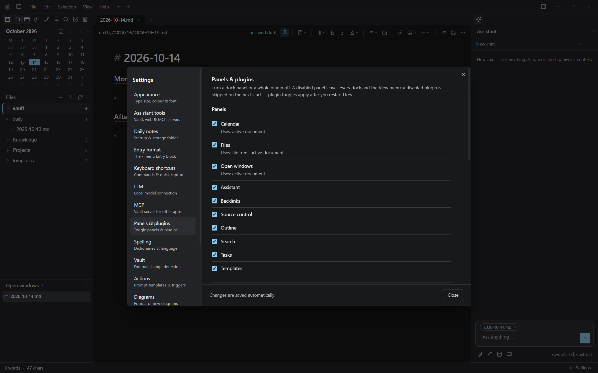

One switch per dock panel and per discovered plugin (`plugins.disabled`
applies on restart), plus each plugin's live status. Third-party
plugins install into `<userData>/plugins/<id>/`.

### Settings: Spelling {#settings-spelling}

Bundled English/German Hunspell dictionaries, additional dictionaries,
and the personal word list.

### Settings: Vault {#settings-vault}

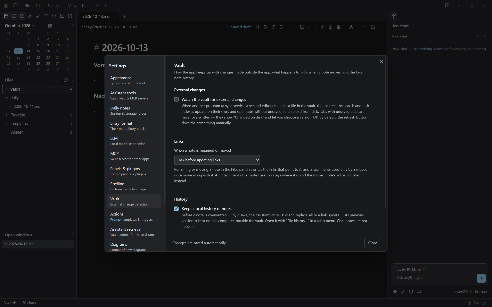

- **Watch for external changes** (off by default) — the opt-in file
  watcher; with it off, use Refresh.
- **Rewrite links on rename** — `ask` / `always` / `never`.
- **Local note history** — enabled, keep days (30), max versions per
  file (50).

### Settings: Updates {#settings-updates}

- **Check for updates on start** (on by default) — once the app is up,
  Drey asks GitHub whether a newer release exists. That is all the
  "automatic" there is: downloading, installing and restarting always
  ask first, and the check sends none of your notes or settings. Turn it
  off to keep the app entirely offline.
- **Status** — the current version, a *Check for updates* button (same
  as the Help menu), the download progress, and *Install and restart*
  once an update is downloaded. When this already is the newest release,
  the status line shows it in green — no dialog. Installing closes
  Drey — unsaved tabs go through the usual save-before-exit prompt — and
  the installer relaunches the app when done. Windows may show its
  SmartScreen warning before the installer starts (the exes are
  unsigned).
- A version you answered **Skip this version** to is listed with an *Ask
  about it again* link; the startup prompt stays silent for exactly that
  version, a manual check always reports.
- The **portable exe** cannot update itself (there is no install to
  update) — it offers the releases page on GitHub instead. The same
  fallback appears when a network blocks the check.

### Plugin-contributed pages

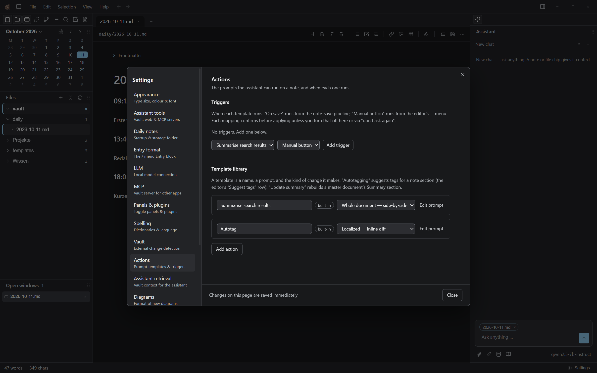
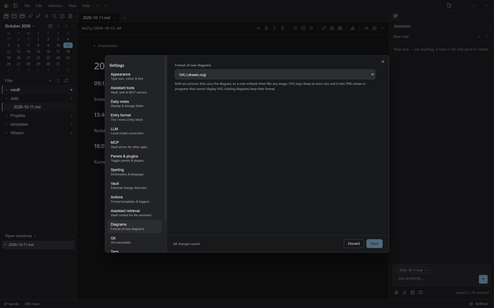
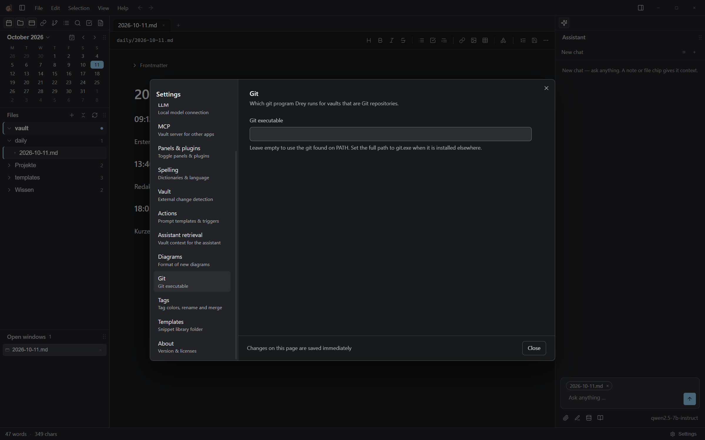
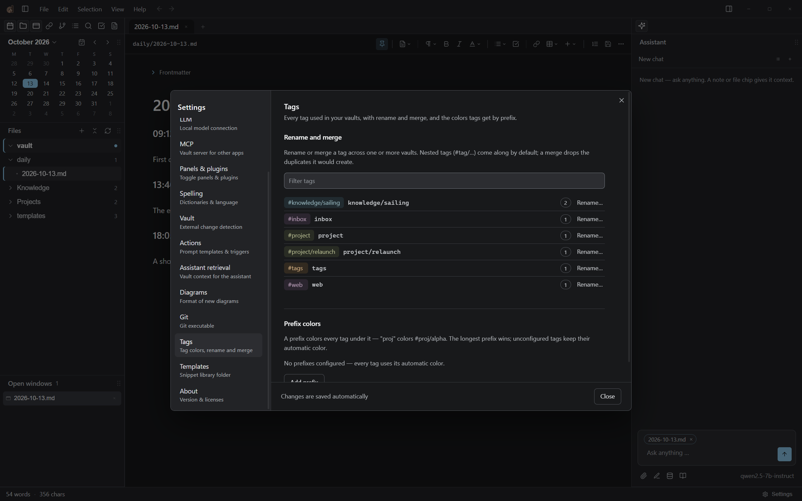
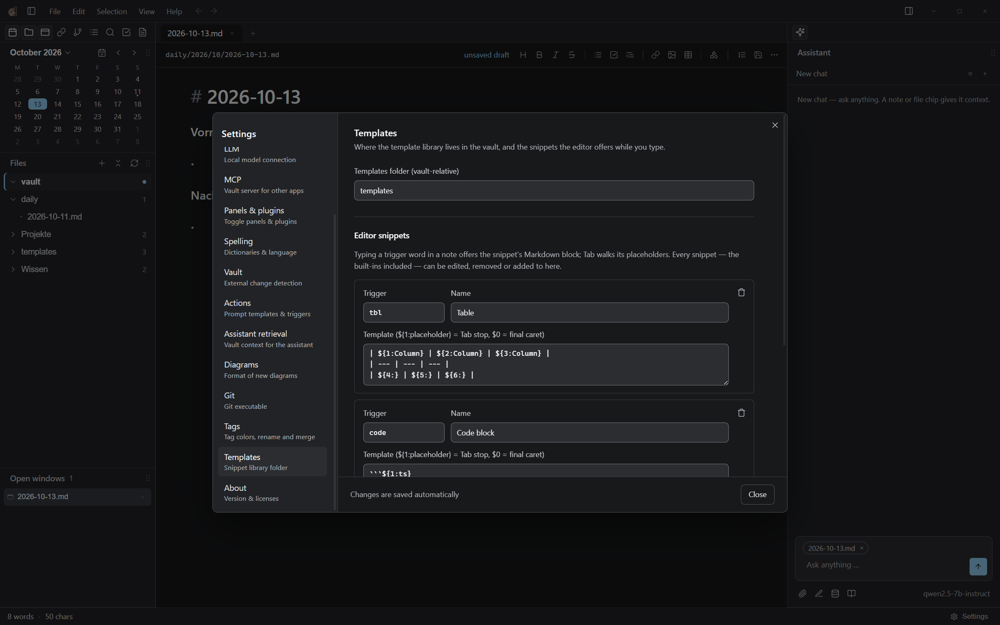
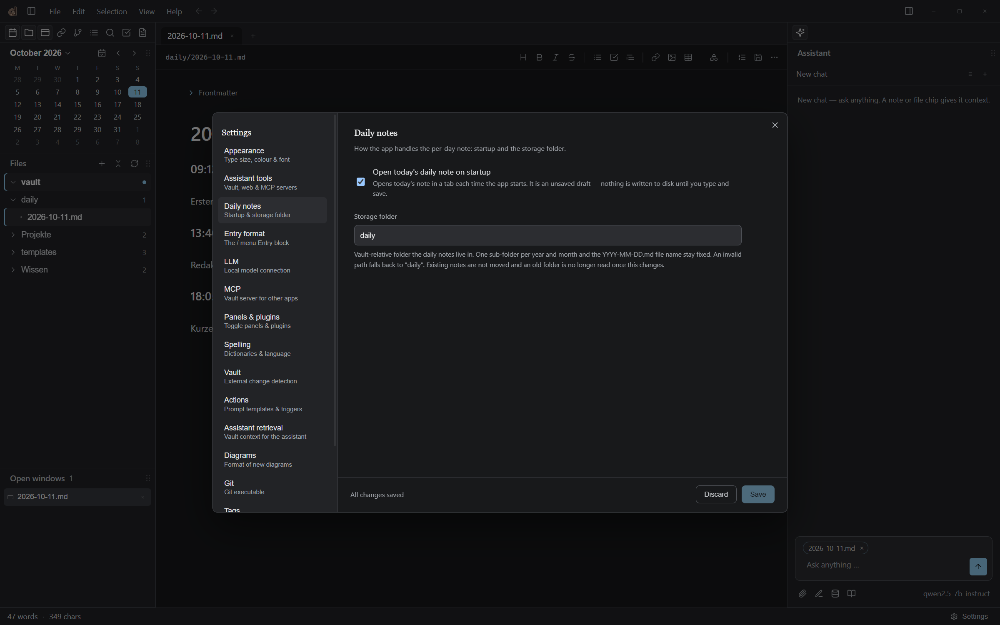
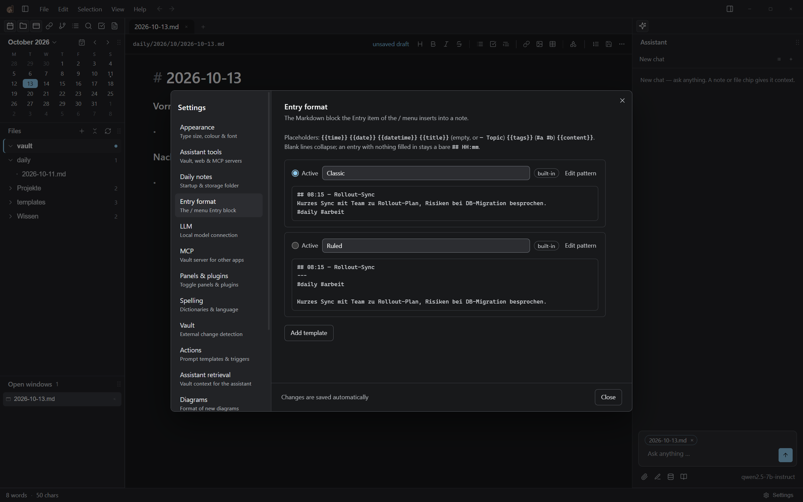
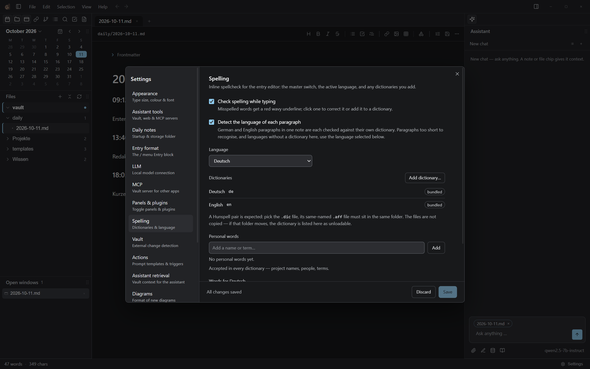
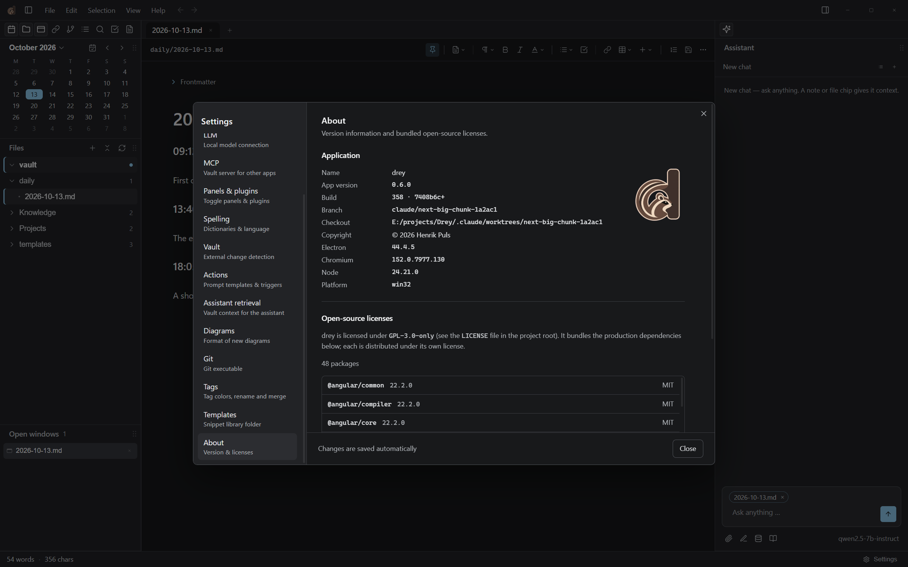

---

## 20. Getting help

The **Help** menu in the title bar has everything:

- **User manual** (`F1`) — this manual, opened inside the app as a
  read-only pinned tab. Screenshots included; it scrolls and follows
  links like any document.
- **Keyboard shortcuts** — a generated list of every command this build
  knows, base and plugins alike, with its current shortcut. It always
  matches the command palette, because it is built from the same
  registry at the moment you open it.
- **Check for updates** — looks for a newer Drey release now (see
  [Settings → Updates](#settings-updates)). A new version asks before it
  downloads; when this already is the newest release, a short green note
  in the status bar says so — no dialog.
- **About Drey** — version, build number and licence information (the
  same page as Settings → *About*).

Help documents are normal tabs in every other respect: they can be
dragged to another pane, and closing one loses nothing — the Help menu
brings them back.

---

## 21. Keyboard shortcuts

`Ctrl` is `Cmd` on macOS. `Mod` below means exactly that. These are the
shortcuts Drey ships with; change any of them, and the quick-capture
hotkey, in [Settings → Keyboard shortcuts](#settings-keyboard-shortcuts).

| Shortcut | Action |
| --- | --- |
| `F1` | This manual |
| `Ctrl+Alt+N` | Quick capture into today's daily note (global, while Drey runs) |
| `Mod+N` | New note |
| `Mod+S` / `Mod+Shift+S` / `Mod+Alt+S` | Save / Save as… / Save all |
| `Mod+P` | Quick switcher (files) |
| `Mod+Shift+P` | Command palette |
| `Mod+,` | Settings |
| `Mod+Shift+F` | Search panel |
| `Mod+Shift+A` | Ask the assistant about the selection |
| `Mod+G` | Toggle line numbers |
| `Mod+B` / `Mod+Alt+B` | Toggle left / right dock |
| `Alt+Left` / `Alt+Right` | Back / forward (also mouse buttons 3/4) |
| `Mod+Alt+Enter` / `Mod+Alt+Shift+Enter` | Split editor right / down |
| `F6` / `Shift+F6` | Focus next / previous pane |
| `Mod+Alt+Z` | Zen mode (hide titlebar, docks and status bar) |
| `F11` | Full screen |
| `Mod+Enter` | Toggle task done (on a task line) |
| `/` on an empty line | Slash menu (Entry, templates, formatting) |
| `Esc` | Close menus, dialogs, drag operations |

The command palette lists every command with its current shortcut — your
own, where you changed one — and so does Help → **Keyboard shortcuts**,
as a document you can keep open beside your notes.

---

## 22. Where your data lives

| Data | Location |
| --- | --- |
| Notes, templates, chats, attachments | your vault folder — plain Markdown, YAML frontmatter, files |
| App settings + API keys | `<userData>/app-config.json` (plain text) |
| Vault registry (which folders, which active) | `<userData>/vault-config.json` |
| Local note history | `<userData>/history/<vaultId>/` |
| Installed plugins | `<userData>/plugins/<id>/` |

Because the vault is just files, any file-based backup covers your
notes completely — Drey adds no hidden state inside the vault (the
history store is deliberately outside it).

---

## 23. Troubleshooting

- **"LLM features are off"** — the master switch in Settings → LLM is
  off, or no model is selected. The request log on the same page shows
  exactly what was (not) sent.
- **A hosted provider rejects the key** — 401/403 is almost always the
  API key, not the URL; the log's `curl` command lets you verify
  outside the app.
- **Generation seems stuck** — there is deliberately no timeout; cancel
  the turn instead.
- **Quick capture hotkey does nothing** — another program owns
  `Ctrl+Alt+N`; Drey logs a warning to the main-process console.
- **External file changes don't show up** — the watcher is off by
  default; press Refresh in the Files panel or enable it in Settings →
  Vault.
- **A plugin's panel is missing** — check Settings → *Panels & plugins*
  (changes apply on restart), and the plugin's status line there.
- **MCP clients can't write** — a change waits for the confirmation
  dialog unless YOLO mode is on; a deletion always does.
- **The assistant says it cannot change a note** — Settings → Assistant
  tools → *Vault* is set to "Not allowed", or the Vault button under the
  question field does not include that vault.
- **Git panel is empty** — the vault is not inside a Git repository, or
  `git` is not on `PATH` (set it in Settings → *Git*); press Refresh
  after initializing a repository.

---

*Manual for Drey {{MANUAL_VERSION}}; manual content last changed
{{MANUAL_GENERATED}}. Screenshots were captured automatically from
the built app (Anthrazit theme, 1600×1000) by
`e2e/manual-screenshots.spec.ts` — run
`$env:DREY_MANUAL_SHOTS='1'; npm run e2e:run -- manual-screenshots`
after `npm run build` to regenerate them.*
