# Drey — User Manual

Drey is a private, local-first note vault that runs your work: your
notes are plain Markdown files in a folder you own, and the app around
them — editor, search, tasks, an optional AI assistant with
permissioned tools — runs entirely on your machine. Nothing leaves it
unless you explicitly switch on a hosted AI provider.

> All screenshots in this manual were taken from the app's default
> **Anthrazit** theme (neutral charcoal, blue accent) on Windows. The demo
> vault shown is German — your notes can be in any language; the interface
> itself is English.

**Contents**

1. [First steps](#1-first-steps)
2. [The window at a glance](#2-the-window-at-a-glance)
3. [Vaults and files](#3-vaults-and-files)
4. [Writing notes](#4-writing-notes)
5. [Daily notes and quick capture](#5-daily-notes-and-quick-capture)
6. [Tasks](#6-tasks)
7. [Tags and search](#7-tags-and-search)
8. [Templates, snippets and prompts](#8-templates-snippets-and-prompts)
9. [The Assistant](#9-the-assistant)
10. [AI providers (LLM)](#10-ai-providers-llm)
11. [Assistant tools and MCP](#11-assistant-tools-and-mcp)
12. [Git source control](#12-git-source-control)
13. [Tickets](#13-tickets)
14. [Diagrams (draw.io)](#14-diagrams-drawio)
15. [Images, PDFs and Office documents](#15-images-pdfs-and-office-documents)
16. [Panes, tabs and layout](#16-panes-tabs-and-layout)
17. [Quick switcher and command palette](#17-quick-switcher-and-command-palette)
18. [Version history and save conflicts](#18-version-history-and-save-conflicts)
19. [Settings reference](#19-settings-reference)
20. [Getting help](#20-getting-help)
21. [Keyboard shortcuts](#21-keyboard-shortcuts)
22. [Where your data lives](#22-where-your-data-lives)
23. [Troubleshooting](#23-troubleshooting)

---

## 1. First steps

### Installing

- **Installer** (`drey-<version>-setup.exe`): per-user setup, the
  installation directory is selectable. It registers Drey as an "Open
  with" program for `.md` / `.markdown` / `.mdx` / `.txt` files.
- **Portable** (`drey-<version>-portable.exe`): single file, no
  installation, registers nothing.

### Your vault is just a folder

On first start Drey asks for a vault folder. A vault is an ordinary
directory (it can live on OneDrive or any sync share) containing your
Markdown notes. Drey never wraps them in a database: open the folder in
any editor and the files are all there. You can register several vaults
and switch between them (see [Vaults and files](#3-vaults-and-files)).

The app imposes only a few conventional folders inside a vault:

| Folder | Purpose |
| --- | --- |
| `templates/` | note templates, snippet prompts (`templates/prompts/`) |
| `daily/` | daily notes (configurable, `daily.dir`) |
| `chats/` | assistant conversations, one Markdown note per chat |
| `attachments/` | images and other assets you paste or drop |
| `.drafts/` | hidden auto-saves of unsaved tabs at exit |

### The two surfaces of "settings"

- **App settings** (Settings screen, `Ctrl+,`) — appearance, AI
  connection, plugins and so on. Stored in the operating system's user
  data directory, *never* in the vault.
- **Vault content** — templates, tag prefix colours' effect on notes,
  the daily-note layout. These live in the vault's files.

---

## 2. The window at a glance

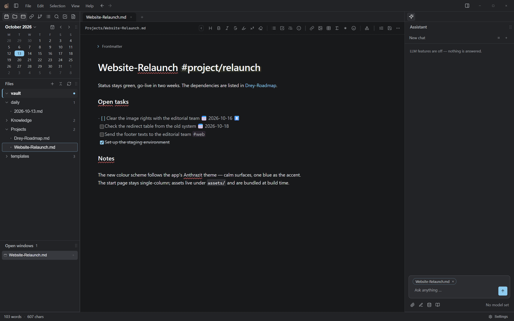

The frameless window is built from:

- **Titlebar** — the accent square, the dock toggles (`Ctrl+B` left,
  `Ctrl+Alt+B` right), the **File / Edit / Selection / View** menus, the
  back/forward arrows (see below), and minimize/maximize/close.
- **Left dock** — Calendar, Files, Templates, Search, Tasks, Open
  windows, Outline, Backlinks, Source control. Every panel can be
  folded to its header with its chevron, dragged to another dock, or
  resized against its neighbours; right-click a header to move or close
  it. The icons at the top of a dock open and close panels.
- **Centre column** — the tab bar, the meta bar (path, *Save* while there
  is something to save, `</>` for the Markdown source, the `⋯` menu)
  and the editor.
- **Right dock** — the Assistant panel by default.
- **Status bar** (bottom, 28 px) — word/character count, a context hint
  while panels are being moved, and the Settings entry.

### Back and forward

The arrows right of the menus walk the session's document history —
like a browser, across all open panes. `Alt+Left` / `Alt+Right` do the
same, and the mouse side buttons (XButton1/2) are bound VS Code-style.
Stepping back to a closed note reopens it.

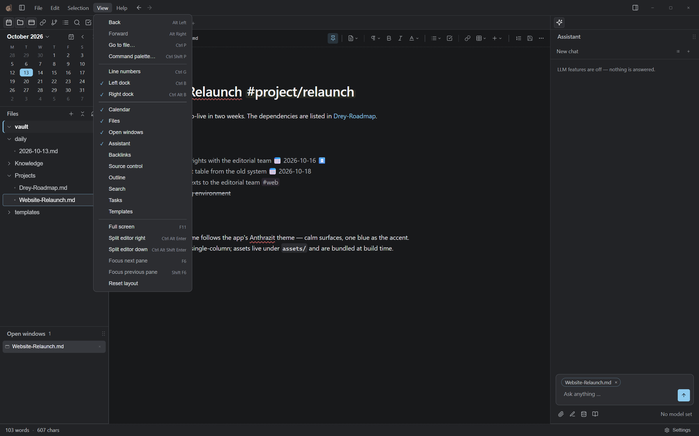

The **View** menu toggles every panel, the docks, zen mode (`Ctrl+Alt+Z`),
full screen (`F11`) and *Reset layout*, which restores the default dock
arrangement and undocks docked editor panes.

### Zen mode

*View → Zen mode* (or `Ctrl+Alt+Z`) hides the titlebar, all docks and
the status bar and leaves just the editor with its tab bar and meta bar —
a plain page for writing or reading. It combines freely with `F11` full
screen. While it is on the menu bar is hidden too; the same chord and the
command palette (`Mod+Shift+P`) stay available. `Ctrl+Alt+Z` again brings
everything back exactly as it was — zen never rearranges your layout, and
it is not remembered across restarts.

---

## 3. Vaults and files

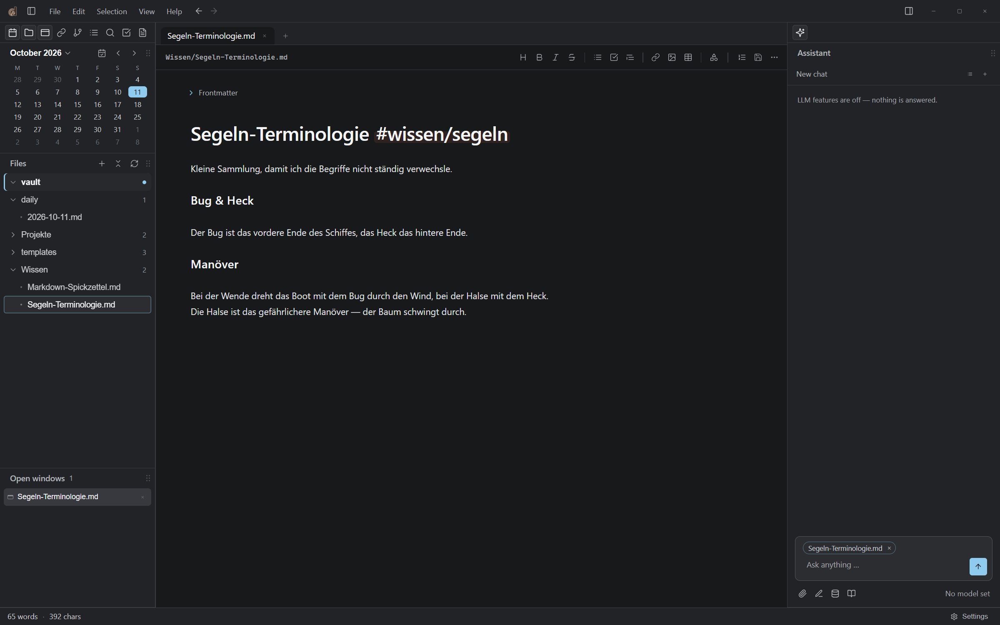

The **Files panel** shows one section per registered vault: a header row
with the vault's name and that vault's file tree. Its tooltip says which
vault is the active one.

- **Register more vaults** with *Add vault…* in a vault header row's
  context menu (right-click), which also offers *Set active*, *Rename*,
  *Open in File Explorer*, *Refresh* and *Remove*. The **+** in the panel
  header (shown on hover) starts a new file in the active vault.
- The **active vault** is the default target for new daily notes, quick
  capture and chats. Every operation can still address another vault
  explicitly (search scopes, the tasks panel, drag & drop).
- Click a file to open it. Right-click a file or folder for **New
  file / New folder / Rename / Delete** — names are edited in place.
- **Drag & drop** moves files and folders within a vault, into another
  vault's header row, or onto a folder or file row. Renames and moves
  can automatically rewrite wikilinks that pointed at the old path
  (see [Settings → Vault](#settings-vault)).
- Some vaults are **managed by a plugin** (the tickets vault): their
  files have meaning the plugin owns, so the panel guards them. A
  refused operation explains itself in a message — inside `tickets/`,
  files are created on the board (New ticket), the filename is the
  ticket's identity, columns come from the pipeline, and deletion goes
  through the archive. **Dragging a ticket between phase folders (or
  into `tickets/archive/`) IS a board move** — stamp, log line, one
  commit, exactly like dragging the card (see
  [Tickets](#13-tickets)). Plugins can also add their own rows to the
  context menus (for example *Archive ticket* on a ticket file).

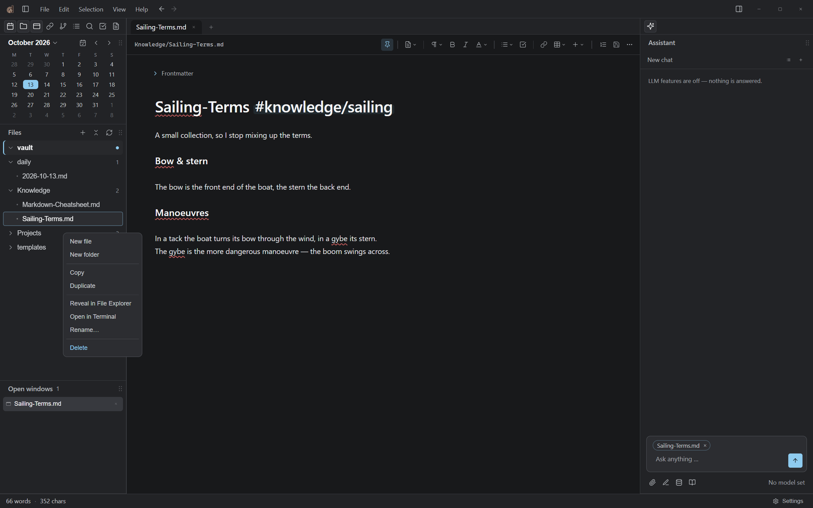

### Files from outside

- A vault file with an Office extension (`.docx`, `.xlsx`, `.pptx`, …)
  never opens as a tab — Drey hands it to the operating system, so it
  opens in Word/Excel/PowerPoint. Dropping such a file into a note
  copies it into `attachments/` and links it; **Alt-dropping** links the
  original file instead.
- Text files from anywhere on disk (Explorer "Open with" → Drey) open
  as **pinned external tabs**, are saved in place, and "Save as…"
  copies them into the active vault.

### Staying in sync

By default Drey does **not** watch the vault folder — external changes
appear after **Refresh** in a vault header row's context menu (or
`vault.refresh` from the command palette). An opt-in watcher that
reacts to outside changes immediately can be enabled in
[Settings → Vault](#settings-vault).

---

## 4. Writing notes

### Modes

One editor, three reading/writing modes, switched in the meta bar's `⋯`
menu:

- **Live Preview** (default) — a true in-place preview: the cursor sits
  in the rendered document, Markdown markers reveal only around the
  selection, tables/images/diagrams render as widgets that show their
  raw source while the caret is inside them. A link in the text opens
  with `Ctrl`+click (a plain click places the caret); a link inside a
  rendered table or block opens with a plain click.
- **View** — read-only rendering; plain clicks follow links.
- **Source** — raw Markdown.

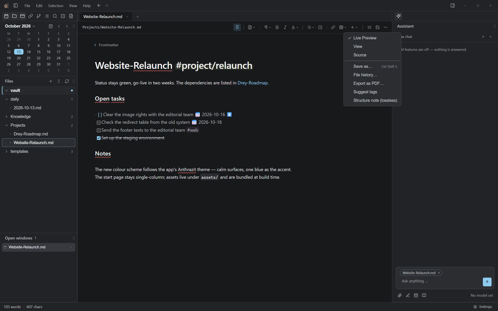

The `⋯` menu also holds *Suggest tags* (AI), *File history…*,
*Export as PDF…*, *Save as…* and any manual Assistant Actions you have
configured.

The editor's text size zooms with `Ctrl +` / `Ctrl -` / `Ctrl 0` or
`Ctrl`+wheel; while it differs from 100%, the meta bar shows the
percentage — click it to reset.

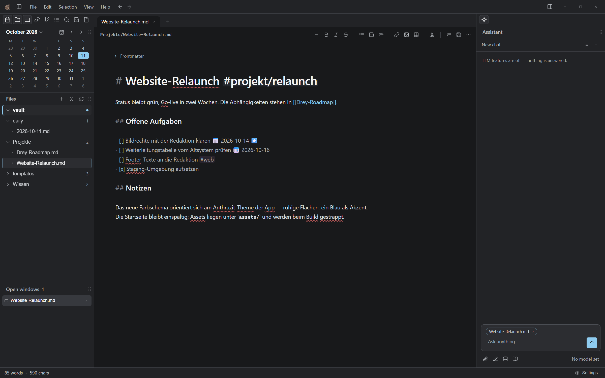

### The slash menu and capture

Typing `/` on an empty line opens the **slash menu**:

- **Entry** — the quick-capture block: a `## HH:mm` heading with an
  optional topic, exactly what daily-note journaling uses. The inserted
  format is configurable (Settings → *Entry format*).
- **Templates…** — opens the template picker at the caret (see
  *Editing aids* below). Typing a template's name after the slash
  (`/stand`) offers it directly, with a preview card.
- **Formatting** — headings, lists, quotes, tables, code blocks.

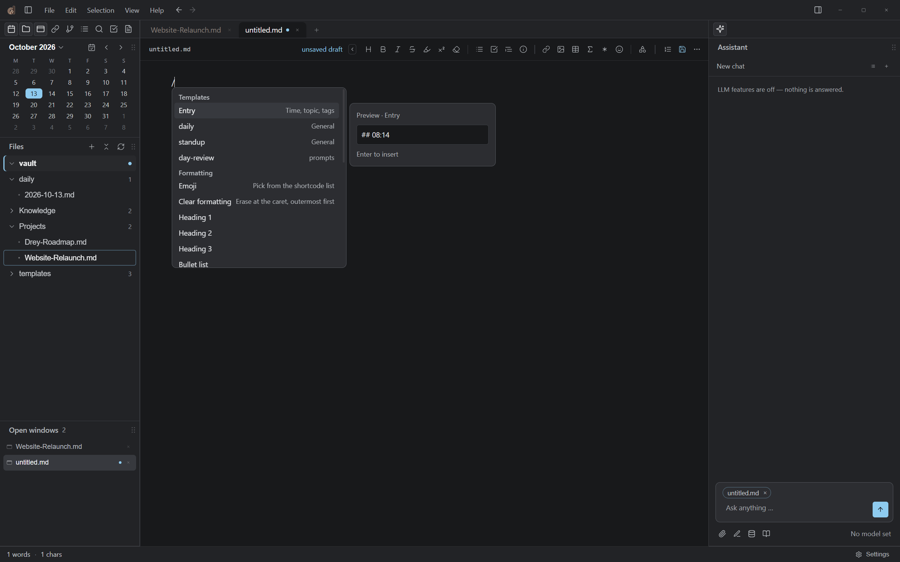

### Snippets

Typing a snippet trigger — `tbl`, `code`, `task`, … — offers a
multi-line block with `${1:placeholder}` tabstops: accept with `Enter`,
then jump between placeholders with `Tab`. The library is yours to edit
in Settings → *Templates*.

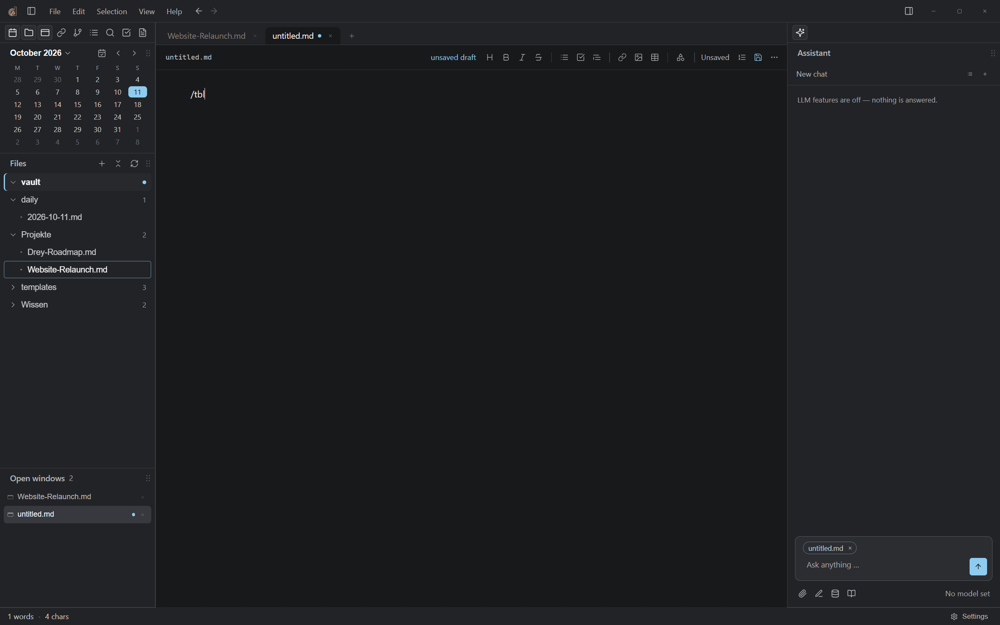

### Tags and wikilinks

- `#tag` words render as **pills**; `Ctrl`/`Cmd`-click a pill to search
  it. Typing `#` autocompletes from your existing vocabulary. Tags are
  free labels — `#project/relaunch` style namespaces give structure
  without folders.
- `[[Note name]]` renders as an internal link (unresolved targets are
  muted and dotted). `Ctrl`/`Cmd`-click **opens** the target — creating
  the note if it does not exist — and `[[Note#Heading]]` jumps to a
  heading. `[[Note|alias]]` shows the alias text. Typing after `[[`
  autocompletes note names across all vaults.
- A link is looked up in its own vault first. With **Settings → Vault →
  Also look for link targets in other vaults** switched on for that vault,
  a link that matches nothing there is looked up in your other vaults (the
  active one first). Hover such a link to see which vault it opens; a name
  found in several other vaults opens the first and is drawn dashed. Off by
  default — then following a link that matches nothing creates the note.

### Editing aids

- **Formatting strip** — one row of icons: the template picker,
  paragraph style (body text, headings, blockquote, callouts — a
  callout written `> [!note]-` starts folded and `> [!note]+` open; a
  click on its title folds or unfolds it), Bold,
  Italic, more text formats (strikethrough, highlight, sub- and
  superscript, *Clear formatting*), lists, Task list, Link, Table (a
  size grid) and an *Insert* menu (image, emoji, footnote, math,
  diagram). A button with a small caret opens a menu, one at a time;
  the others act at once. The strip is the head of the editor's
  **right-click menu**, where it acts on the text you clicked: there
  its first menu is the usual *Cut / Copy / Paste* list, open from the
  start. Its **pin** docks the strip into the meta bar and releases it
  again (also *Pin formatting toolbar* in the command palette).
- **Template picker** — the strip's first button, and *Templates…* in
  the slash menu: type to filter, `↑`/`↓` move through the list,
  `→`/`←` open and close a folder, `Enter` inserts the template at the
  caret, `Esc` closes. The right half previews the selected template.
  Subfolders of `templates/` show as folders; `templates/prompts/`
  (the Assistant's prompts) is left out.
- **Folding** — headings collapse Obsidian-style; the chevron appears on
  hover in the gutter.
- **Line numbers** — *Line numbers* in the `⋯` menu (`Ctrl+G`), an
  app-wide preference.
- **Spell checking** — Hunspell dictionaries (English and German
  bundled), per-language and personal word lists in Settings →
  *Spelling*.
- **Find in note** — from the `Selection`/context menu; CodeMirror's
  search panel.
- Selection menu helpers: *Select line*, *Move line up/down*,
  *Duplicate selection*, *Toggle task done*.
- Every embed that shows its raw source (`</>` *View source* button or
  caret inside) draws it in a visibly contained block; an image's source
  line shows **above** the still-rendered picture, never replacing it.

### Saving

`Ctrl+S` saves the focused note, `Ctrl+Shift+S` saves into a new file,
`Ctrl+Alt+S` saves all dirty tabs. Saving never adds frontmatter you did
not have; an existing `updated:` field is touched only where present.
Every save keeps the overwritten text as a restorable version
([Version history](#18-version-history-and-save-conflicts)).

---

## 5. Daily notes and quick capture

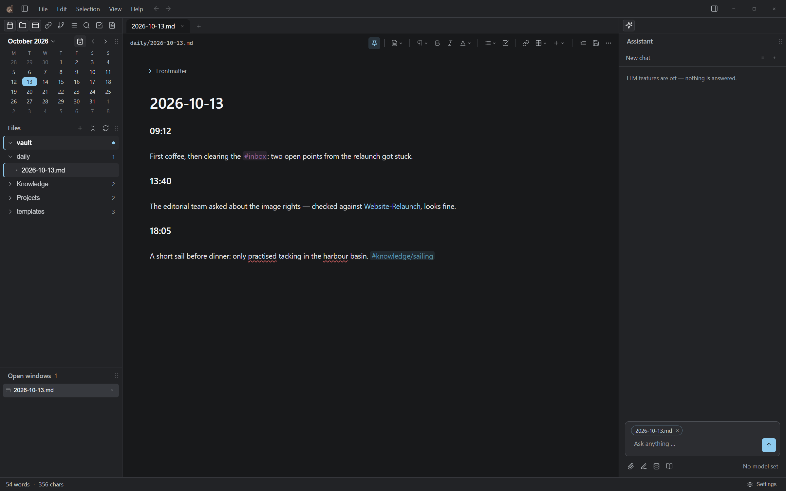

- The **Calendar panel**'s title is the month/year picker; hovering the
  header shows the **Today** button (opens today's daily note) and the
  month arrows. Days that have a note carry a dot.
- Daily notes live in `daily/YYYY-MM-DD.md` (folder and naming
  configurable in Settings → *Daily notes*).
- New daily notes are generated from `templates/daily.md`; the file is
  created with a starter layout on first use and is yours to edit.
  Placeholders: `{{date}}`, `{{time}}`, `{{datetime}}`, `{{title}}`.
- **Quick capture**: press `Ctrl+Alt+N` anywhere in Windows while Drey
  is running — the window comes forward, today's daily note opens, and a
  fresh `## HH:mm` section starts. Type, then `Ctrl+S`. (The main window
  must be open — there is no tray mode. If the hotkey does nothing,
  another program owns it.)

Journal entries through the day are exactly the slash menu's **Entry**
block — heading with time, your text, optional `#tags`.

---

## 6. Tasks

A task is any `- [ ]` checklist line — or a plain text line carrying
`#task`. Tasks understand Obsidian-compatible inline metadata:

- a due date: `📅 2026-10-14`
- a priority glyph: one of `🔺` `⏫` `🔽`

```markdown
- [ ] Clarify image rights with the editor 📅 2026-10-14 ⏫
```

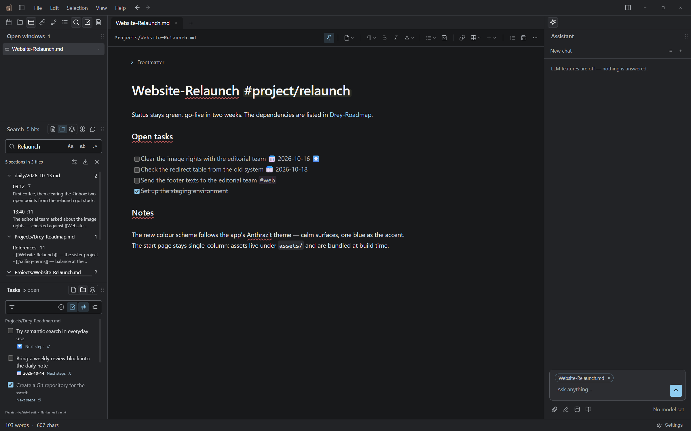

The **Tasks panel** lists tasks from

- **Doc** — the open document's live buffer,
- **Vault** — every note in the active vault,
- **All** — every registered vault, grouped per file with a vault badge.

The toolbar offers *hide done*, a kind filter (checkbox tasks vs.
`#task` lines) and a sort cycle (file order / due / priority). Rows show
a due badge (coloured when overdue or due today) and the priority glyph
— both are buttons that re-open their pickers. In the editor, typing
`due` / `prio` on a task line (or clicking a metadata chip) opens the
same pickers in place.

- Ticking a row in the panel rewrites and saves the note (the open
  buffer if the file is open).
- Clicking a row opens the file at that line, in its vault.
- `Mod+Enter` toggles the task under the cursor done/undone.

### Reminders

Once a day, a system notification counts the open tasks that are due
today or overdue — across every vault (for example "2 due today, 4
overdue"). Clicking it brings Drey to the front and opens the Tasks
panel. Nothing is scheduled while Drey is closed: the next start
reports what piled up in one notification. Turn it off in
Settings → Tasks.

---

## 7. Tags and search

Tags are free inline `#tag` labels (never directories, no frontmatter
list). The **Tags plugin** keeps a per-vault index of every
heading-delimited section — tagged or not — so full-text search reaches
unindexed-looking notes too.

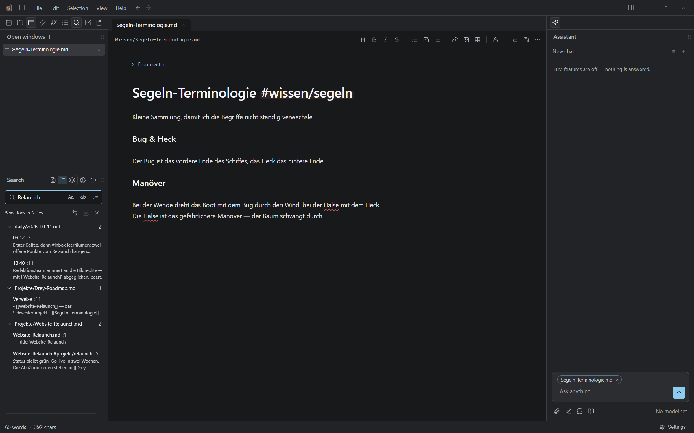

The **Search panel** (open with `Ctrl+Shift+F`) has:

- A **scope switch**: this document / the active vault / all vaults.
- **One field** for everything: free text, and `#tag` words that lift
  into chips as you type them.
- Match toggles: `Aa` case-sensitive, `ab` whole word, `.*` regular
  expression (an invalid regex shows an inline error, not an empty
  list).
- **Include chats** (speech-bubble toggle): `chats/` notes stay indexed
  but are excluded from vault/all results — and from replace — unless
  this is on.

Results are sections grouped per file; a click opens the file at the
section's line, in the file's vault.

### Replace

The replace row patches the **open buffer** in document scope (an
unsaved edit, like typing). Vault-wide replace first shows **one bundled
confirmation** listing every affected file with its diff:

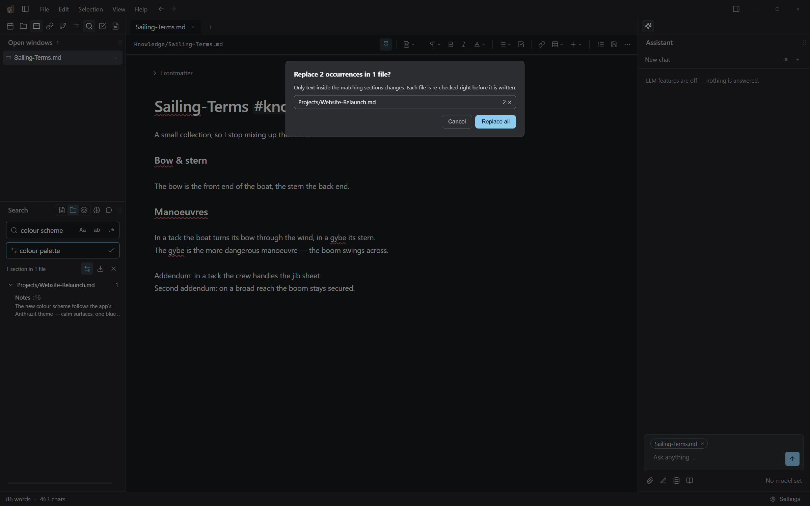

### Export and Summarize

On the result line: **Export** dumps the hits into an unsaved
`search-results.md` scratch tab; **Summarize** (needs an LLM) streams a
digest of the hits into an editable scratch tab, cancellable, over the
`builtin:search-summary` prompt template.

### Tag management

Settings → **Tags** colours tag prefixes (longest `/`-namespace wins,
otherwise a deterministic palette) and renames/merges tags across the
whole vault — a grammar-faithful token rewrite, descendants included by
default. `#task` is reserved and never suggested for renaming.

---

## 8. Templates, snippets and prompts

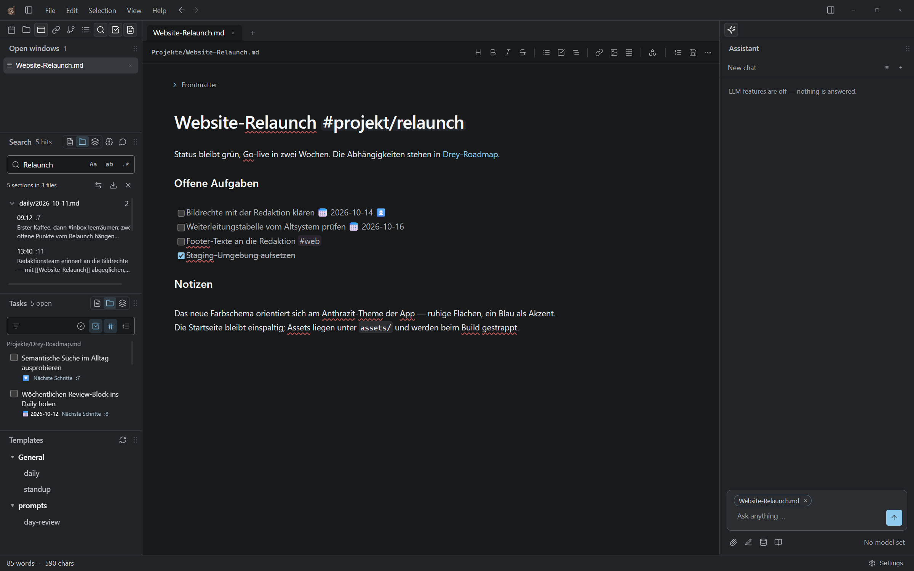

- **Note templates** are Markdown files in `templates/`, in subfolders
  if you like. They appear in the Templates panel, in the template
  picker (the formatting strip's first button, *Templates…* in the
  slash menu) and in "New note" flows.
- **Snippet triggers** (`tbl`, `code`, …) are edited in Settings →
  *Templates* — the library is user-owned app config, with `${n:placeholder}`
  tabstops.
- **Prompts** for the Assistant are Markdown files in the `prompts`
  folder of your templates folder (`templates/prompts/` by default): a
  `# Title` heading, a `> Description` line and the prompt body. They
  surface in the composer's *Prompts* picker and in the popover at a
  selection (section 9).

---

## 9. The Assistant

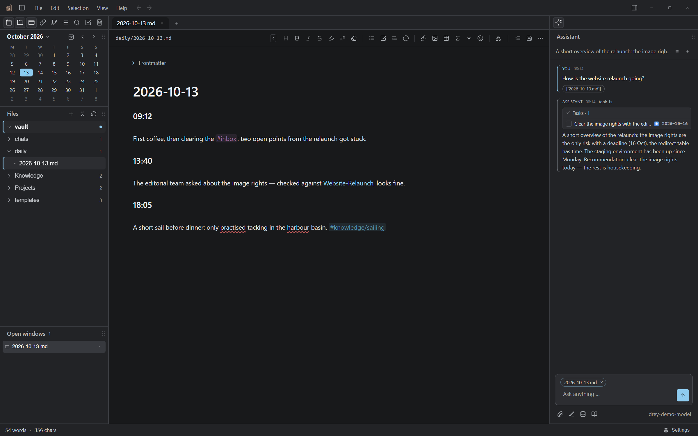

The **Assistant panel** is chat-first:

- The head shows the active conversation plus a chat-list button and
  `+` for a new chat. At startup the newest chat loads once; otherwise
  the panel keeps its chat while you move around the app. Opening a
  chat's own note tab hydrates the panel with it — that is the only
  implicit switch.
- **Every turn is persisted** as ordinary Markdown under
  `chats/<year>/<month>/…` (`kind: chat`). Chat notes auto-save; a
  follow-up replays the whole history, tool calls and applied edits
  included. There is no length cap and no hidden state — the note *is*
  the transcript.
- The **composer** grows with its text and understands `@` to attach
  note chips (autocomplete over vault paths), paste/drop of images, and
  a `+` button to stage external files (they are copied into the vault).
  The tool row: **Attach** · **Live edit** · **Vault context** ·
  **Prompts** · **model picker**.

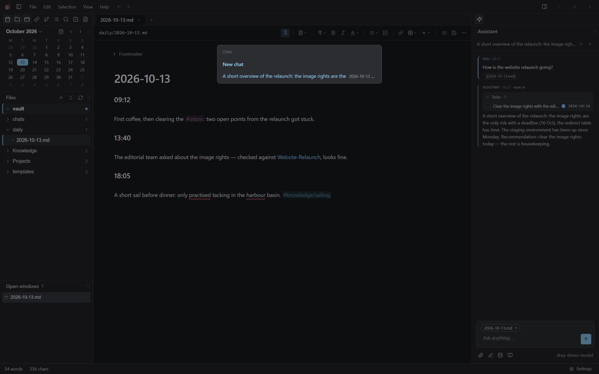

### Conversation targets {#assistant-targets}

The Assistant head is one row: the **chats button** (three lines) opens the
list of chats right in the panel, then come the target icons, the title of the
chat and **+** for a new chat. When the Tickets plugin is on, the icons are a
speech bubble (**Model**), a rocket (**Mission Control**) and two heads
(**1:1**); hover one for its name.

- **Model** is the chat described here: the provider from Settings →
  Assistant, with the composer's chips and tools.
- **Mission Control** is the crew's contact (Pia). It knows the board and
  proposes changes as cards with **Confirm** and **Dismiss**; nothing changes
  until you confirm. A question from Paul, the planner, appears as a card
  above the composer — tap an answer to send it — and his words carry the
  *via Mission Control* chip. Mission Control needs an HTTP provider (LM
  Studio, an OpenAI-compatible server, OpenRouter, the Anthropic API or
  Z.ai GLM); with a CLI provider it answers with an error card saying so.
  The head's list button opens the earlier Mission Control chats, `+`
  starts a new one.
- **1:1** opens a menu of the crew's agent personas. Your messages go into
  that persona's thread — a note to the persona; no run reads it until the
  1:1 becomes a conversation with the persona.

#### Shape a ticket in the editor {#shape-in-editor}

Open a ticket that is still an idea (a phase before the first automatic
one) from the Files panel or the Tickets panel: the ticket is its Markdown
file, and the **Mission Control** target shows that ticket's conversation
with a chip *T-0130.md attached* above the composer. Write what you want;
Mission Control relays it to Paul, the planner, who reads the ticket's
repository and rewrites **only the `## Plan` chapter** of the open file.

- Your own text in the document is saved before each message goes out, so
  Paul reads what you wrote. While he works the document is locked; his
  change appears in place, and a quiet line under the **Plan** heading
  says *Paul edited this · 2 min ago*.
- Edit the plan yourself any time. The line *You edited this · rides along
  with your next message* shows that your changes since Paul's last turn
  will be sent with the next message (as a short summary and a diff); his
  own changes are never sent back to him.
- When Paul has a question, the decision card sits above the composer: the
  question, 2–4 choices as radio rows with the recommended one marked and
  selected, and one **Send “<choice>”** button. Picking a row only selects it;
  Send sends it as your next message. Or write your own answer in the composer.
- When he is ready, the thread shows **Split** / **Keep as one**. *Keep as
  one* moves the ticket into the build queue; *Split* records the choice and
  leads to the plan to accept.

On a target the composer keeps the **Vault** chip (off by default; the same
picker as on Model) and **Prompts**. With the chip on, the note sections that
contain words of your message ride along as read-only reference — pick an
architecture-docs vault and Mission Control or Paul can draw on it. Attachments,
live edit and the model row belong to the Model target only.

Switching to another document switches the conversation with it; a note
shows the latest Mission Control chat as before.

A view can name its own default target: switching to such a view switches the
Assistant with it; Notes always starts on Model. Your own pick stays until you
change the view.

The **microphone** button in the composer dictates into the field (hidden
where the system offers no speech input); read the text, then send it.

### Asking about a selection

Select text in a note and a small assistant button appears next to the
selection. It opens a popover with:

- a **question field** — type and press `Enter`;
- your **prompts** (the files in the prompts folder, see section 8) —
  one click asks that prompt;
- your **manual Actions** — one click runs the Action with the selection
  as its focus.

A question or prompt is answered in the Assistant panel; the selection
is sent along with the note and quoted above your question in the chat.
`Ctrl+Shift+A` opens the same popover from the keyboard. If you do not
want the button, switch it off in Settings → *Actions*.

### Context chips

Attach the notes the model should see: `@`-completion, images
(providers with vision), or scratch text. A small arrow on an answer
inserts it into the open note.

### Vault context

The **Vault chip** opens a picker — *Off / Active vault / All vaults*
plus one checkbox per registered vault, so a non-active vault can be
targeted without switching. When on, the note sections that contain
words of your question are added to that one call — up to four, the
ones with the rarest words first, a word in a heading counting more.
Nothing has to be switched on or built for this. It matches words, not
meaning: ask with a word the note uses. A model that can call tools
searches and reads the vault further on its own when these sections do
not answer the question. Chat notes are excluded so past questions do
not drown out the notes that answer them. The sections come from the
Tags plugin's index; with that plugin disabled there are none.

### Live edit

The **Live edit** chip opts a single question into direct editing: the
model changes the open note piece by piece (`vault_edit`), each change
lands in the editor as one undoable step — without a confirmation and
**without saving**; you save when you are happy with it. The document is
locked against your typing while the turn runs, and the result is
recorded in the chat note. It also works on a new tab you have not
saved anywhere yet. Live edit needs a model that can call tools;
otherwise it says so.

Without live edit the assistant changes the open note the same way, but
shows you each change as a diff first and saves the note once you
accept. This works with the Vault chip off as well — the note attached
to the question is always within reach, the rest of the vault only with
the chip. The assistant works on what the tab shows, so text you have
not saved yet is seen and kept. (A model or provider that cannot call
tools returns the whole changed document instead; you confirm it in the
same dialog.)

### Actions

**Actions** are saved prompts with behaviour — *Autotag* (suggest
tags), *Search summary*, *Structure note (lossless)*, and your own:
name + prompt + result kind (inline diff or whole-document preview).
Triggers run **manually** from the editor's `⋯` menu or **on save**.
Writing results pass through the shared confirmation dialog with a
"don't ask again" switch. Managed in Settings → *Actions*.

*Structure note (lossless)* turns a raw note into structured Markdown —
headings and lists where they help, obvious typos fixed — without
adding, dropping or interpreting anything, and tags it only with tags
your vault already uses. It is in the `⋯` menu on a fresh install; if
you had Drey before, add a manual trigger for it in Settings →
*Actions*. You see the whole rewrite side by side before anything
changes — check the tags there, the model is told to invent none but
nothing forces it.

In any Action prompt, `{{AVAILABLE_TAGS}}` is replaced with your vault's
tags (one per line) when the Action runs. The note itself is always sent
along; you do not need a placeholder for it.

### Suggest tags

`⋯` → *Suggest tags* sends the caret's heading section to the model and
applies its tag suggestions to that section directly — the classifier
only ever suggests; `#task` stays reserved.

---

## 10. AI providers (LLM)

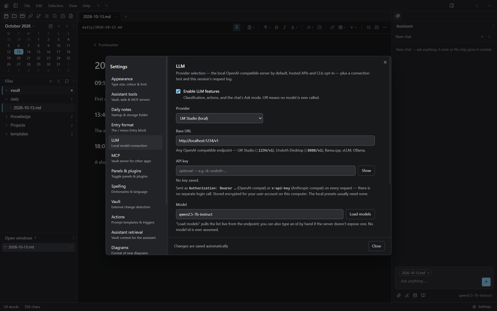

Drey is local-first: the default provider is any **OpenAI-compatible
endpoint** on your machine — LM Studio (the documented default,
`http://localhost:1234/v1`), Unsloth Desktop, llama.cpp, vLLM, Ollama.

- **Master switch** — off means classification, Actions and the chat
  all degrade with a clear message instead of failing silently.
- **Model id** — pick from `GET /models` or type it by hand (CLI/web
  providers advertise no model list at all; the field stays free-form).
- **No generation timeout** — a local model may think for minutes;
  you cancel instead of the app cutting it off.
- A request log with runnable `curl` equivalents sits at the bottom of
  the page.

Hosted presets — **OpenRouter, Anthropic API, Z.ai GLM** — and CLI
providers — **Claude Code (headless)**, **GitHub Copilot CLI**, and the
removable **Copilot Web** scraper — are strictly opt-in and off by
default. API keys are stored in plain text in `app-config.json` in your
user data directory (like every desktop client of a local endpoint).

---

## 11. Assistant tools and MCP

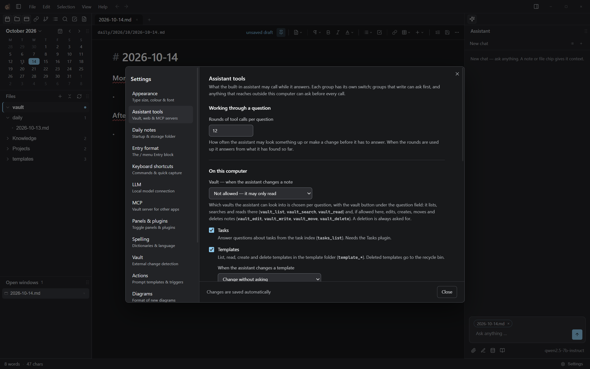

### What the assistant may call

Settings → **Assistant tools** is the tool contract: what the assistant
may do, and when it has to ask.

**The vault.** Which vaults the assistant can look into you choose per
question, with the **Vault** button under the question field (off, the
active vault, all vaults, or a selection). In those vaults it can list
what exists, search for exact words — also inside one note —, and read
a note whole or in parts. With the button off it sees only what you attached
to the question — and the open note, when it is attached, is the one
file it can still read and change.

Whether it may also **change** notes there is the *Vault* choice in
Settings → Assistant tools:

- **Not allowed** — it only reads. The one exception is the note
  attached to your question: a change you ask for there is shown as a
  diff and applied when you accept.
- **Show the change and ask first** — every edit, new file or appended
  text opens the diff dialog; you accept or decline.
- **Change without asking** — edits apply at once. Use it when you trust
  the model and the task.

A **move** asks in a small dialog under *ask first*; a **deletion**
always asks, and the file goes to the recycle bin. The assistant changes
part of a note by replacing exact text, so a small change stays small
in the diff. It never touches a vault the Vault button did not select,
and it leaves your chat notes and drafts alone. A note that is open in
a tab is read as the tab shows it and changed in the tab, so unsaved
text is neither missed nor overwritten; the same goes for programs
connected to Drey's MCP server.

**The other groups** — tasks, templates, web search, web fetch and each
external MCP server — have a switch each, `write: confirm | auto` where they write,
and `approval: ask | allow` on everything that leaves the machine. An
external tool call under *ask* shows the shared approval dialog (source,
tool, arguments — *Allow / Always allow / Deny*).

**Rounds of tool calls per question** (default 12) is how often the
assistant may look something up or change something before it has to
answer. When the rounds are used up it answers from what it has found so
far. Raise it for long research questions; lower it if a small model
keeps circling.

While the assistant works, its answer card lists every tool call as it
starts, and marks one that failed. A failed call is not the end of the
turn — the model is told what was wrong and tries again. If your model
or its server does not accept tools at all, the assistant notices on the
first question and goes on without them.

### Web search and the Web button

Settings → **Assistant tools** → *Web search* lets the assistant search
the web (`web_search`). Pick a provider:

- **DuckDuckGo** — no account, works at once. Drey reads DuckDuckGo's
  ordinary result page, which is not made for programs: it can change or
  refuse requests. Fine to try things out.
- **Brave Search** or **Tavily** — dependable; each needs an API key
  from the provider. The key is stored encrypted on this computer.
- **SearXNG** — the address of an instance you run yourself. It must
  allow the JSON format (`search.formats` in its `settings.yml`).

A search returns titles, addresses and short excerpts. With *Web fetch*
on as well, the assistant can then read the pages it found. Your search
words go to the provider you chose — with *Ask every time* you see them
before each search.

Whether a question may use any of this is your choice per question: the
**globe button** under the question field. It appears once web search,
web fetch or an MCP server is switched on in Settings, starts off, and
stays the way you left it. Off means nothing leaves this computer
through a tool; on lets the assistant search, fetch pages and call your
MCP servers for that question.

### Drey as an MCP *client*

Add external MCP servers (stdio or Streamable HTTP); their tools reach
the model as `mcp__<server>__<tool>`. Like web search and web fetch they
ride a question only while the globe button is on.

### Drey as an MCP *server*

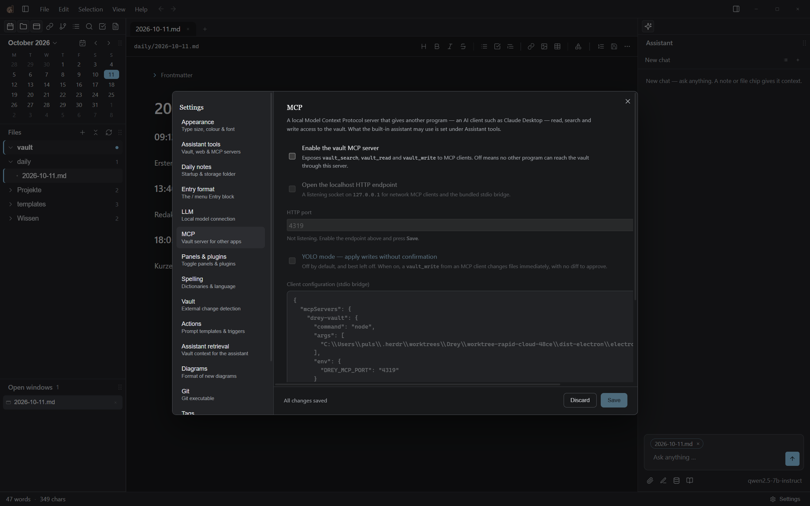

Settings → **MCP** exposes the vault *to other programs*: the same
opt-in discipline, off by default.

- Tools: `vault_list`, `vault_search` (words, a quoted phrase, a regular
  expression, tags; in the whole vault, a folder or one file),
  `vault_read` (numbered lines, a range or a section), `vault_edit`
  (exact text replacement), `vault_write` (`mode`: create, append or
  overwrite), `vault_move`, `vault_delete` and `tasks_list`. They take
  an optional `vault` argument; without it a search covers every
  registered vault.
- A change goes through the confirmation diff (a move through a small
  dialog) unless **YOLO mode** is on. A deletion always asks.
- Transports: a localhost `POST /mcp` HTTP endpoint and a standalone
  stdio bridge for CLI clients.

---

## 12. Git source control

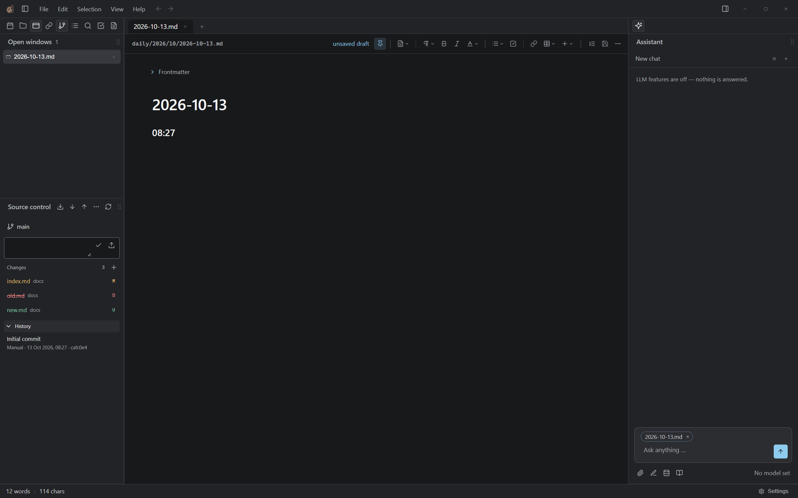

A vault can be a Git repository (its root or a folder inside one). The
**git plugin** runs your installed `git` — no bundled reimplementation.
The panel shows the repository of the focused document's vault:

- **Branch button** → switch, track a remote branch, create.
- **Commit** box — `Ctrl+Enter`, or *Commit and push*
  (`Ctrl+Shift+Enter`). Drey asks before committing with unsaved tabs,
  and refuses checkout/pull while the vault has unsaved tabs.
- **Merge conflicts / Staged changes / Changes** lists — row click
  compares through the diff view; stage, unstage, discard, open from
  each row.
- **History** (collapsible) — commits not on the upstream carry a
  "↑ not pushed" marker.
- Header icons: Fetch · Pull · Push · More (merge a branch, stash,
  stashes, amend — never of a pushed commit — file history) · Refresh.
- A merge shows a banner with an abort button; the conflict surface is
  keep mine / keep theirs / mark resolved.
- A **plugin-managed** repository (the tickets vault) is **read-only
  here**: a "Managed by Tickets" banner sits above the commit box and
  staging, discarding, committing (and amending), pulling and pushing
  are disabled — the plugin writes that repository's history itself
  (one ticket transition is one commit). Everything read-only stays:
  branch, dirty state, history, file history and the Files-panel badges.

### Found repositories (a vault that is only a parent folder)

A vault does not have to be a repository itself. If it is just a parent
folder — `E:\projects` with several repositories inside — Drey scans a
few levels below it (folders starting with a dot, `node_modules` and
reserved `_` folders are skipped) and surfaces every repository it
finds, up to 25 per vault, in the Source control panel **and** as Files
badges. A `.git` file (a linked worktree) counts like a `.git` folder.

A found repository is **read-only by design**: a hint row
*Found by scanning \<vault\> — read-only* sits above its changes, there
is no commit box, and stage/discard, fetch/pull/push, merge, stash and
amend are all disabled or refused — clicking a row still compares, and
history and file history still work. When a focused document lies
inside one of several found repositories, the panel shows exactly that
one; the selector at the top switches between them (its tooltip shows
each repository's absolute path).

**Register as vault** (the button in the hint row) turns a found
repository into a vault of its own with one click — after that you can
work with it like with any vault. The scan re-runs whenever the vault
list changes or you refresh the status, and repositories that already
belong to another registered vault are never listed twice.

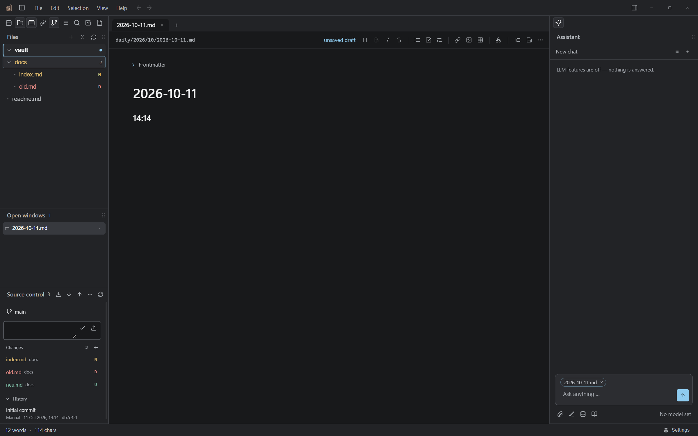

Changed files carry status badges (`M` modified, `U` untracked) and
tones in the Files panel. The `git.path` is configurable in Settings →
*Git*.

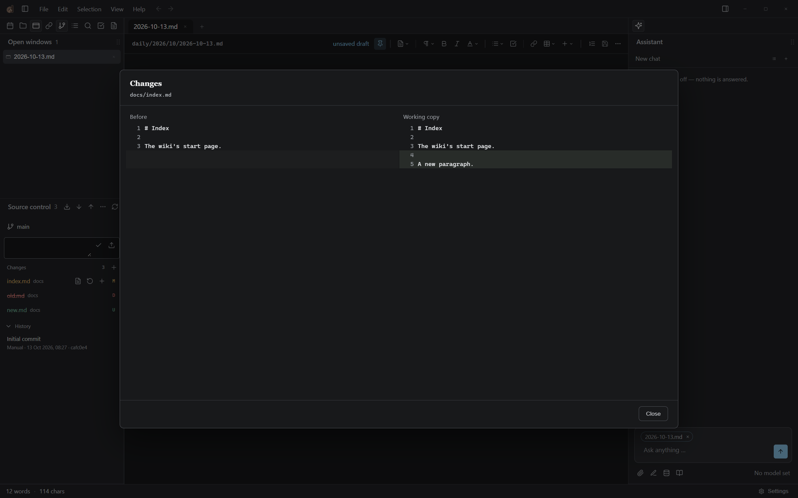

---

## 13. Tickets

The **Work** panel lists your tickets over a **tickets repository** —
its own git repo, registered in Drey like any vault, holding one
Markdown file per ticket. Nothing is stored besides the files: what the
panel shows is derived from them on every refresh. A ticket's phase is
simply the folder its file sits in, and moving a ticket is a git move
plus exactly one commit — the repo's history is the ticket's timeline.

**Projects.** Every tickets repository is one **project** (req-72): its
own tickets, its own pipeline and its own repositories. You can register
several — the panel header carries a project menu listing every vault
that holds a board; picking one switches the board (and the fleet) to
that project. Which project is active survives restarts. A new project
is just another vault with a board: point the empty state's
**Initialize the tickets board** at it, or initialize in the other
vault from its own Files panel.

**Setup.** Create an empty git repository for your tickets (it can live
on GitHub, Azure DevOps or anywhere plain git works — the board never
talks to a host API), clone it locally and register the folder as a
vault (see [Vaults and files](#3-vaults-and-files)). Open the Work
panel; the empty state offers **Initialize the tickets board**, which
creates the configuration files under `tickets/_meta/`:

- `pipeline.md` — the phases in order, each with a title, an
  optional WIP limit, a claim flag and what must happen for a ticket to
  leave (a manual move, an agent run, a check). Edit it like any note;
  the board follows on refresh.
- `repos.md` — the work repositories a ticket can name, with their clone
  URL, integration branch and a note on which branch protection exists.
  You never have to hand-edit it (though you can): **Settings → Tickets →
  Repositories** lists the entries as editable rows — name, URL, branch,
  local path, policy, worker, worktrees base, **launch command**,
  **agent instructions**, linked folders — one
  commit per save, your notes under the frontmatter kept. The launch
  command is what **Launch this version** (below) runs in a ticket's
  worktree; empty means `dev.ps1 -Built -Multi` when the worktree has a
  `dev.ps1`. **Add from
  folder…** picks a folder and registers every git repository found
  inside (the folder itself and its subfolders) with clone URL, branch
  and local path prefilled.

**The Work panel** (req-75) shows six groups, each folded or opened by
its heading (remembered across restarts):

- **Needs you** — only there when something waits on you: a worker's
  question (kind chip *Question*, the question as its line — in the
  thread its options are one-tap pills, each with a leading dot and the
  recommended one's filled), an approval it wants
  (*Approval*), a red gate or a failed run (*Gate red*, *Run failed*),
  a plan to accept (*Plan to accept*), a review (*Review*), and a
  finished ticket (*Ready to try*). The buttons for the last three live
  in the ticket's thread, not on the row.
- **Running** — everything on its way through the pipeline. The
  tickets a worker is on right now come first; then the queue in the
  order the fleet should take it: **dependencies before priority** — a
  ticket never sorts above an open blocker, and a blocker moves up with
  the most urgent ticket it holds up — then closest to done. Each row:
  a dot (accent while a worker is on it), the step — Planning,
  Building, Merging or the phase — and the worker's current action in
  one short line. Without a worker it is queued and says what it waits
  for. The heading counts how many are running.
- **Shaping** — the tickets in the Shaping stage, and those you reserved
  for a dialog with a worker (interactive); with a dialog, the row says
  whether it runs, pauses or has not started, and how many turns it has.
- **Inbox** — the backlog before the machine, highest priority first
  (a blocker before what it blocks, as in Running; a small *Urgent*/*High* chip marks the ones that matter), newest
  first within a priority. The chip on the right is its track —
  **Auto** (runs on its own), **Shape** (a plan-mode dialog with you)
  or **Triage** (not decided yet). Set both track and priority from the
  row's menu (right-click or **⋯**). The first five ideas show; *n more*
  unfolds the rest.
- **Prioritized** — the ideas already in the queue the fleet pulls from, each
  saying whom it waits for.
- **Done this week** — what reached Done or the archive in the last
  seven days, folded away by default. A row opens the ticket like any other
  (document, Thread, Review); **Show older** at the foot loads the whole
  archive under a search field (id or title words).

Every ticket sits in exactly one group — Needs you wins. A row
leads with the ticket's id, the title and an age; under it sits **one grey
line** — the phase, what waits on you or what the worker does, the
persona — and at its right end the ticket's cost in grey (hover it: *So
far*). The open ticket's row is marked with an accent bar. Click a row to open the ticket: its **document**, whatever the run is
doing, and a click never touches a saved view. The ticket's card has
**Thread** — the worker's page — and, once the ticket has passed a step,
**Open Review**. The thread's header shows the run's light and who is working,
and above its composer sits the **decision bar** (Accept, or Accept → next
phase on a board with other checkpoints). The thread follows whichever ticket you
click last — one tab, not one per ticket — and opens where your focus is,
never as an automatic split. A ticket's tab reads `T-0121 · title`, however you opened it: the panel,
the Files panel or a link. The row's menu **Open ticket** opens the same document. The panel's footer is the **crew line** — the fleet's worst light and who
is out there, `Crew · Ben, Tessa busy` (`Crew · idle` when nothing runs);
a click opens the Crew tab, and its tooltip carries tokens in flight and
the oldest run's age. A halted chain, a held column, a tripped breaker or a
provider out of quota show as an alert row above the groups. The header's controls show while you point at it or a control has focus; in a narrow dock the rest shows on a second row over the list: the filter, **New idea** (captures a new idea), **Open Board
tab**, then run/halt, abort and **⋯** (refresh, Mission Control, Board,
Crew, clean up worktrees); the project menu appears only with a second
project. When the tickets vault is not a git repository, a one-line note at
the foot says so — dismiss it with its ×. Errors and leftover worktree folders
show there too; on a ticket store, the foot's tooltip names the store.

**The step card** (req-75 W3, reworked in req-86). At the end of a
step, the thread shows a card above the transcript that follows where the
ticket stands:

- **At a checkpoint of yours** — a *Ready to try* or *Review* row in
  Needs you — it reports what the step did: what changed for you, where
  (which files, and why), which checks passed and how to try it, as the
  worker wrote it into the ticket's `## Changes` section. Its buttons:
  **Launch this version** (only when the ticket has a worktree and a
  launch command — it opens the worktree in a new console and starts the
  program there, a second instance beside yours), **Move to <next
  column>**, and **Send back…** (one note, then the ticket goes back to
  the nearest agent column with the note in its log).
- **In Done** it is the final report: **What was delivered** first (the
  commit step's `## Result`: the merge commit, what landed, anything
  left over), then the changes. The only button is **Archive**, which
  files the ticket away and removes its worktree when clean (a dirty
  one stays and says so).
- While an agent works the ticket, there is no card.

The strip at the top of the card stays when you fold it with the chevron
(or the header chip); folded, the strip carries the buttons, so the
agent log gets the whole height. Drag the bar under the card to give
either side more room — arrow keys work too, a double-click resets, and
the height is remembered.

Beside the card sits **How it got here** — the ticket's story from
capture to now, read from its log, with the total time and tokens. On
a pane narrower than 900 px the story sits below the card. A ticket
without a `## Changes` section still shows the story and the buttons;
only the missing sections are left out.

The funnel icon in the panel header filters the list by **phases** and
**statuses**. The chips toggle at once and the choice survives
restarts; the icon stays marked while a filter is on, and **Clear**
shows everything again.

**Everyday use.** Capture with the **+** in the panel header: a title,
a priority, optionally one or more repositories and a description land
as `T-00xx.md` in the Inbox (req-72: the repositories are checkboxes —
the first checked one is the primary, where the fleet tests; the
others get their own worktrees on the same branch). The ticket file is
an ordinary note (description, plan, executable acceptance criteria and
an append-only log). In the editor the ticket opens with a **card**
instead of the folded frontmatter: the id, the state once, *Open Review* and
*Thread*, and a quiet grid. The title is the page's headline unless the text
opens with its own `#` heading: edit it in place (Enter or leaving the field
applies it, Escape restores it), an ordinary unsaved edit of the file, so
Save and Undo work as for any typing. Priority, repositories and worker are
set on the board, the card menu or in the frontmatter. Under the pointer the
card shows a code button that edits the frontmatter as YAML; its header folds
back to the card. The **Log** section opens folded the first time a ticket
shows in a session: the chevron beside "Log" opens it, and the head says how
many entries lie in it.

**The ticket as a document.** The card follows the ticket's state. In the
Inbox and in Prioritized it reads *Priority*, *Worker*, *Flow* with a *Change*
link and *Repo*. From Shaping on it reads *Flow* (the chain: done steps ticked,
the current one in bold, *(with you)*, *(waits for you)* or *(your turn)*
beside it), *Worker* and *Cost*: what the ticket has cost, always with what it
is (*$1.20 so far*, *$1.84 in total*), and the **estimate** beside it: *est.
$3.00–5.20 · from 3 runs* (the middle half of the similar earlier runs; it
needs at least three), or *no estimate yet (first run)*. *Change* appears under
the pointer there. A ticket that waits on a question shows *Waits for you:* and
the question; a ticket whose file has a real problem shows an issues badge.
While the ticket waits at one of your checkpoints the card has the quiet link
**Decision waiting · go to the card**. There is no Accept or Send back here: you
decide in one place, the decision card (the Ready card in the ticket's thread;
on the phone and iPad the card in Mission Control's Work list).

When a verify run has written `## Verification`, the section reads as a
**Proof** block instead of its Markdown: the verdict with who tested it, the
checks with their notes and video times (click a time to jump there), and a row
of tiles: the screenshots (click one to open it) and the walkthrough video
(click it for its controls). The findings follow. A walkthrough over 25 MB is
not kept; the block says so in one line (Settings → Engine → Videos, *Largest
video*; videos are never deleted automatically). Put the caret in the section
and the Markdown shows again. Once the ticket is in the work, `## Verlauf` reads
as the **Cost** table: every settled run (Phase · Model · Tokens · Time · Cost)
with a total row; a phase of the chain the ticket has still to pass shows *no
run yet*.

**Plan to accept in the ticket.** A Shaping ticket whose plan lists `### Parts`
shows **Plan to accept**: the list as cards, each with its state, the persona
that builds it and its estimate, with the *Typical total* on top. Pick a persona
on a card; drag a card by its grip or use its **⋯** to move it; *Delete part*
takes a second press; a part that is running is locked. *Change flow* opens the
Flow tab, *Ask Mission Control to change the split* opens the ticket's
conversation. You can also edit the Markdown: put the caret in the block. You
accept on the decision card, the link goes there.

**The Review tab.** *Open Review* opens a tab **Review · T-0121**: the proof on
top (the walkthrough, the verdict, chapter buttons, the screenshots), then the
files of the branch on the left with their +/− counts and the selected file's
lines on the right. Drag the line under the proof or the one beside the file
list to give the diff more room; the sizes stay. Switch between *Changes* and
*Whole file*, tick a file's box when you have read it (the head says *1 of 3
viewed*; a file that changed since stays unviewed), *Open in editor* to read it
in a normal tab and *Git history* for the file's history; both need the ticket's
worktree to be inside a vault you have added; otherwise *Open in editor* opens a
copy. Click a **line number** to comment on that line, Shift-click a second
number for a range, then add the comment (Ctrl+Enter). Click a comment's text to
change it, the bin removes it. **Send back with 2 comments** moves the ticket
back to the agent with each comment (file, line, text) in its Handover, so the
next run reads them; as soon as the tab has a comment, the Assistant offers it as
the first option of its decision card, **Your review of <ticket>: what next?** (pick it
and press **Send “Send back with 2 comments”**), next to **Accept**. The Review tab has no Accept
either: while the ticket waits at one of your checkpoints its head has the link
**Decision waiting · go to the card**.

**The Flow tab.** *Change* in the ticket's card or *Change flow* in its Parts
block opens **Flow · T-0121**: the gates the ticket will still pass, each with who
works it and on which model. Click a gate to open its settings on the right:
who works it (the pipeline's default or one persona), *Tell me when it is
done*, *Earlier* / *Later*, *Add a gate after* and *Remove gate* (a standard
gate is struck, not deleted; *Restore gate* brings it back). The round **+**
between two gates adds a gate there. A gate drawn with a dashed outline is a
change you have not saved. Type into *Ask Paul to change this flow* (or leave
it empty) and press *Ask Paul* to get his draft with the reason, *Undo draft*
if you do not like it. Nothing is written until **Save flow**; *Reset to
standard flow* drops every change. The gate that is running and the ones
before it cannot change, and the whole flow is read-only while a run is live
on the ticket.

**By voice.** On Windows the dialog's Description label carries a
**mic button**: it starts Windows dictation (Win+H — Windows' own;
Drey adds no speech recognition), so speaking types into the
description. Typing works beside it at any time, and when dictation
does not start a one-line hint says so. A title is optional while the
description has one — its first line becomes the ticket's title
(trimmed and cut at 80 characters).

**Tidy up.** Right of the mic, the **sparkles button** turns the
dictated or hastily typed idea in Description into a title and a
description with one call to the language model — on demand, never on
its own: the result lands in the two fields for you to edit or
discard before the ticket exists. Your original words are kept — the
new ticket's Log carries them on a `raw capture:` line, so a misheard
dictation is always recoverable. The button needs the language model
on (Settings → LLM); while the call runs it stays disabled, and a
reply it cannot read changes nothing.

**From anywhere.** The title bar's **Capture by voice** button opens the same
dialog, and it is one chord away outside Drey:
`Ctrl+Alt+T` anywhere in Windows brings Drey to the front, opens the
board and opens the dialog on Description with dictation already
started (a failed start shows the hint — press Win+H yourself, or
type). Rebind it in Settings → Keyboard shortcuts like every other
shortcut.

A row's **⋯** button (or a right-click) opens its menu: **Open ticket**
(the ticket page); **Queue for the fleet** on an idea and **Back
to ideas** on a queued one; **Move to ›** with every other phase by
name; the agent rows (see below) and, under **Past runs ›**, the
ticket's finished runs, newest first — a row opens that run's
transcript read-only. **More ›** holds the branch name to copy
(`t/T-00xx`), the claim rows that apply to the ticket's claim, and the
ticket's work folder in a terminal (below). **Remove worktree…** and
**Archive…** close the menu (armed: the first click only relabels
the item, the second moves the ticket to `tickets/archive/` — out of
the list, kept in git; delete files there yourself when you are sure;
moving one back into a phase folder revives it).

Phase folders are numbered (`10-inbox` … `60-done` in the shipped default) — the number is
cosmetics for sorting in a file browser; everything inside a ticket
keeps the plain phase name (the first column is titled *Inbox* on a new
board; its id and folder are `inbox`). **Moving the file yourself counts as a
move**: drag or `git mv` a ticket into another phase folder and the
next refresh completes the transition exactly like a move from the
menu — stamp, log line, one commit. Validation findings (a hand-edited
file, an unknown repo, a ticket in two phases) show as a numbered badge
on the row — the panel keeps rendering, nothing is guessed. Findings
about the tickets repository's own files (`pipeline.md`, `repos.md`)
show as a chip in the panel header (coloured by the most serious one);
click it to list the messages, and **Open** beside a message opens the
file it is about.

Claims: moving a ticket into a claim-flagged phase (Build by default)
stamps who works on it and when. A stale claim is visible by its age;
taking over replaces it and logs the previous holder.

**Dependencies (`blocked-by`).** A ticket that must not start before
another one is done carries `blocked-by: [T-0048]` in its frontmatter —
write the ids by hand, a list, and save like any edit. The blocked
state is derived, never stored: the row says **Blocked by T-0048** for
exactly as long as one of the blockers has not reached the last phase;
no manual unblock edit exists. The fleet never picks a blocked ticket
(no dispatch, no manual run start, no `ci` move); the chain log names
it and its blockers, so an idle phase explains itself. You stay the
final authority: moving a blocked ticket into a worker phase asks first
(**Cancel** / **Move anyway**); anywhere else it just moves. A blocker
id that is not in the repository — deleted, renamed, or archived —
warns and keeps the ticket blocked; nothing unblocks silently.

**More › Open work folder in terminal** opens the ticket's work folder
— the local checkout configured as `path:` for the ticket's repository
in `repos.md`, so testing is one click: `.\dev.ps1` for Drey,
whatever the repo uses elsewhere. The row is there once the ticket names
a repository with a `path:`.

Pushing and pulling the tickets repo is ordinary git — use the
[Source control](#12-git-source-control) panel like for any other
vault. With a remote, two machines racing for the same ticket are
decided by the first push; the loser re-reads the tickets and picks the
next ticket. Pipelines that want it can add a `push: <remote>` key to
`pipeline.md`: every transition Drey or the fleet runner commits is
then pushed to that remote automatically (a failed push warns, it
never fails the move).

The complete format — every field, the grammar, the agent rules — is
specified in the repo's `specs/ticket-schema.md`.

### The Autopilot switch

**Autopilot** says whether the crew works by itself: **On** — workers pick up
tickets on their own; **Paused** — the running step finishes, nothing new
starts, optionally until a time you set (*Resume at*); **Off** — you start
every step. It reads the same everywhere: a status-bar item *● Autopilot · On*
left of today's cost (click it or press `Mod+Alt+P`), the chip in the iPad
header, the icon in the phone's app bar (Work, Crew and the chat; it draws the
state: play, two bars, a square) and the *Autopilot* row of the phone menu, which
leads to Settings. A green dot means On, orange Paused, grey Off. On the desktop the item opens a popover above it: the three states, a
sentence on what the current one means, and chips for the resume time and
today's cost. While Paused, click *Resume time* (or *Resume at 18:00*) to type
a time, Enter takes it; a time already past today means tomorrow, an emptied
field removes it. *Stop all running steps now…* at the foot aborts every live
run and halts the chain; it asks twice. A device paired read-only sees the
state but cannot change it. After a restart the state is Off. The same switch
is in Settings → Tickets → *Budget and runners*.

The Autopilot only decides whether tickets move on and start by themselves.
Talking to the crew does not need it: Mission Control, *Shape with Paul* and a
1:1 with a crew member work with the Autopilot Off. A message to an agent's
run starts the runner when it is not running. If the runner cannot be started,
the switch says why (*The runner could not be started: …*).

### Running agents on tickets (the fleet)

A ticket can be worked by an **external agent CLI** — OpenCode or
Claude Code — while you watch from the Work panel. Open the menu of a row
in an agent column (Inbox, Shaping and Prioritized are yours: move the ticket
to Building first) and choose **Run agent**: the dialog lets you pick the worker (the menu
shows the one your pins resolve to: the ticket's `worker:` field wins,
then the phase's `@worker` pin in `pipeline.md`, then the repo's
`worker:` in `repos.md`, then the configured default) and how freely
it may act. The **Handover** choice says how the run's context reaches
the worker: **Fresh session** (the default the rules compute), **Resume
last session** (continue the previous run's conversation of the same
ticket, worker and model — worthwhile on a warm pause or a small
context) or **Resume + compact first** (the same, natively compacted
before the brief rides — offered only where the worker can). The line
under it shows the run these options would continue — its phase, how it
ended, its last context size and its age — and options that make no
sense are disabled with the reason instead of silently switched: a
review always starts fresh, another worker's session is never resumed,
and a worktree that was rebuilt invalidates the old session. The choice
applies to this run only; dispatched runs decide by the same rules
themselves, and a resume that cannot be established falls back to a
fresh run under the same ticket. The worker gets a checkout of the
ticket's repo on its own
branch (`t/<id>`), the ticket's description, plan and the phase's
prompt as its brief. Folders the checkout has but git ignores — its
toolchain, say `.tools` and `node_modules` — can be shared with every
such checkout instead of rebuilt: list them as `link: [.tools,
node_modules]` under the repository in `repos.md`, and the worker is
told to use them and install nothing.

While the run is live, its row carries a traffic light (green working,
amber context nearly full or stopping, red stalled for five minutes)
and says what the worker does. The ticket's **thread** is the worker's
home (the separate run tab is gone): its header says what the worker
does now — a bold state word (*Planning*, *Building*, *Merging*,
*Waiting for you*, *Idle*) beside the run's dot, one muted line with
the worker, its model, how long it has been at it and how full its
context is (hover it for the numbers: turns, tokens, working time),
and the controls — **Pause**, **Take over** and **Stop**. The Work
panel's footer names who is out there — `Crew · Ben, Tessa busy`
(`Crew · idle` while nothing runs), with the fleet's worst light
before it; hover it for the long form, click it to open the Crew tab.

**Prioritized, persona and cost on every row.** The ideas already in the
fleet's queue are their own group, **Prioritized**, between Shaping and
Inbox; a row says whom it waits for (*waits for Ben*). Every row also carries
the **persona** that works on it (the live run's, else the ticket's pin, else
the column's) and the **cost** of the ticket so far, written as on the phone
(`$1.20`); a ticket without a known cost shows none.

**Board, Crew and Capacity.** Three more surfaces show the whole desk, from
the Work panel's **⋯** menu (*Board*, *Crew*) or the command palette
(*Open the Board*, *Open the Crew*, *Show the Capacity band*):

- **Board** (an editor tab) — the pipeline as columns. A card shows the
  ticket's id, what it is doing (*Running*, *Waiting*, *Plan*), its persona,
  its title and its cost; the head of a column shows the summed cost of its
  tickets. A ticket that is a part of another hangs under it, and a plan's
  parts that are not tickets yet hang under the planning ticket as *P1*,
  *P2*. A click opens the ticket; **New idea** in the first column captures
  one. *Done this week* is the last column.
- **Crew** (an editor tab) — a card per persona: its state (*idle*,
  *running*, *waiting*, *stuck*, *paused*), the day's cost against its
  budget, and one row per live run. A run that stopped making progress
  turns amber and offers **Nudge** (asks the worker for a status line),
  **Hand to Claude Code** (stops the run and starts the ticket again on
  Claude Code) and **Stop**. Above the cards: today's cost against all
  budgets, the pool load (*Local 1/2*), **Pause all** (running work
  finishes, nothing new starts; the button then reads **Resume all**) and
  **Stop all** (press twice — it aborts every live run and halts the
  chain). Click a card to open the persona's **1:1** (your messages to it;
  Ctrl+Enter sends), **Memory** (its entries — pin the ones that must
  always ride along — and a line to teach it) and **Setup** (worker,
  model, pool, phases, cost; **Pause** or **Resume** the persona).
  **Edit persona** on that head opens the persona's own page: its name,
  role, model pool and instructions (the persona's `prompt.md`), its skills
  and a suggested change from its friction findings. **Save** writes
  everything you changed as one commit; new runs get it, running ones keep
  the prompt they started with. **Discard** goes back to what is saved. If
  the instructions cannot be read, the editor and Save stay off, so nothing
  can overwrite them unread.
- **Capacity** (a panel for the bottom dock) — one line: how many of the
  worker slots are busy, the pool chips, what each persona is doing right
  now, today's cost, **Pause all** and **Open Crew ›**. It shows only while
  the Board tab is active. As the only panel of the bottom dock it has no
  icon strip above it; the chevron in its header folds it to the header.

**Pause and stuck workers.** **Pause** (on the thread and on a Crew
run) waits for the current action — a command or an edit — to finish and
then pauses; it never cuts one off half-way. A worker silent for ten
minutes is flagged *Looks stuck*; after forty it is stopped and the step
retries with a growing wait. The Work panel itself shows no worker
cards: they live in the Crew tab and the Capacity band.

**The worker on the ticket.** The thread's conversation is the
ticket's story in steps: each earlier run of the ticket is one folded
line — a mark (✓ done with a green gate, ✕ failed, ■ stopped, ●
live), what it did and how long it took; click it to read that run's
transcript. The current run sits open at the bottom, streaming; your
own messages are bubbles on the right. **Pause** interrupts the
running turn (the session and its context stay); the header then reads
*Paused* and offers **Continue**, which lets the worker pick the step up
where it stopped. A worker standing idle has no turn to interrupt, so
it shows no Pause. **Take over** holds
the run — the runner sends nothing of its own until you **Hand back**
(a worker that is idle by then ends the run and the gate decides —
after a Pause, Hand back continues the step instead);
your first message alone takes over too. **Stop** ends the run. The
header always offers exactly one way on: Stop while the run lives
(also for a worker that lost its runner — it reads *Running* with a
*not connected* note), **Resume session** when a run ended with one,
**Start** when there is none to continue. When a
run ended with a session, **Resume session** continues the
conversation later in a new worker that answers and then waits for
your prompts. Above the steps, the thread says **Shaped with you**
when you accepted this ticket's plan, and a **Changes so far** box
lists what the branch carries against its base — each file, its
status, the lines added and removed — beside **Safe beside others**
(✓ own worktree). Two quick prompts sit above the prompt box: **What
are you doing and why?** and **Stop after this step** — a click fills
the box, you send. While a turn runs, the thread shows the worker's
pulse above the prompt box: a small squirrel that runs while the worker
works, sprints while output arrives fast and sits when there is nothing
to do — the same squirrel marks the Running rows and the Crew cards
— beside what the worker is doing, for how long and the tokens written
so far.

While the worker is in the middle of a turn, what you send does not cut
into it: the message waits in a **queue above the prompt box** — click
one to edit it (Enter saves, Escape cancels), × removes it. When the
turn ends, the first queued message is sent by itself, the next at the
following idle. To interrupt the turn and send at once anyway, use
**Send now** next to the send button or press **Ctrl+Enter**. The queue
is kept per run, also across a reload; when a run ends with messages
still queued, a note above the box says so and offers to copy them.

In the conversation
each tool call is one quiet row: a dot (green when it settled, red when
it failed), the tool, what it was called on — paths relative to the
run's worktree, the full path in the tooltip — and its result. More
than three calls in a row fold into one **N tool calls** line that is
open while the worker is still busy there. Each of the worker's
thoughts is a folded **Thinking** line that previews it; click it to
read the whole thought, and again to fold it — an unfolded thought
stays unfolded while the transcript updates. Code in replies and
thoughts is coloured like code in your notes, with its language on top
and a **Copy** button that shows when you point at the block. The transcript streams
live on OpenCode workers: a tool step appears as the worker calls it
and reply text grows while it is written. The view follows new output
while you are at the bottom; scrolled up, it stays put and a
**↓ New output** button brings you back. Only OpenCode workers can be
taken over for now. When a run ends, the ticket's Log line records the
tokens it used — how much of the input came from the provider's cache,
and the cost, when the provider reports one (flat coding plans report
none). A run that continues an earlier session counts only its own
tokens. When the worker finishes, the runner executes the ticket's
**acceptance criteria** (the backticked commands under Plan): all green
means the ticket moves to the next phase on its own; a failure parks
the reason in the Log and leaves the ticket where it is — the next run
of that ticket carries the failed gate's output (its tail) so the
worker fixes it first and continues the branch instead of starting
over.

**All workers at a glance.** The **Crew** tab (the footer line, or the
Work panel's **⋯** menu) shows a card per persona with one row per live
run, and the controls act on a run or on everything at once — **Nudge**,
**Hand to Claude Code**, **Stop**, **Pause all** and the armed **Stop
all** (click twice); see *Board, Crew and Capacity* above. A busy worker
without progress — no edit for eight minutes, the same file read again
and again, or the runner itself flagging it — is flagged **Looks
stuck**; the ticket thread's header shows the same word. The fleet
daemon's log is on disk as `runner.log` under the app's data folder.

Every run's instruction is a **context pack**, assembled in a fixed
order: the repo's own agent instructions (the file its **Agent
instructions** field names — keep it short, every model call of the
run carries it — else its `CLAUDE.md` or `AGENTS.md`), the phase's prompt, the ticket's plan verbatim, then the
run-specific parts (the worktree's diff so far, and on a retry the gate
failure). Long parts are capped — the gate failure keeps its tail, the
diff stat its head (40 lines / 4 KB and 50 lines / 4 KB by default; the
four caps are number fields under Settings → Tickets → Fleet). A run
that continues the previous run's session gets only what changed since
(the diff, the gate failure, the gate). Its full brief is already in
that session, so it is not sent twice. When the ticket's plan,
description or gate changed in the meantime, the full brief goes again.

Every model call of a run re-reads the run's whole context, so a long
run gets expensive fast. **Context cap** (Settings → Tickets → Fleet,
160,000 tokens by default) makes OpenCode compact a worker's context
once it reaches that size, instead of letting it grow toward the
model's full window (a million tokens for GLM). 0 turns the cap off.
A terminal can read the cost overview the same way the board does:
`GET /report` on the runner (see `plugins/tickets/FLEET.md`) groups the
runs' tokens by ticket, phase and model, and shows how much of each
run's input was spent before its first write — the exploration cost.

**When a worker needs you.** A worker that cannot go on without a
decision of yours asks: its run stops at the question instead of ending,
and keeps its session. The same happens when an OpenCode worker wants to
run a tool that needs approval. Drey then shows a Windows notification
(*T-0042 asks you*); clicking it opens the ticket page. The ticket moves
to **Needs you** with a *Question* chip and the question as its line,
and the question also lands in the ticket's Log. In the thread the
question sits above the prompt box — type your answer and send it; the
worker goes on with its step and the run ends normally when it is done.

A question asked in the fixed shape (req-75 W2) carries its context:
what the ticket is about, where the worker stands, why it asks, two to
four options with their consequences, and the worker's recommendation.
Its options sit as pills with a leading dot in the thread's wait card
and on the phone — **one tap on an option is the answer** (the
recommended one's dot is filled and rings); the free-answer field stays
beside them wherever you are. When the worker offers choices through
OpenCode's question forms, they appear as buttons instead: with one
question a click is the answer; with several, pick one per question and
press **Send answer**. You can always type your own answer instead —
for several questions one line each, a choice by its number or its name.
An approval has three buttons instead: **Allow once**, **Always allow**
and **Deny**. A waiting run never counts as stalled, however long it
waits.

### The interactive dialog (req-65)

Some steps you want to do *with* a worker, not hand to one: shaping a
ticket's plan in a conversation, or walking a checkpoint — the plan
review, the review, the commit step — together. Where a column offers
it, the row menu and the ticket header show a one-click start:

- **Plan with agent** (row menu) on the first automatic column (the plan column in
  the default pipeline) — the worker reads the ticket
  and the repo, asks you the few things it cannot learn there, proposes
  the plan in the chat, and writes only the agreed result into the
  ticket (plan, acceptance criteria, Log).

There is no "Refine with agent" any more: shaping an idea is the ticket
file plus Mission Control in the Assistant (see *Shape a ticket in the
editor* under Conversation targets), and the review of a finished branch
is the Review tab. Automatic columns (agent and CI) offer no dialog — there the runner
  works the ticket, and its thread shows the run.

The start opens **the ticket's thread** (reach the document with the
**Ticket** button on top), and the thread is the dialog. Nothing runs until you ask:
the worker starts quiet (it stands, no first turn of its own) and the
prompt box comes **pre-filled with the step and its meaning** — add
your question and send; that first message carries the dialog's brief
to the worker, and until it arrives the thread says it "waits for your
first message — the worker starts when you send". From there the
runner runs no gate and moves nothing; you keep talking
until you are both done. Where no run is live yet, writing your first
message in the thread starts the phase's dialog too, quiet the same
way. (A Claude Code worker starts as today, running its first turn.)
Ending the dialog
is a move, right in the thread: a plan dialog offers **Finish → Plan
review** and **Accept → Build** (when you settled the open points
yourself, your own checkpoint can be skipped). A click stops the run and makes the move — the same one-commit
move as from the menu. Closing the tab without a move keeps everything:
the reservation stays on the ticket (the fleet will not pick it up), and
when the run ended with a session, a message in the thread — or its
**Resume session** — continues the conversation later.

Each column's dialog prompt is a prompt file like any other: a phase's
`interactive:` key in `pipeline.md` names one, otherwise the shipped
default applies (`plan-interactive-default` — editable in Settings → Tickets,
re-added by "Add Drey's prompts").

Runs survive closing Drey — the runner is its own small process — and,
for OpenCode workers, even a restart of the runner: the new runner takes the
still-running worker back. (A Claude Code worker cannot be taken back; its run
reads *Running* with a *not connected* note and can be stopped — or its
session resumed — from its ticket's thread.)

Rebuilding Drey doesn't interrupt the fleet either, so you can work on Drey
tickets from the Drey you're changing. A rebuild that leaves the runner's code
unchanged keeps the runner as it is. When that code did change, the old runner
hands its runs over to the new one instead of stopping them: OpenCode workers are
taken back, and a Claude Code worker's session continues in a fresh worker under
the same run. Its last turn may be cut short, but the work in its folder stays.
Open ticket threads come back after the restart and pick their run up
again. A run
that is checking its acceptance criteria finishes first; the handover waits for
it. You
can reach it from a terminal, too: its address and token live in
`<user data>/plugins/fleet/runner.json`.

The runner does not stand around, either: switching the Autopilot **Off**
ends it as soon as nothing is running, and closing Drey ends it when no run
is live and the Autopilot is Off. A live run keeps it, and so does an On or
Paused Autopilot — the chain keeps working with Drey closed. It comes back by
itself the next time a run starts or the Autopilot is switched On.

### The chain runs itself (milestone 85)

A column with a **worker** runs itself. Settings → *Tickets* shows the
tickets repository's folder at the top (the folder button opens it) and
the **Pipeline** as one table, a row per column in pipeline order: its
folder number (`10`, `20`, …), name, a *Runs itself* or *Checkpoint*
chip with the folder, then the **worker** (OpenCode, Claude Code or Kimi Code;
*Manual* means a column only you move tickets through), the **model**
and the **prompt**. A manual column shows dashes there. The model field is a
picker: click it to see what the worker offers (OpenCode lists its own
`provider/model` ids, Claude Code its aliases, Kimi Code the models of its
configuration), type to filter, or type
an id the list does not know. The prompt is chosen from the files in
`tickets/_meta/prompts/`. Every change is one commit; the Work panel follows.

**Reordering columns.** Drag a row by its grip, or focus a row and press
Alt+↑ / Alt+↓. The first column (the Inbox, where new tickets land) and Done stay first and
last. A move rewrites `pipeline.md` and renames the phase folders to
their new numbers in one commit; the line under the table says what
moved, with **Undo**. A column whose tickets are being worked on right
now cannot be renumbered — stop or finish the run first.

**Adding, renaming and removing columns.** Below the table, *New
column* adds a checkpoint after the column you pick (by default just
before Done); give it a worker to make it run itself. The pencil next to
a column's name renames it in place — only the name changes, its folder
and tickets stay. The bin removes a column after a second click, and
only while it holds no tickets (move them first). The first column and Done cannot
be removed.

**Defaults and Advanced.** In Settings → Tickets a field you left empty
shows the value in use as grey text; clearing a field resets it. The
rarely needed settings (git executable, resume pause, context cap, and
a repository's policy, worktrees base, launch command, agent
instructions and link folders) sit under **Advanced**.

**Number folders.** Phase folders carry their column number
(`10-inbox`, `20-plan`, …). A repository from before that — or one
with a folder you numbered by hand — shows a banner; **Number folders**
renames every folder to its number in one commit. Tickets keep their
columns.

**Prompts** lists the files in `tickets/_meta/prompts/` exactly as they
are on disk; the buttons in its header create a prompt, open the folder
and reload it. Pick one on the left and edit it on the right, in the same
Markdown editor as your notes. It is saved and committed when you leave
the editor or press **Save**; the circular arrow discards unsaved
changes, and the clock button resets a prompt Drey ships
(`plan-default`, `build-default`, `review-default`, `commit-default`) to
Drey's version after you confirm — your text stays in the git history.
If the file changes outside Drey while you have unsaved text, a notice
offers **Load from disk**. An empty folder offers **Add Drey's
prompts**. A changed prompt reaches the next run, not one that is
already running.

The **master switch** sits in the Work panel's header as one switch with
two halves, the active one filled: **▷ run** runs the chain — every
playing automatic column drains its queue; **❙❙ halt** halts gently
(running work finishes, nothing new starts). The **■ emergency stop**
next to it aborts every live run and halts — it turns red when you
point at it, one click. It survives restarts. (A single phase can
still be held from a terminal — `POST /chain/column` on the runner,
see `plugins/tickets/FLEET.md`; the panel no longer draws per-column
brakes.)

**When the fleet stops by itself, the panel says so.** Above every
group the Work panel shows an alert row for what keeps the machine
from working: a column **stopped by the circuit breaker** (why, since
when, which tickets wait), a machine column **on hold** while tickets
wait in it, a **halted chain** with work waiting, and a worker **out of
quota** (no new run until the time it names; the chain retries by
itself). The breaker, hold and halt rows carry one button — **Resume**
plays the column again (its red streak starts from zero), **Run** runs
the chain. A breaker trip and a quota pause also raise a Windows
notification, and the panel header's status chip turns amber and
names the alert. The chip otherwise shows what the fleet does: the
worst light, the states in words (`2 running · 1 standing`), the
tokens in flight and the oldest run's age — the long form in its
tooltip.

The machine asks the agent to decide its own step's completion — the
brief ends with the completion discipline: run the acceptance commands
yourself, end the turn only when they pass. The runner still re-runs
the gate: green moves the ticket one column right, red parks it (the
failure lands in the Log, the ticket waits). A column that goes red
too often trips its **circuit breaker**: it holds, and its next ticket
parks in the Inbox with a reason — re-prioritize it when you're ready, and
press **Resume** on the panel's alert once the cause is fixed.
After a red gate the column cools down for a minute before it fires
again.

Where a worker column meets your judgment, the pipeline stays yours: a
column without a worker between two worker columns is your
**checkpoint** — the machine never pulls across it; you review, edit,
and move the ticket on, back a column, or back to the Inbox. The shipped
default is **Inbox · Shaping · Prioritized · Building · Ready to try · Done**:
Inbox, Shaping and Prioritized are your columns and the machine takes nothing
from them; you move a ticket into **Building**, the one worker column. **Ready
to try** is your checkpoint: *Send back* returns the ticket to Building with a
note, and *Accept* is the sign-off. It starts the commit step on the program's
repository (the ticket's branch is merged and pushed), and when that is green
the ticket lands in **Done**, which asks nothing more of you. Boards that existed
before keep the columns they have. Add a manual
column between two worker columns and it becomes a checkpoint too. A
manual column *before* the first worker column is your queue — the
machine never pulls from it: refine and plan your tickets there (the
build worker derives file-level detail itself, at run time) and move
one into the worker column when you want it worked. And a ticket held
by `blocked-by` never enters a pool while a blocker is open — the
chain log line names it and its blockers.

**Each worker has its own settings.** Settings → *Tickets* → *Workers*
has a switch between **OpenCode**, **Claude Code** and **Kimi Code**. It opens on your
default worker and shows only the settings of the selected worker:
- **Pool size**: how many of its runs go at once.
- **Resume compact threshold**: the worker's own value for the shared
  setting in *Fleet*. Leave it empty to use the shared value.
- **Pool probe** (OpenCode only).
- **Dispatched-run permissions** (Claude Code only). OpenCode takes its
  permissions from its own configuration and asks in the ticket's thread.
  Kimi Code asks in the thread too (approvals and its questions); install it
  with its own installer and run `kimi login` once in a terminal. Its models
  are hosted (`api.kimi.ai`, `api.z.ai`), so it is opt-in: the default worker
  stays OpenCode. Its cost is estimated from a price table, not reported.

**How many runs go at once** is set per worker, not per column: the
**Pool size** of each worker (one when empty). Every run of that worker takes a
slot, wherever its column is. When a slot frees up, the next ticket is
chosen like this: tickets marked **urgent** or **high** first, then the
column furthest to the right (finishing work beats starting new work),
then the column's own order. A running ticket is never interrupted for
a more important one. If OpenCode talks to a llama.cpp server, put its
address into OpenCode's **Pool probe** — the server's own parallel slots
then cap the pool. A run that fails on the provider's rate limit makes
that pool one slot smaller for five minutes.

The window's own status bar, at the bottom right, shows today's cost
(*$4.10 of $15 today*), what waits on you (*3 need you*, with an orange
dot and *in Work* while the Notes view is active; a click opens the Work
panel) and the Autopilot state (*Autopilot · On*).

A one-row **status bar** under the Work list carries an amber pill
when worktree folders are waiting to be cleaned up (legacy leftovers
or orphans; hover it for the list, **Clean up worktrees…** in the
header's **⋯** menu removes them). The panel's messages show at the
right end of that bar, just before the pill: an action in progress
pulses there (*Cleaning up worktrees…*), a result shows with a green
tick and fades after a few seconds (*Worktrees: 2 removed*), and a
warning (amber) or failure (red) stays until you close it with **×** —
hover a cut-off message for its full text. The `ci` handover works,
too: a phase with a `ci:` command moves its tickets when the check
passes in the work repo.
And the assistant can drive runs: ask it about the fleet — it sees
`fleet_status`, and can `fleet_run`, `fleet_stop`, `fleet_steer` and
`fleet_watch` through Drey's MCP server.


### The Tickets settings page

Settings → Tickets starts with the things you decide about the crew:
**Crew** shows the personas as chips; you are the human persona, called *You* until you type another name into **Your name** (it applies to every column you work, the flow editor, Crew and the phone); *Edit crew* opens the
Crew tab. **Default flow** shows the standard flow, the columns an agent
works with who does each; a flow is changed per ticket, so pick a ticket
next to *Open flow editor* to open its Flow tab (the standard flow itself is
set below, in the pipeline table). **Budget and runners** starts with the **Autopilot** state (*On*, *Paused*, *Off*) and *Resume paused autopilot at*, then shows the daily
budgets of the personas added up with today's spending, and how many runs
each runner takes at once; *Manage* jumps to the runner settings.
**Walkthrough videos** has *Keep in Git* (off: videos are large and stay in
the history once committed — switching it on asks first and can include the
videos already there) and *Largest video* in MB. Under **Mission Control on
other devices** you pair a phone or tablet and revoke it again (below). Fleet and
workers follow *Budget and runners*; *Store and Git* and *Pipeline and
prompts* close the page.

### The board from a phone or tablet

Settings → Tickets → **Mission Control on other devices** offers the board to a phone or
tablet on your network or over Tailscale. It is off until you switch
it on, and only devices you pair get in.

1. Switch **Enabled** on. **Reach** chooses how the phone gets there:
   - *This computer only, through Tailscale Serve* (recommended): Drey
     listens only on this computer. Run `tailscale serve --bg 47811`
     once (the port shown), and enter the address Tailscale gives you —
     `https://<computer>.<tailnet>.ts.net` — as **Device address**. The
     connection is encrypted, also away from home.
   - *Local network (plain HTTP)*: Drey listens on the network interface
     you pick. Simpler, but anyone on the same Wi-Fi can read the
     traffic.
2. Under **Pair a device**, give the device a name and press **Pair**.
   Scan the QR code with the phone's camera — or open the address and
   type the code. The code works once and for five minutes.
3. On the phone, add the page to the home screen.

On the phone the **Menu** is the first screen: a search field, the places Notes, Work (with the
"Needs you" count), Crew and Settings, then the chats with Mission Control, newest first.
Every other page has one bar at the top, below the status bar, with **‹** and the name of
the page it came from at its left (**‹ Menu** on Work, Crew, Settings and a chat; **‹ Work**
on a ticket; **‹ Settings** on Appearance), then the page's title and, at the right, its own
status or button. The bar stays put while the page scrolls beneath it.

On an iPad the app works like the desktop: a header with the **left sidebar** toggle, the
**Notes · Work · Crew** switch and the **right sidebar** toggle. The left sidebar lists the area (the
tickets, the crew), the middle shows the open ticket or persona, the right sidebar is the **Assistant**,
which switches between Mission Control and **Capacity**. A ticket's question or decision waits there as a card; **Go to the card**
on the ticket opens it. **Thread** on a ticket opens its conversation in the middle, with your chats on the left. Crew, Settings,
Review and Flow use the room of the right sidebar; its toggle calls the Assistant over them. Held sideways the iPad opens all three; held upright it opens the
list and the middle, and the right sidebar slides over the page. Which sidebars are open is
remembered on that iPad, separately for each way it is held.

**Notes** (phone and iPad) reach the vault that is active on your computer, away from
your desk. The list shows a search field, the **Recent** notes and the folders; the vault's name
sits under the title. Tap a note to read it; the **View · Live · Source** switch above the text
picks how it is shown. The **pencil** starts editing in Live Preview: **✕** cancels (it asks
only if you changed something) and **✓** saves. If the note changed on your computer in the
meantime, Mission Control shows both versions and you keep yours or the computer's. A note shows
its tags, a link to its ticket when its header says `ticket: T-0123`, and **Ask about this
note**, which opens the Mission Control chat with the note named. **+** in the list makes a new
note in the open folder. A device paired **Read only** can read and search notes but has no
pencil and no **+**. On an iPad the list is the left sidebar and the note sits in the middle, with Mission Control beside it instead of **Ask about this note**.

Settings → **Appearance** sets the **text size** in five steps — **S, M, L, XL, XXL** (XXL is
the largest, 21 px body text) — with the preview underneath; it is kept per device and applies at
once. On an iPad Settings has its categories on the left, then a search and one section per category; **Change…** opens a section's page. In **Work** every ticket is
one row — id and age, title, a line saying what it waits for, the persona and the cost so far
(**$1.20 so far**); a ticket that needs you is shown once, under **Needs you**.

The chat's **microphone** button (next to Send) dictates into the message
field: tap it, speak, and the words appear as you talk; tap again to stop.
The text stays editable and is never sent for you, and typing, sending or
leaving the page ends the dictation. The phone's speech service does the
listening, so the page must be opened over **HTTPS** — Tailscale Serve
provides that; on a plain `http://` address the button does not appear —
and the first tap asks for microphone access. It follows the phone's
language.

Every ticket move from a device is logged with the device's name
(`owner@ipad`), so the Log shows where it came from. **Paired devices**
states how many there are and lists each with when it last connected
("3 h ago"); a device that has not connected for two weeks is marked
**Inactive**, and two devices with the same name get a short id so the
leftover can be spotted. **Revoke** locks one out for good. A device paired
**Read only** can look but not change anything. Mission Control can pair
another device as well: Settings → Devices → **Pair another device** (not
offered on a Read-only device). Runs that skip permission prompts cannot be started from a
device unless you allow **Bypass runs**.

On the phone, four tabs sit at the bottom:

- **Needs you** — what waits on you: a worker's question or permission
  request, a red gate or a failed run, and below them the tickets in
  your checkpoint columns (a manual column between worker columns; the
  shipped default has none). The badge counts the
  first group. Tap an entry to open its ticket.
- **Board** — one column at a time; the chips at the top switch
  columns and show their counts. **Swipe a card left** to move it to
  the next column (a card with a live run does not swipe — open it
  instead). Tap a card to open it.
- **Runs** — the live runs first (what each worker is doing right
  now), then the recent ones. Tap one to follow it.
- **Capture** — a new ticket into the Inbox: title, priority,
  repository, description.
- **Images.** Wherever a Description or Plan text is edited on the
  phone, an image can go straight in: paste it into the field, or tap
  **Image** and pick one. It is uploaded to the desk, saved in the
  tickets vault under `tickets/attachments/` and embedded where the
  cursor sits — PNG, JPEG, GIF or WebP, up to 6 MB. The desk shows it
  like any embedded image.

**Answering a worker.** A worker's question shows its choices as
buttons right in Needs you — a question with one choice is answered
with one tap; or type your own words. A question in the fixed shape
shows its context (ticket, where, why) and one button per option with
the recommendation marked — one tap is the answer, here and on the
run's page alike. A permission request offers
**Once**, **Always** and **Reject**.

**Following a run.** A run shows the worker's steps (each tool call on
one line), its replies, and what it waits for. The ticket's title and
the run's numbers (state, model, tokens, how long it has been running)
stay pinned under the top bar while the transcript scrolls on. The one
button beside **Steer the run…** does both jobs: with something typed
it is **Send** (tell the worker something); over an empty field it is
**Stop**, which ends the run (tap twice). An ended run still takes a
message: type into **Message to reopen the run…** and **Send** picks
its session up again as a new run, which the view then shows. The same
works in the desk's run tab — its prompt box stays open after the run
ended.

**Refining a ticket.** On a ticket, **Edit** beside Description, Plan
or Acceptance criteria opens that part for editing (a missing part
shows as **+ Plan** and the like); **⋯ → Refine title, priority,
repository** edits the header. Description and Plan take pasted or
picked images (see **Images** above); Acceptance criteria do not —
they are the gate's commands. **Save** makes one commit and a Log line
naming your device. What you type is kept on the device until it is
saved, so leaving the screen loses nothing. If the ticket changed on the
desk in the meantime, the save is refused and your text stays: tap
**Reload**, check your text against the new version, and save again. A
ticket whose run is still going cannot be refined. If the same ticket is
open in Drey with unsaved changes, Drey shows its merge view when you
save there.

**On an iPad.** From tablet width the Board shows every column side by
side, scrolling sideways; in landscape the ticket you tap opens in a
pane beside the board, with the same buttons as on the phone. While the
board redraws live — a card moves, the desk saves a ticket — the pane
and each column keep their scroll position. To move a card, **press and
hold it** until it lifts, then drag it — into another column to move it
there, or up and down in its column to change the order (a blue line
shows where it lands). Moving your finger before the card lifts scrolls
instead. **Move…** works here too.

**The fleet's switches.** The chip at the top right (*Running*,
*Halted*) opens the fleet switch: **Run** / **Halt** for every column,
and **Stop every live run** (tap twice). On the Board, the
*Playing* / *Held* chip of an agent column plays or holds that column,
or stops it.

A ticket shows its description, plan and acceptance criteria, its
Log on the second tab, and its latest run on the third. The text
renders its formatting — **bold**, *italic*, `code`, tables, rules
and smaller in-section headings — both in the ticket and in a run's
replies and results. The big button at the bottom is the step that
fits: **Accept → <next column>** in a checkpoint column, **Run
agent** in an agent column (starting a run opens its transcript, so
you see what the worker does), **Move to <next column>** otherwise.
**Move…** lists every column with the commit the move makes; **⋯**
claims, takes over or releases the ticket, and archives it (tap
twice). Everything updates live while the app is open.

---

## 14. Diagrams (draw.io)

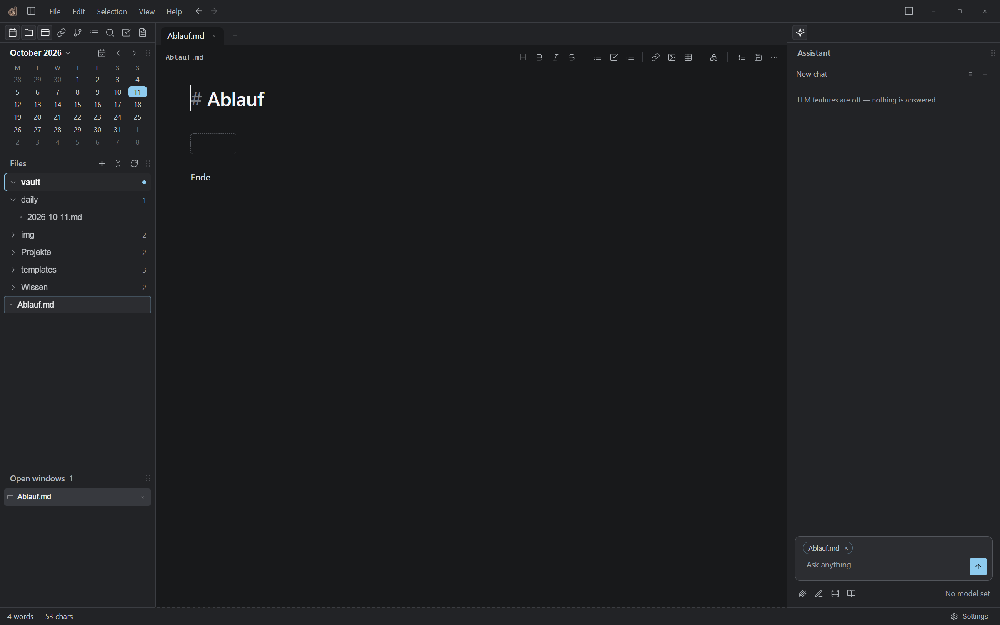

Drey bundles **draw.io** offline — nothing is sent anywhere.

- Insert a diagram from the formatting strip's *Insert* menu or with
  `/diagram` in the slash menu. Until first drawn it is a placeholder
  picture in the note.
- Files: `.drawio` (XML), `.drawio.svg` and `.drawio.png` — the two
  picture formats are ordinary images that carry the diagram inside, so
  notes embed them with the normal image syntax and PDF export needs
  nothing extra. Which format a new diagram gets is set in Settings →
  *Diagrams* (SVG by default).

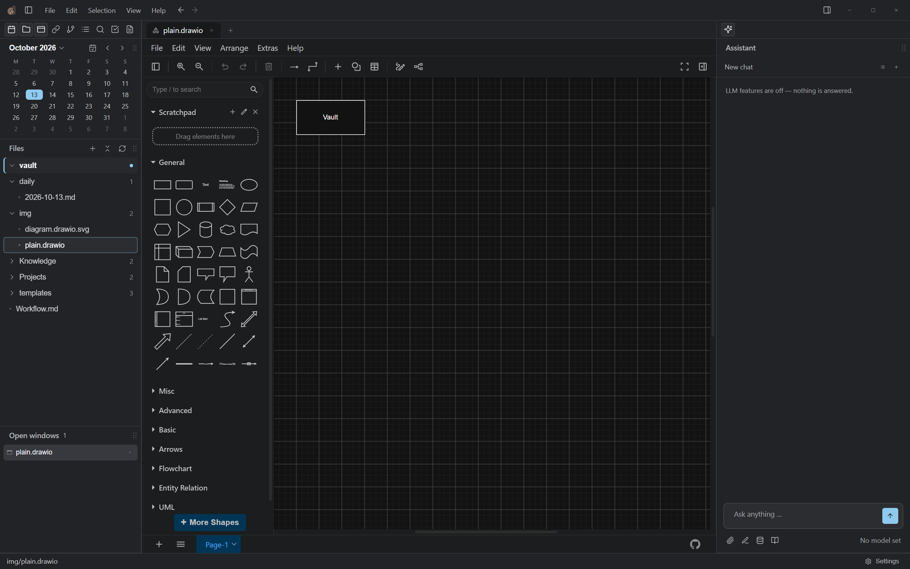

Opening a diagram file opens draw.io in its own tab — **auto-saving**,
no manual `Ctrl+S`. A changed picture reloads in open notes
automatically.

---

## 15. Images, PDFs and Office documents

- **Paste or drop** images into a note — they are stored under
  `attachments/` and referenced with a relative path. Images pasted from
  the web are downloaded and get a `[Source]` link line beneath.
- Click an image's magnifier to zoom (the picture opens in an image
  tab). PDFs in the vault open in a PDF tab.
- **Office documents never render in Drey** — they open in their own
  program (see [Vaults and files](#3-vaults-and-files)). A note link may
  also be a local `file:` URL to a document outside the vault; nothing
  else may use `file:`, and never a network share.
- Dragging text files from the OS into the vault copies them in
  (`Alt`-drop links the original instead, for Office files).

---

## 16. Panes, tabs and layout

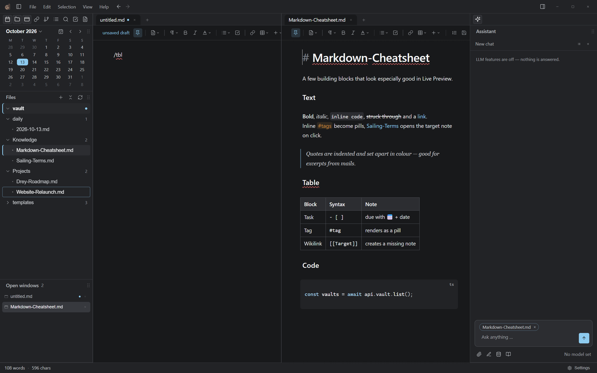

- **Split the editor**: a tab's context menu (*Split right / Split
  down*), or `Ctrl+Alt+Enter` / `Ctrl+Alt+Shift+Enter`. `F6` /
  `Shift+F6` cycle pane focus. The layout is an arbitrary tree of rows
  and columns with draggable splitters.
- **Tabs** — drag to reorder or to move between panes (ghost chip +
  drop line; `Esc` cancels). The pin in a tab's context menu keeps it
  from being replaced. Opening a file replaces the focused pane's
  *clean, unpinned* tab; `Ctrl+Enter` in the quick switcher opens
  beside the current tab.
- **Docked editor bands** — any pane can be dragged into the left/right
  dock (above the panels) or docked from its tab menu; it persists with
  the session. *View → Reset layout* undocks them.
- **Panels** — drag a panel by its header between the left, right and
  bottom docks (or right-click the header), resize them with the
  splitters, fold them to their headers with the chevron. The whole
  layout persists across restarts.
- **Views** — a view is a saved layout: its own docks and panels, split
  panes and open tabs. The title bar shows the views as one segmented
  control (*Notes · Work · …*) with a **Layout ▾** menu beside it;
  `Ctrl+1` … `Ctrl+9` or *View → Switch view* jump between them. A view is
  saved only when you say so: change a panel, a split or a tab and a dot
  appears on that view. *Layout* then offers *Save layout* (keeps the
  arrangement) and *Reset to saved layout* (returns to the saved one);
  until you save, the change lasts for the session only. Switching views
  never changes them. *Save as new view…* keeps the current arrangement
  under a name and switches to it, *Rename view…* and *Delete view* act on
  the view you are in (*Notes* is always there and cannot be renamed or
  deleted), and *Edit views…* lists them all. Tabs belong to
  views: another view's tabs are hidden, and one tab can be shown in
  several views — its context menu lists *Show this tab in* with a check
  per view, then *Go to the Work view* (one row for each other view),
  *Close tab* and the tab's other actions. The Open windows panel reads *2 here · 3 elsewhere*, with the
  tabs *In this view* above those *In other views*, each with *Show here*.
  Closing a tab only takes it out of the current
  view while another view still shows it; it closes for good (asking
  about unsaved changes) with the last one. *Reset layout* resets the
  current view only. A plugin can offer views of its own: they appear in
  the switcher after *Notes* and cannot be deleted, and opening a
  document that belongs to such a view (a tab the plugin names for it)
  switches there first. The tickets plugin offers **Work** (`Ctrl+2`):
  the Tickets panel on the left, the Assistant on the right and the
  Capacity band below. Opening a ticket — from the Tickets panel, the Files panel, a
  `[[T-0121]]` link or the quick switcher — never changes the view: the
  ticket opens as a tab in the view you are in. Opening the Board or
  Crew tab switches to Work; Notes is `Ctrl+1`.
- **Open windows** panel lists the open documents of the current view,
  and under *In other views* the rest, each with a *Show here* button:

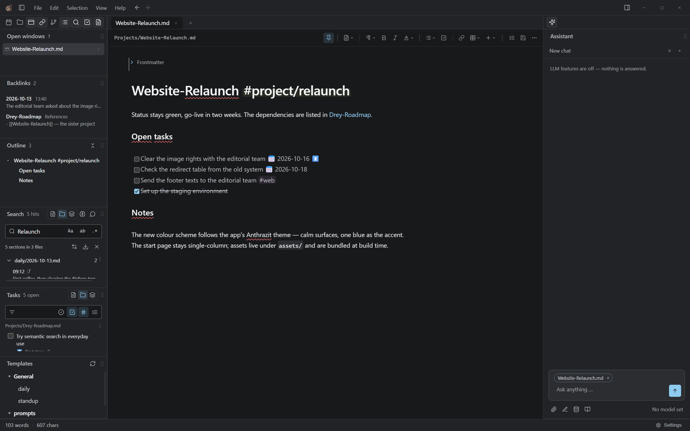

Other panels: **Outline** shows the open note's heading tree (click to
jump, fold levels) …

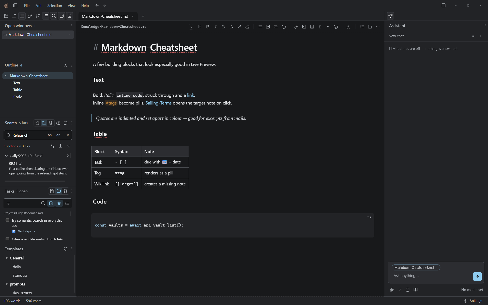

… and **Backlinks** lists every note that links to the open one, grouped
by file and section.


---

## 17. Quick switcher and command palette

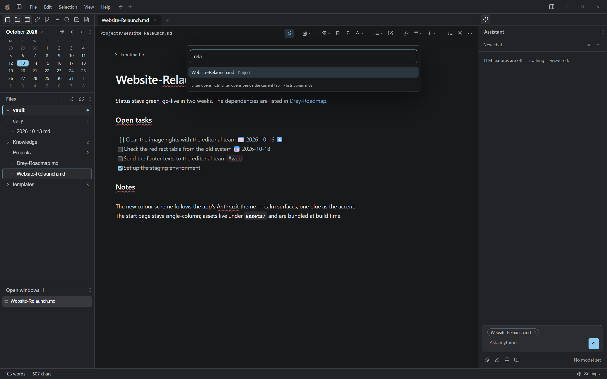

`Ctrl+P` opens the **quick switcher**: fuzzy-search every file of every
vault, session-visited documents first, `Ctrl+Enter` opens beside the
current tab, and a no-match query offers *Create note*.

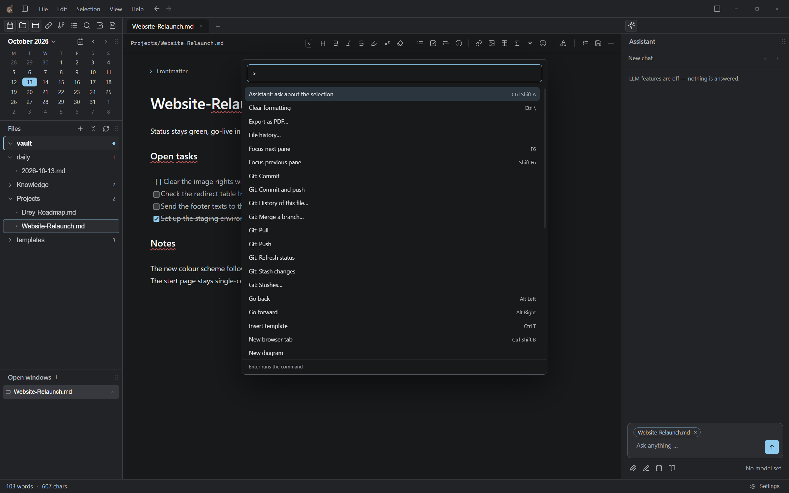

`Ctrl+Shift+P` opens the **command palette** — every registered command
with its shortcut (same actions as the menus, plus *Reset layout*,
*Refresh vault*, *Open today's daily note*, *Toggle source mode*,
*Export as PDF…*, *File history…*, …).

---

## 18. Version history and save conflicts

### Local history

Every save that overwrites text keeps the previous version in the app's
history store (never in the vault; bounded in Settings → *Vault*).
`⋯` → *File history…* (also the tab context menu and the command
palette) lists versions with a diff against your current buffer;
**Restore** loads a version into the editor — saving keeps it.

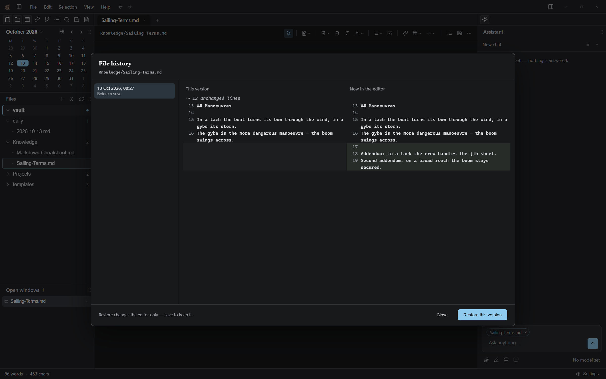

### Save conflicts

When a file changed on disk after your tab last saw it, `Ctrl+S`
refuses to overwrite: the **merge view** opens — *on disk | result |
mine* — with per-block checkboxes and an editable result column. The
meta bar's "Changed on disk" button opens the same view early.

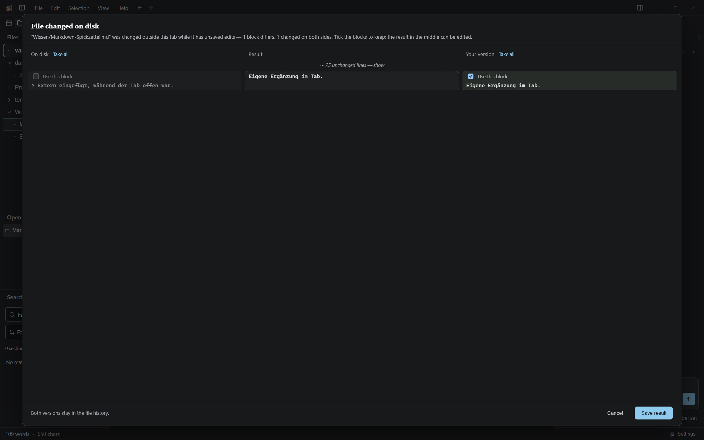

### Further safety nets

- **Exit auto-save**: unsaved untitled tabs are parked in the hidden
  `.drafts/` folder and offered back on the next start (Notepad++
  style) — chats and scratch tabs never raise the exit prompt, only
  your own unsaved notes do.
- **Session restore** reopens tabs, panes, carets and scroll positions.
- **Renames rewrite links** that would break (ask / always / never in
  Settings → *Vault*), and attachments used only by a moved note
  travel with it.

---

## 19. Settings reference

Open with the status-bar entry or `Ctrl+,`. Core categories are
alphabetical, plugin-contributed ones follow, *About* closes the list.
Every change applies as you make it — there is no *Save* and no
*Discard*. A switch or a list choice acts at once; a typed value is
stored when you leave the field or press Enter. Settings is a tab
like any other (File → Settings, `Ctrl+,`, or the Settings entry in the status bar;
opening it again shows the tab that is open). There is no footer and no *Close*
button: `Esc` or the tab's X closes it, and only a failed save shows a message
(with *Close without saving*).

The tab is as wide as its pane, and every page uses the same width — wide
tables and editors fill it instead of the page jumping between a narrow and a
wide layout. A long page is split into sections: a category with sections has a
small arrow in the list; open it to see the sections, click one to scroll the
page to it. The page scrolls as one column and the section in view is
highlighted in the list. The search field across the top filters the
settings of **all** pages by name, description or key; click a result to open
its page at that setting. `Esc` clears the search first and closes Settings on
the second press. While you search, the list shows how many hits each page and
section holds and dims the ones without. When nothing matches, the page says
*No setting matches "…"* with a *Clear search* button. The tabs *All devices*, *This device* and *This vault* above the page
narrow the list to the settings stored for that scope (the app on this computer,
the vault you have open, or shared by every device); click the tab again, or
*All devices*, to show everything.

| Category | What lives there |
| --- | --- |
| [Appearance](#settings-appearance) | theme, accent, UI scale, editor typeface and scale |
| [Assistant tools](#settings-assistant-tools) | tool groups, write/approval rules, external MCP servers |
| [Daily notes](#settings-daily-notes) | daily folder and template behaviour |
| [Entry format](#settings-entry-format) | the slash menu's Entry block |
| [Keyboard shortcuts](#settings-keyboard-shortcuts) | the shortcut of every command, the quick-capture hotkey |
| [LLM](#settings-llm) | provider, endpoint, key, model |
| [MCP](#settings-mcp) | Drey's own vault server for other programs |
| [Panels & plugins](#settings-panels-plugins) | panel and plugin switches, live plugin status |
| [Spelling](#settings-spelling) | dictionaries, personal words |
| [Vault](#settings-vault) | watcher, link rewriting, history bounds |
| Actions | Assistant Action templates and triggers |
| Diagrams | format of new diagrams (SVG/PNG) |
| Git | `git` executable path |
| Tags | prefix colours, rename/merge |
| Templates | snippet trigger library, templates folder |
| About | version, licences |

### Settings: Appearance {#settings-appearance}

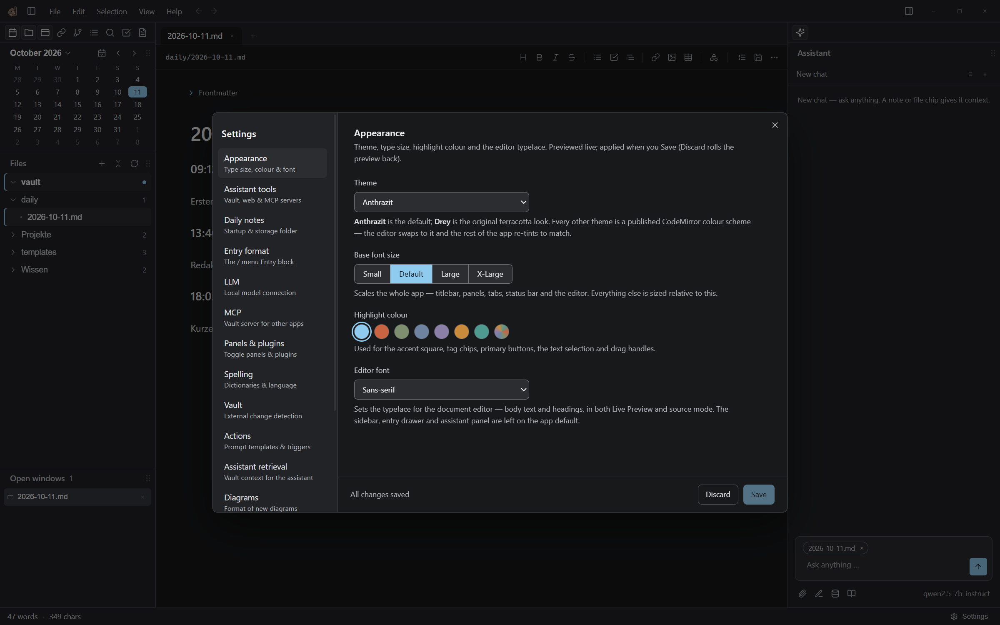

Three bespoke themes ship — **Anthrazit** (neutral charcoal, blue accent,
AA contrast; the default), **Drey** (terracotta) and **Cyberpunk**
(violet-black with neon pink and violet) — plus a
catalogue of published CodeMirror themes. The accent colour follows the
theme by default or can be pinned; the UI scale resizes the whole app;
the editor typeface and font scale affect only the writing surface.
Cyberpunk also brings its own app mark: the logo in the titlebar and the
taskbar icon change with it (the desktop shortcut keeps the usual icon).

### Settings: Assistant tools {#settings-assistant-tools}

See [Assistant tools and MCP](#11-assistant-tools-and-mcp).

### Settings: Daily notes {#settings-daily-notes}

The daily notes root folder (default `daily/`) and template behaviour.

### Settings: Entry format {#settings-entry-format}

What the slash menu's **Entry** block inserts: built-in *classic* and
*ruled* patterns or your own, with the `{{time}}` / `{{date}}` /
`{{datetime}}` / `{{title}}` / `{{tags}}` / `{{content}}` placeholders.

### Settings: Keyboard shortcuts {#settings-keyboard-shortcuts}

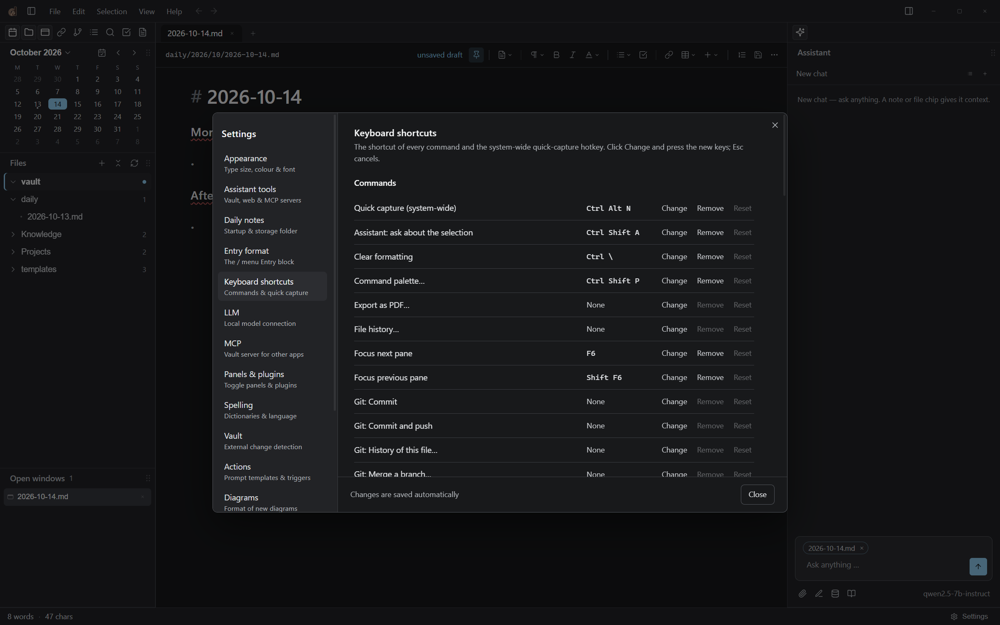

Every command and the system-wide **quick-capture** hotkey, each with
its shortcut. **Change** waits for you to press the new keys (Esc
cancels); **Remove** leaves the command without a shortcut; **Reset**
brings back the one Drey ships with. A shortcut needs `Ctrl` or `Alt`,
or a function key (`F1`–`F12`) — a plain letter would swallow typing —
and the editor's own keys (undo, the clipboard, find, zoom, …) cannot be
taken; they are listed under *Fixed*. If another command already has
the keys you press, Drey names it and offers **Replace**, which leaves
that command without a shortcut. When another program holds the
quick-capture keys, the row says so — choose another combination.
Your shortcuts show everywhere at once: the menus, the command palette
and Help → Keyboard shortcuts.

### Settings: LLM {#settings-llm}

See [AI providers](#10-ai-providers-llm).

### Settings: MCP {#settings-mcp}

See [Assistant tools and MCP](#11-assistant-tools-and-mcp).

### Settings: Panels & plugins {#settings-panels-plugins}

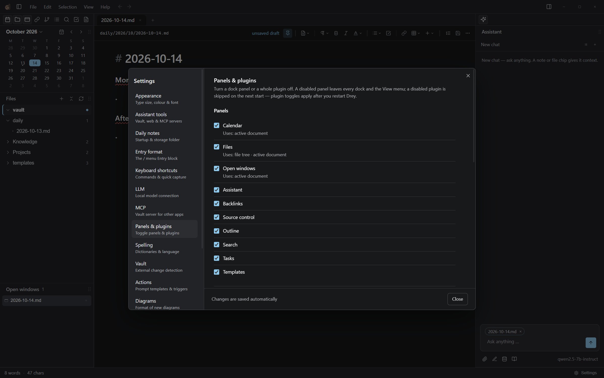

One switch per dock panel and per discovered plugin (`plugins.disabled`
applies on restart), plus each plugin's live status. Third-party
plugins install into `<userData>/plugins/<id>/`.

### Settings: Spelling {#settings-spelling}

Bundled English/German Hunspell dictionaries, additional dictionaries,
and the personal word list.

### Settings: Vault {#settings-vault}

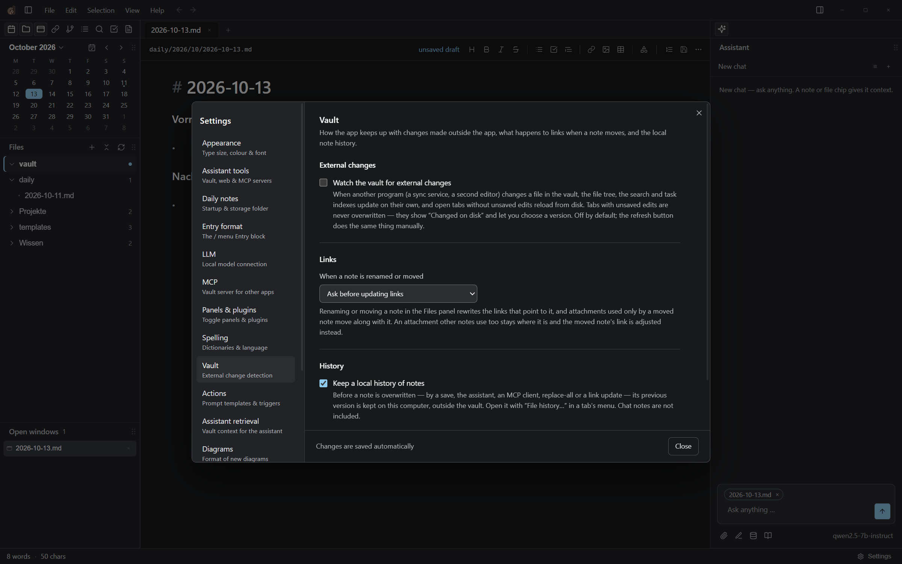

- **Watch for external changes** (off by default) — the opt-in file
  watcher; with it off, use Refresh.
- **Rewrite links on rename** — `ask` / `always` / `never`.
- **Local note history** — enabled, keep days (30), max versions per
  file (50).

### Settings: Updates {#settings-updates}

- **Check for updates on start** (on by default) — once the app is up,
  Drey asks GitHub whether a newer release exists. That is all the
  "automatic" there is: downloading, installing and restarting always
  ask first, and the check sends none of your notes or settings. Turn it
  off to keep the app entirely offline.
- **Status** — the current version, a *Check for updates* button (same
  as the Help menu), the download progress, and *Install and restart*
  once an update is downloaded. When this already is the newest release,
  the status line shows it in green — no dialog. Installing closes
  Drey — unsaved tabs go through the usual save-before-exit prompt — and
  the installer relaunches the app when done. Windows may show its
  SmartScreen warning before the installer starts (the exes are
  unsigned).
- A version you answered **Skip this version** to is listed with an *Ask
  about it again* link; the startup prompt stays silent for exactly that
  version, a manual check always reports.
- The **portable exe** cannot update itself (there is no install to
  update) — it offers the releases page on GitHub instead. The same
  fallback appears when a network blocks the check.

### Plugin-contributed pages

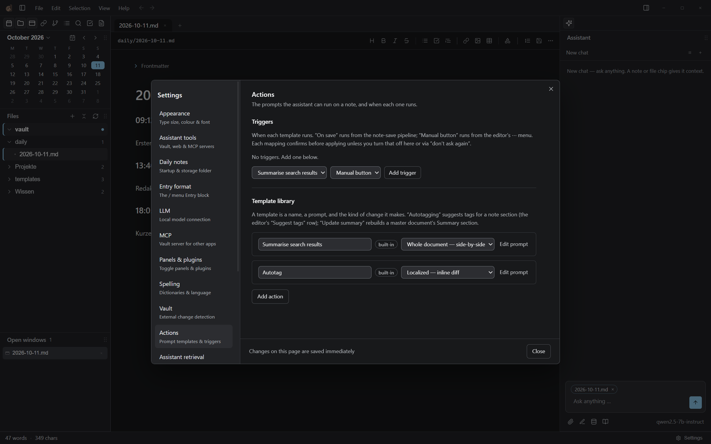
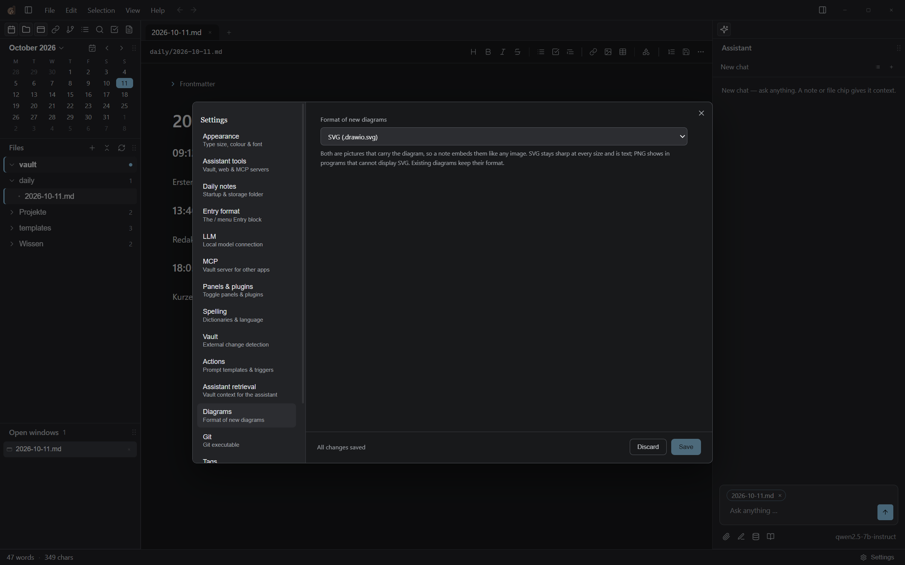
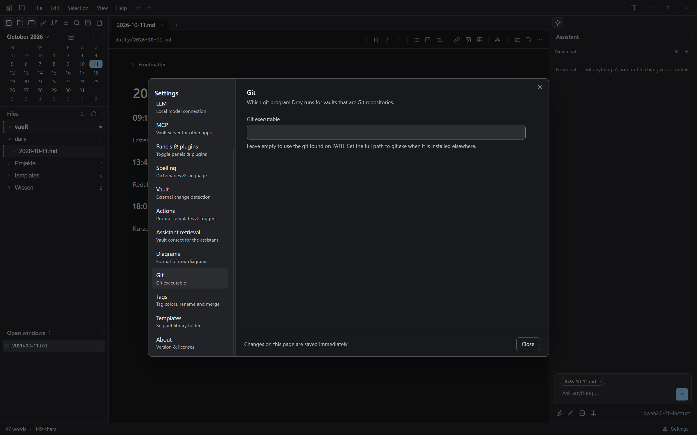
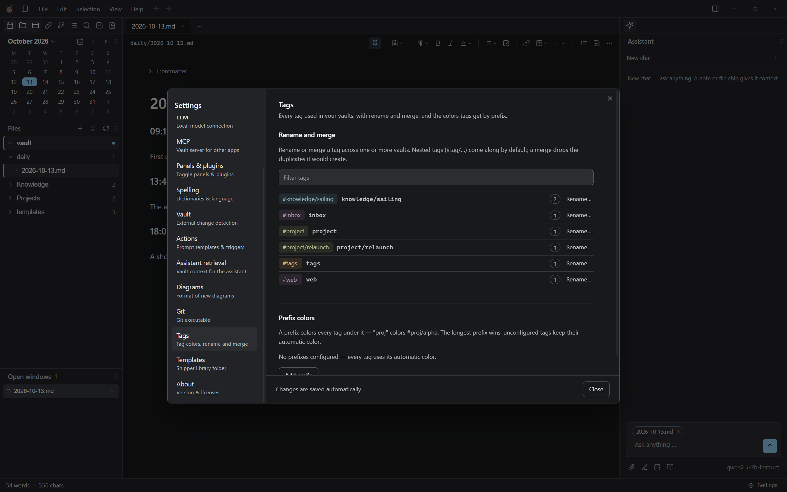
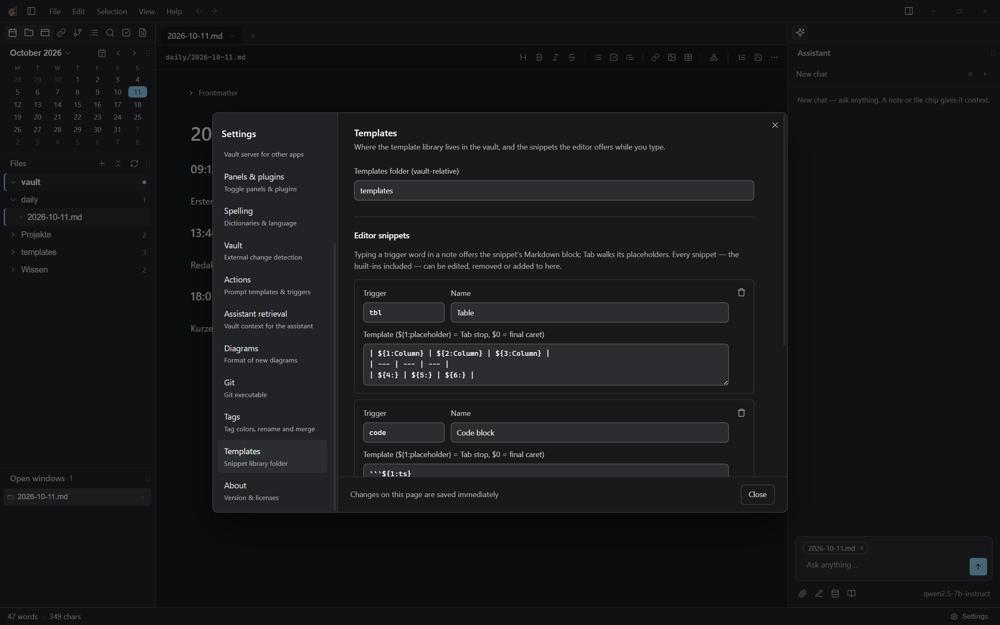
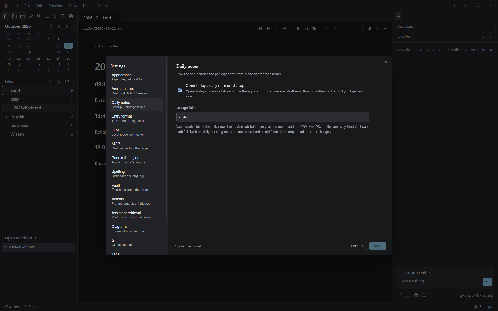
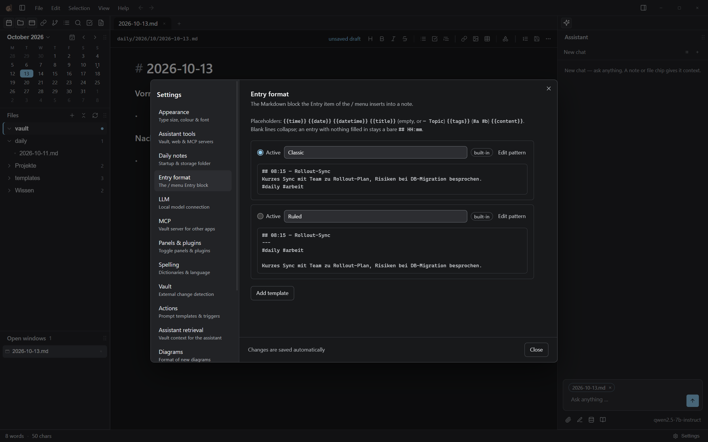
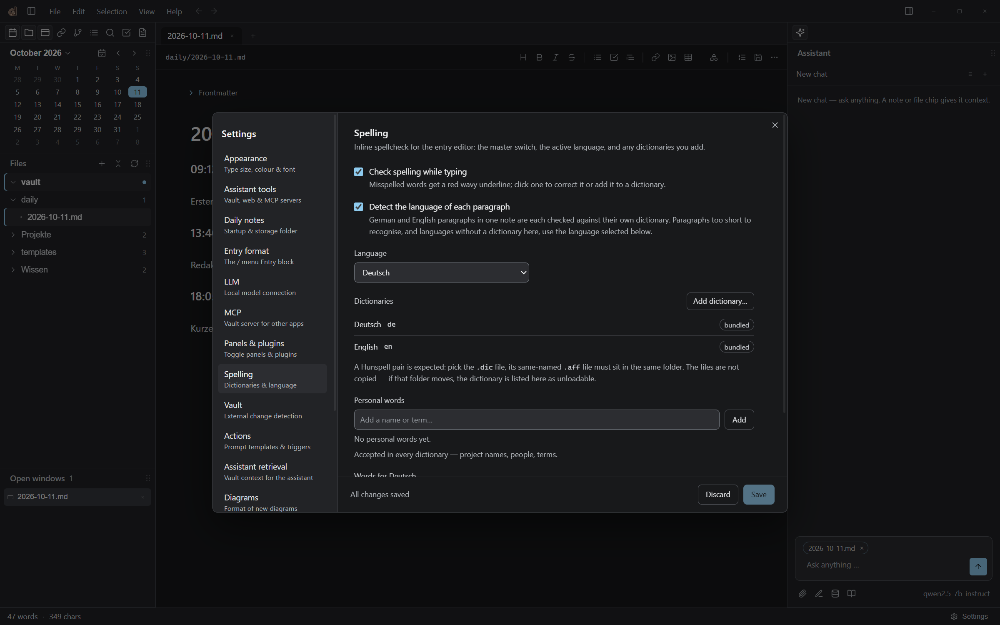
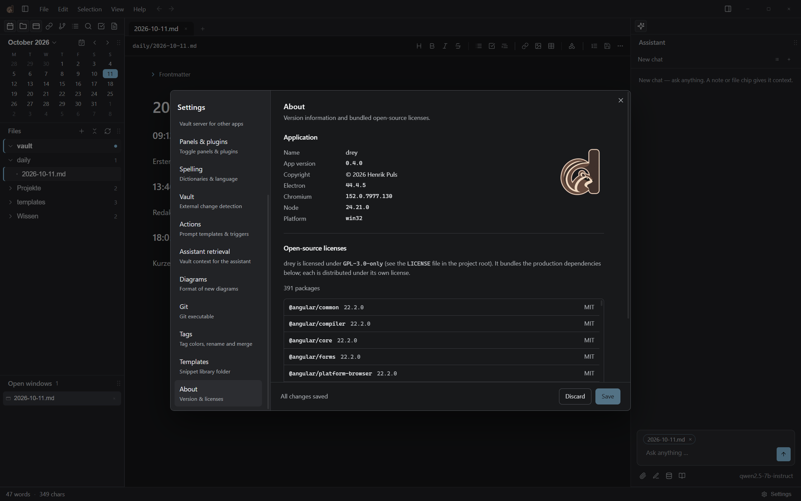

---

## 20. Getting help

The **Help** menu in the title bar has everything:

- **User manual** (`F1`) — this manual, opened inside the app as a
  read-only pinned tab. Screenshots included; it scrolls and follows
  links like any document.
- **Keyboard shortcuts** — a generated list of every command this build
  knows, base and plugins alike, with its current shortcut. It always
  matches the command palette, because it is built from the same
  registry at the moment you open it.
- **Check for updates** — looks for a newer Drey release now (see
  [Settings → Updates](#settings-updates)). A new version asks before it
  downloads; when this already is the newest release, a short green note
  in the status bar says so — no dialog.
- **About Drey** — version, build number and licence information (the
  same page as Settings → *About*).

Help documents are normal tabs in every other respect: they can be
dragged to another pane, and closing one loses nothing — the Help menu
brings them back.

---

## 21. Keyboard shortcuts

`Ctrl` is `Cmd` on macOS. `Mod` below means exactly that. These are the
shortcuts Drey ships with; change any of them, and the quick-capture
hotkey, in [Settings → Keyboard shortcuts](#settings-keyboard-shortcuts).

| Shortcut | Action |
| --- | --- |
| `F1` | This manual |
| `Ctrl+Alt+N` | Quick capture into today's daily note (global, while Drey runs) |
| `Mod+N` | New note |
| `Mod+S` / `Mod+Shift+S` / `Mod+Alt+S` | Save / Save as… / Save all |
| `Mod+P` | Quick switcher (files) |
| `Mod+Shift+P` | Command palette |
| `Mod+,` | Settings |
| `Mod+Shift+F` | Search panel |
| `Mod+Shift+A` | Ask the assistant about the selection |
| `Mod+G` | Toggle line numbers |
| `Mod+B` / `Mod+Alt+B` | Toggle left / right dock |
| `Mod+Alt+P` | Autopilot: open the On / Paused / Off popover |
| `Alt+Left` / `Alt+Right` | Back / forward (also mouse buttons 3/4) |
| `Mod+Alt+Enter` / `Mod+Alt+Shift+Enter` | Split editor right / down |
| `F6` / `Shift+F6` | Focus next / previous pane |
| `Mod+Alt+Z` | Zen mode (hide titlebar, docks and status bar) |
| `F11` | Full screen |
| `Mod+Enter` | Toggle task done (on a task line) |
| `/` on an empty line | Slash menu (Entry, templates, formatting) |
| `Esc` | Close menus, dialogs, drag operations |

The command palette lists every command with its current shortcut — your
own, where you changed one — and so does Help → **Keyboard shortcuts**,
as a document you can keep open beside your notes.

---

## 22. Where your data lives

| Data | Location |
| --- | --- |
| Notes, templates, chats, attachments | your vault folder — plain Markdown, YAML frontmatter, files |
| App settings + API keys | `<userData>/app-config.json` (plain text) |
| Vault registry (which folders, which active) | `<userData>/vault-config.json` |
| Local note history | `<userData>/history/<vaultId>/` |
| Installed plugins | `<userData>/plugins/<id>/` |

Because the vault is just files, any file-based backup covers your
notes completely — Drey adds no hidden state inside the vault (the
history store is deliberately outside it).

---

## 23. Troubleshooting

- **"LLM features are off"** — the master switch in Settings → LLM is
  off, or no model is selected. The request log on the same page shows
  exactly what was (not) sent.
- **A hosted provider rejects the key** — 401/403 is almost always the
  API key, not the URL; the log's `curl` command lets you verify
  outside the app.
- **Generation seems stuck** — there is deliberately no timeout; cancel
  the turn instead.
- **Quick capture hotkey does nothing** — another program owns
  `Ctrl+Alt+N`; Drey logs a warning to the main-process console.
- **External file changes don't show up** — the watcher is off by
  default; use Refresh in the vault row's menu or enable it in Settings →
  Vault.
- **A plugin's panel is missing** — check Settings → *Panels & plugins*
  (changes apply on restart), and the plugin's status line there.
- **MCP clients can't write** — a change waits for the confirmation
  dialog unless YOLO mode is on; a deletion always does.
- **The assistant says it cannot change a note** — Settings → Assistant
  tools → *Vault* is set to "Not allowed", or the Vault button under the
  question field does not include that vault.
- **Git panel is empty** — the vault is not inside a Git repository, or
  `git` is not on `PATH` (set it in Settings → *Git*); press Refresh
  after initializing a repository.

---

*Manual for Drey 0.8.1; manual content last changed
2026-11-08. Screenshots were captured automatically from
the built app (Anthrazit theme, 1600×1000) by
`e2e/manual-screenshots.spec.ts` — run
`$env:DREY_MANUAL_SHOTS='1'; npm run e2e:run -- manual-screenshots`
after `npm run build` to regenerate them.*
